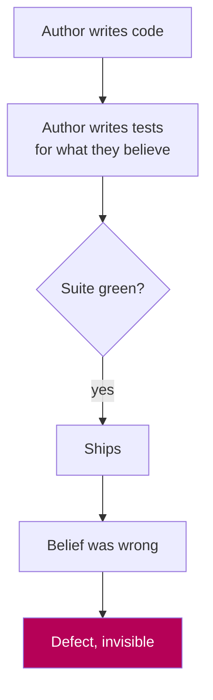
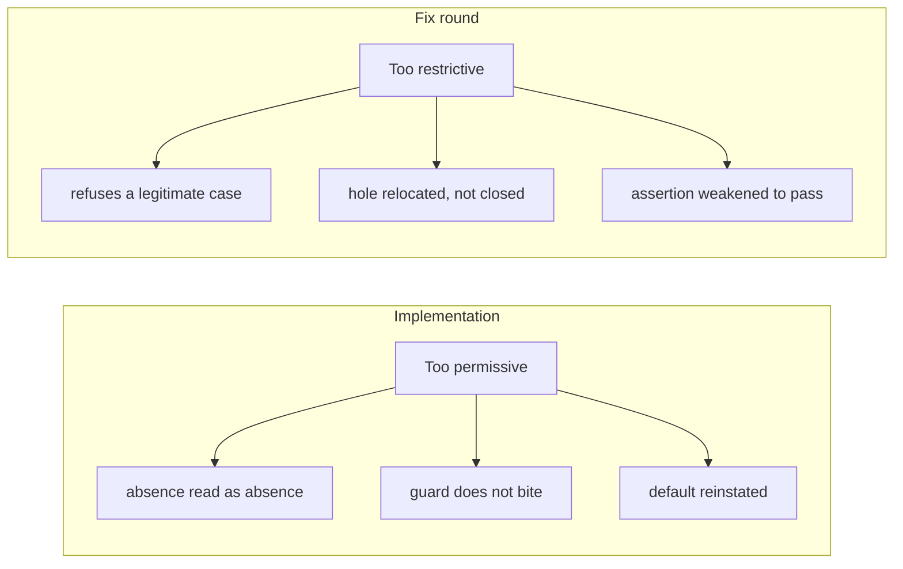

# What nine units in parallel actually taught us

Draft. Written while the wave is still in flight, so the per-unit sections
will move. The spine will not, because it came out of the reviews rather than
out of the plan.

## What was built

Nine implementation units, built simultaneously, each in its own git worktree
with its own virtualenv so that each one verified its own code rather than the
main checkout's.

| Unit | What it added |
|---|---|
| U12 | Worker pool sizing derived from available memory rather than CPU count |
| U16 | Three-state match: owned, needs review, missing |
| U23 | Library adoption, which rewrites tags on files already on disk |
| U24 | Track deletion and tombstones |
| U27 | Setup wizard and doctor |
| U32 | Restore, retention and reconciliation |
| U34 | Read-only library reports |
| U36 | Tree rebuild and convergence check |
| U38 | Reserved exit-code registry |

Every one passed its author's full battery: ruff clean, several thousand tests
green, the repository scan clean.

Then eighteen independent adversarial reviews found **61 blocking defects**,
none of which any of those green suites could see.

## The first thing worth understanding: what a green suite cannot see

A test suite answers "does the code do what its author believed?" It cannot
answer "was the belief right?" Almost every defect found in this wave lived in
that gap.

Three concrete examples, all real, all from this wave.

**U16 argued from a property that does not exist.** It declined to put missing
tracks in the review queue because, it reasoned, the queue would re-ask the
same question on every run. A reviewer tested that assumption directly:
`review.offer` is idempotent. Same identity, same item, verdict preserved, no
second row. The premise was simply false, and every test the author wrote was
consistent with it.

**Four units argued from a wall that was a broken test.** Each concluded
independently that its command-line verb "cannot land" because a conformance
assertion refused it. The assertion was itself asserting a violation of the
requirement it was meant to enforce. Four units paid register bookkeeping to
work around a defect in a test.

**U23 wrote against a data shape it had never seen.** The DJ library volume was
offline, so nobody could look at what rekordbox actually records in its
`Location` column. The unit assumed a plain path. rekordbox writes
`file://localhost/...`. Every row would have classified as "not a path", the
whole unit would have silently done nothing, and its own internal proof that
nothing fell out would have passed, because that proof was about presence
rather than correctness.

## The second thing: absence read as evidence of absence

This is the single most common defect shape in the wave. It appeared
independently in five units whose authors never saw each other's work.

The mistake is folding "I could not observe" into "there is nothing there".

- **U24**: a file path that does not resolve left the reference set silently. A
  one-character typo in a configuration rule turned 50 of 50 still-referenced
  files into deletable ones, while the completeness proof passed. Omitting the
  rule entirely refused loudly. Adding a wrong one proceeded silently.
- **U27**: an unreadable session log reported "0 recorded sessions, none of
  them open" over a live unverified session. And an absent mount point let the
  setup wizard record the **boot disk** as the library volume.
- **U36**: a rebuild that derived nothing reported the tree converged and
  cleared the safety latch. Because the plan was empty, the writer was never
  called, so every gate was skipped on the exact path that clears the flag.
- **U34**: an absent intake node reported identically to an empty one.
- **U11**, historically: a reader that could not tell a wrong document from an
  empty one, which permanently destroyed a decision store.

The codebase already states the correct discipline, in `core/config.py` and
`core/locations.py`. It keeps failing to apply it. That is what makes it a
property of the problem rather than of any one author.

## The third thing: guards that do not bite

A guard is a test whose job is to make a class of mistake impossible. A guard
that passes when the mistake is present is worse than no guard, because it
reports safety that is not there.

Six were found in this wave:

- U34's read-only proof was bypassed by a sibling file whose name merely
  started with the package name.
- U38's table guard inspected only dictionary literals, so eleven other ways of
  writing the same table evaded it, and it could not see a table for causes it
  had not already reserved.
- U27's containment guard matched its own success message, because the word
  "atomically" contains "atomic".
- U27's conformance assertion was provably identical to the existence check it
  claimed to replace. A doctor that did no work passed it.
- U32's derived-target guard was satisfied by a module whose entire body was a
  docstring.
- U12's countdown was satisfied by a hand-built plan requesting nine workers,
  which is exactly the out-of-memory kill the entry existed to prevent.

**The lesson is one sentence.** Running a guard against correct code is half
the job. The other half is running it against the evasion, and that is the half
that keeps getting skipped.

## The fourth thing, and the one I did not expect

After the reviews, each unit got a fix round. I assumed a fix round was safer
than an implementation round, because it starts from a known defect with a
reproduction attached.

That assumption was wrong, and the evidence is unambiguous. Of the branches
verified, nearly all needed a **second** fix round. Fix rounds are roughly as
defect-prone as implementation rounds.

But they fail in the **opposite direction**.

Real examples:

- **U27's fix made `crate doctor` unable to start** on a partial install. A
  unit whose entire job is telling the truth about a broken machine could no
  longer run on one.
- **U32's fix refused restores that genuinely fit**, by roughly 3x, on exactly
  the disk state a person restores from.
- **U36's fix made an ordinary taxonomy edit a one-way door**, and the
  refusal's own remediation step did not work.
- **U23's fix made the undo log unusable** after any later touch of the file,
  including one written by the product's own field set.

## The fifth thing: identity is where this codebase breaks

Step back from the individual defects and one shape dominates: **something used
as an identifier that is not unique to the thing it identifies.**

- U16 and U24 each wrote a `version_identity`. Both were locally correct. They
  were mutually incompatible, so a track you deleted on purpose would be
  re-downloaded forever. The merged tree passed 3262 tests.
- U23 treated "the field holds what adoption wrote" as proof of authorship. The
  value written is the taxonomy bucket name, shared across most of the library,
  so a completely unrelated file passed the check and had its tags overwritten.
- U32 keyed a latch on the restore's own session identifier, which is new on
  every attempt, so a completed restore never discharged an interrupted one and
  repeats accumulated permanent locks.
- U36 keyed a plan on folder display names, so renaming a folder in rekordbox
  filed one destination's tracks into another's playlist, permanently.

If there is one thing to carry into the next unit, it is to ask of every
identifier: **what two different things could produce this same value?**

## The sixth thing: only a merge can find a merge defect

Three of the worst findings were invisible to any single-unit review, because
they only exist in the combination.

The tombstone break is the cleanest case. Two units, each correct alone. Merge
them, resolve every conflict the way a careful person would, and the suite
reports **3262 passing tests** over a library that silently re-downloads
deleted music. The reviewer found it by performing the merge and then computing
both identifiers in one interpreter.

No amount of reading either diff would have caught it.

## What this cost, and whether it was worth it

Nine units, eighteen reviews, and a verification pass over every fix. Roughly
forty agent-runs.

Against that: 61 blocking defects caught before a single line reached `main`,
including a worker pool that hung forever at its shipped defaults, a restore
that destroyed a write-ahead log before checking a replacement existed, a
deletion pass that would trash still-referenced files after a one-character
typo, and a setup wizard that would adopt the boot disk as the music library.

`main` never moved. Every branch stayed revertible throughout.

## The one that made the whole argument

Late in the run, a branch added a rule refusing any commit that closes an issue
its unit still owes work on. Minutes after it existed, that rule **refused the
branch that wrote it**: two commits documenting the rule had used a real issue
number beside a real closing keyword, so merging would have closed two other
units' issues and cascaded every unit waiting on them.

Nobody was looking for that. The rule found it, on its author, immediately.

That is the argument for every layer here in one incident. Authors caught
defects in their own work. Reviewers caught 61 the authors could not see. Fix
rounds introduced defects only a verification pass found. And a rule written
hours earlier caught the branch that wrote it.

Each layer was blind to something the next one saw.
