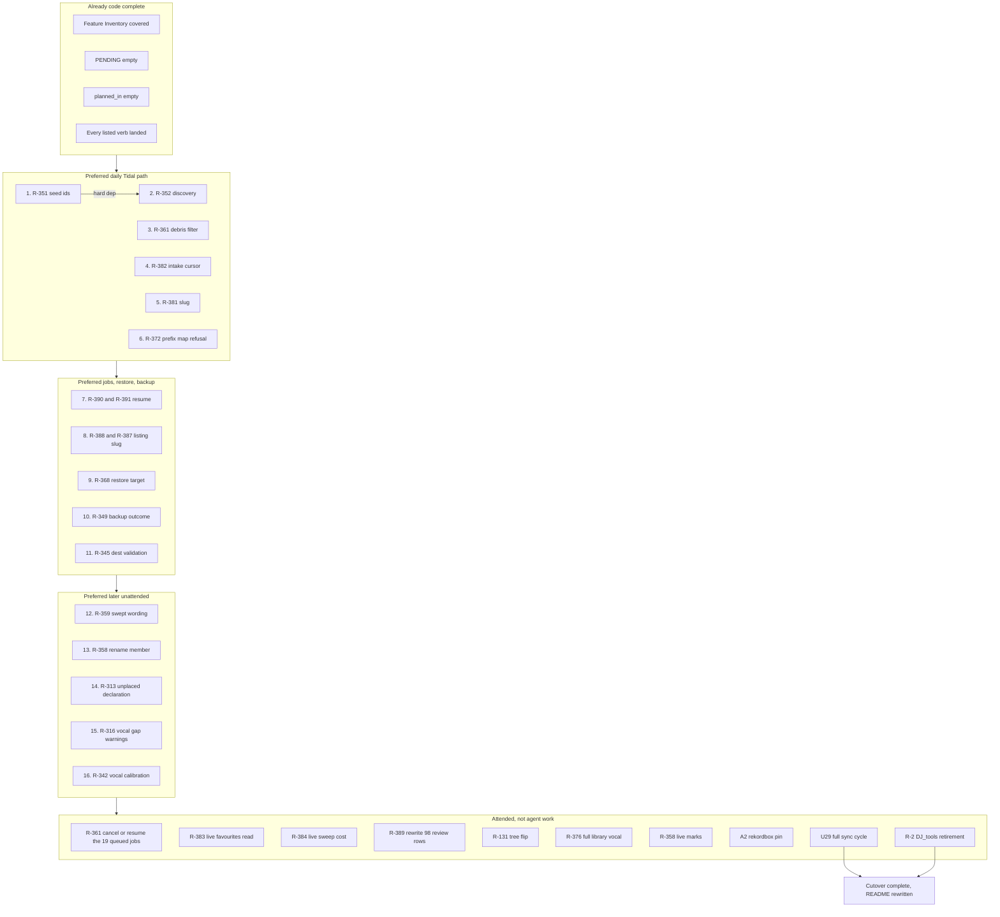
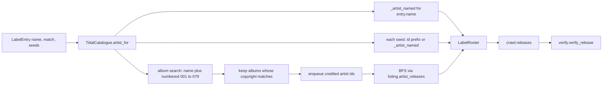

# Cratekit to code complete

| Field | Value |
|---|---|
| Title | Cratekit to code complete |
| Author | Cratekit design loop |
| Date | 2026-09-18 |
| Status | Draft, revised after design review |
| Workspace | Cratekit checkout (this repository) |
| Branch verified | `main` at `fe35323` (R-380, issue 92), 11 commits ahead of `origin/main` |
| Highest residual on main | R-391 |

This document is the remaining unattended product plan. It is not a request to take U29. It is not a parallel queue. Work is still picked from the GitHub board via `scripts/board.py`. The issue is the brief. `docs/plans/` stays closed. METHOD's pipeline is the execution method for every promoted issue.

## Overview

Cratekit's Feature Inventory is covered, `PENDING` is empty, and every listed verb is landed. That is mechanically code complete against the original units, and it is not product complete. Sitting 4 measured the remaining gap on the live account: 32 of 47 carried labels refused as `LabelUnresolvable`, 11 of 18 queued playlists were source-system label debris, a standalone playlist intake was queued again by the next `sync all`, accented labels got mangled identifiers, a My Tags plan reported ok over 9937 unresolved rows, and several job, restore, and backup reports still tell a person the wrong next act.

This plan promotes every residual that currently meets the promotion bar. Each promotion is one GitHub issue, one feature branch from local `main`, one METHOD session, one local merge. R-351 and R-352 are two issues with a hard dependency. Issue filing is Phillip-gated. After those land, the board will again say Take issue 29. That is correct and still forbidden. Cutover complete remains U29, attended, one sitting at a time.

## Background and Motivation

### What is already code complete

Verified 2026-09-18 on local `main` at `fe35323`.

| Register | State |
|---|---|
| Board | 66 units, 65 done, 1 ready (issue 29, U29), 0 blocked |
| `tests/_pending.py` `PENDING` | empty (comments only) |
| `tests/test_pending_units.py` `EXPECTED_PENDING` | `frozenset()` |
| `src/cratekit/cli/registry.py` | zero `planned_in` markers; every listed verb is landed |
| `tests/test_cutover_parity.py` | passes; every owed Feature Inventory row has a covering verb |
| Feature rows 16, 19 | `cut`, decisions, not backlog |
| Feature rows 23, 32 | `defer`, decisions, not backlog |
| `cli.handlers.HANDLERS` | every long-running worker bound except `job.resume`, which is never queued |
| Battery context | R-380 merge reported 7608 collected, mutation table `docs/mutation/r380.md` 6 of 6 killing |
| GitHub vs local | issue 91 and issue 92 still show open remotely because those closes sit on unpushed local `main` |

Owed Feature Inventory rows (disposition `core`, `module`, or `reshaped`) all have landed verbs. Rows 16 (camelot padding), 19 (streamed-track playlist scan), 23 (label to streaming playlist folders), and 32 (web dashboard and desktop application) are explicit non-replacements.

### Code complete vs cutover complete

**Code complete** means the unattended product is finished.

1. Every owed Feature Inventory row has a landed verb. True today.
2. `PENDING` and `planned_in` are empty. True today.
3. Every residual that currently meets the promotion bar is named in this plan's candidate table as Promote, specified as a board issue, and lands under METHOD. Residuals that fail the bar have a named reason in the same table. After those issues land, remaining work is only attended plus ledger entries with named bar reasons.
4. Remaining work is only attended: U29 sittings, A2, live measurements, live store rewrites, Phillip-only gates.

**Cutover complete** is U29. Phillip lives on Cratekit through a full sync cycle, DJ_tools is retired, `docs/cutover.md` records it, README is rewritten. Out of this plan's implementation sequence. Named in the attended remaining list so the two registers do not get confused.

`docs/cutover.md` mid-file section "What blocks a full sync cycle" is stale. It talks as if U62, U63, and U64 only have agent halves. Sitting 4 already ran those live. Treat the "Next sitting" section as current.

### Live sittings already done (do not re-plan as code)

| Sitting | Date | What ran | Lived on? |
|---|---|---|---|
| 1 | 2026-09-16 | setup, doctor, first real download, backup dry run | setup and doctor live |
| 2 | 2026-09-16 evening | real backup job succeeded, restore rehearsal (R-367 later fixed in code) | backup live |
| 3 | 2026-09-17 morning | vocal restamp one folder (R-133 closed), My Tags apply on live DB | vocal restamp for one folder |
| 4 | 2026-09-17 afternoon | harvest, intake playlist, 47 label sweep (15 swept, 32 failed), sync all (599 listed, 19 queued, none resumed), export playlist twice, sync favorites twice | playlist export and favourites sweep cut over |

Cut over as lived on: playlist export, favourites sweep, setup/doctor, backup. Proven not lived on: download. Not yet live: full sync cycle (resume 19 jobs, acquire, place), tree flip R-131, full-library vocal restamp R-376, DJ_tools retirement, plus many verbs that exist but have no sitting row.

Sitting 3 also measured R-372. Setup wrote `location_prefix_map` empty. The first My Tags plan reported `count 0, active 9937, unresolved 9937`, outcome ok, doctor green. The author typed the drive-rename rule by hand. That hole remains for any future machine.

### Why the remaining work is residuals, not new feature units

Inventory is covered. Inventing units for uncovered inventory would reopen a closed register. Remaining work is residual promotions, plus a unit-scale residual when the close condition is a missing capability (R-352 discovery, R-351 seed identifiers, R-358 rename member, R-368 restore target flag, R-372 setup prefix offer).

## Goals and Non-Goals

### Goals

- Promote and land every residual whose candidate-table decision is Promote, in a preferred order that makes the daily Tidal workflows less wrong after each merge.
- Specify issue titles, bodies, labels (`residual` or `unit`), dependencies, and order so Phillip can file them. Do not file them from this document.
- Keep METHOD as the only execution pipeline: `board.py start`, plan as a message, guard first, build, built-in code-review, mutation table cap 25, record, merge locally. Diff review and mutation against local `main`, not `origin/main`. One GitHub issue is one METHOD session, except where this plan names two issues with a hard dependency (R-351 then R-352).
- Name the attended leftovers so a later session does not take them.

### Non-Goals

- Do not take issue 29. U29 is attended live-library cutover.
- Do not invent a parallel queue that replaces the GitHub board.
- Do not backfill the 300 older ledger entries onto the board. Residual numbers stay append only.
- Do not write a new file under `docs/plans/`.
- Do not write a beat grid, a tempo element, a BPM tag, an average-BPM field, or an ANLZ grid.
- Do not write the live rekordbox database. Do not launch rekordbox or `rekordboxAgent`.
- Do not edit DJ_tools code. It is read-only source for discovery and the debris filter.
- Do not edit the rekordbox application pin. A2, issue 50, is attended.
- Do not compose `acquire download` into `sync all`. That spends downloads and is a later product decision.
- Do not build an XML bridge membership writer (R-235).
- Do not change listing stop rules without a driven producer (R-385).
- Do not guess provider refresh rotation (R-350) or live login rejection shapes (R-353).
- Do not write a queue migration that auto-cancels old `sync.all` jobs (R-330) unless a live queue is shown to hold one.
- Do not resume or cancel the 19 currently queued `sync all` jobs in unattended work.
- Do not perform live Tidal playlist renames, live review-store rewrites, or full-library vocal restamp in an unattended session.
- Do not add a sixth catalogue behaviour that offers search-verified albums directly.
- Do not push unless Phillip asks. Local `main` is expected to run ahead of the remote.

## Key Decisions

Locked here. Open Questions lists the same items marked decided. Do not reopen them in a later session.

1. **No new feature units for uncovered inventory.** Inventory is covered. Remaining work is residual promotions, plus a unit-scale residual when the close condition is a missing capability. Rationale: `test_cutover_parity.py` already asserts an empty owed backlog. A new inventory unit would contradict that register.

2. **Promotion bar.** Promote a residual only when all of: named user-facing cost today; input reachable; producer can be driven without the live rekordbox database; work is unattended; not already closed in place. Do not backfill the older ledger. Age on the ledger is not a bar failure. Rationale: METHOD's merge bar, applied to the queue itself.

3. **R-352 is the highest remaining product gap, and it is its own issue.** Close by expanding the roster behind the existing `label.catalogue` seam. Album search for the label name and numbered compilations, copyright match through Cratekit `labels_match` / `labels_from_copyright`, then credited artists. Do not invent a second catalogue. DJ_tools is read-only source. This is not an exact port of `discover`. Rationale: sitting 4 measured 15 swept, 32 failed, 31 as `LabelUnresolvable` because the adapter's roster is the label artist page plus seeds, and the carried registry has no seeds.

4. **R-351 is a separate issue, and R-352 depends on it.** Seeds may be recorded by provider identifier, not only by folded name. Format locked: a seed string `id:<digits>` is looked up via `session.artist` with no search. A seed without that prefix stays an exact folded name. Session 1 lands `id:` seeds and the existing refusal contract. Session 2 lands search plus BFS roster expansion. Two GitHub issues so `board.py start` can take them separately. Hard dependency only: R-352 after R-351. Rationale: one METHOD session cannot cover both surfaces under a 25-row mutation cap.

5. **R-361 rule, conservative.** Exclude playlists whose name ends ` LIBRARY` (leading space, case sensitive) from `sync.playlists`, matching `DJ_sync/plan.py` via `LIBRARY_PLAYLIST_SUFFIX = " LIBRARY"`. Swept prefix is first, so `DOWNLOADED Colorize LIBRARY` is `already-swept`. A person-created playlist whose name ends ` LIBRARY` is also excluded. DJ_tools already accepts that collision. Sitting 4's 11 named debris playlists were all source-system label runs. Do not resume the 19 currently queued jobs in unattended work. Cancelling or resuming them is attended.

6. **R-382.** A completed `intake.playlist` records the playlist in the playlists cursor whichever verb queued it. Do not treat the cursor as private bookkeeping of `sync.playlists` only.

7. **R-381.** Slug transliterates before folding non alphanumerics to hyphens. German umlauts map `ä` to `ae`, `ö` to `oe`, `ü` to `ue`, `ß` to `ss` first, then NFKD strip for the rest, so a carried-over registry produces `sueno` and `voll-schoen`, not `sue-o` and `voll-sch-n`. Migration of already-written Cratekit slugs is in the same unit if a collision would otherwise appear. Watermarks live in `src/cratekit/label/marks.py`.

8. **R-390.** `crate job resume` / `jobs.retry` refuses a job whose cause is non retryable rather than re-arming failed items. Slug locked: `job-not-retryable`. Grep of reserved causes found no existing slug with this meaning (`job-unknown` is a missing job or unknown state). Register it with an exit code in the same commit (P5). Cancelled stays retryable. FAILED with no cause stays retryable. The R-380 brief said do not change `jobs.retry`. This new unit's brief explicitly does.

9. **R-391.** When permanent failures do not share a reason, the job cause names every distinct permanent reason, not only the last item. Implementation: a reserved slug `mixed-permanent-failures` whose message and `detail["permanent_reasons"]` list the distinct reasons in sorted order. A single shared reason still uses that reason as today.

10. **R-388.** A failed listing of a named snapshot gets its own slug whose reserved steps say to check the remote and credential, not to take a new backup. R-387 (pin the listing refusal wording) rides in the same unit. Absence of any snapshot keeps `no-snapshot-available`.

11. **R-349.** Persist the backup outcome payload and print it from `job show` and the foreground envelope, on success and on failure. Success uses `jobs.Produced` (staged JSON, engine flush-then-rename, item DONE). Failure does not use `Produced`. On a failed transfer, write the outcome JSON to the state directory first (explicit mode, P1), then re-raise the existing refusal (`backup-transfer-failed` from `refusal_for`) so `fail_item` keeps the item FAILED. `job show` reads that file by `job_id` / `item_id` even when the item is not DONE. Do not call `backup_facts.record` on a failed portion. Do not mutate the frozen job payload (KTD9). Routing failure through `Produced` would mark the portion DONE, and a resume would not re-arm it.

12. **R-359, conservative.** Do not compose `acquire download` into `sync all` in this plan. Make the human and JSON report say in words that swept means resolved, not acquired. Composing acquire is a later product decision and is attended because it spends downloads.

13. **R-358.** Adding playlist rename to the outbound account seam is in scope as unattended CODE because dual-running with DJ_tools is the current state until U29. The live mark of already-swept playlists is attended. The unit lands the rename member and wires `marks.apply_deferred` for future sweeps that produce an importable file. Production `sync.playlists` stays `"mark": "unbound"` until that file exists. Do not perform live renames in an unattended session. Required test files include `tests/outbound_fakes.py` `PROTOCOL_METHODS`, `FakeAccount.rename_playlist`, and the TidalAccount protocol-membership test.

14. **R-235.** Do not build an XML bridge membership writer. Adoption's `tree-unconverged` refusal stays until U29 records a cutover. Named as attended.

15. **Attended leftovers stay attended.** R-383 live half, R-384 live measurement, R-389 live rewrite, R-376, R-131, R-369 ack, A2, U29, R-2. Named in the attended remaining list. Not in the unattended implementation sequence.

16. **R-385.** Do not change stop rules without a driven producer. Leave on the ledger.

17. **R-350, R-353.** Leave on the ledger until a sitting measures them. Do not guess provider refresh rotation or live rejection shapes.

18. **R-330.** Do not write a queue migration that auto-cancels old `sync.all` jobs unless a live queue is shown to hold one. Leave on the ledger.

19. **R-368 restore `--target`.** The engine `target` seam already exists on `restore_under_one_session` and `backup.plan_restore`. The unit is a verb flag `--target`, valid only with `--from-backup`. Omit-the-flag stays today's live-root restore. When set, refuse if the resolved path is the live library root or a parent or child of that root, AND refuse when `database_target_for(cfg, resolved_target)` equals the live database path. Drive a config whose database sits outside `library.root` (the rekordbox default, the layout `library.db_outside_root_acknowledged_on` exists for). Close condition restated: database-only restore onto a named directory that is not the live database, under today's live gates. The lock-for-rehearsal oddity (scratch restore still claims the live library lock and still requires rekordbox gone) is a leftover residual the landing session files, not a claim that R-368 fully closes.

20. **Do not touch beat grids, live rekordbox, DJ_tools code, or issue 29.**

21. **METHOD pipeline is the execution method.** This design does not replace it. One unit per session. At most two fix rounds. Residuals appended with fresh numbers above main's highest at branch time.

22. **Issue filing is Phillip-gated.** Unattended implementation cannot start until those issues exist and `board.py start` can take them.

23. **Local main is 11 commits ahead.** Review and mutation always diff against local `main`. Do not assume `origin/main` is current.

24. **R-354 stays on the ledger.** Sitting 4 observed the share sheet produce `https://tidal.com/playlist/<uuid>`, which `playlist_id` already accepts. App scheme and embed URLs remain unobserved. No user-facing cost today.

25. **R-356 stays on the ledger.** An ISRC several provider tracks carry is unmatched rather than resolved. That is honest. No non-guessing pick rule is locked. Inventing a ranking would heart or export the wrong release.

26. **R-360 stays on the ledger.** The cursor undercount between job finish and the next pass is real and temporary. The next pass records before deciding, so nothing is swept twice. R-382 is the user-facing duplicate-work hole.

27. **R-312 stays on the ledger.** Additive resort leaves a track in two places. Closing it needs a governed database delete, which is a new destructive capability against a whitelist that today permits only additions. A registry-summary reword does not fix the two-place state.

28. **R-345 is promoted.** Destinations are used verbatim as rclone targets. Sitting 1 observed a bare folder name succeeding a dry run in four seconds. The live dest is now correct, and the hole remains for any future edit. A wrong dest copies the library beside the worker's cwd and publishes a backup age for it.

29. **R-342 is promoted.** `vocal_cut` returns the default 12.0 for a missing file (honest) and for an unreadable file (not). Energy already refuses `energy-calibration-unreadable`. Same shape, same producer (truncated or hand-edited JSON), driveable in tests.

30. **Discovery expands the roster. It does not replace `crawl.releases`.** `TidalCatalogue.artist_for` keeps returning a `LabelRoster`. Album search plus copyright match plus credited-artist walk add artists to that roster. `crawl.releases` and `verify.verify_release` stay the listing and confirmation path. A seed that does not resolve still refuses the label. A sixth catalogue behaviour that offers search-verified albums directly is rejected.

31. **Numbered compilation queries match DJ_tools' range, copyright match does not.** Base query is the label name. Numbered queries are `f"{label} {n:03d}"` for `n` in `range(1, 80)`, which is `001` through `079`. `SEARCH_LIMIT` is 50. Copyright match uses Cratekit `harvest.labels_from_copyright` and `verify.labels_match` (substring either way after `fold_label`, years stripped, may also read a `.label` attribute). That is not DJ_tools `_copyright_matches` (`needle_norm in _norm(album.copyright)`). Do not call this an exact port.

32. **V/A compilations stay unoffered.** A copyright-matching Various compilation whose credited artists do not list that album is found by search and then dropped, because those albums never become roster members' listings. Pin that accepted shortfall with a test. The R-352 session files it as a residual the next attended sweep can measure. Do not add a sixth catalogue behaviour to keep those albums.

33. **R-372 is promoted.** Conservative close is a named refusal plus setup from a disposable copy, no live write. Reserved slug `library-paths-majority-unresolved`, registered with an exit code in the same commit. When `active > 0` and `unresolved * 2 > active`, `plan_mytags` returns `Outcome.FAILED` with that cause. No warning mixed with non-success (`envelope_problems` forbids it). `--apply` refuses the same cause until the prefix map exists. Doctor check key `library.paths_resolved`, added to `CHECKS` and to `metadata.mytags-vocals.doctor_checks`. Setup, when a database is present, copies the database file into a temp directory, then opens the copy (never the live path, even read only), reads one `djmdProperty` row's `BaseDBDrive` and `CurrentDBDrive` columns, and offers `location_prefix_map`. Place this unit on the daily path after slug, before backup and restore.

34. **R-313 is promoted.** `route.unplaced` still carries `writes=frozenset({"db_tree"})`, `destructive=True`, and `doctor_checks` including `rekordbox.closed`. The verb opens the database read only and writes nothing. Drop `writes` and `destructive`. Drop `rekordbox.closed` and `rekordbox.pins` from its doctor checks, and drop the cloud-sync write gate. Keep `library.mounted` if the report still needs the volume. No live write.

35. **R-316 is promoted.** Warning code locked: `vocal-dimension-not-compared`, dict shape `{code, message}` matching `handlers.drift_warnings`. Inbox: `apply_inbox` stops dropping `_gaps`; if `rebuild.VOCAL_DIMENSION` (`"vocal"`) is present, `route_inbox` puts that dict on the envelope. Rebuild: `cli.rebuild.handle` stays `-> None` and still discards `RebuildReport`. After the job, `_resume` (or `_reported`) reads `not_compared` from the `ConvergenceReport` the rebuild already wrote via `check` / `report_convergence`, and adds the same dict to the envelope warnings already passed through from `run_job`. Do not change `handle`'s return type. Do not derive vocals.

36. **R-338 stays on the ledger.** The analysis share is 3.4 GB. Every option changes a destructive backup or restore path, and three options are unlocked. That is a product decision, the same class as composing acquire (R-359) and as a governed membership delete (R-312). Silence is not a reason. The envelope already warns `analysis-share-not-carried`.

37. **The only hard board dependency in this plan is R-352 after R-351.** Preferred order is review hygiene, not a compile or review requirement. Do not write a linear dependency chain that strands the debris filter behind discovery.

38. **R-372 setup never opens the live database.** Copy the database file into a temp directory, then open the copy. A pyrekordbox open of the live path is the live file even if the session is read only. The drive names are columns on one `djmdProperty` row (`SELECT BaseDBDrive, CurrentDBDrive FROM djmdProperty LIMIT 1`), not two tables. The fixture plants that row. If no database is present, setup skips the offer and the refusal half still covers My Tags and doctor.

## Candidate verification

Each candidate was grepped as `^## R-NNN` in `docs/residual-findings.md` and checked against current code. Closed entries are not reopened. Age on the ledger is not a bar failure.

| Residual | Ledger | Still true of the tree? | Decision |
|---|---|---|---|
| R-349 backup outcome | OPEN | `backup.cli.handle` discards `perform_backup`'s report. `job show` prints counts, not rclone argv. | Promote |
| R-351 seed by id | OPEN | `LabelEntry.seed_artists` is `tuple[str, ...]`. `artist_for` calls `_artist_named` only. | Promote, own issue, before R-352 |
| R-352 discovery gap | OPEN | Roster is own artist page plus seeds. Sitting 4: 32 of 47 refused. | Promote, unit-scale, after R-351 |
| R-354 playlist URL schemes | OPEN | Parser accepts the share-sheet shape sitting 4 produced. App and embed unobserved. | Leave, unobserved shapes |
| R-356 ISRC several tracks | OPEN | `TidalAccount.match_track` returns `None` on several identifiers. Honest. No pick rule. | Leave, no non-guessing rule |
| R-358 mark unbound | OPEN | `RemoteAccount` has no rename. Every pass reports `"mark": "unbound"`. | Promote, code only |
| R-359 swept means resolved | OPEN | `reconcile` records on `intake.playlist` SUCCESS, which is every item resolved. | Promote, wording |
| R-360 cursor timing | OPEN | `reconcile` runs at the start of `sync all`. Next pass heals. | Leave, temporary undercount |
| R-361 debris filter | OPEN | `exclusion` has swept prefix, cursor, placeholders, in-flight, empty. No ` LIBRARY` suffix. Sitting 4 queued 11 debris playlists. | Promote |
| R-381 slug | OPEN | `registry.slug` folds `[^a-z0-9]+` to hyphen. `Sueño` becomes `sue-o`. | Promote |
| R-382 intake cursor | OPEN | `source_jobs` requires `source_id == "playlists"`. Standalone intake carries none. | Promote |
| R-387 listing message | OPEN | Failed listing asserts `no-snapshot-available`, not the wording. | Promote with R-388 |
| R-388 wrong restore steps | OPEN | Named snapshot listing failure raises `no-snapshot-available`, whose steps say take a backup. | Promote |
| R-390 resume ignores retryable | OPEN | `cli.jobs.resume` calls `jobs.retry` whenever the job is not open. `retry` re-arms every failed item. | Promote with R-391 |
| R-391 last-reason | OPEN | `_failure_verdict` uses `failed[-1].reason` when reasons differ. | Promote with R-390 |
| R-345 dest validation | OPEN | `BackupConfig.dest`, `archive_root`, `db_dest_root` have no colon check. Wizard never asks. | Promote |
| R-312 additive resort | OPEN | `write_tree_membership` is additive. Close needs a delete. | Leave, governed delete |
| R-313 route.unplaced over-claim | OPEN | Registry still has `writes={"db_tree"}`, `destructive=True`, `rekordbox.closed`. Verb is read only. | Promote |
| R-316 vocal gaps dropped | OPEN | Workers pass `vocal_threshold=None` and drop the engine gaps tuple. Envelope is clean. | Promote |
| R-338 analysis share outside root | OPEN | 3.4 GB share, three unlocked destructive options, envelope already warns. | Leave, product decision |
| R-342 corrupt vocal calibration | OPEN | `vocal_cut` returns `DEFAULT_VOCAL_THRESHOLD` on `OSError, ValueError, KeyError, TypeError`. | Promote |
| R-344 volume identity | **Closed** on `relay/83` | Do not reopen. | Closed |
| R-346, R-347, R-348 | **Closed** on `relay/83` | Do not reopen. | Closed |
| R-367, R-378, R-379, R-380, R-386 | **Closed** in place | Do not reopen. | Closed |
| R-368 restore target | OPEN | `target` is a seam on `restore_under_one_session`. The verb never passes one. | Promote, leftover residual for the lock |
| R-372 empty prefix map | OPEN | Setup writes `location_prefix_map = ()`. `plan_mytags` returns ok over a majority unresolved. Doctor green. | Promote |
| R-330 old `sync.all` jobs | OPEN | Producer is the pre U61 build. Live queue unmeasured. | Leave, unmeasured producer |
| R-350 token refresh | OPEN | Unmeasured live. | Leave, attended measure |
| R-353 login classification | OPEN | Fake's shape, not a live rejection. | Leave, attended measure |
| R-235 XML bridge | OPEN | `tree-unconverged` until U29. | Attended |
| R-383 live half | OPEN | Code half done by U65. Closing condition is a live favourites read. | Attended |
| R-384 request cost | OPEN | Unmeasured live. | Attended |
| R-385 narrowed listings | OPEN | No driven producer. | Leave, no producer |
| R-389 live review rows | OPEN | 98 live rows still carry an address. Live store write. | Attended |
| R-376 full vocal | OPEN | One folder per invocation, 343 folders. | Attended |
| R-131 tree flip | OPEN | Live tree. | Attended |
| R-369 ack | OPEN | Mint from a real terminal. | Attended |

## Proposed Design

### Remaining path

Preferred order is the filing sequence in the PR Plan. Nodes are unlinked except the one hard dependency. Do not copy this diagram into issue dependency lines except `U2` after `U1`.

The arrows from `done` to the subgraphs, and between subgraphs, are the preferred sequence of work, not board dependency lines. The only hard dependency is R-352 after R-351, because discovery's `session.artist` fake and `id:` seed contract land in session 1.

### Unit 1. A seed can be a provider identifier (R-351)

**Kind:** residual promotion.

**User-facing cost today:** `TidalCatalogue.artist_for` resolves every seed by exact folded name and refuses the label when two provider artists carry that name. `LabelEntry.seed_artists` holds names only. A person whose seed shares a name has no way to say which act they mean.

**Producer:** fake session with two artists of one name, and a seed `id:<digits>` that selects one of them via `session.artist`. Drive in `tests/test_label_tidal_catalogue.py`. Grow `tests/label_fakes.py` with a `session.artist` fake. `TidalCatalogue` does not call `session.artist` today. Only vendored code does.

**Changes.**

- A seed string `id:<digits>` is looked up via `self._session.artist(remainder)` with no search. A not-found identifier is an unresolved seed and still refuses the label.
- Name seeds stay exact-fold via `_artist_named`. Two exact name matches still raise.
- An `id:` seed plus a colliding same-name artist on the provider succeeds.
- Registry `add` accepts `id:` seeds. Document the shape on `LabelEntry.seed_artists`. Protocol unchanged.
- Existing refusal contract unchanged: unresolved name seed refuses, empty roster with no seeds still `LabelUnresolvable`.

**Key files:** `src/cratekit/label/tidal_catalogue.py`, `src/cratekit/label/registry.py`, `tests/test_label_tidal_catalogue.py`, `tests/label_fakes.py`.

**Test scenarios.** Seed `id:99` resolves via `session.artist` and does not search. A colliding name seed still refuses. An `id:` seed plus a colliding same-name artist succeeds. Unresolved `id:` seed refuses. Unresolved name seed still refuses.

**Out of scope:** album search, BFS, live registry writes, changing `Catalogue` members.

**Residuals closed:** R-351. Closing trailer issue TBD.

**Estimated METHOD sessions:** 1

### Unit 2. Label discovery expands the roster (R-352)

**Kind:** unit-scale residual.

**Depends on:** Unit 1 (R-351). Hard. Discovery BFS resolves credited artists by id through the same `session.artist` fake.

**User-facing cost today:** 32 of 47 carried labels refuse every sweep. 31 as `LabelUnresolvable` for want of a seed artist. The 15 that swept offered only what the label's own artist page released.

**Producer:** `TidalCatalogue.artist_for` over a fake session whose album search returns copyright-matching compilations credited to artists that are not named for the label. Drive through the catalogue tests the way `tests/test_label_tidal_catalogue.py` already drives the refusal.

**Seam:** keep `Catalogue.artist_for`. Do not add a sixth protocol member. Do not import DJ_tools.

Discovery data flow:

**Changes.**

- After resolving own page and seeds (Unit 1), run discovery even when the roster is already non-empty, because R-352's silent shortfall is incomplete seeds, not only an empty roster.
- Album search: `session.search(query, models=[tidalapi.album.Album], limit=SEARCH_LIMIT)` for the label name and each numbered compilation `001` through `079`. Single-shot search, not a page loop. Artist release walks inside BFS go through `listing.artist_releases`.
- Copyright match uses Cratekit `harvest.labels_from_copyright` and `verify.labels_match` against `entry.match or entry.name`. Not DJ_tools `_copyright_matches`.
- BFS: enqueue credited artist ids from kept albums, resolve via `session.artist(id)`, list releases through `listing.artist_releases`, keep copyright matches, enqueue new collaborators. Deduplicate by artist id. A listing failure on one artist skips that artist and continues. A session-dead failure still refuses the label, matching `sweep.list_recent`.
- If after own page, seeds, and discovery the roster is still empty, raise `LabelUnresolvable` with a message that names discovery found nothing, not only "names no seed artists".
- `LabelRoster` still lists at construction. Request cost grows (R-384). Do not change stop rules.
- Accepted shortfall, pinned: a copyright-matching Various compilation whose credited artists do not list that album is not offered. File that shortfall as a residual the next attended sweep can measure. Do not add a sixth catalogue behaviour.

**Key files:** `src/cratekit/label/tidal_catalogue.py`, `src/cratekit/label/catalogue.py` (docstring only), `tests/test_label_tidal_catalogue.py`, `tests/label_fakes.py`. Read-only reference: sibling `DJ_tools/src/dj_tools/DJ_label/label_playlists.py` `discover`.

**Test scenarios.**

- Label with no artist page and no seeds, album search returns one copyright-matching compilation credited to artist A, roster contains A, sweep offers A's matching releases.
- Label with no artist page and no seeds, album search returns only copyright mismatches, still `LabelUnresolvable`.
- Numbered query `"{label} 001"` is issued. Derive the query set from the production range, do not hand-list three queries (P3).
- A copyright-matching Various compilation whose credited artists do not list that album is not offered.
- `listing.GUARDED_METHODS` still holds. Discovery does not call `get_albums` / `get_ep_singles` on the client.
- Unresolved name seed still refuses even if discovery would have found albums (Unit 1 contract holds).

**Out of scope:** live sweep of the 47, composing acquire, changing `Catalogue` protocol members, importing DJ_tools, changing listing stop rules, writing seeds into the live registry, offering search-verified albums that no roster artist lists.

**Residuals closed:** R-352. Closing trailer issue TBD. The V/A shortfall is a new residual, not a close.

**Estimated METHOD sessions:** 1

### Unit 3. Debris name filter (R-361)

**Kind:** residual promotion.

**User-facing cost today:** sitting 4 queued 11 source-system label-run playlists (`Sol Selectas LIBRARY` five times, `Colorize LIBRARY` four times, plus `Rebellion LIBRARY` and `Do Not Sit On The Furniture LIBRARY`) as ordinary intake, about 1600 tracks.

**Producer:** `playlists.exclusion` over an `AccountPlaylist` whose name ends ` LIBRARY`. Drive through `tests/test_incremental_sync.py` and `tests/test_sync_all.py`.

**Changes.** Add `Excluded.LABEL_DEBRIS = "label-debris"`. Add `LIBRARY_PLAYLIST_SUFFIX = " LIBRARY"` (leading space, matching DJ_tools). `is_library_debris(name)` is `str(name or "").endswith(LIBRARY_PLAYLIST_SUFFIX)`, case sensitive. Call it after the swept prefix and before recorded. A person-created playlist whose name ends ` LIBRARY` is excluded, matching DJ_tools. Sitting 4's 11 named debris playlists were all source-system label runs. Do not cancel existing queued jobs.

**Key files:** `src/cratekit/sync/playlists.py`, `tests/test_incremental_sync.py`, `tests/test_sync_all.py`.

**Test scenarios.** `Colorize LIBRARY` excluded as `label-debris`. `Colorize Library` not excluded. `DOWNLOADED Colorize LIBRARY` still `already-swept`. A person-created `My Night LIBRARY` is excluded, and the test names that as the accepted collision. A normal playlist `Colorize 2026` is queued.

**Out of scope:** cancelling or resuming the 19 live jobs, renaming those playlists on the account, changing the swept prefix.

**Residuals closed:** R-361 (code half). Live cancel/resume of the 19 stays attended. Closing trailer issue TBD.

### Unit 4. Intake records the playlists cursor (R-382)

**Kind:** residual promotion.

**User-facing cost today:** sitting 4 ran `crate intake playlist` to done, then `crate sync all` queued the same playlist again.

**Producer:** queue `intake.playlist` without `source_id`, succeed it, run `playlists.reconcile`. The playlist must appear in the cursor.

**Changes.** Reconcile over every succeeded `intake.playlist` job for this library whose payload has a playlist reference, whether or not `source_id` is `playlists`. Exclude `intake.set`. Do not treat a failed or cancelled standalone intake as recorded. `open_playlists` should also see a standalone in-flight intake so a pass does not queue a duplicate while that job is still open. Do not move the cursor on job completion inside `jobs.drive` in this unit.

**Key files:** `src/cratekit/sync/playlists.py`, `src/cratekit/intake/cli.py` (docstring on `queue_playlist`), `tests/test_sync_all.py`, `tests/test_incremental_sync.py`.

**Test scenarios.** Standalone succeeded intake is recorded on the next `plan`. Standalone in-flight intake is `in-flight`, not queued. `intake.set` is ignored. A playlists-source job still records as today. Two succeeded jobs for the same playlist record it once.

**Out of scope:** R-360 status undercount, composing acquire, marking the account.

**Residuals closed:** R-382. Closing trailer issue TBD.

### Unit 5. Slug transliteration (R-381)

**Kind:** residual promotion.

**User-facing cost today:** two of 47 live labels. `Sueño` stored as `sue-o`, `Voll Schön` as `voll-sch-n`. Source-system keys are `sueno` and `voll-schoen`. Watermarks keyed on one identifier are invisible to the other.

**Changes.** Transliterate first. Map `ä/ö/ü/ß` and their uppercase forms to `ae/oe/ue/ss`. Then `unicodedata.normalize("NFKD", ...)` and drop combining marks. Then the existing fold. Empty after transliteration still refuses `label-name-invalid`.

Migration, same unit: when loading a registry, if an entry's `label_id` equals the old fold of `name` and the new slug differs, and the new slug is not already taken, rewrite `label_id` and any watermark in `src/cratekit/label/marks.py` keyed on the old id (`config.state_path("label_watermarks")`). If the new slug is taken, leave the old id, refuse the rewrite, and file a residual. Sitting 4 said nothing collides today.

**Key files:** `src/cratekit/label/registry.py`, `src/cratekit/label/marks.py`, registry tests.

**Test scenarios.** `Sueño` yields `sueno`. `Voll Schön` yields `voll-schoen`. `Harbour Lights` unchanged. Punctuation-only still refuses. A stored entry `sue-o` / `Sueño` migrates to `sueno` and its watermark follows. A collision leaves the old id. P3: parametrize over a table of names, including the two live ones.

**Out of scope:** renaming files on disk, live sitting rewrite beyond the loader.

**Residuals closed:** R-381. Closing trailer issue TBD.

### Unit 6. Location prefix map, majority-unresolved refusal and setup offer (R-372)

**Kind:** residual promotion.

**User-facing cost today:** sitting 3, first real `crate metadata mytags-vocals`. Setup wrote `location_prefix_map` empty. `LibraryConfig` still documents "Populated at setup from what the database actually contains", and the default is `()`. The plan reported `count 0, active 9937, unresolved 9937`, outcome ok. `crate doctor` reported no failing check. An apply would have written nothing and reported success. The author typed the drive-rename rule by hand. The live map is now correct, and the hole remains for any future machine.

**Producer, refusal half:** `plan_mytags` over a fixture collection whose recorded paths sit under a prefix the config does not map. Active 10, unresolved 10, envelope is `Outcome.FAILED` with cause `library-paths-majority-unresolved`. Doctor over the same fixture fails `library.paths_resolved`. No live library.

**Producer, setup half:** copy a fixture database file into a temp directory, then open the copy. The fixture holds one `djmdProperty` row with `BaseDBDrive` and `CurrentDBDrive` columns naming an old volume and a current mount. Setup offers `location_prefix_map`. A spy on the opener asserts the live path was never opened.

**Changes.**

- Reserved slug `library-paths-majority-unresolved`, exit code in the same commit (P5). When `active > 0` and `unresolved * 2 > active`, `mytags_vocals` returns `Outcome.FAILED` with that cause. Totals stay in `data`. `envelope_problems` requires a cause on every non-success outcome, and forbids a cause on success. Do not attach a warning to a failed outcome.
- `--apply` still requires the flag, and refuses the same cause until the prefix map exists. It does not write.
- A minority unresolved (sitting 3 after the hand edit: 167 of 9937) stays `Outcome.OK` with the count visible.
- Doctor check `library.paths_resolved`, added to `CHECKS` in `cli/doctor.py` (explicit ordered tuple) and to `metadata.mytags-vocals.doctor_checks` in `cli/registry.py`. The check uses the same ratio over a disposable copy of the database when one is present. Copy the file, then open the copy. Never open the live path, even read only. Green must not mean "could not resolve most rows".
- Setup, when a database is present, copies the database file into a temp directory, then opens the copy, then `SELECT BaseDBDrive, CurrentDBDrive FROM djmdProperty LIMIT 1`. It offers a `location_prefix_map` rule from those two names. Those are columns, not tables. If no database is present, setup skips the offer.
- No live write. The offer is a config value, recorded the way other wizard answers are.

**Key files:** `src/cratekit/write/metadata_cli.py` (`plan_mytags`, `mytags_vocals`), `src/cratekit/cli/doctor.py` (`CHECKS`), `src/cratekit/cli/registry.py` (`metadata.mytags-vocals.doctor_checks`), `src/cratekit/cli/setup.py`, `src/cratekit/cli/exit_codes.py`, `src/cratekit/core/config.py` (`location_prefix_map`), mytags, doctor, and setup tests.

**Test scenarios.** Majority unresolved, plan `FAILED` with `library-paths-majority-unresolved`, doctor `library.paths_resolved` not green. `--apply` with majority unresolved refuses the same cause, writes nothing. Minority unresolved, plan ok, counts still present. Setup over a copied fixture with one `djmdProperty` row offers the two drive names. Setup with no database skips the offer. Opener never receives the live path.

**Out of scope:** live setup against the real library, applying My Tags on the live database, changing prefix match order, R-373 associations.

**Residuals closed:** R-372. Closing trailer issue TBD.

### Unit 7. Resume refuses a non retryable job, mixed permanent reasons (R-390, R-391)

**Kind:** residual promotion.

**User-facing cost today:** R-380 stopped the printed resume remedy. Typing `crate job resume` still re-arms every failed item. A mixed permanent job names whichever item the driver claimed last.

**Producer:** `jobs.retry` and `cli.jobs.resume` over a FAILED job whose cause has `retryable=False`. Drive in `tests/test_jobs.py`.

**Changes.**

- `retry` refuses when `current.cause is not None` and `current.cause.retryable is False`. Slug `job-not-retryable`. Grep found no reserved cause with this meaning. Register it with an exit code in the same commit (P5). Items stay FAILED. DONE items stay DONE.
- `cli.jobs.resume` relies on that refusal. Do not special-case only the CLI.
- Cancelled jobs stay retryable. A FAILED job with no cause stays retryable.
- `_failure_verdict`: one distinct permanent reason still uses that reason. Several distinct permanent reasons use reserved `mixed-permanent-failures`, message names every reason, `detail["permanent_reasons"]` is the sorted tuple. Register that slug in the same unit.
- A mixed job that still has a retryable failure stays retryable and names both counts, unchanged from R-380.

**Key files:** `src/cratekit/core/jobs.py`, `src/cratekit/cli/jobs.py`, `src/cratekit/cli/exit_codes.py`, `tests/test_jobs.py`, `tests/test_reserved_causes.py`.

**Test scenarios.** Resume of a permanent-failure job refuses, failed items stay failed. Resume of a cancelled job still re-arms. Resume of FAILED with no cause still re-arms. Two permanent reasons produce `mixed-permanent-failures` naming both, order independent of item order. One shared permanent reason still uses that reason.

**Out of scope:** changing R-380's retryable verdict, auto-cancelling items, live resume of the sitting 4 labels job.

**Residuals closed:** R-390, R-391. Closing trailer issue TBD.

### Unit 8. Restore listing slug and wording pin (R-388, R-387)

**Kind:** residual promotion.

**User-facing cost today:** a named snapshot whose `rclone lsf` exits non zero tells the person to take a backup. The snapshot exists. The remote or credential is what failed.

**Producer:** `plan_restore` with a runner that exits 1 on `lsf` of a named snapshot.

**Changes.** Keep `no-snapshot-available` for "no dated snapshot exists". Add `snapshot-listing-failed` for a named snapshot whose listing failed. Steps: check the remote is reachable, check the credential, check `db_dest_root`. A test asserts the distinctive phrase `could not be listed`. A reword of that phrase must kill it.

**Key files:** `src/cratekit/modules/tools/backup.py`, `src/cratekit/cli/exit_codes.py`, `src/cratekit/session/restore_cli.py`, restore and reserved-cause tests.

**Test scenarios.** Named snapshot, lsf exit 1, slug `snapshot-listing-failed`, steps mention remote or credential, do not mention taking a backup as the first act. No snapshots at all still `no-snapshot-available`.

**Out of scope:** `--target`, live rclone, changing prune behaviour.

**Residuals closed:** R-388, R-387. Closing trailer issue TBD.

### Unit 9. Restore `--target` for rehearsal (R-368)

**Kind:** unit-scale residual.

**User-facing cost today:** the only restore a person can run is the destructive one onto the live root. Sitting 2 rehearsed from a session script calling the engine with `target` set.

**Producer:** `crate restore run --from-backup --target SCRATCH` over a fake runner. A second case points `--target` at the parent of a live database that sits outside `library.root`.

`database_target_for` rebases the configured database onto `target`. When the database sits outside the library root, it returns `target / database.name`. A person can pass `--target` as the parent directory of the live database file. That path is not the live library root, not a parent or child of that root, and not equal to the live database file path, and the restore would write `master.db` in place. That layout is the rekordbox default and is the layout `library.db_outside_root_acknowledged_on` exists for.

**Changes.** Add `--target` to `restore run`. Valid only with `--from-backup`. Omit-the-flag stays today's live-root restore. When set:

- Resolve it to an absolute path. Missing directory is `restore-target-absent`.
- Refuse if it is the live library root, or a parent or child of that root.
- Refuse when `database_target_for(cfg, resolved_target)` equals the live database path (`config.state_path("rekordbox_db", cfg)` / `rb_writer.live_db_path`). Slug `restore-target-is-live-root` covers both refusals, or a sibling slug if the destination check needs a distinct sentence. Prefer one slug if the steps are the same (do not restore onto the live database). Register it with an exit code in the same commit.
- Database only by default. Combining `--target` with a session rollback refuses.
- Today's live gates stay: `recovery_session`, library lock, rekordbox gone.

**Close restated.** Database-only restore onto a named directory that is not the live database, under today's live gates. The lock-for-rehearsal oddity (a scratch restore still claims the live library lock and still requires rekordbox closed) is a leftover residual the landing session files, numbered above main's highest at branch time. Do not claim R-368 fully closes.

**Key files:** `src/cratekit/session/restore_cli.py`, `src/cratekit/modules/tools/backup.py` (`database_target_for`), `src/cratekit/cli/exit_codes.py`, `tests/test_restore.py`.

**Test scenarios.** `--target` plus `--from-backup` onto a scratch dir plans onto scratch. `--target` equal to `cfg.library.root` refuses. `--target` without `--from-backup` refuses. Config with database outside `library.root`, `--target` equal to that database's parent, `database_target_for` equals the live database path, refused. Missing directory still `restore-target-absent`. Live rekordbox still refused.

**Out of scope:** live Drive rehearsal, shipping `bare_metal_session`, skipping the library lock.

**Residuals closed:** R-368 (restated close). Leftover residual for the lock. Closing trailer issue TBD.

### Unit 10. Backup outcome on the job (R-349)

**Kind:** residual promotion.

**User-facing cost today:** nobody can read which rclone commands ran. That cost is highest on a failed transfer, which is the path that made R-345 visible.

**Producer:** `backup.cli.handle` over a fake runner that records argv, including a run that exits non-zero.

**Changes.** Two channels, because `jobs.drive` will not pair them.

- Success: write `backup.outcome_payload(outcome)` as JSON, staged then renamed via `jobs.Produced`. Item DONE. Directory mode explicit (P1).
- Failure: `perform_backup` still calls `refusal_for` and raises (`backup-transfer-failed` on a non-zero rclone exit). Before re-raising, write the outcome JSON to the state directory at a path keyed by `job_id` / `item_id` (explicit mode, P1). Do not return `Produced`. `fail_item` stores the cause and leaves the item FAILED. A resume can re-arm it. Do not call `backup_facts.record` on a failed portion. `published_ages` already runs only after `refusal_for` returns None.
- `job show` reads the JSON file by `job_id` / `item_id` even when the item is not DONE, and prints argv. Do not mutate `job.payload`.

Routing failure through `Produced` would `commit_artifact` then `complete_item`, flipping the item DONE. A person who quits rekordbox and resumes would get a SUCCEEDED job over a half backup. That is the hole `perform_backup` already documents.

**Key files:** `src/cratekit/backup/cli.py` (`handle`, `perform_backup`, `refusal_for`), `src/cratekit/cli/jobs.py` (`show`), `src/cratekit/modules/tools/backup.py` (`outcome_payload`), backup and job-show tests.

**Test scenarios.** Queued backup, fake runner, item DONE, `job show` names argv. Dry run persisted and flagged `dry_run`. Non-zero rclone exit, item FAILED, cause `backup-transfer-failed`, no published age, `job show` still names argv from the state file. A job show on a non-backup job does not grow an outcomes field. A FAILED backup item is re-armed by `jobs.retry` (it is not DONE).

**Out of scope:** R-345 validation, live rclone, changing prune-as-warning.

**Residuals closed:** R-349. Closing trailer issue TBD.

### Unit 11. Backup destinations must name an rclone remote (R-345)

**Kind:** residual promotion.

**User-facing cost today:** `dest`, `archive_root`, and `db_dest_root` are passed to rclone exactly as typed. A bare folder name is a local relative path. A real run would copy the library beside the worker cwd and publish a backup age.

**Producer:** load a config whose `backup.dest` is `MusicBackup` with no colon. Drive effective values after env overrides (P2).

**Changes.** Each of `dest`, `archive_root`, `db_dest_root` must contain a colon. `remote` is derived or checked against them. Wizard asks when backup is on. An unset dest when backup is off stays allowed.

**Key files:** `src/cratekit/core/config.py`, `src/cratekit/cli/setup.py`, config and setup tests.

**Test scenarios.** `gdrive:bucket/path` accepted. `MusicBackup` refused. Env override that adds a colon is what the check sees. Wizard path asks when backup is enabled.

**Out of scope:** changing rclone argv shape, live backup.

**Residuals closed:** R-345. Closing trailer issue TBD.

### Unit 12. Sync all says swept means resolved (R-359)

**Kind:** residual promotion.

**User-facing cost today:** a playlist holding tracks the library does not own is recorded as swept. The next pass excludes it as `recorded`. Missing tracks are reported once and never offered by a later sync.

**Changes.** JSON: `"swept_means": "resolved-not-acquired"`. Human renderer: one sentence that recorded playlists had their tracks resolved, not acquired. Do not change `reconcile`. Do not compose `acquire download`. Drive the default human renderer, not only JSON.

**Key files:** `src/cratekit/sync/playlists.py`, `src/cratekit/cli/render.py`, `src/cratekit/sync/cli.py`, `tests/test_sync_all.py`.

**Test scenarios.** JSON carries the wording field. Human output contains `resolved` and does not say the library holds the files.

**Out of scope:** composing acquire, changing cursor policy, live sync.

**Residuals closed:** R-359. Closing trailer issue TBD.

### Unit 13. The outbound account can rename a playlist (R-358)

**Kind:** unit-scale residual, code only.

**User-facing cost today:** while DJ_tools and Cratekit both run, a playlist Cratekit swept is new to DJ_tools' next `dj-sync`. `"mark": "unbound"` on every pass.

**Producer:** fake account with `rename_playlist`. A sweep that produced an importable file calls `marks.apply_deferred`. Current intake writes none, so production stays unbound.

**Changes.** Add `rename_playlist(self, playlist_id: str, name: str) -> None` to `RemoteAccount` and `TidalAccount`. Update `tests/outbound_fakes.py` `PROTOCOL_METHODS` (today the frozen six-name set), `FakeAccount.rename_playlist`, and `StrictAccount` so the new name is not treated as forbidden. `tests/test_outbound_tidal_account.py` asserts `TidalAccount` matches that set. Wire `marks.apply_deferred` when `local_output` is a real non-empty file. Production playlists path stays unbound until that file exists. Do not log in.

**Key files:** `src/cratekit/modules/outbound/service.py`, `src/cratekit/modules/outbound/tidal_account.py`, `src/cratekit/sync/marks.py`, `src/cratekit/sync/playlists.py`, `tests/outbound_fakes.py`, `tests/test_outbound_tidal_account.py`, `tests/test_sync_all.py`.

**Test scenarios.** Fake rename is called only after a non-empty importable file and a holding recheck. Current intake path does not call rename and still reports unbound. Protocol-membership test includes `rename_playlist`. `src` still has no remove or unheart.

**Out of scope:** live Tidal writes, composing acquire.

**Residuals closed:** R-358 (code half). Live mark remains attended. Closing trailer issue TBD.

### Unit 14. route.unplaced is a report, not a write (R-313)

**Kind:** residual promotion.

**User-facing cost today:** `route.unplaced` declares `writes={"db_tree"}`, `destructive=True`, and `doctor_checks` including `rekordbox.closed`. The verb opens the database read only, writes nothing, takes no session. A person is told to close rekordbox before a report.

**Producer:** registry entry and doctor. Drive conformance and doctor checks. No live write.

**Changes.** Drop `writes` and `destructive` on the `route.unplaced` entry in `src/cratekit/cli/registry.py`. Drop `rekordbox.closed` and `rekordbox.pins` from its `doctor_checks`. Drop the cloud-sync write gate. Keep `library.mounted` if the report still needs the volume. Do not add a membership sweep. `route.inbox` is where that act lives.

**Key files:** `src/cratekit/cli/registry.py`, `src/cratekit/write/routing_cli.py` if the handler docstring over-claims, conformance and doctor tests.

**Test scenarios.** Doctor no longer requires rekordbox closed for this verb. Conformance 6 no longer counts it as a write. The verb still reports unplaced rows read only.

**Out of scope:** implementing a move, live database, changing `route.inbox`.

**Residuals closed:** R-313. Closing trailer issue TBD.

### Unit 15. Vocal gaps are envelope warnings (R-316)

**Kind:** residual promotion.

**User-facing cost today:** shipped taxonomy declares `with_vox` as derived, additive, present in all buckets. `rebuild_governed_tree` defaults `vocal_threshold=None`. `apply_inbox` unpacks `placements, _gaps` and drops `_gaps`. `cli.rebuild.handle` discards `RebuildReport` and returns `None`. A person runs a rebuild, sees a clean job, and the vocal dimension is not filed. The engine already names the gap: `declared_membership` appends `VOCAL_DIMENSION` (`"vocal"`) and `rebuild_tree` stores it as `ConvergenceReport.not_compared`.

**Producer:** inbox apply and rebuild resume over the shipped taxonomy with `vocal_threshold=None`. Envelope warnings include `{code: vocal-dimension-not-compared, message: ...}`. No live write. Fixture database, not the live library.

**Changes.** Warning code locked: `vocal-dimension-not-compared`. Dict shape is `{code, message}`, the same shape as `handlers.drift_warnings`, not a call to that function.

- Inbox: `apply_inbox` stops dropping `_gaps`. If `VOCAL_DIMENSION` is in the gaps tuple, `route_inbox` passes `warnings=` with that dict on the envelope it already builds.
- Rebuild: do not change `handle`'s return type. It stays `-> None`. After the job, `_resume` already holds `warnings` from `run_job` (config drift). It reads `not_compared` from the `ConvergenceReport` the rebuild already wrote (`check` / `report_convergence` on the tree just rebuilt) and, if `VOCAL_DIMENSION` is present, appends the same dict. Queue-only `rebuild()` that does not drive still reports no vocal warning, because nothing has been compared yet. The warning is on the driven envelope.
- Do not derive vocals. Do not pass a threshold.

**Key files:** `src/cratekit/cli/rebuild.py` (`_resume`, `_reported`), `src/cratekit/write/rebuild.py` (`VOCAL_DIMENSION`, `ConvergenceReport.not_compared`, `declared_membership`), `src/cratekit/write/routing_cli.py` (`apply_inbox`, `route_inbox`), rebuild and inbox tests.

**Test scenarios.** Inbox apply over the shipped taxonomy, envelope warning `vocal-dimension-not-compared`. Rebuild resume after a driven job, same warning on the envelope alongside any drift warnings. A taxonomy with no vocal dimension produces no such warning. `handle` still returns `None`.

**Out of scope:** deriving the vocal dimension, R-376, live rebuild, changing `jobs.drive` or `handle`'s return type.

**Residuals closed:** R-316. Closing trailer issue TBD.

### Unit 16. An unreadable vocal calibration refuses (R-342)

**Kind:** residual promotion.

**User-facing cost today:** an unreadable vocal calibration tags from cut 12.0, as if the library had never been calibrated. Energy already refuses the same shape.

**Producer:** truncated JSON at the vocal calibration path.

**Changes.** Mirror `energy.load_calibration`. Missing file returns the default. Unreadable file raises `vocal-calibration-unreadable`. Reserve the slug. `AttributeError` in the tuple if `payload` is a list.

**Key files:** `src/cratekit/write/metadata_cli.py`, `src/cratekit/cli/exit_codes.py`, vocals/mytags tests, `tests/test_reserved_causes.py`.

**Test scenarios.** Absent file, default 12.0, no raise. Truncated JSON, named refusal. Threshold present, that float.

**Out of scope:** R-376 full library walk, live restamp.

**Residuals closed:** R-342. Closing trailer issue TBD.

### Attended remaining (not scheduled as agent work)

| Item | Why it is attended | What a sitting actually does |
|---|---|---|
| R-361 job cancel/resume | Mutates the live job queue that sitting 4 left | After unit 3 lands, cancel the 11 debris jobs, decide the other 8 |
| R-383 live half | Closing condition is a live favourites read | Confirm 197 both ways, or whatever the account holds that day |
| R-384 live measurement | Request cost of the new listing rule | Record request count and wall clock of a label sweep next to sitting 4 |
| R-389 live rewrite | Write to the live review store | Discard or rewrite the 98 address rows |
| R-358 live marks | Writes the live Tidal account | After unit 13, mark already-swept playlists if an importable file exists |
| R-131 tree flip | Live rekordbox tree | Precheck, flip, open in rekordbox, one post-cutover sync |
| R-376 full vocal | 343 folders, hours, live files | Scripted or recursive pass, recorded in cutover.md |
| R-369 ack | Controlling terminal | Author mints from Terminal, never a session |
| A2 issue 50 | Rekordbox application pin | Person only |
| U29 issue 29 | Live library, full sync cycle | After unattended promotions and the sittings above |
| R-2 issue 39 | DJ_tools retirement | Closes when U29 retires DJ_tools |
| R-350, R-353 | Live provider behaviour | Measure during a sitting that already logs in |
| R-235 | Cutover record | Stays `tree-unconverged` until U29 |
| V/A shortfall residual | Live catalogue measurement | After unit 2, the next label sweep measures whether compilation-heavy labels still refuse |

`docs/cutover.md` "Next sitting" order, still current: a decision on R-383 (code half done, live half remains), the tree flip R-131, the 19 queued jobs (decide R-361's rule first, which unit 3 lands). Anything that writes needs a backup acknowledgment inside its validity window, minted by the author from a Terminal window.

## API / Interface Changes

| Surface | Before | After | Unit |
|---|---|---|---|
| `LabelEntry.seed_artists` | Names only | Names or `id:<digits>` | 1 |
| `TidalCatalogue.artist_for` | Own page plus name seeds | Own page, `id:` seeds, then discovery roster | 1 then 2 |
| `playlists.Excluded` | 6 members | plus `label-debris` | 3 |
| `playlists.source_jobs` / reconcile | `source_id == playlists` | any succeeded `intake.playlist` for this library | 4 |
| `registry.slug` | Fold only | Transliterate then fold | 5 |
| `plan_mytags` / `--apply` | ok over majority unresolved | `Outcome.FAILED` with `library-paths-majority-unresolved` | 6 |
| doctor | no path check | `library.paths_resolved` on `CHECKS` and on `metadata.mytags-vocals` | 6 |
| setup `location_prefix_map` | empty default, never offered | offered from a copied db file, one `djmdProperty` row | 6 |
| `jobs.retry` | Re-arms every failed item | Refuses with `job-not-retryable` | 7 |
| `_failure_verdict` | Last item's reason if mixed | `mixed-permanent-failures` naming all | 7 |
| Restore listing | `no-snapshot-available` | `snapshot-listing-failed` for a named listing failure | 8 |
| `crate restore run` | No target flag | `--target` refuses live root, parent/child, and live database destination | 9 |
| `backup.cli.handle` | Returns None | `Produced` on success only. Failure writes JSON then re-raises | 10 |
| `job show` | Counts and cause | plus backup outcomes by job_id/item_id, including FAILED argv | 10 |
| `BackupConfig` dests | Untyped strings | Must be `remote:path` | 11 |
| `playlists.report` | `mark: unbound` | plus `swept_means: resolved-not-acquired` | 12 |
| `RemoteAccount` | 6 add-only members | plus `rename_playlist` | 13 |
| `route.unplaced` | `writes` and `destructive` | report, not a write | 14 |
| rebuild / inbox envelope | clean over vocal gaps | warning `vocal-dimension-not-compared` | 15 |
| `vocal_cut` | Default on corrupt | Named refuse on corrupt | 16 |

No public protocol member is removed. `Catalogue` stays five members.

## Data Model Changes

- Label registry document: `seed_artists` remains a list of strings. New string shape `id:<digits>`. `label_id` values may change on slug migration (unit 5). `REGISTRY_VERSION` stays 1. `slug()` is the one function both write and migrate through.
- Watermarks: `src/cratekit/label/marks.py`, keys follow migrated `label_id`.
- Job items: `artifact` column used for successful backup outcome JSON via `Produced`. Failed backup outcomes live as state files keyed by job_id/item_id, not as artifacts. No schema version bump.
- Cause table: new reserved slugs `job-not-retryable`, `mixed-permanent-failures`, `snapshot-listing-failed`, `restore-target-is-live-root`, `vocal-calibration-unreadable`, `library-paths-majority-unresolved`. Each gets an exit code reservation in the same commit that first raises it (P5). Warning code `vocal-dimension-not-compared` is an envelope warning, not a reserved cause.
- Doctor: new check `library.paths_resolved` in `CHECKS`.
- Config: backup dest validation on load. `location_prefix_map` still a tuple of prefix tables. Setup may write it from the disposable-copy offer.
- Registry entry `route.unplaced`: `writes` and `destructive` cleared.

No SQLite migration. No rekordbox schema change. No XML rewrite.

## Alternatives Considered

### Discovery

1. **Roster expansion behind `artist_for` (chosen).** Reuses `LabelRoster`, `crawl.releases`, `verify_release`. Accepts the V/A shortfall, pinned by a test, filed as a residual. Request cost is R-384.
2. **Hand-seed the 32 labels.** Faster for this library, not a product. Rejected.
3. **A sixth catalogue behaviour that offers search-verified albums directly.** Splits confirmation into two paths. `Catalogue` is five members because there are five call sites. Rejected. This is the V/A lock.

### Swept means acquired

1. **Report wording (chosen).** Honest, unattended, no download spend.
2. **Compose `acquire download` into `sync all`.** Makes swept mean held. Spends downloads, attended. Deferred.
3. **Hold the cursor until no MISSING item.** Re-queues forever for tracks the provider will not serve. Rejected.

### Resume of permanent failures

1. **Refuse in `jobs.retry` with `job-not-retryable` (chosen).** One function, every caller.
2. **Refuse only in `cli.jobs.resume`.** A future caller of `retry` re-opens the hole. Rejected.
3. **Help text saying it will retry them regardless.** Leaves the hole. Rejected.

### Restore rehearsal

1. **`--target` flag that refuses live root, parent/child, and `database_target_for` live destination (chosen).** Engine seam exists. Database-outside-root is the rekordbox default.
2. **Record that sitting 2's script satisfied R-9.** Leaves the person with no shipped rehearsal. Rejected.
3. **Ship `bare_metal_session` as a verb.** Different gates, larger unit. Rejected.

### R-372 prefix map

1. **Named refusal plus setup from a copied database file (chosen).** `Outcome.FAILED` with `library-paths-majority-unresolved`. No warning mixed with non-success. Copy the file, then open the copy. One `djmdProperty` row, not two tables.
2. **Warning on an ok outcome.** Sitting 3's cost was outcome ok. `envelope_problems` also forbids a warning as a substitute for a cause on failure. Rejected.
3. **Setup reads the live database.** A pyrekordbox open of the live path is the live file even if read only. Rejected.

### R-338 analysis share

1. **Leave on the ledger (chosen).** 3.4 GB, three unlocked destructive options, same class as compose-acquire.
2. **Ride the share on every dated snapshot.** Spends storage every run. Deferred as a product decision.
3. **Fourth configured destination.** Setup change plus restore half. Deferred.

### R-356 same-ISRC tracks

1. **Leave unmatched (chosen).** Honest. No non-guessing rule is locked.
2. **Prefer an already-hearted identifier.** Does not help the sitting 4 export rows. Deferred.
3. **Prefer singles over compilations.** A guess. Rejected.

## Security and Privacy Considerations

- Secrets stay in the keychain. No credentials in the tree, in issue bodies, or in mutation tables.
- Backup still requires `rekordbox` and `rekordboxAgent` gone. Restore `--target` does not weaken that gate.
- Restore `--target` must not default to the live root. Omitting the flag keeps today's live-root behaviour. Setting it refuses the live library root and its parent or child, and refuses when `database_target_for(cfg, resolved_target)` equals the live database path. Drive the database-outside-root layout.
- R-372 setup copies the database file into a temp directory, then opens the copy. Never the live path, even read only. Drive names are columns on `djmdProperty`.
- Backup dest validation is a containment check. A dest without a colon is a local relative copy.
- R-358 rename is an account write. Unattended sessions drive a fake. A session that ignores the attended gate and calls the live adapter would prefix real playlists. Brief and tests must not log in.
- Discovery and seed-by-id perform provider reads, not writes. Tests use fakes. A live 47-label sweep is a sitting, not a unit.
- P1 on any new state directory (`backup_outcomes`). Explicit directory mode, not umask inheritance.
- A2, issue 50, remains the only path that may edit the rekordbox application pin. No unit here touches it.

Threat model for this plan is local misconfiguration and wrong-next-act reporting, not a new network attacker. The existing provider session and rclone credential model is unchanged.

## Observability

- Label discovery: `LabelUnresolvable` messages must distinguish "no own page, no seeds, discovery found nothing" from "seed X did not resolve".
- Jobs: `job show` gains backup outcomes on DONE items via artifact and on FAILED items via the state file. Mixed permanent failures name every reason. Resume refusal is `job-not-retryable`.
- Sync: excluded map gains `label-debris`. Report gains `swept_means`.
- My Tags and doctor: majority unresolved is `library-paths-majority-unresolved` / `library.paths_resolved`, not ok.
- Restore: listing failure slug is visible in the envelope cause.
- Rebuild and inbox: vocal gaps are envelope warning `vocal-dimension-not-compared`.
- No metrics daemon. This product's observability is the envelope, `job show`, doctor, and the cutover sitting table.

## Rollout Plan

Issue filing is Phillip-gated. Unattended implementation cannot start until the issues exist.

1. Phillip files the sixteen unattended issues from the PR Plan, labels `residual` or `unit` as specified, dependency lines as specified. The only hard dependency line is R-352 after R-351. Do not hand-edit `ready` and `blocked`. Those are derived.
2. `board.py sync` recomputes labels from dependency lines.
3. Push of local `main` is Phillip's decision. Until it happens, GitHub still shows issue 91 and issue 92 open, and `board.py next` still names issue 29. Filing new issues does not require that push, and review still diffs against local `main`.
4. One session: `.venv/bin/python scripts/board.py next` then `board.py start N` from a clean `main`. It will keep naming issue 29 until a newly filed residual is Ready and ranked above it, or until the operator passes an explicit number. **Do not start issue 29.** If `next` names only issue 29, take the first Ready residual by number from this plan.
5. METHOD pipeline to a local merge. Trailer `Closes #<assigned>` as `board.py start` printed. Battery from inside the checkout. `board.py closing --since main` before the merge commit. `board.py audit` after.
6. Repeat for the next unit. Do not batch unrelated modules. Do not start R-352 until R-351 is merged.
7. After all sixteen land, `board.py next` will again say Take issue 29. That is correct and still forbidden.
8. Attended sittings follow `docs/cutover.md` "Next sitting", updated if a sitting's observations require it. Rollback of any unit is a local revert merge. No feature flags. Modules are already toggleable; these units fix landed verbs, they do not add toggles.

Rollback: each unit is one merge on `main`. Revert that merge if a unit is wrong. Discovery (unit 2) is the largest blast radius, and it is still a read path. Resume (unit 7) can block a person from retrying a job they believe is transient. Mitigation is the existing cause flag, which R-380 already sets. Restore `--target` (unit 9) can still take the live lock. Mitigation is the destination check against `database_target_for`.

## Open Questions

Empty of unresolved items. Empty of Phillip input. The following were decided in Key Decisions, including the three designer locks the review named.

| Item | Status |
|---|---|
| Discovery behind `artist_for`, not a second catalogue | Decided |
| V/A compilations stay unoffered, pinned by a test, filed as a residual | Decided |
| Copyright match uses Cratekit `labels_match` / `labels_from_copyright`, not DJ_tools `_copyright_matches` | Decided |
| Seed format `id:<digits>` | Decided |
| R-351 and R-352 are two issues, hard dep R-352 after R-351 | Decided |
| Debris suffix ` LIBRARY`, case sensitive, person-created collision accepted | Decided |
| Do not resume the 19 jobs in unattended work | Decided |
| Intake records the playlists cursor | Decided |
| Umlaut transliteration before NFKD | Decided |
| Watermarks live in `src/cratekit/label/marks.py` | Decided |
| Resume slug is `job-not-retryable` | Decided |
| Cancelled stays retryable, FAILED with no cause stays retryable | Decided |
| Mixed permanent reasons get `mixed-permanent-failures` | Decided |
| Named snapshot listing failure gets its own slug | Decided |
| Backup outcome via `Produced` on success only. Failure writes JSON then re-raises | Decided |
| Swept wording, not composed acquire | Decided |
| Rename member is code only, live mark attended | Decided |
| `PROTOCOL_METHODS` and FakeAccount must gain `rename_playlist` | Decided |
| No XML bridge | Decided |
| `--target` refuses live root, parent/child, and live database destination via `database_target_for` | Decided |
| R-368 close is restated, lock-for-rehearsal is a leftover residual | Decided |
| R-372 `library-paths-majority-unresolved` plus setup from a copied db file, one `djmdProperty` row | Decided |
| R-313 drop writes and destructive | Decided |
| R-316 warning code `vocal-dimension-not-compared`, inbox `_gaps`, rebuild reads `not_compared` | Decided |
| R-338 left as a product decision, same class as compose-acquire | Decided |
| R-354, R-356, R-360, R-312, R-330, R-350, R-353, R-385 left on the ledger | Decided |
| Only hard board dependency is R-352 after R-351 | Decided |
| Issue filing is Phillip-gated | Decided |
| Do not take issue 29 | Decided |

## Risks

| Risk | Severity | Mitigation |
|---|---|---|
| Promoting too much ledger | Medium | Bar applied per candidate. 300 older entries stay on the ledger. R-354, R-356, R-360, R-312, R-338, R-330, R-385, R-350, R-353 explicitly left with named reasons. |
| Discovery that diverges from DJ_tools | High | Roster expansion, not an exact port. Numbered range `001` through `079`. Copyright match through Cratekit helpers, named as different. V/A shortfall pinned by a test and filed as a residual. DJ_tools remains read-only source. |
| Unit 2 still large for one session | Medium | Seeds split into unit 1. Mutation table scoped to discovery guards. Cap 25, two fix rounds, leftover becomes a residual. |
| Changing `jobs.retry` after R-380 forbade it | Medium | Unit 7 brief explicitly authorizes the change. Slug locked `job-not-retryable`. R-380's verdict stays. |
| Dual-running marks (R-358) writing the live Tidal account | High | Unattended session drives a fake. Brief forbids login. Live rename is attended. Production path stays unbound until an importable file exists. |
| Restore `--target` pointed at the live database via a parent dir | High | Refuse live root, parent/child, and `database_target_for` live destination. Drive database-outside-root. |
| Linear board deps stranding later units | High | Only hard dep is R-352 after R-351. Preferred order is not a dependency line. |
| Backup dest already correct, validation locks a person out | Low | Check is `remote:path`. Live dest that succeeded sitting 2 already has a colon. |
| Setup copy of a large database | Low | Copy is the database file, not the library. Temporary directory, deleted after the offer. Never the live opener. |
| Discovery request cost | Medium | Accepted. R-384 remains the attended measurement. Do not change stop rules to save requests. |
| Slug migration collision | Low | Sitting 4 measured no collision. Collision leaves the old id and files a residual. |
| Author's mutation table vs independent tables | Known | METHOD already records the gap. Cap 25. Zero rows get a composite when user-facing. |
| `board.py next` names issue 29 | Operational | Standing rule. Ready is about dependencies, not who can do the work. |

DJ_tools/docs/migration/00-SEAM-DECISIONS.md Part 5 applies to every unit: P1 directory modes, P2 effective values, P3 walk don't enumerate, P4 complete derivations, P5 close softening paths in the same commit, P6 ask what depended on the old behaviour, P7 a guard that fires on correct code trains people to route around it.

## References

- Session contract: `CLAUDE.md`
- Operating instruction: `docs/METHOD.md`
- Verified state: `RESTART-cratekit.md`
- Ledger: `docs/residual-findings.md`
- Cutover record: `docs/cutover.md` (sittings 1 to 4, Next sitting; mid-file "What blocks a full sync cycle" is stale)
- Vocabulary: `CONCEPTS.md`
- Solutions already paid for: `docs/solutions/workflow-issues/a-job-cause-that-ignores-item-retryable-tells-a-person-to-resume.md`, `docs/solutions/workflow-issues/a-json-only-driver-cannot-see-a-blank-human-renderer.md`
- Parity: `tests/test_cutover_parity.py`, `src/cratekit/cli/registry.py` `FEATURES`
- Source-system discovery (read only): sibling `DJ_tools/src/dj_tools/DJ_label/label_playlists.py` `discover`
- Source-system debris filter (read only): sibling `DJ_tools/src/dj_tools/DJ_sync/plan.py` `filter_account_playlists`
- Restore destination helper: `src/cratekit/modules/tools/backup.py` `database_target_for`
- Watermarks: `src/cratekit/label/marks.py`
- Outbound protocol tests: `tests/outbound_fakes.py` `PROTOCOL_METHODS`
- Seam standards: sibling `DJ_tools/docs/migration/00-SEAM-DECISIONS.md` Part 5
- Board: `https://github.com/users/philgutowski/projects/2`

## PR Plan

Cratekit has no pull requests. Each item below is an implementation unit: a GitHub issue (the brief), a feature branch from local `main`, METHOD pipeline, local merge, no push unless Phillip asks. The heading stays "PR Plan" because the template requires it. Issue numbers are TBD. Closing trailer is the line `board.py start` prints once the issue exists. Do not write a closing keyword against a number until that issue exists.

Filing order is the preferred implementation order. Label `unit` for unit-scale residuals (items 2, 9, 13), label `residual` for the rest. The only hard dependency line is item 2 on item 1. Do not copy preferred order into board dependency lines.

### 1. A seed can be a provider identifier

- **PR title:** A seed can be a provider identifier
- **Kind:** residual promotion
- **Files/components:** `src/cratekit/label/tidal_catalogue.py`, `src/cratekit/label/registry.py`, `tests/test_label_tidal_catalogue.py`, `tests/label_fakes.py` (`session.artist` fake)
- **Dependencies on other PRs:** none. Hard prerequisite for item 2.
- **Residuals closed:** R-351
- **Brief description:** Seeds of the form `id:<digits>` resolve via `session.artist` with no search. Name seeds stay exact-fold and still refuse collisions. Grow `tests/label_fakes.py` with a `session.artist` fake. Existing `LabelUnresolvable` contract unchanged. No album search in this unit.
- **Estimated METHOD sessions:** 1
- **Producer:** fake session with two artists of one name, and an `id:` seed that selects one.
- **Out of scope:** discovery BFS, live registry writes.
- **Issue label:** `residual`

### 2. Label discovery expands the roster from album search

- **PR title:** Label discovery expands the roster from album search
- **Kind:** unit-scale residual
- **Files/components:** `src/cratekit/label/tidal_catalogue.py`, `src/cratekit/label/catalogue.py` (docs), `tests/test_label_tidal_catalogue.py`, `tests/label_fakes.py`. Read-only reference `DJ_tools` `label_playlists.discover`.
- **Dependencies on other PRs:** item 1 (R-351). Hard. Do not start until item 1 is merged.
- **Residuals closed:** R-352. Files a leftover residual for V/A compilations that no credited artist lists.
- **Brief description:** Expand `TidalCatalogue.artist_for` by album search for the label name and numbered compilations `001` through `079`, copyright match via Cratekit `labels_match` / `labels_from_copyright` (not DJ_tools `_copyright_matches`), then a BFS of credited artists through `listing.artist_releases`. Keep `LabelRoster` and `crawl.releases`. A copyright-matching Various compilation whose credited artists do not list that album is not offered, pinned by a test. Do not invent a second catalogue. Do not import DJ_tools. Do not run a live 47-label sweep.
- **Estimated METHOD sessions:** 1
- **Producer:** fake session whose album search returns a copyright-matching compilation credited to an artist not named for the label.
- **Out of scope:** live sweep, composing acquire, listing stop rules, offering search-verified albums directly.
- **Issue label:** `unit`

### 3. Sync playlists exclude source-system label LIBRARY debris

- **PR title:** Sync playlists exclude source-system label LIBRARY debris
- **Kind:** residual promotion
- **Files/components:** `src/cratekit/sync/playlists.py`, `tests/test_incremental_sync.py`, `tests/test_sync_all.py`
- **Dependencies on other PRs:** none required to merge.
- **Residuals closed:** R-361 (code half)
- **Brief description:** `exclusion` drops playlists whose name ends ` LIBRARY`, case sensitive, swept prefix first. A person-created playlist with that suffix is also excluded, matching DJ_tools. Sitting 4's 11 named debris playlists were all source-system label runs. Do not cancel or resume the 19 live jobs.
- **Estimated METHOD sessions:** 1
- **Producer:** `AccountPlaylist` named `Colorize LIBRARY`.
- **Out of scope:** live job queue, account rename.
- **Issue label:** `residual`

### 4. A completed playlist intake records the playlists cursor

- **PR title:** A completed playlist intake records the playlists cursor
- **Kind:** residual promotion
- **Files/components:** `src/cratekit/sync/playlists.py`, `src/cratekit/intake/cli.py`, `tests/test_sync_all.py`, `tests/test_incremental_sync.py`
- **Dependencies on other PRs:** none required.
- **Residuals closed:** R-382
- **Brief description:** Reconcile and in-flight detection see every `intake.playlist` job for this library, not only those with `source_id == playlists`. A standalone succeeded intake is recorded. A standalone in-flight intake is not queued again. `intake.set` is ignored.
- **Estimated METHOD sessions:** 1
- **Producer:** succeed an `intake.playlist` job with no `source_id`, run `playlists.plan`.
- **Out of scope:** R-360 completion-path cursor, composing acquire.
- **Issue label:** `residual`

### 5. A label slug transliterates before it folds

- **PR title:** A label slug transliterates before it folds
- **Kind:** residual promotion
- **Files/components:** `src/cratekit/label/registry.py`, `src/cratekit/label/marks.py`, registry tests
- **Dependencies on other PRs:** none required.
- **Residuals closed:** R-381
- **Brief description:** Transliterate umlauts to `ae/oe/ue/ss`, NFKD-strip the rest, then fold. `Sueño` yields `sueno`, `Voll Schön` yields `voll-schoen`. Migrate already-written ids when the old fold of the name matches and the new slug is free. Watermarks in `src/cratekit/label/marks.py` follow the id.
- **Estimated METHOD sessions:** 1
- **Producer:** `registry.slug("Sueño")` and a stored entry `sue-o`.
- **Out of scope:** live sitting rewrite beyond the loader, file renames.
- **Issue label:** `residual`

### 6. Setup offers the drive-rename rule, and My Tags will not report ok over a majority unresolved

- **PR title:** Setup offers the drive-rename rule, and My Tags will not report ok over a majority unresolved
- **Kind:** residual promotion
- **Files/components:** `src/cratekit/write/metadata_cli.py`, `src/cratekit/cli/doctor.py`, `src/cratekit/cli/setup.py`, `src/cratekit/core/config.py`, mytags, doctor, and setup tests
- **Dependencies on other PRs:** none required. Preferred after item 5, before backup and restore.
- **Residuals closed:** R-372
- **Brief description:** When `active > 0` and `unresolved * 2 > active`, `plan_mytags` and `--apply` return `Outcome.FAILED` with reserved slug `library-paths-majority-unresolved` (exit code in the same commit). No warning mixed with non-success. Doctor check `library.paths_resolved` joins `CHECKS` and `metadata.mytags-vocals.doctor_checks`. Setup copies the database file into a temp directory, then opens the copy, then reads one `djmdProperty` row's `BaseDBDrive` and `CurrentDBDrive` columns and offers `location_prefix_map`. Never open the live path, even read only.
- **Estimated METHOD sessions:** 1
- **Producer:** fixture collection with majority unresolved paths. Fixture database file with one `djmdProperty` row, copied then opened.
- **Out of scope:** live setup, applying My Tags on the live database, opening the live path.
- **Issue label:** `residual`

### 7. Resume refuses a non retryable job, and mixed permanent reasons are all named

- **PR title:** Resume refuses a non retryable job, and mixed permanent reasons are all named
- **Kind:** residual promotion
- **Files/components:** `src/cratekit/core/jobs.py`, `src/cratekit/cli/jobs.py`, `src/cratekit/cli/exit_codes.py`, `tests/test_jobs.py`, `tests/test_reserved_causes.py`
- **Dependencies on other PRs:** none. This brief explicitly changes `jobs.retry`, which the R-380 brief forbade.
- **Residuals closed:** R-390, R-391
- **Brief description:** `jobs.retry` refuses with `job-not-retryable` when the job cause is non retryable. Register the slug with an exit code in the same commit. Failed items stay failed. Cancelled stays retryable. FAILED with no cause stays retryable. When every failure is permanent and reasons differ, the job cause is `mixed-permanent-failures` naming every distinct reason. A mixed job that still has a retryable failure stays retryable, unchanged from R-380.
- **Estimated METHOD sessions:** 1
- **Producer:** FAILED job with `retryable=False`; FAILED job with two distinct permanent item reasons.
- **Out of scope:** changing the R-380 verdict, live resume of sitting 4's labels job.
- **Issue label:** `residual`

### 8. A failed snapshot listing tells the person to check the remote

- **PR title:** A failed snapshot listing tells the person to check the remote
- **Kind:** residual promotion
- **Files/components:** `src/cratekit/modules/tools/backup.py`, `src/cratekit/cli/exit_codes.py`, `src/cratekit/session/restore_cli.py`, restore and reserved-cause tests
- **Dependencies on other PRs:** none.
- **Residuals closed:** R-388, R-387
- **Brief description:** Named snapshot `lsf` failure raises `snapshot-listing-failed` whose steps say check the remote and credential. Absence of any snapshot stays `no-snapshot-available`. A test asserts the distinctive phrase `could not be listed`.
- **Estimated METHOD sessions:** 1
- **Producer:** runner that exits 1 on `lsf` of a named snapshot.
- **Out of scope:** `--target`, live rclone.
- **Issue label:** `residual`

### 9. Restore to a named directory that is not the live database

- **PR title:** Restore to a named directory that is not the live database
- **Kind:** unit-scale residual
- **Files/components:** `src/cratekit/session/restore_cli.py`, `src/cratekit/modules/tools/backup.py` (`database_target_for`), `src/cratekit/cli/exit_codes.py`, `tests/test_restore.py`
- **Dependencies on other PRs:** none. Prefer after item 8 so restore listing and restore target do not collide in one review.
- **Residuals closed:** R-368 (restated). Files a leftover residual that rehearsal still takes the live library lock and rekordbox-gone.
- **Brief description:** `--target` on `crate restore run` is valid only with `--from-backup`. Omit-the-flag stays today's live-root restore. When set, refuse the live library root and its parent or child, AND refuse when `database_target_for(cfg, resolved_target)` equals the live database path. Drive a config whose database sits outside `library.root`. Database only by default. Close is database-only restore onto a named directory that is not the live database, under today's live gates.
- **Estimated METHOD sessions:** 1
- **Producer:** verb with `--target` pointing at a temp dir, and the same flag pointing at the parent of a database outside `library.root`.
- **Out of scope:** live Drive rehearsal, shipping `bare_metal_session`, skipping the lock.
- **Issue label:** `unit`

### 10. The backup outcome is persisted on the job, including failures

- **PR title:** The backup outcome is persisted on the job, including failures
- **Kind:** residual promotion
- **Files/components:** `src/cratekit/backup/cli.py`, `src/cratekit/cli/jobs.py`, `src/cratekit/modules/tools/backup.py`, backup and job-show tests
- **Dependencies on other PRs:** none.
- **Residuals closed:** R-349
- **Brief description:** Success writes `outcome_payload` through `jobs.Produced`. Failure writes the JSON to the state directory first (explicit mode, P1), then re-raises `backup-transfer-failed` so the item stays FAILED. `job show` reads that file by job_id/item_id even when the item is not DONE. Do not use `Produced` on failure. Do not call `backup_facts.record` on a failed portion. Drive a non-zero rclone exit and assert FAILED plus argv, no published age.
- **Estimated METHOD sessions:** 1
- **Producer:** queued `backup.run` over a fake runner, including a non-zero rclone exit.
- **Out of scope:** dest validation (item 11), live rclone.
- **Issue label:** `residual`

### 11. Backup destinations must name an rclone remote

- **PR title:** Backup destinations must name an rclone remote
- **Kind:** residual promotion
- **Files/components:** `src/cratekit/core/config.py`, `src/cratekit/cli/setup.py`, config and setup tests
- **Dependencies on other PRs:** none. Prefer after item 10 so a person can see rclone argv (item 10) and cannot type a dest that never reaches rclone (item 11).
- **Residuals closed:** R-345
- **Brief description:** `dest`, `archive_root`, and `db_dest_root` refuse unless they contain a colon. `remote` is derived or checked against them. Wizard asks when backup is on. Validate effective values after overrides (P2).
- **Estimated METHOD sessions:** 1
- **Producer:** config load with `dest = "MusicBackup"`.
- **Out of scope:** live backup, changing rclone argv.
- **Issue label:** `residual`

### 12. Sync all says swept means resolved, not acquired

- **PR title:** Sync all says swept means resolved, not acquired
- **Kind:** residual promotion
- **Files/components:** `src/cratekit/sync/playlists.py`, `src/cratekit/cli/render.py`, `src/cratekit/sync/cli.py`, `tests/test_sync_all.py`
- **Dependencies on other PRs:** none.
- **Residuals closed:** R-359
- **Brief description:** Human and JSON report say in words that a recorded playlist had its tracks resolved, not acquired. Cursor policy unchanged. Do not compose `acquire download`. Drive the default human renderer, not only JSON.
- **Estimated METHOD sessions:** 1
- **Producer:** `playlists.report` over a succeeded intake that includes MISSING items.
- **Out of scope:** composing acquire, changing reconcile.
- **Issue label:** `residual`

### 13. The outbound account can rename a playlist it did not create

- **PR title:** The outbound account can rename a playlist it did not create
- **Kind:** unit-scale residual
- **Files/components:** `src/cratekit/modules/outbound/service.py`, `src/cratekit/modules/outbound/tidal_account.py`, `src/cratekit/sync/marks.py`, `src/cratekit/sync/playlists.py`, `tests/outbound_fakes.py` (`PROTOCOL_METHODS`, `FakeAccount.rename_playlist`, `StrictAccount`), `tests/test_outbound_tidal_account.py` (protocol-membership test), `tests/test_sync_all.py`
- **Dependencies on other PRs:** none. Prefer after item 12 so the report still says unbound until a future sweep produces an importable file.
- **Residuals closed:** R-358 (code half)
- **Brief description:** Add `rename_playlist` to `RemoteAccount` and `TidalAccount`. Update `PROTOCOL_METHODS` and `FakeAccount`. Wire `marks.apply_deferred` for a sweep that produced an importable file. Production playlists path stays unbound until that file exists. Do not log in. Do not rename live playlists.
- **Estimated METHOD sessions:** 1
- **Producer:** fake account plus a non-empty importable file.
- **Out of scope:** live Tidal writes, composing acquire.
- **Issue label:** `unit`

### 14. route.unplaced is a report, not a write

- **PR title:** route.unplaced is a report, not a write
- **Kind:** residual promotion
- **Files/components:** `src/cratekit/cli/registry.py`, `src/cratekit/write/routing_cli.py`, conformance and doctor tests
- **Dependencies on other PRs:** none.
- **Residuals closed:** R-313
- **Brief description:** Drop `writes` and `destructive` on `route.unplaced`. Drop `rekordbox.closed` and `rekordbox.pins` from its doctor checks, and drop the cloud-sync write gate. The verb stays a read-only report. Do not add a membership move.
- **Estimated METHOD sessions:** 1
- **Producer:** registry entry and doctor over that verb.
- **Out of scope:** implementing a move, live database.
- **Issue label:** `residual`

### 15. Rebuild and inbox warn when the vocal dimension is not derived

- **PR title:** Rebuild and inbox warn when the vocal dimension is not derived
- **Kind:** residual promotion
- **Files/components:** `src/cratekit/cli/rebuild.py`, `src/cratekit/write/rebuild.py`, `src/cratekit/write/routing_cli.py`, rebuild and inbox tests
- **Dependencies on other PRs:** none.
- **Residuals closed:** R-316
- **Brief description:** Warning code `vocal-dimension-not-compared`. Inbox: stop dropping `_gaps`; if `VOCAL_DIMENSION` is present, put that dict on `route_inbox`'s envelope. Rebuild: after the job, `_resume` reads `not_compared` from the `ConvergenceReport` the rebuild already wrote and adds the same dict to the warnings from `run_job`. Do not change `handle`'s return type. Do not derive vocals.
- **Estimated METHOD sessions:** 1
- **Producer:** inbox apply and rebuild resume over the shipped taxonomy with `vocal_threshold=None`.
- **Out of scope:** deriving vocals, R-376, live rebuild, changing `handle`'s return type.
- **Issue label:** `residual`

### 16. An unreadable vocal calibration refuses rather than defaulting

- **PR title:** An unreadable vocal calibration refuses rather than defaulting
- **Kind:** residual promotion
- **Files/components:** `src/cratekit/write/metadata_cli.py`, `src/cratekit/cli/exit_codes.py`, vocals/mytags tests, `tests/test_reserved_causes.py`
- **Dependencies on other PRs:** none. Last unattended unit because it is off the daily Tidal path.
- **Residuals closed:** R-342
- **Brief description:** Missing vocal calibration still defaults to 12.0. Unreadable calibration raises `vocal-calibration-unreadable`, matching `energy-calibration-unreadable`.
- **Estimated METHOD sessions:** 1
- **Producer:** truncated JSON at the vocal calibration path.
- **Out of scope:** R-376 full library walk, live restamp.
- **Issue label:** `residual`

### 17. Attended remaining list (not agent work, not scheduled)

- **PR title:** not filed from this plan
- **Kind:** attended
- **Files/components:** live library, live Tidal account, live review store, rekordbox pin
- **Dependencies on other PRs:** items 1 through 16 landed, then sittings
- **Residuals closed:** none by an agent
- **Brief description:** R-383 live favourites read, R-384 live sweep cost, R-389 rewrite of 98 review rows, R-361 cancel or resume of the 19 queued jobs, R-131 tree flip, R-376 full vocal, R-358 live marks, R-369 ack from a Terminal, A2 issue 50 pin, U29 issue 29 full sync cycle, R-2 issue 39 DJ_tools retirement, V/A shortfall measurement after unit 2. `board.py next` will name issue 29. Do not take it.
- **Estimated METHOD sessions:** 0 agent sessions. Sittings are Phillip's, one workflow at a time.
