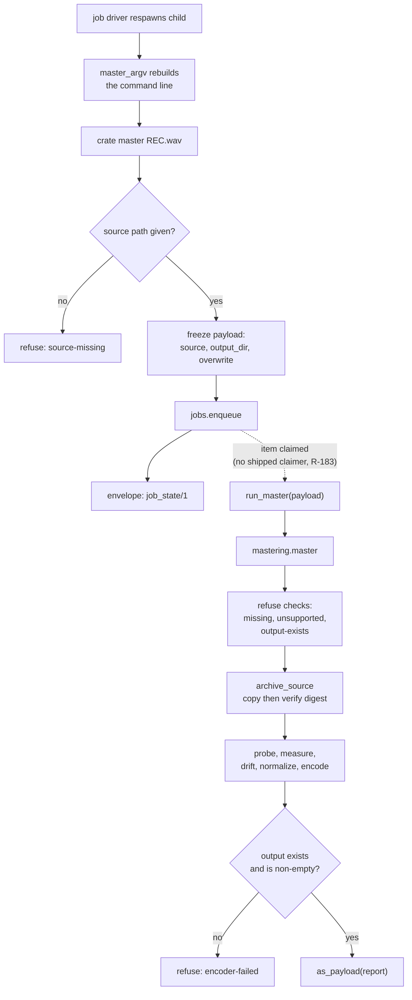

# The master command-line shell - Plan

Board unit U44, issue #62, Feature Inventory row 30.

**ID convention.** `R<N>`, `KTD<N>` and `U<N>` in this document are plan-local. The repository's own identifiers are always cited with a `repo` qualifier: `repo R32`, `repo KTD24`, `repo KTD26`, `repo R34`, `repo U35`, `repo U44`. Residual numbers are cited as `R-183` with the hyphen, which is the repository's own spelling and never collides with a plan-local `R1`.

**Every count in this document was measured on the branch point**, not read off a comment. Three counts were wrong in the first draft because they were quoted from prose in the tree that is itself stale. Where a number appears below, it came from running the derivation.

---

## Goal Capsule

- **Objective:** A person who recorded a DJ set can level and encode it from the command line, and the recording they started with is still on disk byte for byte when the command finishes.
- **What this unit delivers against that objective, stated plainly:** the queueing half and a work half that is shipped code a caller can drive. It does not deliver a mastered file to a person, because nothing in `src` claims a job item (`R-183`). Typing the verb produces a job identifier and nothing advances it. See Scope Boundaries; this is inherited, not introduced.
- **Means:** A queueing shell over the mastering engine that `repo U35` already landed, at `src/cratekit/master/cli.py` (KTD3).
- **Authority hierarchy:** `DJ_tools/docs/migration/00-SEAM-DECISIONS.md` outranks this plan. `docs/METHOD.md` owns the merge bar and the mutation method. The registry entry at `src/cratekit/cli/registry.py:1469` is the declared surface and is not redesigned here. This plan outranks the board issue text where the two differ, and every place they differ is recorded in Key Technical Decisions.
- **Execution profile:** One board unit, one branch, one merge commit. The plan-local units below are sequencing inside that branch, not separate merges.
- **Stop conditions:** Stop and record a residual rather than widening scope if the first-caller audit in U4 surfaces a defect whose producer cannot be driven. Stop and report if appending the seven refusal slugs in U1 moves the collected test count, because that is a signal the registry has a guard this plan did not find. Do not build a job claimer; `R-183` is out of scope.
- **Tail ownership:** The battery, the mutation table and the residual ledger belong to this unit. The merge, the push and the issue trailer belong to whoever runs the merge.

---

## Product Contract

### Summary

Ship `crate master`, the command-line shell over `cratekit.modules.tools.mastering`. The verb takes a recording as a positional path, freezes it into a job payload, and reports the job. The engine archives the source with a verified digest before anything else touches the file, and the shell is built so that it cannot skip that step.

### Problem Frame

`repo U35` landed the mastering ENGINE and never landed a shell. `src/cratekit/modules/tools/mastering.py` ships nine public functions and a refusal enum; `src/cratekit/master/` does not exist as a package. The registry entry for `master` still carries `planned_in="U35"` against a closed issue, so the board showed nothing owed while Feature Inventory row 30 sat uncovered. The gap was found on 2026-08-26 while handing off `repo U40`.

The derived cutover backlog holds four owed rows today: 6, 7, 30 and 31. Three open issues cover them, because rows 6 and 7 are both served by `acquire.download` under issue #60. Row 30 is this unit's. `tests/test_cutover_parity.py::test_the_cutover_is_not_yet_possible_and_says_why` fails on the day the backlog empties, which is the day issues #60, #62 and #63 are all done.

### Key Decisions

- **The verb declares no confirm gate on the ordinary path.** Governs R5. Rationale on KTD1, including the branch where the warrant does not hold.
- **The verb never offers a way to skip the archive.** Governs R2. Rationale on KTD2.
- **`--overwrite` is the person's explicit act and needs no second confirmation.** Governs R5. Rationale on KTD1.

### Requirements

**The surface**

- R1. `crate master <recording>` appears in `crate --help` when the `mastering` module is on, and is absent from a slim profile.
- R2. The verb never writes to the recording it was given, and never proposes an output path that could resolve to it. The destination comes from `mastering.output_path`, which appends `_mastered.flac` to the source stem and places it beside the source or under an optional output directory.
- R3. The verb queues rather than running the ffmpeg passes inline, per `repo KTD26`. Queueing exits OK on a machine with no ffmpeg and no recording, because queueing needs neither.
- R4. Every refusal the verb can raise carries a slug from `cratekit.core.cause.REASONS` and an exit code from the reserved vocabulary. A missing recording refuses `source-missing` at PRECONDITION **on the work path**, never INTERNAL and never a traceback. The queueing path does not stat the recording and so cannot reach this refusal; see the Scope Boundaries entry that records that silence.
- R5. Replacing an existing master requires `--overwrite`. Without it the verb refuses `output-exists` and writes nothing.

**The archive promise**

- R6. The source file is byte identical after a full run, proved by digest over a real container rather than by mtime.
- R7. The archived copy is verified against the source's digest before the run proceeds, and the run does not proceed when that verification fails.

**The report**

- R8. The verb emits a `job_state/1` envelope on the queueing path, per `repo R32`.
- R9. A run whose ffmpeg pass fails does not report success. A run whose ffmpeg pass exits zero and produces no output file does not report success either.

**The resume**

- R10. The resume command line rebuilt from a frozen payload reproduces every flag that shaped that payload, so the respawned child does the work the person asked for rather than a default version of it.

### Success Criteria

- `tests/test_cutover_parity.py`'s derived backlog shrinks from four rows to three, leaving 6, 7 and 31. **This is a statement about a landed declaration, not about a reachable capability.** Coverage derives from `entry.landed`, so row 30 reads covered the moment `planned_in` is dropped, while `R-183` still means nobody can run the work. Say that in the explanation rather than letting the parity table imply otherwise.
- The three-part battery is clean: `ruff check src tests scripts`, `python -m pytest`, `python scripts/scan_repo.py`.
- R2, R6 and R7 are each satisfied by a landed test. These three are the verb's central promise and are not dischargeable by writing a residual; see Definition of Done.
- A mutation table over the archive path exists in `docs/mutation/` with row descriptions, not only counts.

### Scope Boundaries

- **The engine's `concatenate` function is out of scope, and this is a known parity gap rather than a clean exclusion.** `concatenate` joins a recording a device split across several files. The live script this verb replaces, `DJ_tools/.claude/skills/dj-master-set/master_set.sh`, ships `--concat` labelled "for RX3 split recordings", and an RX3 split recording is a set recording, which is what row 30 is titled. Recorded as an open question rather than silently dropped.
- **Settings flags are out of scope, and this is also contested.** `Settings` validates `target_lufs`, `true_peak_db`, `loudness_range`, `drift_window` and `frame_ms` at construction, and the defaults are the product's opinion. The live script ships `-t`, `-p` and `-g` for the first three. Recorded as an open question.
- **The queueing path exits OK on a recording that is not there**, and that is a consequence of `R-183` rather than a decision. A person typing a wrong path is told a job was queued. File it as a residual in U5 with its measured cost.
- **`R-183` is not fixed here.** Nothing in `src` claims a job item, so no long running verb's work is executed by shipped code, and this verb inherits that. KTD3 is a testability mitigation, not the fix.
- **Engine behaviour with no shell participation stays proved where it is.** `tests/modules/test_tools.py` already proves the scratch WAV cleanup and the engine-level byte-identical property. This unit's tests drive the same properties through `run_master`, which is a different claim, and they do not restate what the shell does not touch.
- **The stale prose counts in `tests/test_reserved_causes.py` are a pre-existing drift and are not swept here.** U1 corrects the two live present-tense sites its own append moves. The file carries a dozen further mentions of the old figure inside past-tense narrative about earlier review rounds, and rewriting those would falsify a historical record.

---

## Planning Contract

### Key Technical Decisions

KTD1. **No confirm gate, and `--overwrite` is the explicit act.** The verb is `destructive=True` by declaration because it declares `writes={"files"}`, and `Entry.__post_init__` makes that binding at `src/cratekit/cli/registry.py:184`. Destructive does not imply a gate: no registry invariant requires one, and five landed verbs are already destructive and gateless, `tag.folder`, `intake.set`, `analyze.run`, `sync.labels` and `label.import`.

  **On the ordinary path the warrant is that nothing is lost.** The verb writes a NEW file under a name derived from the source, archives the original with a verified digest first, and refuses `output-exists` rather than replacing a master somebody kept. There is no decision for a person to make. The cost of not gating is that a long expensive run starts unconfirmed, and the mitigation is that the verb queues rather than running inline, so `crate job cancel <id>` undoes it.

  **On the `--overwrite` path that warrant does not hold, and it must not be leaned on.** `archive_source` archives the SOURCE only. The encode writes straight to the target with `ffmpeg -y`, so an existing master is truncated before the run can fail, and a failed encode under `--overwrite` leaves the person holding a broken file where their previous master was, with no copy anywhere. What carries the decision on that path is the second argument alone: the flag is a decision the person volunteered on the command line, and gating a flag somebody had to type is a second confirmation of one decision. `repo R34`'s gate machinery exists for decisions the product raises, not for ones the person volunteered. U4 drives this branch rather than assuming it.

KTD2. **The shell never passes `archive=False`.** `mastering.master` takes an `archive` keyword defaulting to True. No flag exposes it and no payload key carries it. The live script ships `--no-archive`; this verb deliberately does not, because a flag that switches off the safety copy converts a recoverable operation into a destructive one, and `archive_source` at `src/cratekit/modules/tools/mastering.py:423` is the whole reason the engine can make its central promise. The engine's ordering is load bearing and its docstring says so: refuse, archive, then process.

KTD3. **The work is a module level function, not a closure inside the handler.** `run_master(payload, ...) -> dict` lives beside the handler in `src/cratekit/master/cli.py` and takes plain data. `RESTART-cratekit.md` records the measured cost of the alternative: `tag.retag`'s plan digest was built inline in its handler, so the one property that mattered about it could only be reached through a configured machine, a job store and a gate, and a mutation replacing it with a constant killed no test. Pulling `plan_for` out made it a three line test. The same shape applies harder here, because `R-183` means no shipped code claims a job item, so an inline work body would be reachable by nothing at all.

KTD4. **Refusals are translated at the shell boundary, and the seven slugs join the closed reason registry.** `mastering.Refusal`'s seven members are already reserved with codes in `src/cratekit/cli/exit_codes.py`, all PRECONDITION. None of them is in `cratekit.core.cause.REASONS`, and `Cause.__post_init__` at `src/cratekit/core/cause.py:1297` refuses a reason the registry does not declare. So a `MasteringRefused` escaping the handler is converted by the dispatcher at `src/cratekit/cli/__init__.py:433` into `internal-error`, which carries `report-defect`. A person whose recording is not where they said it was would be told to file a bug. Appending the seven to `REASONS` at PRECONDITION keeps the two tables in agreement, which `tests/test_reserved_causes.py:510` asserts by deriving the overlap rather than listing it.

KTD5. **The report is derived from the result, never from the plan.** `mastering.master` builds its `Report` with `output_bytes=target.stat().st_size if target.exists() else 0` at `src/cratekit/modules/tools/mastering.py:613`, with no check beside it, and `size_reduction` then reports a saving of 1.0 over a file that is not there. A report read as a statement of intent announces a successful encode that did not happen, which is why R9 requires the shell to read the result. `docs/solutions/workflow-issues/adding-the-first-caller-makes-you-the-owner-of-its-unreviewed-defects.md` is the worked case for this exact package, one module over. Its rule: adding the first caller to an existing internal function makes you the owner of its unreviewed defects, and the deciding question is whether the input was reachable before your change. U4 owns the audit and the decision.

### Assumptions

These are agent bets made without a synchronous user to confirm them. They are recorded here rather than folded into the units so a reviewer can scrutinize them as a group.

- The board issue's list of files is a floor, not a ceiling. This plan adds `src/cratekit/core/cause.py` (KTD4) and may add `src/cratekit/modules/tools/mastering.py` (U4). Both are inside `src/cratekit` and neither is on METHOD's do-not-touch list. Both are required by the tracker's own test scenarios rather than opportunistic.
- `--output-dir` is the right name for the optional destination flag, matching `mastering.output_path`'s own `output_dir` keyword. The live script spells the same thing `-o`.
- The `mastering` module toggle is already declared at `src/cratekit/core/profiles.py:68` and carries no heavy Python dependency. `PROFILES["slim"]` is an empty frozenset, so R1's slim-profile absence follows from the toggle.
- The verb's whole declaration is already in the registry. Implementing what is declared means changing none of it, and the only registry edit is removing `planned_in="U35"`.
- Removing `planned_in` moves the collected count by two. Three parametrisations key on the landed population (`tests/test_cli_contract.py:1277`, `:1494`, `:1689`) and one keys on the not-landed population (`:1169`). Conformance 5 and 8 key on all entries, so `master` is already in those and neither moves.
- `mastering.master` resolves ffprobe separately from ffmpeg, so a drive overriding only `CRATEKIT_BIN_FFMPEG` leaves the real ffprobe in the loop. That is fine under `tests/_containers.py`'s `require_ffmpeg`, which guarantees a real toolchain.

### High-Level Technical Design

The verb has two halves that never run in the same process. The queueing half runs when a person types the command. The work half runs when something claims the job item. Today nothing in `src` claims one (`R-183`), which is why the work half is written as a function a test calls directly.

The archive is the third box in the work half and it is before the first ffmpeg pass. That ordering is the engine's, not the shell's, and the shell's only job is to not undermine it: no in place output path, no `archive=False`, no path composed here instead of by `output_path`.

### Sequencing

U1 first, because the shell cannot raise a refusal until the vocabulary declares it. U2 then lands the package, the parser and the handler surface. U3 and U4 are the two halves and are independent of each other. U5 is last and carries the registry cutover, because dropping `planned_in` is what puts `master` into the landed conformance population, and that population indexes `_sample_arguments` by verb name with a plain dict lookup. Cutting over before that entry exists raises `KeyError` in three parametrisations and the battery cannot pass mid-branch.

---

## Implementation Units

### U1. Reserve the mastering refusals in the closed reason registry

- **Goal:** `cratekit.core.cause.refuse` accepts the seven `mastering.Refusal` slugs, so a mastering refusal can reach the command line as a refusal rather than as an internal defect.
- **Requirements:** R4.
- **Dependencies:** none.
- **Files:**
  - `src/cratekit/core/cause.py` (modify)
  - `tests/test_reserved_causes.py` (modify, prose counts only)
- **Approach:**
  1. Append a `U44's refusals` block to the END of the `REASONS` literal, for the reason every block above it gives: two units inserting into different halves of one mapping auto merge, so a duplicate key is resolved silently by whichever line comes last, while an append conflicts textually and gets read.
  2. **Append exactly these seven and no others:** `source-missing`, `source-unsupported`, `output-exists`, `archive-holds-a-different-recording`, `archive-verify-failed`, `encoder-missing`, `encoder-failed`. Map each to `ExitCode.PRECONDITION`, matching the reservation the reserved table already carries for it.
  3. **Do not copy the reserved table's block by line range.** `restore-transfer-failed` is interleaved among the mastering reservations in `src/cratekit/cli/exit_codes.py`, sitting between `archive-verify-failed` and `encoder-missing`, and it is already a key in `REASONS`. Carrying it across duplicates a key and trips the duplicate-key guard at `tests/test_cli_contract.py:442`, which spends one of the two fix rounds METHOD allows this branch.
  4. Write the comment that says why these arrive late: the reserved table has held them since `repo U35` and the closed registry did not, because `repo U35` landed no caller that could raise one.
  5. Correct the two live present-tense prose sites in `tests/test_reserved_causes.py` that this append moves, at `:2119` and `:4123`. **Measure both numbers rather than quoting them.** At the branch point `len(REASONS)` is 121 and becomes 128; the registry-only figure is 111 and stays 111, because all seven slugs are already in the reserved table. Both sites currently say sixty one and sixty, so both are already wrong on main by sixty and by fifty one. Leave the past-tense mentions near `:85` and `:88` alone: they narrate an earlier review round and correcting them would falsify a record.
- **Patterns to follow:** the `U43's refusals, appended` block at the tail of `REASONS`, and `registry_only_causes()` at `tests/test_reserved_causes.py:4148` for why the registry-only figure does not move.
- **Test scenarios:**
  - `test_where_this_table_and_the_closed_reason_registry_overlap_they_agree` passes with an overlap that has grown from ten slugs to seventeen. Measured, not assumed: the two tables already share ten, which are `rekordbox-running`, `rclone-missing`, `remote-not-configured`, `destination-not-configured`, `library-root-absent`, `database-absent`, `restore-not-confirmed`, `restore-target-absent`, `no-snapshot-available` and `restore-transfer-failed`.
  - `tests/test_cli_contract.py`'s duplicate-key check over the `REASONS` literal still passes, which is what proves the append introduced no repeat and that `restore-transfer-failed` was not carried across.
  - The collected test count does not move. If it does, something parametrises over `REASONS` membership and this plan did not find it; stop and report rather than absorbing the drift.
  - Test expectation for the `refuse("source-missing", ...)` round trip: none in this unit. The committed assertion lives in U4's `source-missing` scenario, which drives it through the shell where a person meets it. Adding a test here would move the collected count that this unit's verification requires to be still.
- **Verification:** the battery is clean and the collected count is unchanged from the branch point.

### U2. The `cratekit.master` package and the declared surface

- **Goal:** the package exists, the parser declares the surface, and the module imports.
- **Requirements:** R1, R2, R5, for the declaration half. U4 proves the behaviour.
- **Dependencies:** U1.
- **Files:**
  - `src/cratekit/master/__init__.py` (new)
  - `src/cratekit/master/cli.py` (new)
- **Approach:**
  1. Write `build(parser, entry)` taking an untyped `entry`, so this layer does not import the CLI registry (`repo KTD23`). Model it on `src/cratekit/tagging/retag_cli.py:105`.
  2. Declare the positional `recording`, then `--job`, then `--output-dir`, then `--overwrite`. `--job` continues a queued run and matches the spelling both tagging shells use.
  3. Do not declare settings flags. Scope Boundaries records that this is contested and Open Questions carries the fork.
  4. Add a module docstring saying what the shell is for and what it refuses to offer, in the register the sibling shells use. It must say that no flag switches off the archive and why (KTD2).
- **Patterns to follow:** `src/cratekit/setbuilder/cli.py` for a landed shell's docstring and its `_load` config wrapper.
- **Test scenarios:**
  - The parser built over an explicit entry list containing the `master` entry accepts `master <path> --output-dir D --overwrite` and rejects an unknown flag. The parser builder takes an `entries` argument and falls back to `registry.landed_entries()` only when it is None, so a test supplies the entry directly. It cannot be driven through `crate --help` in this unit: the verb still carries `planned_in`, so it is not in the landed set and the subcommand does not exist until U5.
  - `importlib.import_module("cratekit.master.cli")` succeeds and exposes `build`.
  - `Entry` construction still succeeds, which is the invariant check at `src/cratekit/cli/registry.py:166` confirming `writes={"files"}` and `destructive=True` remain consistent and `long_running` still has its argv builder.
- **Verification:** the battery is clean. The verb is absent from `crate --help`, which is the intended mid-branch state, and U5 is what makes it appear.

### U3. The queued half: freeze the payload, build the resume argv

- **Goal:** Typing the command queues a job and reports it, and the child the job driver respawns runs the same work the person asked for.
- **Requirements:** R3, R8, R10.
- **Dependencies:** U2.
- **Files:**
  - `src/cratekit/master/cli.py` (modify)
- **Approach:**
  1. The handler refuses an empty positional with a vocabulary slug before loading config, the way `retag_genres` refuses an empty folder at `src/cratekit/tagging/retag_cli.py:147`.
  2. Normalize an empty `--output-dir` to absent at the handler, before the payload is frozen. An empty string reaches `mastering.output_path` as `Path(".")` and lands the master in the working directory, while the argv builder drops a falsy flag and the resumed child writes beside the source instead. That divergence is what R10 forbids.
  3. Freeze `source`, `output_dir` and `overwrite` into the payload. Do not resolve, probe or stat the recording here: queueing must exit OK on a fixture with no ffmpeg and no recording, and a stat in the handler would break that.
  4. When `--job` is present, reconcile that identifier through `jobs.reconcile` and report it rather than enqueuing, the branch `src/cratekit/tagging/cli.py` takes ahead of `jobs.enqueue`.
  5. `master_argv(job)` rebuilds the command line from the payload alone. It carries `--output-dir` when the payload holds one and `--overwrite` when the payload holds it, because a resume that drops a flag does different work from the one the person asked for and reports success for it.
  6. Do not emit `--run`. The verb declares no gate (KTD1), so there is no gate run to freeze, and `--run` here would name a run nothing was recorded against.
  7. Tolerate a payload missing a key this version writes. This is forward tolerance for keys a later build may add rather than a case that is reachable at merge, since no payload of this shape can exist until the verb ships. The sibling shells carry the same shape and `retag_argv`'s docstring gives the reason: a builder that raises does so inside a detached child whose only output is a log nobody is watching.
- **Patterns to follow:** `tag_argv` at `src/cratekit/tagging/cli.py:48` for the ungated shape; `retag_argv` at `src/cratekit/tagging/retag_cli.py:118` for the docstring that explains what the argv must carry and why. `_reported` is duplicated in both tagging shells and should be reproduced rather than reached for across packages.
- **Test scenarios:**
  - Queueing on the `configured` fixture exits OK and emits a well formed `job_state/1` envelope, on a machine with no ffmpeg and no recording.
  - Passing `--job <known-id>` reconciles and reports that job rather than enqueuing a second one.
  - Passing `--job` with an identifier that is not in the queue refuses with a vocabulary code, not a traceback.
  - A payload carrying `output_dir` and `overwrite` produces an argv containing both, and `argv[argv.index("--output-dir") + 1]` is the frozen directory.
  - A payload carrying neither produces an argv containing neither, and the argv still names the verb, the recording and the job.
  - An empty `--output-dir` on the command line produces the same payload and the same argv as omitting it.
  - A payload missing the keys this version writes builds an argv without raising.
  - The verb is absent from `tests/test_queued_resume_contract.py`'s derived population, because it declares no explicit gate. Assert this as a property of the entry rather than by name, so the day somebody adds a gate the guard covers it.
- **Verification:** a queued job's argv, fed back through the parser, reaches the same handler with the same values.

### U4. The work half: drive the engine, derive the report from the result

- **Goal:** The mastering work is shipped code a caller can drive, and it does not report success over an output that is not there.
- **Requirements:** R2, R5, R6, R7, R9.
- **Execution note:** Do the first-caller audit before writing the call, and write down what the greps returned. The finding it produces, if any, counts against this unit's merge bar rather than against `repo U35`.
- **Files:**
  - `src/cratekit/master/cli.py` (modify)
  - `src/cratekit/modules/tools/mastering.py` (modify, only if the audit finds a defect on the checking path)
- **Approach:**
  1. Run the audit the corpus document prescribes. **The measurement taken while planning, corrected against the tree:** `master` and `as_payload` return only a `def` and an `__all__` entry. `output_path`, `archive_source` and `probe_source` each return one further hit, their single call site inside `master` itself at `:541`, `:559` and `:563`. So the whole surface is reachable only through `master`, and no shipped verb reached `master` before this unit. This unit is therefore the first caller of the surface in `src` and its failure paths are this unit's to drive, which is the same reading the corpus document applied to `run_restore`, whose own suite drove it six times while nothing in `src` called it. Note also that `as_payload` matches `src/cratekit/modules/tools/setbuilder.py` as well; it is a different function with the same name, which is the one-symbol-two-meanings shape the battery says to hunt.
  2. Read the return-code paths. `_run_or_refuse` at `src/cratekit/modules/tools/mastering.py:634` covers the measure, drift and encode stages. `probe_source` at `:466` does NOT route through it and reads `result.returncode` itself, raising `ENCODER_FAILED`. That is a duplicate rather than a hole; record the reading rather than repeating it.
  3. Write `run_master(payload)` as a module level function returning `mastering.as_payload(report)`. It converts `MasteringRefused` into a `refuse` carrying `str(exc.refusal)` as the reason, so the engine's vocabulary reaches the envelope unchanged.
  4. **Build the stand-in ffmpeg so it dispatches on its own argv**, the way `_fake_rclone` at `tests/test_restore_cli.py:149` dispatches rather than answering everything the same way. A stand-in that exits zero and prints nothing cannot reach the defect it is aimed at: `parse_loudness` returns an empty `Loudness`, and `apply_filter` at `:281` raises `ENCODER_FAILED` for the missing measurement before the encode command is built, so the `Report` construction is never reached. The stand-in must print a loudnorm JSON block carrying `input_i`, `input_lra`, `input_tp`, `input_thresh` and `target_offset` on stderr for the measure invocations, write the intermediate on the drift invocation, and vary only on the final encode invocation. A non-reproduction counts as evidence only when the run got past `apply_filter`; anything short of that is a harness failure, not an absent defect.
  5. Decide fix versus residual on what that drive shows. If the encode arm that exits zero and writes nothing produces a success envelope, land the reading on the CHECKING path inside `mastering.master`, so every future caller is covered rather than the one this unit added.
  6. Do not pass `archive=False`. Do not compose the output name here; pass `output_dir` through to `output_path`.
- **Patterns to follow:** `docs/solutions/workflow-issues/adding-the-first-caller-makes-you-the-owner-of-its-unreviewed-defects.md` for the audit, the ownership rule and the checking-path placement. `src/cratekit/modules/tools/backup.py:1050` for what the fix looks like when it lands on the checking path. `tests/test_restore_cli.py:149` for the argv-dispatching stand-in.
- **Test scenarios:**
  - Over a real container from `tests/_containers.py`, a full run through `run_master` leaves the source byte identical, asserted by `mastering.digest` before and after, not by mtime.
  - The same run leaves an archived copy under `_originals` whose digest equals the source's.
  - A source that is not there refuses `source-missing` at `ExitCode.PRECONDITION`, and writes nothing.
  - A source in a container the engine does not read refuses `source-unsupported`, which is a different slug from the missing case because a person told the file is absent will go looking for a file sitting in front of them.
  - An existing output refuses `output-exists` without `--overwrite`, and proceeds with it.
  - **A failed encode under `--overwrite` with an existing master in place**: assert what the person is left holding, and that the report does not claim success. This is the branch KTD1's first argument does not cover and it must be driven rather than reasoned about.
  - An archive slot already holding different audio under the same name refuses `archive-holds-a-different-recording` and leaves both files intact.
  - A stand-in ffmpeg exiting 1 on the encode invocation makes the run refuse `encoder-failed`, driven through `CRATEKIT_BIN_FFMPEG`, the shipped per binary override `core.binaries.find` reads before PATH.
  - A stand-in ffmpeg exiting 0 on the encode invocation and writing nothing does not report success. This is the reachability drive for step 5 and its outcome decides fix versus residual.
- **Verification:** every one of `mastering.Refusal`'s seven members is raised by at least one test in this unit or is named in the residual ledger with the reason no drive reaches it. `archive-verify-failed` and `encoder-missing` are the two the scenarios above do not enumerate; decide during the unit whether a read-only archive directory and an emptied PATH reach them rather than defaulting to the ledger.

### U5. The registry cutover, the contract entry, and the suite

- **Goal:** The verb joins the landed conformance population with the sample arguments that population needs, and the guards this unit wrote are measured rather than assumed.
- **Requirements:** R1, R3, R4, R8.
- **Dependencies:** U1, U2, U3, U4.
- **Files:**
  - `src/cratekit/cli/registry.py` (modify)
  - `tests/test_master_cli.py` (new)
  - `tests/test_cli_contract.py` (modify)
  - `docs/mutation/u44-author.md` (new)
  - `docs/residual-findings.md` (modify)
  - `RESTART-cratekit.md` (modify)
- **Approach:**
  1. **Add the `master` entry to `_sample_arguments` at `tests/test_cli_contract.py:1293` FIRST, then drop `planned_in="U35"` from the registry entry.** That order is the unit. `_sample_arguments` ends in a plain dict lookup, `}[entry.name]`, and dropping the marker flips `Entry.landed` to True, which adds `master` to three landed parametrisations at `:1277`, `:1494` and `:1689`. Cutting over first raises `KeyError` in all three.
  2. Hand the entry a path under the CONFIGURED library that is deliberately absent, for the `repo R1` reason every file verb there gives, and write the comment saying why an absent recording still exits OK: queueing freezes the path and never stats it.
  3. Replace the `planned_in` marker with the comment `repo U43`'s entry uses at `src/cratekit/cli/registry.py:1462`, naming what landed and what the flags now bind. Change nothing else on the entry.
  4. Confirm conformance 1 through 9 pass for the entry. Conformance 8's first check needs `doctor_checks` non-empty against a non-empty `writes`, which the declared entry already satisfies with `binary.ffmpeg`.
  5. Write `tests/test_master_cli.py` with the scenarios enumerated in U3 and U4. Put the container-backed proofs behind `tests/_containers.py`'s `require_ffmpeg`, which FAILS rather than skips, because a skipped audio-safety proof is indistinguishable from a passing one in every summary anybody reads.
  6. Run the mutation table with `scripts/mutate.py`. Do not hand roll a driver. Scope it to this round's diff plus a fixed sample of the engine's existing archive guards, capped at 25 rows for a light pass. Weight the archive path heavily: that guard is what stands between this verb and data loss.
  7. When a guard kills zero, add a row that breaks the TEST's own premise as well as the code's, per the fixture-position lesson in `RESTART-cratekit.md`. A fixture sitting where the thing it tests cannot matter looks identical to a guard.
  8. File residuals above the current highest, which is R-190 on main, and append only. At minimum: the queueing path's silence on an absent recording, and whichever `Refusal` members U4 could not drive.
  9. Update `RESTART-cratekit.md`'s wave state: three remaining units become two, the suite count moves, and row 30 leaves the backlog table.
- **Patterns to follow:** `tests/test_setbuilder_cli.py` for a landed shell's suite shape; `docs/mutation/u43-author-light.md` for the table's own shape and its verdict column.
- **Test scenarios:**
  - `crate --help` under the full profile lists `master`; under a slim profile it does not.
  - `test_conformance_1_structured_output_is_actually_emitted` passes for `master` under the `configured` fixture.
  - `test_conformance_2_exit_codes_are_from_the_vocabulary_and_never_status_two` passes for `master`.
  - `test_conformance_5_long_work_is_queued_rather_than_run_inline` passes for `master`, which is the guard that proves the ffmpeg passes do not run in the handler.
  - `tests/test_cutover_parity.py`'s backlog holds three rows rather than four, leaving 6, 7 and 31, and its "not yet possible" test still passes because three rows remain.
  - The mutation table's own null control kills zero. If it kills something, the driver is contaminated and the whole table is void.
- **Verification:** the battery is clean, `board.py audit` exits 0, and the mutation table is committed with full row descriptions rather than counts alone.

---

## Verification Contract

| Gate | Command | Applies to |
|---|---|---|
| Lint | `.venv/bin/ruff check src tests scripts` | every unit |
| Suite | `.venv/bin/python -m pytest` | every unit |
| Repo scan | `.venv/bin/python scripts/scan_repo.py` | every unit |
| Board | `.venv/bin/python scripts/board.py audit` | before the session ends |
| Counts | `.venv/bin/python -m pytest --collect-only -o addopts=` | U1, U5 |
| Mutation | `.venv/bin/python scripts/mutate.py` | U5 |

Never pass `-q`. `pyproject.toml` already sets it, so a second one becomes `-qq` and suppresses the summary line and the collect listing. Use `pytest --tb=no` for a run count and `pytest --collect-only -o addopts=` for the collected count; the Counts gate compares the collected count, which is the one that catches a file that stopped collecting.

The collected count must NOT move at U1 and is expected to move at U5, where the registry cutover adds landed parametrisations and removes a countdown case, and the new test file arrives. Reconcile by IDENTIFIER, not by total: a total-only check shows a healthy rise and hides a collapse.

CI is not the merge gate and does not run the suite. It proves packaging and portability, which is what the battery structurally cannot see on a laptop that already has everything.

---

## Definition of Done

**Global**

- All three battery commands are clean, run from the checkout with its own venv.
- `board.py audit` exits 0.
- **R2, R6 and R7 are satisfied by a landed test and may not be discharged as residuals.** They are the verb's central promise: the source is never written, it is byte identical after a run, and the archive is verified before the run proceeds. Every other plan-local requirement is either satisfied by a landed test or named in `docs/residual-findings.md` with its measured cost.
- The mutation table is in `docs/mutation/` with row descriptions. Anything dropped at the 25 row cap is logged with the reason it ranked below the cap, so a truncation is visible rather than read as coverage.
- No abandoned experimental code is left in the diff.
- The code and architecture explanation ships with the unit, and it says out loud that row 30 reads covered while `R-183` still means nobody can run the work.
- No em dash, en dash or double hyphen appears in any prose, comment or commit message on the branch.

**Per unit**

| Unit | Done when |
|---|---|
| U1 | The seven slugs resolve through `refuse` at PRECONDITION, `restore-transfer-failed` was not carried across, the derived overlap check passes at seventeen shared slugs, and the collected count is unchanged. |
| U2 | The parser accepts the verb's full argument shape over an injected entry list, and the module imports and exposes `build`. |
| U3 | Queueing exits OK on `configured` with no ffmpeg and no recording, and a resume argv round trips every frozen flag including the empty-output-dir case. |
| U4 | The byte-identical proof passes over a real container, the overwrite-failure branch has been driven, and both encode-stage stand-in arms reached `apply_filter` before their outcomes were recorded. |
| U5 | Conformance 1 through 9 pass for `master`, the parity backlog holds three rows, and the residuals are appended above R-190. |

---

## Open Questions

Both are product forks this plan could not settle without Phillip, and both are deferred rather than dropped. Neither blocks implementation: the plan is executable as written and each fork adds surface rather than changing what is already specified.

- **Does `crate master` need the split-recording input shape?** The live script ships `--concat` for XDJ-RX3 split recordings and the engine already has `concatenate`. Without it, a person whose set arrived as three files gets three separate masters and keeps using the script, while row 30 reads covered. Recommendation: keep this verb at one input and give concatenation its own verb, so the mastering verb keeps one positional, then record the gap as a residual now. A related point worth deciding at the same time: `master_set.sh` is absent from `tests/fixtures/dj_tools_scripts.txt`, whose second block exists precisely for workflows that are not console scripts and which already carries `backup.sh`, and the `master` entry declares no `source_scripts` the way `backup.run` declares `backup.sh`. Nothing in the repository can currently see that this verb has a predecessor.
- **Should `--target-lufs` be exposed?** The live script ships `-t`, and the engine's own comment records that minus fourteen suits general playback while a louder target suits platforms that normalize upward. Today `Settings` is only ever constructed as `DEFAULT_SETTINGS` in `src`, so a person who needs a different target has no route but editing source. Recommendation: expose `--target-lufs` alone, freeze it in the payload and carry it in `master_argv`, leaving the other four knobs at their defaults. Deferred because it widens the declared surface, which the tracker told this unit not to redesign.

---

## Risks and Dependencies

- **The first-caller audit may return a blocking finding.** That is the expected outcome rather than the surprising one, because the corpus document that describes this exact hazard is about the sibling module in the same package. Budget one fix round for it. METHOD caps the branch at two.
- **`R-183` is inherited, not created.** No shipped code claims a job item, so a person who queues a master gets a job nothing advances. This is true of every long running verb on main and this unit makes it true of one more. Do not let the explanation or the merge commit imply the verb masters anything for a person yet.
- **Clearing row 30 makes the parity table read closer to a possible cutover than the product is.** Coverage derives from `entry.landed`, and `covering_verbs()`'s own docstring warns that counting a verb a person cannot run would report a cutover as possible while the workflow it replaces has no replacement. That is true of every queued verb on main rather than introduced here, so it is recorded rather than filed as a blocker.
- **`test_conformance_6`'s docstring is stale.** It says every destructive entry carries a `planned_in` marker, which stopped being true when `restore.run` landed. It still passes because it drives the shared session gate rather than the verb. Do not fix it inside this unit; record it as a residual if nobody has.

---

## Sources and Research

- `src/cratekit/modules/tools/mastering.py`. `master` at `:505` for the ordering; `archive_source` at `:423` for the copy-then-verify; `output_path` at `:253` for the destination; `apply_filter` at `:281` for the refusal that fires before the encode when a measurement is missing; `_run_or_refuse` at `:634` for the return-code reading; the `Report` construction at `:606` and `output_bytes` at `:613` for the hazard KTD5 names.
- `src/cratekit/cli/registry.py:1469`. The declared entry, in full, including `planned_in="U35"` at `:1484`.
- `src/cratekit/cli/exit_codes.py`. Seven reservations for the mastering refusals, all PRECONDITION, with `restore-transfer-failed` interleaved among them.
- `src/cratekit/core/cause.py:656`. The closed reason registry, 121 slugs at the branch point, and `__post_init__` at `:1297` which is what makes an undeclared reason an internal defect.
- `src/cratekit/tagging/retag_cli.py`. The gated queueing shell, and `retag_argv`'s docstring for what a resume argv owes its own gate.
- `src/cratekit/tagging/cli.py`. The ungated queueing shell, which is the closer model for this verb, including its `--job` reconcile branch.
- `tests/test_cli_contract.py`. `_sample_arguments` at `:1293` and its `}[entry.name]` lookup at `:1483`; the landed parametrisations at `:1277`, `:1494` and `:1689`; the duplicate-key guard at `:442`.
- `tests/test_queued_resume_contract.py:52`. The derived population and its three-condition membership test.
- `tests/test_reserved_causes.py:510`. The derived overlap between the two tables.
- `tests/test_restore_cli.py:149`. The argv-dispatching rclone stand-in, which is the model for the ffmpeg stand-in.
- `tests/_containers.py`. One synthesizer for a real audio container, and its deliberate fail-rather-than-skip.
- `tests/modules/test_tools.py:868`. The engine-level byte-identical proof this unit's shell-level version sits above rather than duplicates.
- `DJ_tools/.claude/skills/dj-master-set/master_set.sh`. The live script row 30 replaces, and the surface both Open Questions compare against.
- `docs/solutions/workflow-issues/adding-the-first-caller-makes-you-the-owner-of-its-unreviewed-defects.md`. The ownership rule, the audit, and the checking-path placement.
