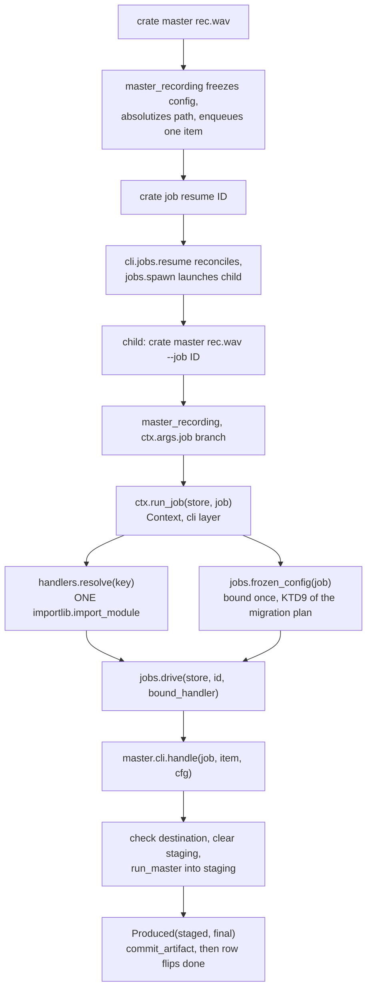

# Job Handler Registry - Plan

Board unit U46, issue #64. It narrows residual R-198 and does not close R-183.

R-198 closes when a unit lands the handler binding and one verb's queued work runs to completion, which is what this unit does. R-183's own recorded condition is that every long running verb's engine has a caller in `src`, which one binding does not meet, so R-183 gets a measurement appended and stays open.

## Goal Capsule

- **Objective:** a person who queues long running work and then runs `crate job resume` gets the work done, and is told plainly when a queued job has no worker behind it. Today the items stay `pending` for ever, the job cycles between reported and respawned, and nothing on the reporting surface says so.
- **Means:** declare handlers as inert data the supervisor can read without importing anything, resolve one lazily at drive time, and reach the existing `jobs.drive` loop from the CLI layer through the dispatcher's `Context` (KTD1, KTD2).
- **Authority:** `docs/METHOD.md` and `DJ_tools/docs/migration/00-SEAM-DECISIONS.md` Part 5 outrank this plan. `CLAUDE.md` standing constraints bind. Where this plan and the issue #64 brief disagree, this plan states why.
- **Stop conditions:** stop and record a residual rather than binding a second verb to prove a property. Stop if the layering guard, the mutation table, or the battery cannot be made honest without changing `jobs.drive` itself.
- **Execution profile:** one board unit, one branch, no pull request. The battery gates the merge.
- **Tail ownership:** the residual ledger owns everything this unit knowingly leaves open. Numbers start above R-202.

---

## Product Contract

### Summary

Land a handler declaration table in the CLI layer that maps a `handler_key` to a dotted implementation string, resolve it lazily at the moment the driver needs the function, and call `cratekit.core.jobs.drive` from a single new site reached through the dispatcher's `Context`. Bind one verb's handler for real, `master`, and drive its queued work from `pending` to `done`. Mark a queued job whose handler key is unbound as having no worker, on the reporting surface a person reads. Guard the seam with tests derived from the registry rather than enumerated, including a clean subprocess probe for the no import property. Record the unbound queued verbs as a residual with the reason.

### Problem Frame

`cratekit.core.jobs.drive` at `src/cratekit/core/jobs.py:1181` is a complete, guarded, resumable item loop, and `tests/test_jobs.py` already drives it directly across seven cases. Nothing in `src` calls it. The only process level caller is `tests/job_worker.py`, which pytest does not collect and which runs as a script.

The path a person takes stops one step short. A long running verb freezes its configuration, enqueues, and reports. `crate job resume <id>` reconciles the job, then `jobs.spawn` launches the child that the verb's `argv_builder` describes. That child re enters the same verb with `--job <id>`, takes the `if ctx.args.job:` branch, reconciles, reports, and exits. Nothing between those two steps claims an item.

An `ast` walk of `src/cratekit` on this branch finds seventeen such branches in fifteen modules, not the sixteen branches in fifteen modules the R-198 entry records. `backup/cli.py:242` joined the family when U45 landed. Both counts must be re derived by the implementer rather than quoted.

The branch count is not the population this unit reasons about. Two populations exist and they differ. The registry holds twenty landed `long_running` entries, and those are the queued verbs. The seventeen branches are modules, and `sync/cli.py` carries one branch serving three handler keys while `delete.review` is a landed queued entry with no branch at all. Binding `master` and exempting `job.resume` by role leaves eighteen queued verbs unbound. Confusing the two populations is what produced the wrong figure in the first draft of this plan.

The consequence is a cutover blocker. U29 requires each replacement workflow to run correctly at least once, and no queued workflow can run at all. `tests/test_cutover_parity.py` will not catch it, because the parity table measures whether a verb exists for a Feature Inventory row, which is a weaker claim than the cutover needs.

### Requirements

**The seam**

- R1. A `handler_key` resolves to the per item function `jobs.drive` calls, and the declaration that binds them is inert data rather than an import.
- R2. Answering whether a key is known imports nothing, including the module that implements it. This is KTD26's property and it is what lets the supervisor validate a queued job without pulling every feature module into a process that is merely listing jobs.
- R3. Resolution imports exactly one module, and only after the key is known to be real.
- R4. A declared key with no resolvable function fails the suite by name, and a queued verb with no declaration fails the suite by name unless it is on a named, expiring exemption list.

**The driver**

- R5. Exactly one site in `src` calls `jobs.drive`. The loop's contract stays in `jobs.drive` and is not reimplemented in the caller.
- R6. The handler runs against the configuration frozen at enqueue, read off the job, never loaded fresh (KTD9). A configuration changed on disk between enqueue and resume does not reach the handler.
- R7. Drift between the frozen configuration and the current one reaches the person, as a warning on the envelope the resume branch emits.

**The driven verb**

- R8. `crate master <recording>` queues a job with one item, and re entering the verb with `--job <id>` runs that item to `done`, read back from the store rather than inferred from an exit code.
- R9. A handler that raises fails its item and records that failure's cause on the item row: the engine's own cause when the engine raised one, and an `internal-error` the handler or the driver raised otherwise. The job stays resumable.
- R10. A job whose items partly failed can be resumed, and the resume redoes exactly the unfinished items and no other. Measured on a multi item job, because a one item job cannot fail this.
- R11. A job killed mid item resumes correctly through the same seam, proved with a process that genuinely dies.
- R12. A queued job over a recording that does not exist puts the engine's `source-missing` cause on the item row. The job's own cause is `unavailable-transient` and the refusal the driver raises is `no-evidence`, each carrying `source-missing` as its inner cause.
- R13. A mastered file is made durable by the engine's own commit ordering, and its path is recorded on the item row.

**Honesty**

- R14. A queued job whose handler key has no binding in this build is marked on the reporting surface as having no worker, with the reason. Answering that question imports nothing, per R2.
- R15. Every queued verb this unit does not bind is recorded, with the reason, as a residual numbered above R-202.
- R16. The unit ships the code and architecture explanation `CLAUDE.md` requires, and it states which of the candidate homes for the handler declaration was chosen and why.

### Key Decisions

- **The registry lives in the CLI layer, and the verb reaches it through `Context` rather than by importing it.** The issue brief names `src/cratekit/core/handlers.py` and the layering guard forbids it; a verb module importing the CLI layer is forbidden by the same guard. Governs R1, R2, R3, R5. Owned by KTD1.
- **One verb is bound for real and it is `master`, not `acquire.download`.** The brief suggests acquisition; three critical residuals say the adapter has never fetched a file. Governs R8, R12. Owned by KTD4.
- **An unbound queued verb is reported as having no worker rather than left to look healthy.** Uniform brokenness taught the user that queues do not run; asymmetric brokenness would teach nothing. Governs R14. Owned by KTD9.

### Scope Boundaries

**In scope**

- The declaration table, the lazy resolution, the single driver call site, the completeness and no import guards, and one verb driven end to end.
- Item materialization and output staging for the one bound verb.
- The unbound worker marker on the job reporting surface.
- The residual bookkeeping and the `CONCEPTS.md` vocabulary this seam introduces.

**Deferred for later**

- Binding the remaining eighteen queued verbs. Each needs its own worker body and its own item materialization decision, and neither is mechanical. Recorded as a residual.
- Refusing loudly at resume for an unbound key, rather than reporting the job with its no worker marker. That is a behaviour change across eighteen verbs whose workers do not exist, and it belongs to the unit that binds them.
- The first caller reading of `download.acquire_paced`, `download.acquire_concurrently`, `adapter.dispatch_invocation` and `adapter.adapter_names`. It transfers with the acquisition binding, and this unit does not make that binding. Recorded as a residual with the reason.

**Outside this unit entirely**

- U29, U30, U20, R-9, A1, A2, and `.worktrees/conformance`. `docs/METHOD.md` puts them on the do not touch list and that list binds.
- Anything that touches the live rekordbox database or launches rekordbox.

### Outstanding Questions

- Deferred, not blocking: whether the unit that binds the remaining verbs should also flip resume from reporting to refusing for an unbound key. R14 lands the cheap, honest half now; the refusal is the behaviour change and it waits.
- Deferred, not blocking: whether U29's cutover check should read the handler binding state directly, now that "a verb exists for the row" and "the row's work can run" are visibly different claims.

---

## Planning Contract

### Key Technical Decisions

- KTD1. **The handler declaration lives in `src/cratekit/cli/handlers.py`, and a verb reaches the driver through the `Context` the dispatcher builds, never by importing that module.** Two halves, both forced by `tests/test_layering.py`. First, the table cannot live in `src/cratekit/core/handlers.py` as issue #64 asks: `:98` ranks `cratekit.core.*` as `infrastructure` and `:100` ranks `cratekit.cli.*` as `cli`, `import_direction_violations` at `:238` walks the whole AST so even a function body import is caught, and `higher_concept_violations` at `:315` fires on any string constant in a sub `modules` module that is a member of `registry.VERB_NAMES` or that names a feature package. `Entry.name` equals `Entry.handler_key` for every entry, so every handler key is a verb name and every implementation string names a feature package. A core module holding this table fails two guards on its first line. Second, the verbs are `modules` rank and the table is `cli` rank, so `master/cli.py` importing `cratekit.cli.handlers` is an upward import and fails the same guard. `cratekit.cli.output` is importable from a verb only because `:70` re ranks it as foundation. The driver is therefore a method on `Context` in `src/cratekit/cli/__init__.py`, which every verb already holds and already calls for `ctx.envelope`. Governs R1, R5.
- KTD2. **The table declares `handler_key` to a `"dotted.module:function"` string, and resolution is a separate call that performs the only import.** This extends the precedent at `src/cratekit/cli/jobs.py:220`, where `argv_for` looks the key up first, refuses twice, and imports exactly once at `:257`. It also matches `src/cratekit/modules/tools/__init__.py:14`, which states the failure directly: an entry holding a function object imports the defining module at table build time, and the laziness is gone while still looking present. The alternative weighed and rejected was a `worker: str | None` field on `registry.Entry`, validated in `__post_init__` beside the `long_running` implies `argv_builder` rule at `registry.py:190`. That would make a declaration unable to outlive its verb by construction and would move the completeness rule from a test to table construction. It was rejected because the exemption mapping has to carry a per key reason and a residual number that `Entry` has no room for without a second field, because `ENTRIES` is appended to by every unit and a field with eighteen `None` values invites the next author to leave it `None` silently, and because R14 needs the unbound reason as data the reporting surface can read rather than as a validation message. A separate table keeps both the binding and the absence in one readable place. Governs R2, R3, R4, R14.
- KTD3. **The handler contract is `handle(job, item, cfg)` and the driver binds `cfg` once from `jobs.frozen_config(job)`.** `jobs.Handler` is `Callable[[Job, Item], Produced | None]`, so the driver closes over the configuration and hands `drive` a two argument callable. The parameter removes the handler's need to load a configuration; it does not remove its ability, so this is a convention with a signature that supports it rather than a structural guarantee. What makes it checkable is the guard in U4 that walks every module named in the table and fails a handler body that calls `config.load`. Governs R6.
- KTD4. **The one verb bound for real is `master`.** Four candidates were weighed. `acquire.download` is what issue #64 suggests and R-197 rules it out: the adapter's `fetch` is marked `pragma: no cover`, has never fetched a file, and R-195 and R-196 sit on the same path. Binding it would make three critical residuals reachable, and under `docs/METHOD.md`'s merge bar a residual whose input this branch makes reachable becomes blocking on this branch. `analyze.run` and `analyze.restamp` are the only verbs that already enqueue items, and their extras are not installed here: `librosa` and `scipy` are both absent, so the suite cannot drive them. `adopt.scan` has no worker and cannot have one, because the collection reader it needs has not landed. `master` is the fit: `src/cratekit/master/cli.py:204` already ships `run_master(payload, *, runner=...)` as a module level function with an injectable runner, and `tests/test_master_cli.py` already has the fake encoder that drives it offline. Governs R8, R12.
- KTD5. **`master` enqueues one item, whose `item_id` is the frozen recording path, and the path is made absolute at freeze.** `master_recording` at `src/cratekit/master/cli.py:171` enqueues with no `item_ids`, so `drive` would claim nothing and transition straight to succeeded over an empty queue. One recording is one item. The path is absolutized in `frozen_payload` because `jobs.spawn` starts the child with the resuming process's working directory, which need not be the enqueueing process's, so a relative path masters a different file after a `cd`. `Path(recording).absolute()` is lexical and stats nothing, so it leaves the deliberate no stat decision at `:186` intact. Governs R8.
- KTD6. **The handler encodes into a per job staging directory beside the destination and returns a `Produced`, and it checks `output-exists` against the real destination itself.** `mastering.master` writes straight at its final target with ffmpeg `-y`. Driven from a queue that is the wrong ordering twice over: a killed encode leaves a partial file at the destination, the next resume hits `target.exists() and not overwrite` and raises `output-exists` for ever, and the refusal tells the person that replacing it would discard a master they kept when the file is the queue's own corpse. The engine's own module docstring already names the second half of this on the `--overwrite` path. The fix goes on the checking path: the handler computes the real destination with `mastering.output_path`, which is the engine's own name builder rather than a second one, refuses `output-exists` there when `overwrite` is false, clears its per job staging directory, and passes that directory to the engine as `output_dir`. It then returns `Produced(staged=<the file in staging>, final=<the real destination>)` and `jobs.commit_artifact` performs the flush, the rename and the directory flush before the row flips to done. The staging directory sits under the destination's own parent so the rename stays within one filesystem. Governs R9, R13.
- KTD7. **The completeness guard derives its population from the registry and carries a named exemption mapping that expires on its own.** Part 5 P3 requires a test that quantifies over a set to derive that set at run time. The population is every landed `long_running` entry, twenty of them today. `job.resume` is exempt because it is the resume verb rather than a queued handler, and the eighteen unbound verbs are exempt with their residual number. A key in both the table and the exemption mapping fails, so the exemption cannot outlive the binding. This mirrors the `UNREACHABLE_GATES` convention at `tests/test_cli_contract.py:2606`. The mapping ships in `src/cratekit/cli/handlers.py` rather than in the test, because R14 needs its reasons at runtime. Governs R4, R14.
- KTD8. **The no import guard is a clean subprocess probe asserting a per call delta, never an in process `sys.modules` diff and never a total.** `tests/test_cli_contract.py:1262` records that the in process version was measured empty by a mutation table: inserting a real `importlib.import_module` into `by_handler_key` killed zero tests, because by then the feature modules are already cached. The working shape is the probe at `:1282` to `:1322`, which runs a fresh interpreter and snapshots `sys.modules` around each individual lookup. A total set assertion would fail for an unrelated reason, because importing `cratekit.cli.handlers` runs `cratekit/cli/__init__.py` and pulls in `gates`, `output`, `registry`, `render` and four `core` modules before the loop starts, and the natural repair under time pressure is to loosen the assertion back into the shape KTD8 rejects. Governs R2.
- KTD9. **An unbound queued key is reported, not hidden and not refused.** `cli/jobs.py`'s `_summary` gains a field derived from `handlers.is_known` and the exemption mapping's reason. Refusing at resume instead would be a behaviour change across eighteen verbs and is deferred; reporting nothing would leave one working verb indistinguishable from nineteen broken ones, which is worse than today's uniform silence because it invites the inference that resume works generally. Governs R14.

### High-Level Technical Design

The seam sits entirely inside the CLI layer. `core.jobs` keeps its rule that it names no verb, and a verb keeps its rule that it names nothing in `cratekit.cli` except the foundation ranked `output`.

The supervising half never crosses into the resolving half. `cli.jobs.argv_for`, `handlers.is_known` and the `job show` payload all answer from the tables alone. Only `handlers.resolve`, called inside the child that is about to do the work, imports anything.

### Assumptions

- The `analysis` extra stays uninstalled in this checkout, so `analyze.run` and `analyze.restamp` remain undrivable by the suite. This is why `master` was chosen over the two verbs that already have items.
- `run_master`'s runner default is bound at definition time at `src/cratekit/master/cli.py:204`, so patching `mastering.subprocess_runner` does not reach it. The handler therefore passes `runner=mastering.subprocess_runner` explicitly, resolving the attribute at call time, and the tests substitute the fake encoder by patching `master_cli.mastering.subprocess_runner`. ffmpeg happens to be installed on this machine, so a handler with no runner seam would pass here and fail elsewhere.
- `jobs.spawn` starts the child detached with `start_new_session=True`, so no test observes the composed `crate job resume` path in one piece. The two halves are proved separately and the Definition of Done says so.

### Sequencing

U1, U2 and U3 are authored and verified together rather than checked off in order. U1's own tests require the table to be non empty and every key to resolve, and the only handler this plan writes is declared in U3. U2's completion test needs a real job to drive. The Dependencies fields record the build order; they do not mean U1 is independently verifiable before U3 exists. U4, U5 and U6 follow and are independently verifiable.

---

## Implementation Units

### U1. The handler declaration table and lazy resolution

- **Goal:** a `handler_key` resolves to a per item function through inert data, and answering whether a key is known imports nothing.
- **Requirements:** R1, R2, R3, R4.
- **Dependencies:** none in the build order. Verified together with U2 and U3, per Sequencing.
- **Files:** `src/cratekit/cli/handlers.py` (new), `tests/test_handlers.py` (new).
- **Approach:**
  1. Declare `HANDLERS: dict[str, str]` mapping a handler key to a string such as `"cratekit.master.cli:handle"`. Strings only. Nothing at module scope imports a feature module.
  2. Declare `HANDLERS_NOT_YET_BOUND: dict[str, str]` mapping a queued handler key to the one line reason it has no worker, including the residual number. `job.resume` carries its own reason, that it is the resume verb rather than a queued handler.
  3. `is_known(key) -> bool` and `unbound_reason(key) -> str | None` answer from the two dicts. No import.
  4. `resolve(key)` refuses an unknown key with `reason="internal-error"` and `Remedy.REPORT_DEFECT`, then performs exactly one `importlib.import_module` and one `getattr`. Refuse before importing, in that order, mirroring `cli/jobs.py:229` through `:257`.
  5. Refuse a declaration whose string is malformed, whose module has no such attribute, or whose attribute is not callable, each with its own message naming the key.
  6. Keep the module docstring honest about why the table is strings, citing KTD26 and the `modules/tools/__init__.py:14` precedent, and about why it is not a field on `registry.Entry`.
- **Patterns to follow:** `src/cratekit/cli/jobs.py:220` for the lookup then refuse then import ordering. `src/cratekit/modules/tools/__init__.py:14` for the inert entry argument. `src/cratekit/cli/registry.py:1655` for the refusal shape on an unknown key.
- **Test scenarios:**
  - Every key in `HANDLERS` resolves to a callable, derived by iterating the table rather than naming keys.
  - The table is not empty, so the derivation above cannot pass vacuously.
  - `is_known` is true for a declared key and false for an invented one.
  - `resolve` on an unknown key raises a `CratekitError` whose cause names the key and carries `report-defect`.
  - `resolve` on a declaration naming a module attribute that does not exist raises with a message naming both the key and the missing attribute.
  - `resolve` on a declaration whose attribute is not callable raises rather than returning it.
  - Every key in `HANDLERS` and every key in `HANDLERS_NOT_YET_BOUND` is the `handler_key` of a landed registry entry, so neither can outlive the verb it describes.
  - `unbound_reason` returns a non empty string for every key in the exemption mapping and `None` for a bound one.
- **Verification:** the new tests pass, `ruff` is clean, and reading the module shows no import of a feature module anywhere above `resolve`.

### U2. The single driver call site, and the no worker marker

- **Goal:** exactly one site in `src` calls `jobs.drive`, it binds the frozen configuration once, and a job with no worker says so.
- **Requirements:** R5, R6, R7, R13, R14.
- **Dependencies:** U1.
- **Files:** `src/cratekit/cli/handlers.py`, `src/cratekit/cli/__init__.py`, `src/cratekit/cli/jobs.py`, `tests/test_handlers.py`, `tests/test_jobs.py`.
- **Approach:**
  1. Add `run_job(store, job, *, root=None) -> jobs.DriveResult` to `src/cratekit/cli/handlers.py`.
  2. Resolve the handler from `job.handler_key`. Resolution failure propagates; it is a defect in the build, not in the user's job.
  3. Read `cfg = jobs.frozen_config(job)` once and close over it, so the callable handed to `drive` is a two argument adapter onto `handle(job, item, cfg)`.
  4. Pass `current_config` from `config.load()` so `drive` computes drift. A configuration that cannot be loaded is not a reason to refuse to finish queued work, so fall back to no drift computation and say so in a comment.
  5. Call `jobs.drive` and return its result unchanged. Do not reimplement the lock, the claim release, the interrupt checks, the artifact ordering, or the total failure transition. State in a comment that `drive` raises `no-evidence` when items were attempted and none succeeded, so `run_job` does not always return.
  6. Add a `Context.run_job(store, job)` method in `src/cratekit/cli/__init__.py` that delegates to `handlers.run_job`. This is the only route a verb has, per KTD1.
  7. In `src/cratekit/cli/jobs.py`, extend `_summary` with a worker field derived from `handlers.is_known` and `handlers.unbound_reason`, so `job list` and `job show` say when a job has no worker.
- **Execution note:** write the smallest possible body in `run_job`. Anything it does beyond resolve, bind, and delegate is a copy of a contract that already has an owner.
- **Test scenarios:**
  - An `ast` walk over `src/cratekit` finds exactly one `Call` node whose callee is `drive` or `jobs.drive`. Use `ast`, not a text search: `src/cratekit/backup/cli.py` names `jobs.drive` in prose and `src/cratekit/core/jobs.py` names it in two `origin` tuples, so a grep returns four non calls today.
  - Driving a job whose handler completes every item leaves every item `done` and the job succeeded, read back from the store.
  - Covers R13. A handler that returns a `Produced` has its staged file committed and the committed path recorded in the item's `artifact` column.
  - The configuration object the handler receives equals `jobs.frozen_config(job)` and not the configuration currently on disk, driven by saving a different configuration between enqueue and drive.
  - Drift between the frozen configuration and the current one appears in the returned `DriveResult`.
  - Driving a job whose key has no declaration raises rather than reporting a clean empty success.
  - `job show` on a job whose handler key is unbound carries the no worker reason in its payload, and on a bound one carries no such reason.
- **Verification:** the seam runs a real job to completion in a test, the single call site assertion passes, and `crate job show` distinguishes a bound job from an unbound one.

### U3. Bind master, and make its queue have something to claim

- **Goal:** `crate master` queues one item and re entering the verb with `--job <id>` runs it to `done` through shipped code.
- **Requirements:** R8, R9, R12, R13.
- **Dependencies:** U1, U2.
- **Files:** `src/cratekit/master/cli.py`, `src/cratekit/cli/handlers.py`, `tests/test_master_cli.py`, `tests/test_job_seam.py` (new).
- **Approach:**
  1. In `frozen_payload`, absolutize the recording with `Path(recording).absolute()`. Lexical, no stat. Then read `tests/test_master_cli.py` for every assertion on `master_argv`'s output, because this changes what the rebuilt command line contains.
  2. In `master_recording`, pass `item_ids=(<the frozen path>,)` to `jobs.enqueue`. One recording, one item.
  3. Add `handle(job, item, cfg)` to `src/cratekit/master/cli.py`. Before writing it, run the first caller grep on this branch. `git grep -n "run_master" -- src` returns the definition, the export line, and two prose mentions in docstrings, one of them added by U45. That still makes this unit the first caller. Read `run_master` and `mastering.master`'s failure paths and drive at least one of them through the handler rather than asserting it.
  4. The handler, in order: compute the real destination with `mastering.output_path` using the frozen `output_dir`; refuse the engine's own `output-exists` when it exists and `overwrite` is false; clear and recreate a per job staging directory under the destination's parent; call `run_master` with a payload whose `output_dir` is the staging directory and with `runner=mastering.subprocess_runner` passed explicitly; read `as_payload(report)["output"]` and confirm the staged file is on disk, raising `internal-error` if it is not; return `Produced(staged=<that file>, final=<the real destination>)`.
  5. Wire the resume branch. In `master_recording`, the `if ctx.args.job:` branch reconciles first, then calls `ctx.run_job(store, job)` when the job is open, then reports the job and puts the drive result's `drifted` entries into the envelope's `warnings`, matching `cli/jobs.py:286`. Let the `no-evidence` refusal from a total failure propagate unchanged; the report step is not reached on that path and that is correct.
  6. Declare `master` in `HANDLERS` and remove it from `HANDLERS_NOT_YET_BOUND`.
  7. Part 5 P6. The enqueue site now creates an item where it created none and the frozen path is now absolute. Re read every existing `master` test and every job progress assertion that counted items for this verb, and say what you found.
- **Patterns to follow:** `src/cratekit/analysis/cli.py:105` for the `item_ids` shape. `tests/test_master_cli.py`'s `_encoder` for the fake runner. `src/cratekit/adopt/scan_cli.py:134` for the reconcile first comment. `src/cratekit/cli/jobs.py:286` for putting drift into `warnings`.
- **Test scenarios:**
  - `crate master <recording>` reports a job whose progress shows one pending item, and whose frozen payload holds an absolute path.
  - Re entering with `--job <id>` and the fake encoder leaves the item `done`, the job succeeded, and the item's `artifact` column holding the mastered file's path, all read from the store.
  - Covers R12. A job over a recording that does not exist fails the item with the engine's `source-missing` cause on the item row, the job's cause is `unavailable-transient`, and the envelope carries a `no-evidence` refusal whose inner cause is `source-missing`.
  - The failed job stays resumable: a second resume reopens it and claims the same item again.
  - Driving `encoder-missing` through the handler, which R-192 records as reachable and undriven, reports that refusal rather than an internal error.
  - `output-exists`. A destination that already exists with `overwrite` false is refused by the handler before the engine runs, and the existing file is untouched.
  - A stale partial file left in the staging directory by a previous attempt does not refuse the next attempt.
  - A handler that raises a non `CratekitError` exception fails the item with `internal-error` and does not kill the driver.
  - The engine reporting a staged output path that is not on disk raises rather than completing the item.
  - A relative recording queued from one working directory is mastered correctly when the resume runs from a different one.
  - A configuration changed on disk between enqueue and resume does not reach the handler.
- **Verification:** a job goes from `pending` to `done` through `crate master <recording> --job <id>`, with the item row and its artifact path read back from the store.

### U4. The guards that make the seam hold

- **Goal:** a verb added later without a handler fails the suite, and the no import property is measured where it can differ.
- **Requirements:** R2, R4, R6.
- **Dependencies:** U1, U3.
- **Files:** `tests/test_handlers.py`, `tests/test_cli_contract.py`.
- **Approach:**
  1. Derive the queued population as every entry in `registry.ENTRIES` with `landed` and `long_running`. Do not enumerate. Add the vacuity assertion that the population is not empty, following `tests/test_queued_resume_contract.py:70`.
  2. Assert every queued key is either in `HANDLERS` or in `HANDLERS_NOT_YET_BOUND`, failing by name when neither.
  3. Assert no key is in both, so an exemption expires the day its handler lands.
  4. Extend the subprocess probe at `tests/test_cli_contract.py:1256` to call `handlers.is_known` for every landed entry inside the fresh interpreter. Snapshot `sys.modules` immediately before and after each call and assert the per call delta holds no `cratekit` module. Do not assert a total set: importing `cratekit.cli.handlers` runs the package `__init__` and pulls in several modules before the loop begins. Keep the existing vacuity guard that more than zero keys were walked.
  5. Add a guard that parses every module named in `HANDLERS`, finds the declared handler function, and fails if its body calls `config.load`. This is what makes KTD3 checkable rather than a convention.
- **Execution note:** do not write an in process `sys.modules` diff for the no import property. `tests/test_cli_contract.py:1262` records that shape being measured empty by a mutation table.
- **Test scenarios:**
  - The derived queued population is not empty.
  - Every queued handler key is bound or exempt, and an invented unbound key fails the assertion by name.
  - A key present in both `HANDLERS` and `HANDLERS_NOT_YET_BOUND` fails.
  - In a fresh interpreter, each `handlers.is_known` call adds no `cratekit` module to `sys.modules`.
  - The probe walked more than zero keys.
  - A handler body that calls `config.load` fails the guard, driven against a fixture module rather than asserted.
- **Verification:** temporarily adding a fake landed long running entry with no declaration turns the completeness test red, and removing it turns it green again.

### U5. Kill a driver mid item and resume through the seam

- **Goal:** the resume guarantee holds when the process that was driving genuinely dies, and it is measured on a job with more than one item.
- **Requirements:** R10, R11.
- **Dependencies:** U2, U3.
- **Files:** `tests/job_worker.py`, `tests/test_job_seam.py`.
- **Approach:**
  1. Add a mode to `tests/job_worker.py` that drives through `cratekit.cli.handlers.run_job` rather than calling `jobs.drive` directly, so the killed process exercises the shipped seam.
  2. The worker enqueues its own job under `handler_key="master"` with several recording paths as `item_ids`, so the population R10 ranges over is larger than one. It sets `master_cli.mastering.subprocess_runner` to a fake encoder inside the child before driving, which reaches the handler because the handler resolves the attribute at call time.
  3. Stall on a named item, kill the process, and resume in the parent.
  4. Assert by identifier, never by count.
- **Execution note:** use the real process. A thread cannot be killed the way this needs and an in process fake never leaves the driver lock behind for the kernel to release.
- **Test scenarios:**
  - A worker killed while holding a claim leaves that item claimed, and the next drive releases the orphan and redoes exactly it.
  - Items completed before the kill are not redone, asserted by identifier.
  - The second drive finishes the job.
  - Covers R10. A job whose first item failed and whose later items succeeded is resumed, and the resume claims exactly the failed item.
  - A killed encode leaves its partial file in the staging directory rather than at the destination, and the resume completes rather than refusing `output-exists`.
- **Verification:** the ledger the worker writes shows the stalled item attempted twice and every other item attempted once.

### U6. Bookkeeping, vocabulary, and the explanation

- **Goal:** what this unit knowingly leaves open is written down where the project looks for it.
- **Requirements:** R15, R16.
- **Dependencies:** U1 through U5.
- **Files:** `docs/residual-findings.md`, `CONCEPTS.md`, `docs/mutation/u46-author.toml`, `docs/mutation/u46-author.md`, `RESTART-cratekit.md`.
- **Approach:**
  1. Append residuals starting above R-202, one per finding. Expected: the unbound queued verbs, counted from `registry.ENTRIES` rather than from resume branches, with the reason binding each is not mechanical; the acquisition first caller obligation that did not transfer because this unit does not bind acquisition, naming R-195, R-196 and R-197 as the reason; the composed `crate job resume` path that no test observes in one piece because the child is detached.
  2. Append a closing measurement to R-198 saying one verb's queued work now runs to completion. Append a measurement to R-183 saying one verb is bound and its own closing condition, that every long running verb has a caller in `src`, still stands. Do not rewrite either entry's history. R-191 closes only when R-183 does, so record that R12 drove its second half.
  3. Add `CONCEPTS.md` entries for handler, handler key, job, item, and driver. Resolve the collision on "driver": `docs/METHOD.md` already uses it for the mutation driver and this seam uses it for the thing that runs job items. One symbol meaning two things is what METHOD tells you to hunt after a green suite.
  4. Produce the mutation table with `scripts/mutate.py` over the resolution path, the driver call site, and the handler's checking path. Write it under `docs/mutation/`.
  5. Write the code and architecture explanation, stating that the declaration lives in the CLI layer rather than in core, that the verb reaches it through `Context` rather than by importing it, and why the layering guard makes both halves of the brief's shape impossible.
- **Test scenarios:** Test expectation: none. This unit is documentation and measurement. The mutation table is its own evidence.
- **Verification:** `grep "^## R-" docs/residual-findings.md | sort | uniq -d` is empty, `git diff origin/main -- docs/residual-findings.md | grep '^-## R-'` is empty, and the mutation table names every row it dropped and why.

---

## Verification Contract

| Gate | Command | Applies to |
|---|---|---|
| Lint | `.venv/bin/ruff check src tests scripts` | every unit |
| Suite | `.venv/bin/python -m pytest --tb=no` | every unit |
| Portability and secrets | `.venv/bin/python scripts/scan_repo.py` | every unit |
| Layering | included in the suite, `tests/test_layering.py` | U1, U2, U3 |
| Mutation | `.venv/bin/python scripts/mutate.py docs/mutation/u46-author.toml` | U6 |
| Board | `.venv/bin/python scripts/board.py audit` | before the session ends |

The layering gate applies to U3 as well as U1 and U2, because U3 is the unit whose call site can break it.

Never pass `-q` to pytest. `pyproject.toml` already sets it and a second one suppresses the summary line. Use `pytest --collect-only -o addopts=` for a collected count, and reconcile the count by identifier rather than by total, because this unit adds test files and changes an enqueue site that existing tests read.

The mutation table matters more than usual here. This unit's whole value is that queued work runs, so a guard that would not notice the binding being removed is not a guard. Rows to include at minimum: remove `master` from `HANDLERS`; make `is_known` return `True` unconditionally; make `resolve` import the module before checking the key; replace the frozen configuration binding with `config.load()`; drop the `item_ids` argument from the `master` enqueue; make `run_job` return without calling `jobs.drive`; drop the handler's `output-exists` check; drop the staged file existence check; return `None` from the handler instead of a `Produced`. Confirm deaths on a subset and promote any zero to a full run before reporting it. Cap at the METHOD limit and log what was dropped.

## Definition of Done

**Global**

- The three part battery is green.
- Exactly one site in `src` calls `jobs.drive`, proved by an `ast` walk rather than a text search.
- A `master` job runs from `pending` to `done` through `crate master <recording> --job <id>`, with the item row and its artifact path read from the store. `crate job resume` is proved separately to spawn a child carrying that argv; no test observes the two halves in one piece, because the child is detached, and that gap is a recorded residual rather than an unstated one.
- `crate job show` tells a person when a queued job has no worker.
- The mutation table is written into `docs/mutation/` with full row descriptions, not only counts.
- Every knowingly open finding is a numbered residual above R-202.
- No abandoned experimental code is left in the diff.
- The commit message and every doc this unit writes are free of em dashes, en dashes, and double hyphens in prose.

**Per unit**

| Unit | Done when |
|---|---|
| U1 | `HANDLERS` resolves for every key it declares, both tables name only landed queued verbs, and nothing above `resolve` imports a feature module |
| U2 | one call site, the frozen configuration is bound once, a real job completes through it with its artifact recorded, and an unbound job reports its reason |
| U3 | `master` queues one absolute path as one item and drives it to done, and two `run_master` failure paths are driven rather than asserted |
| U4 | an unbound queued verb fails the suite by name, the no import property is measured per call in a fresh interpreter, and a handler calling `config.load` fails a guard |
| U5 | a killed driver's unfinished item is redone and nothing else is, on a job with more than one item |
| U6 | the ledger, the vocabulary, the mutation table, and the explanation are written |

---

## Risks & Dependencies

- **The layering guard is the highest risk and it bites twice.** It rules out the brief's `core/handlers.py` and it rules out a verb importing `cratekit.cli.handlers`. Both halves are measured, and the second one was found only by running the checker's own functions against the call the first draft of this plan specified. Run the checker against any new import before assuming it is legal.
- **`drive` does not always return.** A one item job whose item fails is a total failure, so `evidence_or_raise` raises `no-evidence`. For the verb this unit binds, that is the common failure path, not an edge.
- **The mutation table may drift the collected count.** `tests/test_cli_contract.py:2438` records that no clean mutation measurement exists for a registry flag a parametrisation keys on. Expect the same for the exemption mapping, and say so in the table rather than treating drift as a defect.
- **A zero row on the resume branch is likely and it is a branch finding, not a line finding.** `docs/solutions/workflow-issues/an-explicit-gate-makes-a-queued-job-undriveable-without-the-run-id.md` records that these branches have essentially never been driven. Before writing a test a zero row asks for, confirm something drives the branch at all.
- **Changing the `master` enqueue site and the frozen path changes what existing tests observe.** Part 5 P6 applies: after the change, name what else read the old behaviour.
- **R-149 may become reachable.** `delete.review` declares a queueing contract its shell does not implement and has no resume branch at all, so it needs an exemption entry the branch shaped count would never have produced. Re read it once handler keys become drivable.
- **R-192 sits on the path this unit newly calls.** It records `encoder-missing` as reachable and undriven. U3 drives it, which is cheap and discharges part of the first caller obligation on `run_master`.

## Sources & Research

- `docs/residual-findings.md`, entry R-198 at line 10009, and R-183, R-191, R-192, R-195, R-196, R-197, R-199, R-130, R-149.
- `src/cratekit/core/jobs.py:1181`, the `drive` docstring, which is the loop's contract, and `evidence_or_raise` at `:1047`.
- `src/cratekit/cli/jobs.py:220`, `argv_for`, the lazy resolution precedent, and `:286` for drift as an envelope warning.
- `tests/test_cli_contract.py:1256`, the subprocess probe that is the only honest shape for the no import property, and its docstring at `:1262` recording why the in process version was empty.
- `tests/test_layering.py:70`, `:98`, `:100`, `:238`, `:315`, the rules that decide where the table lives and how the verb reaches it.
- `src/cratekit/cli/__init__.py:61`, the `Context` the dispatcher builds and every verb already holds.
- `src/cratekit/master/cli.py:120`, `:171`, `:204`, and `src/cratekit/modules/tools/mastering.py:253`, `:505`, `:747`.
- `docs/solutions/workflow-issues/adding-the-first-caller-makes-you-the-owner-of-its-unreviewed-defects.md`.
- `docs/solutions/workflow-issues/a-guard-safe-only-because-its-subject-is-unimplemented-expires-when-it-lands.md`.
- `DJ_tools/docs/migration/00-SEAM-DECISIONS.md` Part 5, and KTD9, KTD23 and KTD26 in `DJ_tools/docs/plans/2026-08-01-001-feat-dj-product-reengineering-plan.md` at lines 397, 412 and 415.
