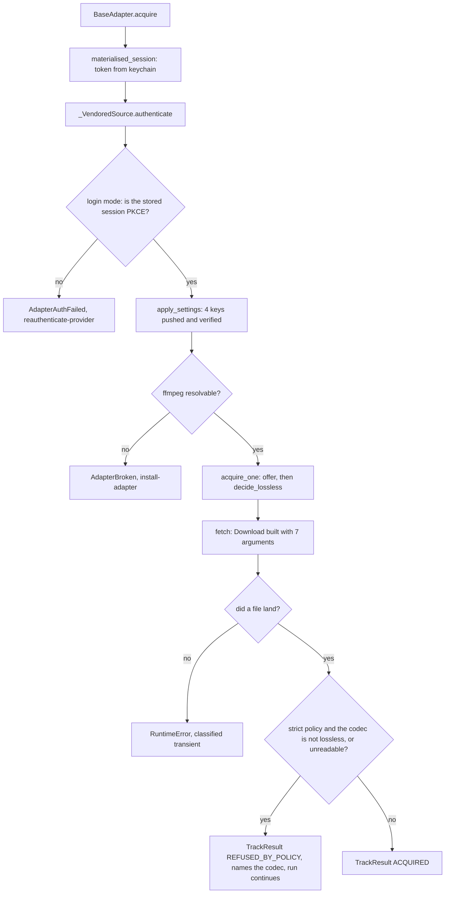

# A lossless landing, PKCE login, and the ffmpeg the downloader is never told - Plan

This plan is board unit U47, issue #65. Its plan-local unit IDs `U1` through `U6` are sequencing inside that one board unit; they are not board units and get no issues.

## Goal Capsule

- **Objective:** a person who asks Cratekit for a lossless track gets a lossless file, or gets told why not. Today they get a 320k AAC file and a clean report, and have since July.
- **Means:** fix the one defect chain in `src/cratekit/acquire/vendored.py`, move the login to PKCE, and check the landed file's codec instead of only the requested setting (KTD1, KTD4).
- **Authority hierarchy:** `DJ_tools/docs/migration/00-SEAM-DECISIONS.md` Part 5, then `docs/METHOD.md`, then `CLAUDE.md`, then this plan. The board issue #65 brief is this plan's origin and this plan supersedes it where the two disagree, in the three places noted under Assumptions.
- **Execution profile:** offline. Nothing in this unit may need a live provider, an account, or the network to run the battery.
- **Stop conditions:** stop and report rather than proceed if a vendored patch anchor is not unique, if the codec probe cannot classify a container the suite produces, or if the re-authorisation sequence R15 names turns out not to work.
- **Tail ownership:** the runner owns the gate, the merge, and the push. This plan ends at a green battery on `relay/65`.

---

## Product Contract

### Summary

Make the shipped adapter land a genuinely lossless file, and refuse a lossy one instead of accepting it silently. Three ledger residuals, R-195, R-196 and R-197, are one path and are fixed together, with a post-landing codec check that makes the whole chain falsifiable.

### Problem Frame

Attended smoke test A1 on 2026-08-28 tried to get one FLAC out of the product and found three defects in sequence, each hidden by the one before it.

`_VendoredSource.fetch()` builds the vendored `Download` with three arguments where the vendored CLI passes eight. Without the events, `Download.item()` dies on `self.event_abort.is_set()`. With the events and no progress objects it returns `(False, path)` and logs nothing. The adapter has never fetched a file, and `fetch` carries `# pragma: no cover` for exactly that reason, which is why every green battery missed it.

With the download driven by hand, the track landed as a 320k AAC `.m4a` while `crate doctor` reported `[ok] binary.ffmpeg`. Doctor and the tool answer different questions. Doctor asks whether ffmpeg exists on this machine. The tool asks whether it was told the path, reading only its own `path_binary_ffmpeg` setting, whose factory default is the empty string, and when that is empty `Download.__init__` turns `extract_flac` off and logs one warning through a logger the adapter discards.

With the ffmpeg path set, the same track still came down as AAC. The account is PREMIUM with `highestSoundQuality: HI_RES`. A PKCE login on the same account, same track, same minute was served LOSSLESS as a 16 bit 44.1 kHz FLAC. The cause is the client: the provider gates lossless behind the PKCE client, and the device linking client both tools use was demoted to lossy at some point after 2026-07-09.

Underneath all three is the reason nothing said so. The lossless rule is enforced at the SETTING and never at the FILE, so the product's central promise can fail with a green suite, a green doctor and a zero exit code.

### Key Decisions

- KD1. **PKCE is the product's only login path.** (session-settled: user-directed, chosen over keeping the device flow behind a flag: the provider gates lossless behind the PKCE client, so a flag that preserves the device flow preserves the defect it exists to fix.) Governs R7, R8, R9, R15.
- KD2. **The landing is checked, not just the request.** A post-landing codec check is what stops the next silent demotion, and it is the cheap half of a problem whose expensive half is a login change. Governs R10, R11, R12.

### Requirements

**Reaching the downloader**

- R1. `_VendoredSource.fetch()` constructs the vendored downloader with `event_abort`, `event_run`, `progress` and `progress_overall` in addition to the three it passes today.
- R2. `event_run` is passed already SET and `event_abort` is passed CLEAR. An unset `event_run` makes `_download_segment` call `Event.wait()` with nothing to wake it, so the download blocks forever rather than failing.
- R3. The two progress objects are real `rich.progress.Progress` instances with rendering disabled, so the tool's progress writing reaches no stream a caller may be parsing (R32).

**Telling the tool where ffmpeg is**

- R4. The adapter pushes `path_binary_ffmpeg`, and its value is the path `cratekit.core.binaries` resolves, so doctor and the tool answer from one lookup.
- R5. `verify_applied` covers the ffmpeg key, by that key being pushed rather than by a second list being edited.
- R6. When ffmpeg cannot be resolved, the invocation refuses, names ffmpeg, and carries a remedy token from `cratekit.acquire.adapter.Remedy`, rather than landing a lossy file and reporting success.

**Login**

- R7. The vendored interactive login mints a PKCE session. The device flow call is replaced, not made conditional.
- R8. A persisted session records whether it is a PKCE session, and reloads as one.
- R9. A stored session that is not a PKCE session is refused at authentication with a re-authorisation remedy, rather than being used to download lossy audio.
- R15. The re-authorisation R9 demands is written down and reachable before R9 ships. Every session in the keychain today was minted by the device flow, so on the day this merges R9 refuses all of them, and a refusal whose remedy has no procedure behind it strands the user with no supported next action.

**The landing guard**

- R10. Under `LosslessPolicy.STRICT`, a landed file whose codec is not lossless is refused, and the refusal names the codec that actually arrived.
- R11. Under `LosslessPolicy.STRICT`, a landed file the codec probe cannot read is refused. Not being able to confirm lossless is not the same as confirming it.
- R12. The check runs where the landing is accepted, so a future second caller of that acceptance is covered by existing rather than by remembering.

**The record**

- R13. Every edit to `src/cratekit/_vendor/` is declared in `scripts/revendor_downloader.py` with an anchor that occurs exactly once, recorded as a row in `vendor/README.md`, and pinned by a test in `tests/test_vendor_import.py`.
- R14. What this unit cannot prove without a live account is recorded as a residual naming the attended check that would close it.

### Success Criteria

- The three closing conditions the ledger already wrote are met by their own terms, not by narrative: R-195 wants four pushed keys and a test pinning the set; R-196 wants PKCE or a session file recording `is_pkce`, plus the post-landing check; R-197 wants both events, a disabled `Progress` pair, and a test pinning the constructor call.
- The full battery passes with no network available.
- A mutation table over the settings mapping and the codec check shows non-zero deaths on the user-facing guards, or pairs a zero row with a composite showing what it does hold.

### Scope Boundaries

- The live attended smoke test. It needs Phillip's real credentials and a real download, and it is not this unit's to run.
- Binding `acquire.download`'s job handler. R-204's closing condition names a unit that binds the handler AND takes these three residuals with it. This unit takes the three and does not bind the handler, so R-204 stays open. Say so in the ledger rather than letting the discharge of three entries read as satisfying it.
- The DJ_tools note the ledger says is owed to that repository. DJ_tools is read only for code.
- U29, U30, U20, R-9, A1, A2, and `.worktrees/conformance`.
- Correcting the lossless CLASSIFICATION under `LosslessPolicy.ALLOW_LOSSY_MARKED`. See KTD8; this becomes a residual.

#### Deferred to Follow-Up Work

- R-210, the attended smoke test with its device flow control (R14).
- R-211, the surviving R21 violation under ALLOW_LOSSY_MARKED (KTD8).
- R-212, the plaintext token between the vendored mint and the keychain ingest.

---

## Planning Contract

### Key Technical Decisions

- KTD1. **A lossy or unreadable landing is a PER TRACK `REFUSED_BY_POLICY` result, not an invocation failure.** The detail names the codec that arrived and the remedy is `RELAX_LOSSLESS_POLICY`, which is literally what would change the answer. Rejected, and the reason is a defect rather than a preference: raising `AdapterBroken` from inside `landed_file` puts the first mid-loop adapter failure in the product, and `acquire_with_source` would then build `InvocationResult(outcome=ADAPTER_BROKEN, results=tuple(results))` carrying whatever landed earlier in the same run. `InvocationResult.__post_init__` raises `ValueError` when a failed invocation carries any `UNAVAILABLE_PERMANENT` result, and `BaseAdapter.acquire` catches only `AdapterAuthFailed` and `AdapterBroken`, so one delisted track earlier in the batch turns the refusal into an uncaught `ValueError` with no outcome, no remedy and no requeue list. The per track shape also matches what the adapter already does with the identical condition detected at the OFFER, which `decide_lossless` answers with `REFUSED_BY_POLICY` while the run continues, so one unreadable file does not end a fifty track sync. The cost is accepted and stated: `REFUSED_BY_POLICY` is requeueable, so a demoted client re-downloads and re-refuses each run. That is already true of an offer refusal, and N refusals naming the same codec is the pattern a person needs to see.
  - The other two failures in this unit stay invocation level, because both mean nothing can be downloaded at all: absent ffmpeg is `AdapterBroken` with `INSTALL_ADAPTER` ("the chosen adapter's third-party tool is not installed"), and a non PKCE stored session is `AdapterAuthFailed` with `REAUTHENTICATE_PROVIDER`. Both are raised in `authenticate()`, before any per track result exists, which is where every existing `AdapterBroken` in both shipped adapters is raised.
- KTD2. **`tool_settings()` takes the ffmpeg path resolver as a keyword parameter defaulting to `cratekit.core.binaries.resolve`.** The function's own docstring calls it pure and calls it the single source of what is pushed and what is verified. Both stay true if the impurity is a parameter: tests drive it with a stub, one test drives it with the real resolver over a fake executable, and the mapping stays the one place a key is added. Rejected: resolving in `apply_settings` and passing a value in, which splits the mapping's two jobs; and calling `binaries.resolve` inline, which makes every existing settings test depend on the machine's PATH.
- KTD3. **`_VendoredSource` gains a `downloader` seam.** A new keyword-only constructor parameter holding the downloader CLASS, defaulting to a module-level function that performs the deferred vendored import. This is what lets a fake `Download` record the constructor's keyword set at run time, and it is what lets `fetch` lose most of its `# pragma: no cover`. Rejected: an AST-only guard over `acquire/vendored.py`. `tests/test_pool_sizing.py` and `tests/test_write_session.py` establish that pattern and this plan keeps one, but AST alone cannot see that `event_run` was passed SET, which is R2 and is the sharpest hazard here.
- KTD4. **Three minimal vendor patches. No login flow is written into the vendored tree.** `docs/vendoring.md` names three earned patch categories and a login feature is none of them, so the patches are kept to the smallest edits that make PKCE reachable: a `is_pkce` field on the `Token` dataclass, one line added to `token_persist`, and swapping which of two already-present lines in the vendored `login()` is live. The PKCE handshake itself is not added anywhere; the vendored `login()` calls `self.session.login_pkce(fn_print)`, which the provider's client library 0.8.11 already provides. Governs R7, R8, per KD1.
- KTD5. **The login mode decision is a pure function in `acquire/vendored.py`.** `authenticate()` returns early on an injected session, and there is no seam for the vendored login wrapper, so the decision cannot be reached by any existing test double. Extracting "given what was read from the stored session, do we proceed and with PKCE on" into a pure function puts R9 on a testable surface without inventing a second seam. This is the checking path; `authenticate()` calls it.
- KTD6. **The progress pair is `rich.progress.Progress(disable=True)`.** `rich` is already a core dependency, declared for exactly this. `disable=True` keeps `add_task` and `update` working while rendering nothing, which is what the vendored code calls and what R3 requires. Rejected: a hand-rolled stub, which would be a second model of an interface the vendored tree can change under us.
- KTD7. **A refused lossy file stays in staging and the refusal names its path.** Deleting a file the product just downloaded is a destructive act taken on the strength of a probe, and the file is the evidence somebody diagnosing the next demotion will want. Staging cleanup is not this unit's.
- KTD8. **Under `ALLOW_LOSSY_MARKED` the guard does not refuse, and the surviving R21 violation becomes a residual.** `acquire_one` builds an ACQUIRED result whose `lossless` comes from the OFFER, so a lossless offer that lands lossy is recorded as lossless with `requires_lossy_marker` False. Name that for what it is: an unmarked lossy file in the library, which `acquire/adapter.py` calls unconstructable by type and `docs/adapters.md` repeats. The type forbids the combination it can see; it cannot see a file whose codec nobody read. It is not the headline failure because `core/config.py` defaults the policy to `strict`, and that is what bounds the exposure. Fixing it means `TrackSource.fetch` returning what it landed rather than a path, which changes the contract in `acquire/adapter.py` and both adapters. Out of scope, recorded rather than done, and recorded as a live violation rather than as a classification nicety.
- KTD9. **The codec probe is a pure classifier plus a thin reader.** A table from container and codec to lossless, driven exhaustively without files, and a reader that opens the file with mutagen using the deferred-import convention `src/cratekit/core/tags.py` sets. A `.m4a` can be AAC or ALAC, so the reader must consult mutagen's codec string and a suffix test alone gives the wrong answer for the exact container this defect produced.
  - The classifier's shape is decided by a measured fact: mutagen exposes `info.codec` only on MP4. A real FLAC, WAV or AIFF reports `None`. So a `None` codec means CONTAINER DECIDED, not unreadable, and the classifier answers from the container in that case. Reading `None` as unreadable would make R11's refusal fire on every genuine FLAC, which is the opposite of this unit's purpose. Unreadable means mutagen returned no file object at all.

### High-Level Technical Design

The acquisition path. The call sites already exist; G1, G2 and G4 are the new checks inserted into them.

Two mechanisms are load-bearing and are not visible from the call sites.

The vendored `Settings` class is a `SingletonMeta`. `Download.__init__` calls `Settings()` with no arguments and gets back the same object `apply_settings` wrote to during `authenticate()`. That is the whole reason pushing `path_binary_ffmpeg` reaches the downloader at all. It is also a test hazard: the singleton survives between tests in one process, so a settings test that passes because a previous test warmed the singleton is proving nothing.

`event_run` is not a flag the downloader reads once. `_download_segment` runs `if not self.event_run.is_set(): self.event_run.wait()` inside the worker pool. The vendored `HandlingApp.__init__` calls `self.event_run.set()`, and nothing else ever does. A fresh `Event()` passed unset makes every segment worker block with nothing that will ever wake it, so the failure is a hang rather than an error, and a test asserting only that four keyword names are present would pass over it.

### Assumptions

Unvalidated bets. Each is the plan's call, not the brief's.

- The brief says main's highest residual is R-202. It is R-209, verified against `docs/residual-findings.md` on `main`. New residuals here are R-210 and R-211.
- The brief calls for a test that asserts the constructor's keyword SET so "a future edit that drops `event_abort` fails the suite". `Download.__init__` declares all four with `= None` defaults, so construction with any subset succeeds and the crash is in `item()`. The test therefore asserts what `fetch` PASSES, and asserts the event states, rather than asserting that the constructor rejects anything.
- The brief scopes the guard to "the policy is lossless". Read as `LosslessPolicy.STRICT`. `ALLOW_LOSSY_MARKED` is handled by KTD8.
- `Remedy.INSTALL_ADAPTER` is the right token for absent ffmpeg. ffmpeg is a third party binary the adapter's tool needs, which is what that token's comment says it means.
- The interactive PKCE mint is the vendored CLI's job, not the adapter's. The adapter's `authenticate()` loads a stored session and never opens a browser, so R7 is satisfied by the vendored `login()` patch and R9 by the adapter refusing a non PKCE token.
- `synth_container` in `tests/_containers.py` produces AAC for `.m4a` and FLAC for `.flac` under ffmpeg's defaults. Verify this in the unit rather than assuming it; if `.m4a` comes out as something else, assert on what ffmpeg actually produced.

### Sequencing

U1 first, because it is the only one whose seam the later tests use. U2 and U3 are independent of each other. U4 depends on U1's seam for its end to end test. U5 and U6 are last and depend on everything.

One ordering constraint cuts across that. U3 ships R9, the refusal that rejects every session in the keychain today, and U6 owns R15, the procedure that tells the user what to do about it. Those two land in the same commit or R9 does not land at all. A refusal whose remedy has no procedure behind it is worse than the lossy download it replaces, because a lossy file can at least be re-acquired later.

---

## Implementation Units

### U1. The seam, the four arguments, and the event states

- **Goal:** `fetch` builds the downloader the way the vendored CLI does, and a test can see it do so without a network. Closes R-197.
- **Requirements:** R1, R2, R3.
- **Files:** `src/cratekit/acquire/vendored.py`, `tests/test_adapter_contract.py`.
- **Approach:** add a keyword-only `downloader` parameter to `_VendoredSource.__init__`, defaulting to `None`, and a module-level `_vendored_downloader()` that performs the deferred import and returns the class (KTD3). `fetch` resolves the class through that seam, builds `threading.Event` objects with `event_run` set and `event_abort` clear (R2), builds two `rich.progress.Progress` instances with `disable=True` (KTD6), and passes seven keywords. `Download.__init__` declares nine parameters; `skip_existing` and `progress_gui` are deliberately left at their defaults, `skip_existing` at False because this product always downloads and the vendored code assigns it directly rather than reading it from settings. `VendoredAdapter._source` passes nothing new, so the default path is unchanged. Narrow the `# pragma: no cover` to the deferred-import helper alone; `fetch` itself becomes reachable and the pragma comes off it.
  - Note the two path authorities and leave both: `fetch` passes `path_base=str(destination)` and `tool_settings` pushes `download_base_path`. Both resolve to `settings.download_staging` and the vendored code reads `self.path_base` for the landed path. Do not remove either without driving it.
- **Test scenarios:**
  - A fake downloader class records the keyword names it was constructed with. Two assertions, because one cannot do both jobs: every keyword `fetch` passes must appear in `inspect.signature(Download.__init__).parameters`, which catches an upstream rename mechanically, AND the seven names are present. The set cannot be derived from the signature alone, since the constructor declares nine and two are deliberately omitted, so a pure derivation could not tell a rename from an omission.
  - The same fake asserts `event_run.is_set()` is True and `event_abort.is_set()` is False at construction. This is the row that catches the hang.
  - The two progress objects are disabled. Assert on the attribute the `rich` version `pyproject.toml` pins (`rich>=14.2,<15`) exposes, checked against `rich` rather than assumed.
  - `fetch` returns the path the fake reports, and raises when the fake reports `(False, path)`.
  - An AST guard over `src/cratekit/acquire/vendored.py` asserts the seven keyword names appear in the downloader construction, in the shape `tests/test_write_session.py` uses for a required-keyword assertion. This survives the seam being bypassed.
- **Verification:** `.venv/bin/python -m pytest tests/test_adapter_contract.py`.

### U2. The ffmpeg path the tool is told

- **Goal:** the adapter tells the vendored tool where ffmpeg is, and refuses by name when it cannot. Closes R-195.
- **Requirements:** R4, R5, R6.
- **Files:** `src/cratekit/acquire/vendored.py`, `tests/test_adapter_contract.py`.
- **Approach:** add a keyword-only `resolve` parameter to `tool_settings` defaulting to `binaries.resolve`, add the fourth key, and translate `binaries.BinaryNotFound` into `AdapterBroken` naming ffmpeg with `Remedy.INSTALL_ADAPTER` (KTD2, KTD1). Thread the same parameter through `apply_settings`. Rewrite `tool_settings`'s docstring in the same edit: it currently claims purity, and the resolver parameter is what keeps that claim honest. Add the per-key drift cost sentence for the new key, matching the three already there: a reverted ffmpeg path silently turns FLAC extraction off and lands lossy.
- **Test scenarios:**
  - `tool_settings` returns exactly four keys. Assert the SET, not three names, so a fifth key added later is a decision rather than an accident.
  - The ffmpeg value equals what the resolver returned, driven through a stub resolver, and separately driven through the real `binaries.resolve` against a fake executable installed via `monkeypatch.setenv(binaries.env_var("ffmpeg"), ...)`, following `tests/test_binaries.py`'s `_make_executable` helper. `tests/conftest.py` does not scrub `PATH` or `CRATEKIT_BIN_*`, so an unstubbed call is machine dependent and must not be written.
  - `verify_applied` reports the ffmpeg key when the tool does not take it, reached through `apply_settings` with a `_ToolSettings` target that drops the attribute.
  - On a machine where ffmpeg cannot be resolved, `VendoredAdapter.acquire` returns `InvocationOutcome.ADAPTER_BROKEN`, the detail names `ffmpeg`, and the remedy is `Remedy.INSTALL_ADAPTER`. Simulate absence with `monkeypatch.setenv("PATH", "/nonexistent")`, `monkeypatch.delenv` on the override, and `monkeypatch.setattr(binaries, "fallback_dirs", lambda: ())`.
  - Existing settings tests that now need a resolver stub are the moment this guard still owes its own failure branch. Write the refusal test in the same sitting as any fixture edit.
- **Verification:** `.venv/bin/python -m pytest tests/test_adapter_contract.py tests/test_binaries.py`.

### U3. PKCE end to end

- **Goal:** the product has one login path, and a PKCE session survives a round trip through persistence. Closes R-196's login half.
- **Requirements:** R7, R8, R9, R13. Implements KD1, which governs R7, R8, R9.
- **Files:** the vendored downloader's `model/cfg.py` and `config.py` under `src/cratekit/_vendor/`, `scripts/revendor_downloader.py`, `vendor/README.md`, `src/cratekit/acquire/vendored.py`, `tests/test_vendor_import.py`, `tests/test_adapter_contract.py`.
- **Approach:** three vendor patches (KTD4), each declared in `scripts/revendor_downloader.py` and registered in the tuple in `main`, each anchored on a full `def` or field line because bare names are ambiguous: `login_token` occurs four times in `config.py`, `token_persist` twice, and `is_pkce` five times.
  1. `model/cfg.py`: append `is_pkce: bool = False` to the `Token` dataclass. Anchor on the line `expiry_time: float = 0.0`, which occurs once.
  2. `config.py` `token_persist`: add the `is_pkce` write alongside the four existing `set_option` calls. Anchor as a span from `def token_persist(self) -> None:` to `def switch_to_atmos_session(self) -> bool:`, both of which occur once.
  3. `config.py`, the vendored `login`: replace the `login_oauth_simple` call with `login_pkce`. Anchor as a span from `def login(self, fn_print: Callable) -> bool:` to `def logout(self):`, verifying both counts before writing.
  Two things about patch 2 that will otherwise cost a debugging round. The write must NOT go through `set_option`: that method reads the existing attribute and, when it is a bool, calls `value.lower()` on the incoming value, and `is_pkce` is the `Token` dataclass's first bool field, so `set_option("is_pkce", True)` raises `AttributeError`. Write `self.data.is_pkce = bool(self.session.is_pkce)` before `self.save()` instead. And the source matters: `self.session.is_pkce` is the right symbol, not `self.is_pkce`, because the vendored `login()` calls `login_token()` first with `do_pkce` defaulting to False, which sets `self.is_pkce` False before the PKCE handshake ever runs. Persisting the wrong one records every fresh PKCE session as a device flow session and R9 then refuses it forever.
  Then in the adapter, add a pure `login_mode` function taking what was read from the stored session and returning either "proceed with PKCE" or a refusal reason (KTD5). `authenticate()` calls it after the session's `read(...)` and before `login_token`, raises `AdapterAuthFailed` with `Remedy.REAUTHENTICATE_PROVIDER` on a non PKCE session, and calls `login_token(do_pkce=True)` otherwise.
  - Hard constraint: `tests/test_adapter_contract.py::test_no_module_in_this_unit_persists_the_wrapped_tools_settings` AST-walks every module under `src/cratekit/acquire/` and fails on any call whose attribute is `save`, `token_persist` or `set_option`. Patching the vendored `token_persist` is fine. Calling it from `acquire/` turns that guard red on the source.
- **Test scenarios:**
  - A `Token` written by the vendored `token_persist` and read back by `BaseConfig.read` carries `is_pkce` as True. Drive the round trip through the persistence function against a fake session object and a `tmp_path` file, because the defect is a field dropped in the WRITE and a read cannot see what was never stored.
  - A token file with no `is_pkce` key reloads with `is_pkce` False, so a legacy device flow token is identifiable rather than silently treated as PKCE.
  - `login_mode` returns the refusal for a non PKCE stored session and the proceed answer for a PKCE one, driven directly as a pure function.
  - `VendoredAdapter.acquire` against a stored non PKCE session returns `InvocationOutcome.AUTH_FAILED` with `Remedy.REAUTHENTICATE_PROVIDER`, and its `alternatives` are non empty so the AE9 invariant holds.
  - A vendored-tree test asserts the vendored `login` calls `login_pkce` and does not call `login_oauth_simple`, by walking the AST for `ast.Call` attribute names inside that function. Do NOT assert on raw source text: the patch's own `why` comment names the device flow, so a substring check would fail on the fix rather than on the defect, which is the trap `test_version_detection_does_not_read_a_nearby_pyproject` already documents.
  - A vendored-tree test asserts the `Token` dataclass declares `is_pkce`.
  - Any credential-shaped fixture uses the `FAKE-` prefixed short-value convention `FAKE_SESSION` already uses, so `scripts/scan_repo.py` reads it as an illustration. Do not name a fixture file `session.json`; that filename trips the scan on its path alone.
- **Verification:** `.venv/bin/python -m pytest tests/test_vendor_import.py tests/test_adapter_contract.py`, then `.venv/bin/python scripts/scan_repo.py`.

### U4. The post-landing codec guard

- **Goal:** a landed file whose codec is not lossless is refused under a strict policy, naming the codec it actually got. This is what makes the whole chain falsifiable. Closes R-196's landing half.
- **Requirements:** R10, R11, R12. Implements KD2.
- **Files:** `src/cratekit/acquire/vendored.py`, `tests/test_adapter_contract.py`.
- **Approach:** a pure classifier from container plus codec string to lossless, and a thin reader that opens the file with mutagen using the deferred-import convention (KTD9). `landed_file` gains the policy and a probe parameter and refuses per KTD1 and KTD7. Put it in `landed_file` and not in `fetch`: `landed_file` is the acceptance point, it is already the one decision `fetch` delegates out, and its docstring already explains why that separation exists. Nothing in `src/cratekit` inspects an audio file's codec today, so this is new code with nothing to reuse; `cratekit.core.tags` owns "opens an audio file with mutagen" and its `_open` is the convention to follow.
- **Test scenarios:**
  - The classifier over the full table: FLAC, ALAC, WAV and AIFF lossless; AAC, MP3, Vorbis and Opus not. Assert the mapping is exhaustive over its own declared inputs rather than sampling it.
  - A real FLAC built by `synth_container(tmp_path, ".flac")` is accepted under strict policy.
  - A real AAC `.m4a` built by `synth_container(tmp_path, ".m4a")` is refused under strict policy. The refusal message contains the codec string mutagen reported, asserted against what the probe read rather than against a hardcoded `"aac"`.
  - A real FLAC reports a `None` codec from mutagen and is still accepted, because `None` means container decided. This is the row that would go red if the classifier read `None` as unreadable, which would refuse every genuine FLAC.
  - A zero byte file and a file with an unknown suffix are both refused under strict policy, and each refusal says it could not read the codec rather than saying the codec was lossy. Two different sentences, because they are two different facts.
  - Under `ALLOW_LOSSY_MARKED` a lossy landing is accepted and not refused.
  - The refusal names WHICH gate caught it. There are now four routes to "no file was accepted" in this adapter, so an assertion that merely observes the absence is satisfied by all of them. Assert the positive trace: the outcome, the remedy token, and the codec in the detail.
  - The refused file still exists at its staging path after the refusal, per KTD7.
  - An end to end scenario through `VendoredAdapter.acquire` with U1's downloader seam returning a lossy file: `InvocationOutcome.OK` at the invocation level, one `TrackOutcome.REFUSED_BY_POLICY` result carrying the codec, and `quarantine_keys()` empty so nothing is poisoned by a demoted client. Inject through `BaseAdapter`'s existing `source=` parameter with a `_VendoredSource` built on the fake downloader; U2's ffmpeg scenario needs the same technique to avoid constructing the real vendored `Settings`.
  - A TWO TRACK request where the first track is reported not found and the second lands lossy returns a contract-shaped result rather than raising. This is the row that pins KTD1's reason for being per track: an invocation-level failure carrying a prior `UNAVAILABLE_PERMANENT` result cannot be constructed at all.
- **Verification:** `.venv/bin/python -m pytest tests/test_adapter_contract.py`. `synth_container` requires ffmpeg and fails rather than skips without it, which is the project's rule and is correct here.

### U5. The mutation table

- **Goal:** measure whether the new guards would be noticed if they were removed.
- **Requirements:** none directly; this is the Verification Contract's evidence.
- **Files:** a rows file, and `docs/mutation/u47-author.md` plus its `.json` written by the driver.
- **Approach:** use `scripts/mutate.py` with a TOML rows file. Do not hand roll a driver; three of this project's recorded incidents were hand rolled driver mistakes. Set `pass_kind = "full"`, cap 45 rows, and record any dropped row with its reason so a truncation is visible rather than read as coverage.
  - Rows to cover, at minimum: each of the four new keywords in the downloader construction removed one at a time; `event_run.set()` removed; `disable=True` removed; the `path_binary_ffmpeg` entry removed from the settings mapping; the `BinaryNotFound` translation removed; the codec refusal removed; the unreadable-file refusal removed; the `None` codec branch changed to read as unreadable; the `is_pkce` field removed from the `Token` dataclass; the `is_pkce` write removed from `token_persist`; the `login_mode` refusal branch removed.
  - Coefficient and near-value rows, not only deletions: change `event_run` to be passed clear rather than set, and change the codec table so ALAC reads as lossy.
- **Verification:** `.venv/bin/python scripts/mutate.py <rows>.toml --name u47-author`. A zero death row on a user-facing guard needs a paired composite showing what it does hold; a zero row on a maintainer-facing guard gets one line. Expect the codec guard's first row to read zero for the same reason U44's did, and treat that as the signal to write its failure branch rather than as a result.

### U6. The record

- **Goal:** the repository says what was done to the vendored tree, what is now known, and what is still unproven.
- **Requirements:** R13, R14, R15.
- **Files:** `vendor/README.md`, `docs/vendoring.md`, `docs/residual-findings.md`, `docs/adapters.md`.
- **Approach:**
  - `docs/adapters.md`: write down the re-authorisation procedure R15 demands, verified rather than assumed. The product's design already assigns the browser conversation to the vendored downloader: `src/cratekit/cli/verbs/login.py` says in its own docstring that it does not perform an authorization flow, and that exactly one verb in the product may read standard input. So the sequence is three steps, not a new verb. Mint a PKCE token by invoking the vendored CLI's `login` command in process, which after patch 3 runs `login_pkce` and writes the tool's `token.json`. Move it into the keychain with `crate login provider-session --from-file <that path>`. Erase the plaintext original, because R4's promise is that no token survives on disk between invocations and this hop is the one place that promise is briefly false. Drive all three before writing them down; a procedure nobody ran is the dead end R15 exists to prevent. Make R9's refusal detail point at this section.
  - `docs/vendoring.md`: its "Patching vendored code" section names three earned patch categories and a login change is none of them, so after this unit the policy understates its own patch set. Widen a category or add a fourth, with the reason. Leaving it is how the one document a re-vendor reads becomes the one it cannot trust.
  - `vendor/README.md`: append rows 8, 9 and 10 to the `### Patches` table, matching its four columns and its row style, with the `Failure it prevents` column naming the demotion each prevents. Update the Inventory table's "Smoke-tested end to end" row, which currently cites R-195 to R-197 as open.
  - `docs/residual-findings.md`: append a dated closing paragraph to R-195, R-196 and R-197 naming U47, in the style the file already uses for a discharged entry. Append a correction to R-204 stating that its three named residuals are closed while its handler-binding half is not, so the discharge is not read as satisfying it. Append R-210, the attended smoke test this unit cannot run. It must name TWO observations, not one: that a real PKCE session downloads a real FLAC through the shipped adapter with no tempo tag, AND that a FRESHLY MINTED device flow session on the same account and track is still served lossy. Without the second, R-210 closes on a result equally consistent with the diagnosis being wrong, because the A1 session compared aged persisted device flow tokens against a fresh PKCE one and so varied token vintage alongside the client. It is one extra step in the same attended sitting and it cannot be recovered once the device flow is gone. Append R-211, the surviving R21 violation under ALLOW_LOSSY_MARKED from KTD8, stating that it is an unmarked lossy file rather than a classification nicety and that `strict` being the config default is what bounds it. Append R-212, the plaintext token that exists between the vendored mint and the keychain ingest, which the R15 procedure tells the user to erase and which nothing enforces.
  - `docs/adapters.md`: also qualify the "unconstructable" claim about an unmarked lossy result. The type forbids the COMBINATION it can see; it cannot see a file whose codec nobody read, so until this unit the invariant governed a correctly classified result and never guarded against misclassification. One sentence, no restructuring.
  - Verify the merge invariants METHOD names: `grep "^## R-" docs/residual-findings.md | sort | uniq -d` must be empty, and `git diff origin/main -- docs/residual-findings.md | grep '^-## R-'` must be empty.
- **Test scenarios:** the licence guards in `tests/test_vendor_import.py` and U3's per-patch assertions are the existing coverage. Add one guard this unit owes: the `### Patches` row count in `vendor/README.md` equals the number of patches registered in `scripts/revendor_downloader.py`. No such guard exists today, so a row added to one and not the other stays green, and this unit adds three rows.
- **Verification:** the full battery.

---

## Verification Contract

| Gate | Command | When |
|---|---|---|
| Lint | `.venv/bin/ruff check src tests scripts` | before every commit |
| Suite | `.venv/bin/python -m pytest` | before every commit |
| Repository scan | `.venv/bin/python scripts/scan_repo.py` | before every commit |
| Collected count | `.venv/bin/python -m pytest --collect-only -o addopts=` | after U1, U3 and U4 |
| Mutation table | `.venv/bin/python scripts/mutate.py <rows>.toml --name u47-author` | U5 |

Driver rules that apply and were each paid for once: never pass `-q`, because `pyproject.toml` already sets it and yours becomes `-qq`. Reconcile the collected count by identifier, not by total, because a total only check shows a healthy rise and hides a collapse. Set `PYTHONDONTWRITEBYTECODE=1` for mutation rows. Run every row in the foreground.

The suite must pass with no network. Nothing added here may reach a provider.

---

## Definition of Done

**Global**

- All three battery commands pass on `relay/65`.
- The collected test count is reconciled by identifier against `main`, with every difference accounted for.
- No em dash, en dash or double hyphen in any prose, comment, commit message or plan text added by this work.
- No credential, no personal path, no beat grid write in any container.
- The mutation table is written into `docs/mutation/`, with full row descriptions and not only counts.
- Every dead end from an approach that did not work is removed from the diff.
- The explanation ships: what changed, why the three defects were one path, and how the guard makes the chain falsifiable.

**Per unit**

| Unit | Done when |
|---|---|
| U1 | Seven keywords passed, `event_run` set, progress disabled, and the keyword set derived from the real signature |
| U2 | Four keys pushed and verified, and a machine with no ffmpeg refuses by name with a remedy token |
| U3 | Three patches declared in the revendor script, recorded in `vendor/README.md`, and each pinned by a test; a PKCE token round trips; a non PKCE token is refused |
| U4 | A lossy landing and an unreadable landing are both refused per track under strict policy, a real FLAC is still accepted, and a two track run with an earlier permanent failure returns a contract-shaped result |
| U5 | Table written, every zero row on a user-facing guard paired with a composite, every dropped row logged with its reason |
| U6 | The R15 re-authorisation procedure driven end to end and written down before R9 ships; `docs/vendoring.md` policy widened; R-195, R-196 and R-197 closed by their own stated conditions; R-204 corrected; R-210, R-211 and R-212 appended; both ledger merge invariants verified empty |

---

## Sources and Research

- `docs/residual-findings.md`, entries R-195, R-196, R-197 and R-204. R-204 is the sequencing constraint that Scope Boundaries answers.
- `docs/solutions/integration-issues/the-provider-serves-lossy-audio-to-the-device-flow-client-and-neither-the-vendored-tool-nor-the-adapter-can-log-in-any-other-way.md`. The A1 session. It records the driven PKCE sequence in the provider's client library 0.8.11 and establishes that ffmpeg absence explains a lossless stream failing to extract but never explains a lossy stream, which is why R-195 is real and is not R-196's cause.
- `docs/solutions/workflow-issues/a-checker-that-reimplements-what-it-checks-drifts-and-stays-green.md`. Why U1's keyword set is derived from `inspect.signature` and not from a literal tuple.
- `docs/solutions/workflow-issues/asserting-an-absence-pins-the-observation-and-not-the-mechanism.md`. Why U4 asserts which gate caught the refusal. It also holds the canonical list of documents to read about zero death rows, which is U5's reading list.
- `docs/solutions/workflow-issues/keeping-a-fixture-green-under-a-new-guard-is-not-evidence-the-guard-is-tested.md`. U44's `_wrote_or_refuse` is the same shape as U4's guard and measured zero deaths on its first table.
- `docs/solutions/workflow-issues/adding-the-first-caller-makes-you-the-owner-of-its-unreviewed-defects.md`. The doctrine behind R-204 and behind landing each fix on the checking path.
- `docs/vendoring.md` and `vendor/README.md`. The patch discipline KTD4 works inside.
- The vendored `config.py:288-293`, where `HandlingApp.__init__` sets `event_run`, and the vendored `download.py:455-461`, where an unset one blocks. Together these are R2.
- The vendored `config.py:88-92`, the `Settings` singleton that makes the pushed ffmpeg path reach `Download.__init__`.
- `tests/test_pool_sizing.py` and `tests/test_write_session.py` for the AST keyword-assertion pattern, `tests/test_binaries.py` for the fake-executable helper, `tests/_containers.py` for the one audio synthesizer.
