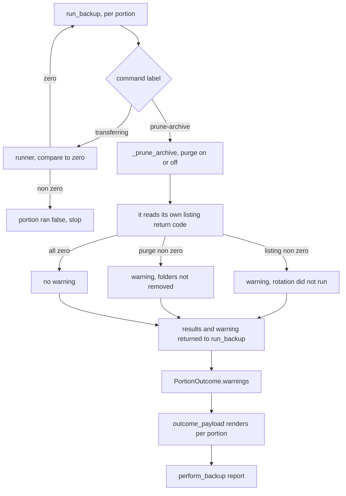

# The prune that fails into silence, and the remedy the session discards - Plan

Board issue #66, unit U48, phase E. Closes residuals R-200 and R-201.

## Goal Capsule

- **Objective:** A person refused a destructive session over an unreadable fact file is told the act that would actually fix it, and the backup's own report says whether the archive rotation ran, so the unit that binds `backup.run` to a worker has a stalled rotation to show rather than having to rediscover it.
- **Means:** The backup engine records the prune's outcome per portion and renders it in its own payload (KTD1); `core.session._shown_ages` carries the remedy its exception already holds (KTD6).
- **Authority:** `DJ_tools/docs/migration/00-SEAM-DECISIONS.md` outranks this plan. `docs/METHOD.md` outranks it on method, and its "Do not touch" list binds. Board issue #66 is the brief this plan enriches; where they disagree, the issue wins on scope and this plan wins on mechanism.
- **Execution profile:** One branch, `relay/66`. Four units, each landing green on the full battery.
- **Stop conditions:** Stop and report rather than proceed if closing R-200 would require changing which portions run, which commands are issued, or whether a failed prune fails its portion. None of those is in scope, and a diff that touches them has left the unit.
- **Tail ownership:** No pull request. The runner owns the merge and the push.

---

## Product Contract

### Summary

Two reporting defects found during U45 and deliberately deferred, because each belonged to a layer that unit was not writing. The engine reads the archive prune's return code and records the outcome as a per-portion warning that `outcome_payload` renders, so a failed rotation reaches the report instead of vanishing. The destructive session's refusal carries the remedy token the exception already distinguishes at the raise site, instead of hard coding the repair answer over a permission problem. Neither changes what gets backed up, which portions run, or whether a portion fails.

### Problem Frame

`run_backup` compares every return code that DECIDES a portion against zero and stops the portion on the first non zero, which is what `ran` then reports. The archive prune is the one class it does not fail on, and `_prune_archive`'s docstring argues that correctly: by the time the prune runs, the mirror in the same portion has completed, so the backup exists, and a stale folder using remote space is a smaller problem than reporting a completed backup as failed and sending the person to repeat the whole transfer.

That argument covers whether to FAIL. It does not cover whether to REPORT. The prune branch does `results += _prune_archive(...)` and then `continue`, so the listing's return code is never compared to anything, and `_prune_archive` returns early on a failed listing having pruned nothing. The results ride on `PortionOutcome.results`, `outcome_payload` does not render them, and `src/cratekit/backup/cli.py` has nothing to say even if it read them. A person whose remote refuses `lsf` gets a successful backup and a fresh published age, both of which are true, and no signal that the rotation has stopped. Dated archive folders then accumulate for as long as the condition lasts.

The second defect is one line. `cratekit.core.backup_facts.Remedy` declares three members and its docstring says why the third exists: a file this account may not open and a file whose contents are damaged are two conditions with opposite fixes. `read_facts` distinguishes them at the raise site, raising `GRANT_PATH_ACCESS` for a permission error and `REPAIR_BACKUP_FACTS` for a damaged one. `src/cratekit/cli/doctor.py` and `cratekit.backup.cli.published_ages` both carry it through with `Remedy(str(exc.remedy))`. `src/cratekit/core/session.py`'s `_shown_ages` writes `Remedy.REPAIR_BACKUP_FACTS` unconditionally, so a person whose configuration directory this account cannot traverse is told to repair or reset a file that is very likely intact, in the refusal standing immediately before the riskiest operation in the product.

### Requirements

**Reporting the prune**

- R1. When the archive prune's listing fails, the portion's entry in `outcome_payload` carries a warning whose code says the archive rotation did not run.
- R2. When the listing succeeds and one or more purges fail, the same portion carries a warning under a SECOND code saying folders could not be removed, and its message names how many.
- R3. A portion whose prune completed carries no warning, and a portion with no prune command carries no warning.
- R4. A rehearsal that lists and does not purge reports a failed listing the same way a real run does.

**Carrying the remedy**

- R5. A destructive session refused because the fact file could not be READ for a permission reason carries `GRANT_PATH_ACCESS`.
- R6. A destructive session refused because the fact file is DAMAGED still carries `REPAIR_BACKUP_FACTS`.
- R10. A destructive session refused because the fact file was written by a NEWER build carries `UPGRADE_CRATEKIT`. `read_facts` raises all three tokens and the carry moves all three, so the third is a requirement rather than a side effect nobody named.

**Not changing what already works**

- R7. A failed prune still does not fail its portion. `ran` stays true, `BackupOutcome.ok` stays true, and the backup's age is still published. This holds because the prune is the last command in its portion; a portion that failed earlier builds an outcome with no warnings on it, so a later plan that puts a command after the prune would drop the warning silently.
- R8. `published_ages` in the backup shell keeps reading the fact file through `backup_facts.ages`, the same function `core.session._shown_ages` calls. It is not derived from the outcome.
- R9. The prune's decision rules are unchanged: it runs only after the mirror in its portion succeeded, it deletes on a good listing only, and `archive_keep` still decides how many folders survive.

### Key Decisions

- **The engine reports, the shell renders what the engine gives it.** Failing the portion from the shell would overrule the engine's decision from the wrong layer, which is METHOD pattern 3 inverted. Governs R1, R2, R7.
- **R-202 stays open.** `BackupOutcome.ok` can only ever be true in a report the shell emits. Both remedies, dropping the key or reversing `refusal_for`, are product decisions Phillip has not made. The work here does not make either obviously correct: a prune failure never reaches `refusal_for`'s failed set, because the portion still ran, so the new warning is variable where `ok` is not. Governs R7.

### Scope Boundaries

**In scope:** the files each unit names, their tests, the residual ledger, the mutation table, and the two prose sites that the remedy carry makes false. The issue names three source files; `src/cratekit/cli/exit_codes.py` is this plan's addition and its reason is in U3.

**Deferred to follow-up work:** nothing. Any residual this unit finds is appended to `docs/residual-findings.md` starting at R-216, since main's highest is R-215. Board issue #66 says main's highest is R-202; that line is stale and the file is authoritative.

**Outside this unit:** R-202. U29, U30, U20, R-9, A1, A2, and `.worktrees/conformance`. Changing which portions run or which commands are issued. Bumping `PAYLOAD_VERSION` (KTD4). Adding a refusal cause or an exit code.

### Sources

- `docs/residual-findings.md`, entries R-200 and R-201, which are this brief's source.
- `docs/solutions/workflow-issues/adding-the-first-caller-makes-you-the-owner-of-its-unreviewed-defects.md`. Its rule that the reporting half fails independently of the checking half is exactly this unit, and its sweep rule is what puts the dry run branch in scope. Its claim that `run_backup` has no caller in `src` is stale as of U45; the shell is the caller now.
- `docs/solutions/workflow-issues/a-mutation-zero-can-mean-the-value-is-constant-at-this-entry-point-not-that-it-is-untested.md`. The R-202 precedent, and the instruction to check whether `refusal_for` forecloses a state before writing a guard for it.
- `docs/solutions/workflow-issues/asserting-an-absence-pins-the-observation-and-not-the-mechanism.md`. Why the prune guards assert where the prune stopped rather than that a key is missing.
- `docs/solutions/workflow-issues/keeping-a-fixture-green-under-a-new-guard-is-not-evidence-the-guard-is-tested.md`. Editing the shared `Recorder` in `tests/modules/test_tools.py` is the signal that a new assertion is owed in the same sitting.
- `docs/mutation/u45-round-1.md` and `docs/mutation/u45-round-2.md`. The guards this unit sits beside were measured there.

---

## Planning Contract

### Key Technical Decisions

- KTD1. **`_prune_archive` classifies its own outcome, `run_backup` records it per portion, and `outcome_payload` renders it.** This is R-200's second stated closing condition, the recorded warning, and the first one is not taken, because two reports of one condition drift apart. The classification sits in `_prune_archive` because that function ALREADY reads the listing's return code, in the branch that decides whether to purge, and it is the only place that knows which result is the listing. Having `run_backup` re-derive it would be a second read of one return code, and it could only identify the listing by its position in a returned list, which is METHOD defect pattern 2, identity that is not unique to the thing it identifies. `outcome_payload` stays a renderer for the same reason inverted: a function whose whole contract is serialization must not be where a return code is interpreted, or a caller that reports the outcome any other way loses the interpretation. Governs R1, R2, R3.

- KTD2. **The warning is a `code` and `message` pair, and there are two codes.** One warning vocabulary across the repository: `src/cratekit/cli/output.py` declares `warnings: tuple[Mapping[str, str], ...]`, `src/cratekit/cli/handlers.py` produces `{"code": "config-drift", "message": ...}`, and `src/cratekit/cli/render.py` renders exactly those two fields. The alternative shape in the tree, `warnings: tuple[str, ...]` on `src/cratekit/write/trees.py`'s report dataclasses, carries no code and has no renderer, so a consumer can only regex a sentence. Two codes rather than one because R1 and R2 are two conditions with different fixes, and a single code leaves the discriminator in prose, which is the drift the label constants beside `PRUNE_ARCHIVE` exist to prevent. **This is not a bet on the envelope.** `Envelope.warnings` is a flat top-level field and these warnings are per portion, so lifting them later would flatten away which portion stopped rotating; the shape is chosen for one vocabulary, not for a free lift. Cost, accepted: two new kebab literals in `src`, which move the literal pin in `tests/test_reserved_causes.py` and must be re-pinned by name.

- KTD3. **The dry run prune folds into `_prune_archive` behind a flag, so there is one prune path and one reading of it.** Today `run_backup` has a separate dry run branch that runs the listing, appends the result, and continues without reading it. That is the same defect three lines over, which is the sweep the first-caller learning asks for. `_prune_archive` gains a keyword parameter that suppresses the purge loop, **defaulting to today's behaviour, purge on**, so a caller that does not pass it is unchanged and a flag that switches off the destructive half cannot be reached by accident. The dry run branch passes it, and the same warning rule then covers both. Behaviour is unchanged: a rehearsal still lists and still purges nothing, and it issues the listing with the plan's own argv untouched, which is what `tests/modules/test_tools.py::test_the_dry_run_argv_is_derived_from_the_real_command` checks by zipping the plan's commands against the recorder's log. Governs R4.

- KTD4. **`PAYLOAD_VERSION` is not bumped.** The rule is written once in the tree, at `src/cratekit/modules/tools/setbuilder.py`: bumped when a field is REMOVED or its meaning changes. This adds a field. No payload version in this repository has ever been bumped, and U45 added two top-level keys to this same report without one.

- KTD5. **`published_ages` is not touched.** It reads the fact file through `backup_facts.ages`, the same function `core.session._shown_ages` calls, and deriving it from the outcome would be a second copy of the engine's publish rule living in a different file from the rule it copies. The drift runs in the expensive direction: a report saying a portion is backed up over a file that says never recorded. Governs R8.

- KTD6. **The remedy carry is `Remedy(str(exc.remedy))`, copied verbatim from its two siblings.** `src/cratekit/cli/doctor.py` and `cratekit.backup.cli.published_ages` already spell it that way, and `core.exit_codes.Remedy` already declares all three tokens, so nothing is added to either enum or to the reservation table. The carry moves every token `read_facts` raises, not only the permission one, which is why R10 exists. Governs R5, R6, R10.

### High-Level Technical Design

Where the prune's return code is read today, and where it will be read.

Today `E` returns only results and `run_backup` appends them and continues. The `G` classification and everything below it is new, and nothing on the `C` path changes.

### Assumptions

- **No invocation of `crate backup run` reaches `run_backup` in this build, so the warning has no human audience yet.** The verb is `long_running` and only enqueues: `backup.run` sits in `HANDLERS_NOT_YET_BOUND` with the reason "no worker yet", and `perform_backup`'s own docstring says nothing passes it today. The report this unit fixes is therefore read by tests and by the unit that eventually binds the handler. That does not weaken the case for fixing it, since that unit would otherwise have to rediscover the hole, but it does mean no test here may claim to prove a person sees anything.
- One warning per portion per condition is enough. A portion whose listing failed cannot also have failed a purge, because a failed listing purges nothing, so the two conditions in R1 and R2 are mutually exclusive. Several purges failing in one prune is still ONE R2 warning whose message carries the count, not one warning per folder, because the person's next act is the same either way.
- `PortionOutcome` is a frozen slots dataclass, so adding a tuple of mappings makes an instance unhashable at call time rather than at definition time. Nothing in `src` or `tests` hashes one today, so this is a constraint to keep rather than a change to make.
- `docs/residual-findings.md` records R-200 and R-201 as closed in the entry's own text, following the `**Closed by U47, 2026-09-01**` shape already in the file, rather than deleting them. Residual numbers are append only.

---

## Implementation Units

### U1. The engine records what the prune did

- **Goal:** `_prune_archive` classifies its own outcome, `run_backup` records it per portion, and `outcome_payload` renders it. The dry run prune goes through the same path.
- **Requirements:** R1, R2, R3, R4, R7, R9. KTD1, KTD2, KTD3, KTD4.
- **Dependencies:** none.
- **Files:**
  - `src/cratekit/modules/tools/backup.py`, modify: the prune branch and the dry run prune branch in `run_backup`, `_prune_archive`, `PortionOutcome`, `outcome_payload`, `__all__`, and two new code constants beside the existing `PRUNE_ARCHIVE` pair.
  - `tests/modules/test_tools.py`, modify: new guards beside the existing prune tests.
  - `tests/test_reserved_causes.py`, modify: re-pin the kebab literal assertion.
- **Approach:**
  1. Add the warning field to `PortionOutcome`, defaulting to empty, in the `code` and `message` shape (KTD2). Name both codes as constants beside `PRUNE_ARCHIVE` and `PRUNE_ARCHIVE_FOLDER`, for the reason those two are constants: two spellings of one token make the producer and the reader disagree about which condition they are looking at. Neither code is a refusal cause, so neither joins `backup.REFUSALS` or the reservation table.
  2. Give `_prune_archive` a keyword parameter that suppresses the purge loop, defaulting to purge on, and have the dry run branch call it with the purge off instead of running the listing itself (KTD3). Behaviour must not move: a rehearsal lists and purges nothing, exactly as today, with the plan's own argv.
  3. Have `_prune_archive` return its results together with at most one warning it classified itself, since it is the function that already reads the listing's return code and the only one that knows which result is the listing. `run_backup` records what it is handed rather than re-deriving it from a position in a list.
  4. Render the warnings per portion in `outcome_payload`. Do not bump `PAYLOAD_VERSION` (KTD4).
  5. Correct `_prune_archive`'s docstring. It claims in the present tense that a failed listing and a failed purge are each "reported", and neither was. Say what is now true rather than leaving a sentence the unit made true by accident.
  6. Add any new public name to `backup.__all__`. It is hand ordered, not sorted.
  7. Re-pin `tests/test_reserved_causes.py`'s kebab literal assertion. Difference the literal set against `origin/main`'s own `src` tree extracted to a scratch directory and name what joined, rather than moving the total by two, because a literal joining while another leaves reads identically in a count. Neither new code is a cause, so both halves of the pin move by the same amount.
- **Patterns to follow:** `src/cratekit/cli/handlers.py`'s `drift_warnings` for the warning's shape; the existing label constants block in `src/cratekit/modules/tools/backup.py` for naming; the re-pin comments already in `tests/test_reserved_causes.py` for how a re-pin is recorded.
- **Test scenarios:**
  - A run whose prune listing fails, driven with the existing `Recorder` and its `fail_labels` set to the prune label: the portion's `ran` stays true, `BackupOutcome.ok` stays true, the portion carries exactly one warning under the rotation code, and no purge command was issued. Assert the sibling registers in the same test, because zeroing one register says nothing about the others. `Recorder` sets no `stderr`, so build the message from the return code rather than from `stderr` or extend the fixture, and if the fixture is extended, that edit is the signal a new assertion is owed in the same sitting.
  - A run whose listing succeeds and whose purge fails: the portion carries exactly one warning under the SECOND code, its message names how many folders could not be removed, `ran` stays true, and the listing itself is recorded as having succeeded.
  - A run whose prune completes: the portion carries no warnings, and the newest folder survives while the older one is purged. Assert this beside the failure case rather than alone, so the guard is not satisfied by "the prune never ran".
  - A portion with no prune command in its plan, the database portion: no warnings, and no prune command in its results.
  - A rehearsal whose listing fails: the same warning appears, and no purge command was issued in the rehearsal either.
  - A rehearsal whose listing succeeds: no warning, and still no purge command. This is the guard that the dry run fold changed nothing.
  - The existing prune tests named in Verification stay green without being edited to accommodate the new field.
- **Verification:** `tests/modules/test_tools.py::test_a_dry_run_never_purges`, `::test_the_prune_keeps_the_newest_and_removes_the_rest`, `::test_the_retention_the_plan_declared_is_the_retention_the_run_applies`, `::test_a_negative_retention_never_prunes_at_all`, `::test_the_prune_runs_only_after_the_mirror_succeeded` and `::test_the_dry_run_argv_is_derived_from_the_real_command` pass unmodified. The full battery is green. `tests/test_reserved_causes.py` passes with the re-pin naming both literals that joined.

### U2. The shell stops dropping it

- **Goal:** The report `perform_backup` returns carries the prune warning, and the comment explaining why `PortionOutcome.results` is dropped stops describing a hole that is closed.
- **Requirements:** R1, R7, R8. KTD1, KTD5.
- **Dependencies:** U1.
- **Files:**
  - `src/cratekit/backup/cli.py`, modify: the comment at the `run_backup` call site in `perform_backup`, and the module docstring's account of what the shell reads.
  - `tests/test_backup_cli.py`, modify: a new rclone stand-in fixture and the end-to-end drives.
- **Approach:**
  1. Rewrite the dropped-results comment. It currently ends by recording R-200 as a residual rather than fixed, and states that a failed prune reaches no report at all. Both halves are now false. Keep the part that is still true and still load bearing, that failing the portion here would overrule the engine from the wrong layer, and say what the engine now reports instead.
  2. Do not add a second aggregation of the warnings at the shell. The payload already carries them per portion, and a top-level copy is the second report KTD1 exists to prevent.
  3. Leave `published_ages` alone (KTD5).
  4. `src/cratekit/backup/cli.py` already carries bare `R-198` citations, so any residual reference added here stays in that bare form. A title-form citation in this file turns `tests/test_reserved_causes.py` red.
- **Patterns to follow:** the module docstring's existing "WHY THE OUTCOME IS READ RATHER THAN THE PLAN REPORTED" section, which is where the shell records what it reads and why. `tests/test_backup_cli.py::test_a_run_that_succeeded_publishes_an_age_the_session_reads_back` is the template for every drive below: it calls `backup_cli.perform_backup({}, now=MOMENT)` against the `rclone` stand-in fixture and reads the fact file back through `backup_facts.ages`.
- **Execution note:** the drives here call `perform_backup` directly, NOT `cli.run(["backup", "run"])`. The verb only enqueues, since `backup.run` is in `HANDLERS_NOT_YET_BOUND`, so a dispatcher drive returns a job envelope carrying none of the keys these scenarios assert. Every existing end-to-end backup drive in this file already works that way.
- **Test scenarios:**
  - A variant of the `rclone` stand-in whose script exits non zero on `lsf` and zero on everything else, driven through `perform_backup`: the call returns without raising, `report["ok"]` is true, and the files portion's row carries the rotation warning. This is the drive R-200 records as not having been performed.
  - The same drive asserts the published age is FRESH, read back through `backup_facts.ages`, and the test says out loud that a stopped rotation is not a failed backup, so a later reader does not mistake the warning for one.
  - The same drive asserts the mirror actually ran, from the stand-in's invocation log, so the fixture cannot pass by refusing everything.
  - A drive with the ordinary `rclone` fixture, where `lsf` succeeds: no warnings on any portion, `report["ok"]` true, age fresh. The pair is what separates "the warning fires on the condition" from "the warning fires always" and from "the key is never populated".
  - A rehearsal against the failing stand-in: the warning appears in the preview and `report["dry_run"]` is true, while `report["ages"]` still shows never-recorded, because a rehearsal publishes nothing.
  - The U45 round two guards in this file are not weakened. Name them in the test docstring rather than editing them.
- **Verification:** `.venv/bin/python -m pytest tests/test_backup_cli.py` is green with the new drives, and no existing test in that file was edited to accommodate the new key. The full battery is green.

### U3. The session carries the remedy

- **Goal:** A refusal raised because the fact file could not be read names the act that fixes the condition that actually occurred.
- **Requirements:** R5, R6, R10. KTD6.
- **Dependencies:** none. Independent of U1 and U2.
- **Files:**
  - `src/cratekit/core/session.py`, modify: the `remedy=` argument in `_shown_ages`.
  - `tests/test_write_session.py`, modify: the permission and newer-build twins beside the existing damaged-file guard.
  - `tests/test_reserved_causes.py`, modify: the `_converted_exception_types` docstring, which cites this line as a live example of a discarded remedy.
  - `src/cratekit/cli/exit_codes.py`, modify: the `grant-path-access` reservation note, whose premise sentence says the flattening "is itself a finding, filed as a residual rather than repaired here".
  - `docs/residual-findings.md`, modify: R-56 item 2, which is the same finding as R-201 recorded earlier under a different number.
- **Approach:**
  1. Change the one line to carry `exc.remedy` through, spelled the way its two siblings spell it (KTD6).
  2. Update `_shown_ages`'s docstring, which already argues that "could not read" must never collapse into any other answer because the remedies differ. The function was violating its own paragraph; say so plainly rather than leaving the paragraph looking like it was always honoured.
  3. **The citation-rule trap is in `tests/test_reserved_causes.py` itself, not in the two source files.** Coverage is derived from the presence of a title-form citation, and neither `src/cratekit/core/session.py` nor `src/cratekit/cli/exit_codes.py` carries one, so both are uncovered and edits there are unconstrained. The covered file is the test module, and its `_converted_exception_types` docstring holds the repository's ONLY written citation of the declared title "Five accepted findings from the U38 reviews", in the very sentence the fix makes false. Rewriting that sentence without keeping the title in citation form fails the assertion that the declared set and the written set match in both directions. So either keep the title in citation form while correcting the claim around it, or drop the title from the declared tuple in the same edit. Do not introduce a bare `R-<number>` into that file.
  4. The reserved exit code for `grant-path-access` does not move. Only the note's reasoning about why it was measured that way changes.
  5. Record the closure of R-56 item 2 alongside R-201, in the shape the file already uses, and say there that R-201 is the later duplicate of the same finding. Recording only R-201 would leave the ledger asserting a defect the repository no longer has, in the entry the test module cites by title.
- **Patterns to follow:** `src/cratekit/cli/doctor.py`'s `Remedy(str(exc.remedy))` and `cratekit.backup.cli.published_ages`'s identical line. `tests/test_backup_cli.py`'s existing unreadable-fact-file test is the template for the new session test, adapted to drive the real `read_facts` rather than a monkeypatched `ages`.
- **Test scenarios:**
  - A fact file whose read raises a permission error, driven THROUGH `read_facts` rather than through a hand built exception: the session's refusal carries `GRANT_PATH_ACCESS`. A hand built exception can be constructed with a field the code path never produces, which is exactly the defect under test, so the drive must produce the `PermissionError` at the file boundary and let `cause.permission_denied` classify it. Assert the precondition rather than assuming it, the way the `no_rclone` fixture asserts its own: a run as a user the mode bits do not restrain would read the file successfully and the test would pass over a refusal that never happened.
  - A damaged fact file, the existing guard's condition: the refusal still carries `REPAIR_BACKUP_FACTS`. Both directions, because a fix that hard codes the other token is the same defect mirrored.
  - A fact file whose `schema_version` is newer than this build's: the refusal carries `UPGRADE_CRATEKIT`. This is the third token the carry moves and the one R-56 item 2 names first, so leaving it undriven would leave the requirement asserted rather than measured.
  - The refusal's reason string and detail keys are unchanged in all three cases, so the fix is provably the remedy field alone.
  - An ABSENT fact file still mints normally and does not refuse, which is the state of every library before its first backup.
- **Verification:** `tests/test_write_session.py` is green including the existing damaged-file guard unedited. `tests/test_reserved_causes.py` and `tests/test_cli_contract.py` are green, the first of them with its declared and written citation sets still agreeing in both directions. The full battery is green.

### U4. The mutation table and the ledger

- **Goal:** The guards this unit added are measured, and the two residuals it closed say so in the register that owns them.
- **Requirements:** R1 through R9, as the measurement of them.
- **Dependencies:** U1, U2, U3.
- **Files:**
  - `docs/mutation/u48-author.toml`, `docs/mutation/u48-author.md`, `docs/mutation/u48-author.json`, create: the rows and the driver's output.
  - `docs/residual-findings.md`, modify: R-200 and R-201. R-56 item 2 is U3's, since it is the same finding as R-201 and its closure must land with the code that closes it.
- **Approach:**
  1. Author the rows as data and run `scripts/mutate.py`. Do not hand roll a driver. Scope the table to this unit's own diff plus a fixed sample of the prune guards measured in the U45 tables, and stay under the light pass cap of 25 rows. Log anything dropped and why it ranked below the cap.
  2. Rows that measure something: invert the listing's return code test in `_prune_archive`; drop the warning classification it returns; drop the warnings key from `outcome_payload`; collapse the two warning codes into one; revert the purge suppression so a rehearsal purges; revert the remedy carry to the hard coded token. Rows that measure nothing and must not be written: reordering keys in `outcome_payload`, or removing an argument equal to its own default.
  3. Confirm deaths on the subset of test files importing the mutated module. Promote any zero row to the full suite before reporting it as a zero.
  4. Record the closures in `docs/residual-findings.md` in the shape the file already uses, stating what was done and on whose terms. Say in R-200's entry that the recorded-warning condition was taken, that the payload-derives-it condition was not, and that the classification moved into `_prune_archive` because that is where the return code was already read. Do not write the closure as though both conditions were taken.
  5. Read `docs/mutation/u45-round-1.md` and its round two companion first, by summary row rather than in full, and check that no guard measured there is killed by this unit's diff.
- **Test scenarios:** `Test expectation: none -- this unit produces measurement and records, and adds no behaviour.`
- **Verification:** `docs/mutation/u48-author.md` exists with full row descriptions and not only counts. Every row's count is measured rather than argued. `grep "^## R-" docs/residual-findings.md | sort | uniq -d` is empty and `git diff origin/main -- docs/residual-findings.md | grep '^-## R-'` is empty, so no existing residual number moved.

---

## Verification Contract

| Gate | Command | Applies to |
|---|---|---|
| Lint | `.venv/bin/ruff check src tests scripts` | every unit |
| Suite | `.venv/bin/python -m pytest` | every unit |
| Repo scan | `.venv/bin/python scripts/scan_repo.py` | every unit |
| Focused suite | `.venv/bin/python -m pytest tests/modules/test_tools.py tests/test_backup_cli.py tests/test_write_session.py tests/test_reserved_causes.py tests/test_cli_contract.py` | U1, U2, U3 |
| Mutation table | `.venv/bin/python scripts/mutate.py docs/mutation/u48-author.toml --name u48-author` | U4 |

Driver rules that bite here, from `docs/METHOD.md`: never pass `-q`, because `pyproject.toml` already sets it; check the COLLECTED count on every mutation row, because a file that fails to collect takes its tests with it and the run still looks green; run rows synchronously in the foreground; set `PYTHONDONTWRITEBYTECODE=1`.

An author's own battery is not a review. After the suite is green, hunt what a green suite cannot see: a duplicate key in a mapping several branches appended to, and one symbol meaning two things in two modules. The second is live here, since this unit adds a warning code that must not collide with a refusal cause or a payload kind.

---

## Definition of Done

**Global**

- The battery is green on `relay/66`.
- The diff touches only the files the units name.
- No beat grid is written anywhere, in any container.
- No live rekordbox database is read, copied, or launched by any test.
- No em dash, en dash or double hyphen appears in any prose, comment, or commit message added by this unit.
- `.venv/bin/python scripts/board.py audit` exits 0.
- No abandoned experimental code remains in the diff.

**Per unit**

- U1: a failed prune produces a warning on its portion under the right one of the two codes and does not fail the portion; the dry run prune goes through the same function; the literal pin is re-pinned by name.
- U2: a `perform_backup` drive with a failing `lsf` returns without raising, reports the warning, and shows a fresh age; `published_ages` is unchanged.
- U3: a permission error driven through `read_facts` produces `GRANT_PATH_ACCESS`; a damaged file still produces `REPAIR_BACKUP_FACTS`; a newer build produces `UPGRADE_CRATEKIT`; both stale prose sites are corrected and R-56 item 2 records its closure.
- U4: the mutation table is in the repository with full row descriptions; R-200 and R-201 record their closure and R-202 is left open.
