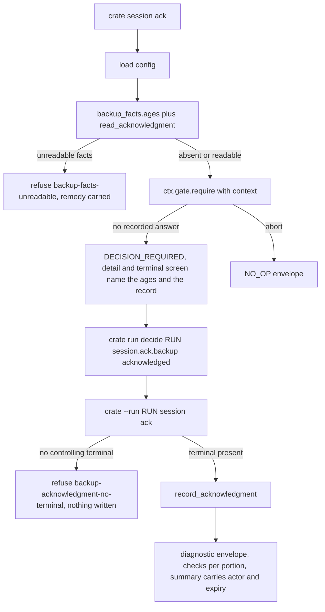

# The session verbs U8 declared and never landed - Plan

Board issue #67, unit U49, phase E. Opens residuals R-216 through R-219.

## Goal Capsule

- **Objective:** A person can protect their library and then actually spend that protection. Today every destructive verb in the product refuses, because the acknowledgment those verbs consult can only be minted by a Python call no command reaches, and a lock left by a dead installation can only be cleared by editing a file by hand.
- **Means:** Land `cratekit.session.cli`, the module the registry has named since U8, with the two verbs and the two gates already declared there (KTD3), and give a gate refusal a way to name what the person was shown before they answer it (KTD2).
- **Authority:** `DJ_tools/docs/migration/00-SEAM-DECISIONS.md` outranks this plan and Part 5 applies to every unit. `docs/METHOD.md` outranks it on method, and its "Do not touch" section binds. `src/cratekit/cli/registry.py` outranks board issue #67 on what the two verbs ARE, for the reason KTD1 gives. Where the issue and this plan disagree on anything else, the issue wins on scope and this plan wins on mechanism.
- **Execution profile:** One branch, `relay/67`. Three units, each landing green on the full battery.
- **Stop conditions:** Stop and report rather than proceed if landing either verb would require a new way past `assert_backup_acknowledged`, a parameter that names the actor, a parameter that asserts the answer, or any fourth source in `cli/gates.py`'s precedence list. Each of those is R34 being dismantled by the thing it gates, and a diff that touches one has left the unit.
- **Tail ownership:** No pull request. The runner owns the merge and the push.

---

## Product Contract

### Summary

`cratekit.session.cli` lands with `session.ack` and `session.release`, exactly as `src/cratekit/cli/registry.py` has declared them since U8. `session.ack` reads the published backup ages, names them in the refusal that asks the acknowledgment question, and on the answering invocation records the acknowledgment through `cratekit.core.session.record_acknowledgment`. `session.release` reads the recorded lock holder, names it in the same kind of refusal, and on the answering invocation clears a holder that is gone through `cratekit.core.session.release_stale_lock`. Both `planned_in="U8"` markers come off in the commit that creates the file. A gate refusal gains an optional way to carry what the verb showed, and the human decision screen renders it, so the question a person answers arrives with the facts it was asked over.

### Problem Frame

`src/cratekit/cli/registry.py:623` and `:642` declare `session.ack` and `session.release` against `module="cratekit.session.cli"`, with `planned_in="U8"`. Issue 8 is closed. The package holds `__init__.py` and `restore_cli.py` and nothing else.

`cratekit.core.session.record_acknowledgment` at `core/session.py:1076` has no caller anywhere in `src` or `scripts`. `assert_gates` calls `assert_backup_acknowledged`, which refuses unless a valid recorded acknowledgment exists, and five call sites pass through it: `write/trees.py:875`, `deletion/run.py:744`, `adopt/apply_cli.py:211`, `core/restore.py:412`, `modules/tools/backup.py:237`. So no shipped command can write a rekordbox row, trash a file, or restore. The suite is green because it mints acknowledgments through the core API directly.

`docs/solutions/workflow-issues/a-guard-safe-only-because-its-subject-is-unimplemented-expires-when-it-lands.md` names this shape: a guard that is safe only because its subject is unimplemented, measured in a world where its premise cannot fail. `cratekit.core.session.release_stale_lock` at `core/session.py:824` is in the same state and has no caller in `src` either, so nothing a person can type clears a dead installation's claim on the library.

This is the U45 shape. U35 landed the backup engine and never the shell, the pending register owed nothing, and the remedy was a new unit rather than a reopened one. Issue 8 stays closed.

### Requirements

**The acknowledgment verb**

- R1. `crate session ack` records a backup acknowledgment through `cratekit.core.session.record_acknowledgment`, and a destructive session on the same library then passes `assert_gates`.
- R2. The refusal that asks the acknowledgment question names the backup ages the verb consulted, per portion, and the acknowledgment currently on record, before anything is recorded. On record means one of three states: absent, live with its expiry, or expired with the moment it lapsed.
- R3. The ages come from `cratekit.core.backup_facts.ages` and from nowhere else, so the verb, `core.session._shown_ages` and `backup.cli.published_ages` all answer from one file.
- R4. An unreadable fact file refuses and carries the remedy the exception raised, for all three tokens `read_facts` distinguishes, so a permission problem is never answered with a repair instruction.
- R5. An absent fact file is not an unreadable one. It mints normally, because it is the state of every library before its first backup.
- R6. `session.ack` gains no parameter that names the actor and no parameter that asserts the answer. R34's rules stay where they are.
- R17. The answering invocation needs a controlling terminal. Without one it refuses `backup-acknowledgment-no-terminal`, writes nothing, and leaves the recorded gate answer intact for a later retry from a terminal.
- R18. `session.ack` re-mints on every answering invocation, replacing any record that is still live and restarting the validity window. Governed by KTD12.

**The lock verb**

- R7. `crate session release` clears a library lock whose recorded holder is gone, through `cratekit.core.session.release_stale_lock`.
- R8. The refusal that asks the release question names the holder it found, so the person is deciding over a described claim rather than over a prompt string.
- R9. A lock whose recorded holder is still running refuses by name and clears nothing.
- R10. A lock with no recorded holder is a no-op with a report saying so, not a refusal and not a traceback. Governed by KTD5.
- R19. A lock whose recorded holder is gone but whose file cannot be taken refuses `session-lock-held` with `Remedy.WAIT_FOR_HOLDER` and clears nothing. That is `release_stale_lock`'s fourth outcome and the least obvious one.

**What a person sees**

- R20. The refusal a person reads at a terminal shows the carried facts, not only the JSON envelope. `cli.render.render_gate` renders the `shown` mapping when it is present and is unchanged when it is absent.
- R21. Both verbs emit a `diagnostic/1` payload in the shape that schema declares, `checks` as an array and `summary` as an object, with no undeclared keys. Governed by KTD9.

**The registry and the countdown**

- R11. Both entries lose `planned_in` in the same commit that creates `src/cratekit/session/cli.py`, because both name that one module string and the file appearing expires both markers or neither.
- R12. `tests/test_cli_contract.py::_sample_arguments` gains an entry for each verb, and both verbs appear in `crate --help`.
- R13. The conformance properties that arm against these two entries all pass, and the count of them is measured by differencing collected identifiers rather than asserted from the phrase "nine". Governed by KTD8.
- R14. `tests/test_cutover_parity.py` still derives clean and its headline assertion is unchanged in meaning.
- R22. The conformance suite controls the controlling-terminal probe, because dropping `session.ack`'s marker is what first makes that probe reachable from a derived population. Governed by KTD10.

**The record**

- R15. `docs/residual-findings.md` gains R-216 through R-219, appended, nothing above them moved. R-216 is the landing gap and what KTD1 leaves unbuilt, R-217 is the replayable recorded answer, R-218 is the two reads of the ages, R-219 is the release prompt that asserts a holder. Each is stated in full in U3.
- R16. `docs/mutation/u49-author.md` carries a table over the acknowledgment recording path, the remedy carry, the gate context that names the ages, and the release path's live-holder refusal, with full row descriptions and not only counts.

### Key Decisions

- The registry, not the issue, defines what `session.release` is. Governs R7, R8, R9, R10, R19. See KTD1.
- Releasing a lock nothing holds reports a no-op rather than refusing. Governs R10. See KTD5.
- Nothing declared in the registry is reworded or retyped by this unit, including a gate prompt this plan judges wrong. Governs R21 and the R-219 entry. See KTD3 and KTD11.
- The vocals half of the `planned_in` debt is not touched. Governs R15.

### Scope Boundaries

**In scope:** `src/cratekit/session/cli.py`, `src/cratekit/session/__init__.py`, the two registry entries, an optional context argument on `cli/gates.py`'s gate resolver and its `DecisionRequired`, the `shown` rendering in `cli/render.py`, `tests/test_session_cli.py`, `tests/test_cli_contract.py`'s argument table plus the gate-context scenarios U1 adds, its terminal-probe fixture, and the one stale docstring at `:857`, `docs/residual-findings.md`, `docs/mutation/u49-author.md`.

**Deferred for later:** the two `planned_in="U25"` entries at `registry.py:1192` and `:1213`, `analyze.vocals` and `metadata.mytags-vocals`. They name a different module string, so nothing this unit creates expires them, and they belong to the analysis worker batch.

**Outside this unit:** U29, U30, U20, R-9, and the attended chores A1 and A2 from `docs/METHOD.md:316`, which are a different numbering from this plan's own assumptions A1 through A5. Also `.worktrees/conformance`. Reopening issue 8. Any change to `record_acknowledgment`'s signature, to `assert_backup_acknowledged`, or to the five call sites that pass through it. Any change to `Gates.require`'s precedence order, the digest staleness check, or run-record retention.

### Open Questions

All three are deferred, not blocking. Each is recorded in the ledger by U3 so the decision survives the branch.

- Should a recorded gate answer be consumed when it mints an acknowledgment? A person or agent holding one run id can re-drive `crate --run RUN session ack` indefinitely, and each drive mints a fresh validity window with no new deliberate act. `DEFAULT_ACK_VALIDITY`'s own docstring calls an unbounded acknowledgment "a permanent affirmative wearing a timestamp, and R34 exists to forbid exactly that". The fix is one line in the handler, clearing `ctx.run.decisions["session.ack.backup"]` after a successful mint, and it is deferred because it changes what a recorded answer means for every explicit gate, which is a shared-seam decision this unit did not open. R-217.
- Should `session.release.confirm`'s prompt stop asserting a holder? It reads "Release the lock held by another installation?" and is asked even when the verb has already established no lock is held. KTD3 forbids retyping what the registry declares, so the wording stands and the observation is recorded. R-219.
- Should any verb withdraw an acknowledgment inside its validity window? KTD1 removes the only candidate, and after this unit hand editing the state file is still the only route. R-216.

### Sources

- `src/cratekit/cli/registry.py:604` to `:643`, the two entries in full: module, builders `build_ack` and `build_release`, handler keys, `emits={"diagnostic"}`, `output_schema="diagnostic/1"`, `feature_rows=(12,)`, one explicit gate each, no `writes`, no `destructive`, no `doctor_checks`, no `long_running`, no `argv_builder`.
- `src/cratekit/session/restore_cli.py`, the sibling that landed in the same package. Its module docstring is the model for this one, `build_list` at `:152` is the model for an argument-free builder, and `perform_restore` at `:652` is the model for a handler that asks an explicit gate and then acts.
- `src/cratekit/core/session.py:1020` `_shown_ages`, `:1076` `record_acknowledgment`, `:1097` the no-terminal refusal, `:1159` `assert_backup_acknowledged`, `:824` `release_stale_lock` with its two refusal paths at `:842` and `:855`, `:488` `Holder` with `to_json` at `:507` and `describe` at `:519`.
- `src/cratekit/backup/cli.py:278` `published_ages`, the second consumer of `backup_facts.ages` and the one whose remedy carry this unit copies. `src/cratekit/cli/doctor.py:1599` is the first.
- `src/cratekit/core/backup_facts.py:199`, `:204`, `:235`, the three raise sites: `GRANT_PATH_ACCESS` on a permission or untraversable parent, `REPAIR_BACKUP_FACTS` on a damaged file, `UPGRADE_CRATEKIT` on a newer schema version.
- `src/cratekit/cli/gates.py:56` `DecisionRequired`, `:335` `Gates.require` with exactly two raise sites. The refusal's `detail` is built entirely inside the class today.
- `src/cratekit/cli/render.py:341` `render_gate`, which reads exactly five keys off `cause.detail` and prints nothing else from it. `src/cratekit/cli/__init__.py:291` is what calls it.
- `src/cratekit/cli/output.py:109`, the `diagnostic` payload declaration: `checks` an array, `summary` an object, both required, undeclared keys rejected.
- `tests/test_cli_contract.py:1665` `_conformance_3`, which answers an explicit gate through `run decide`, resumes with `--run`, and asserts the resumed drive returns OK.
- `src/cratekit/cli/registry.py:400` and `:439`, the two comments claiming "all nine conformance properties", and `:653` to `:660`, the `restore.list` comment that already corrects it: "THREE of the nine arm against it, not nine, measured by differencing the collected identifiers: the claim `all nine` was made here first and is wrong for every entry".
- `docs/solutions/workflow-issues/a-guard-safe-only-because-its-subject-is-unimplemented-expires-when-it-lands.md`, and its closing rule about the pending register.
- `docs/solutions/workflow-issues/the-brief-files-line-is-not-the-landing-path.md`, on the module string being the landing path and on both markers expiring together.
- `docs/solutions/workflow-issues/a-planned-verb-cannot-share-a-leafs-first-path-word.md`, on the argparse collision a discharged marker can uncover.
- `docs/solutions/workflow-issues/a-handler-key-doubling-as-a-verb-name-fails-layering-for-a-second-reason.md`, on the two layering rules and on running the checker's own functions rather than reasoning from the prose.
- `docs/solutions/workflow-issues/adding-the-first-caller-makes-you-the-owner-of-its-unreviewed-defects.md`, which `release_stale_lock` puts this unit under.
- `docs/residual-findings.md:10317` R-201, closed by U48 on 2026-09-02, whose closure note is the exact form the remedy carry takes and whose mutation table `docs/mutation/u48-author.md` is the shape U3 copies.

---

## Planning Contract

### Key Technical Decisions

- KTD1. **`session.release` releases the LIBRARY LOCK, not the acknowledgment.** The registry's summary is "release a library lock whose holder is gone, explicitly", its gate prompt is "Release the lock held by another installation?", and `cratekit.core.session.release_stale_lock` is the engine that answers exactly that with no caller in `src`. Board issue #67 describes the verb as releasing what `ack` recorded, and its own first approach step says to implement what the registry declares rather than redesigning it. Those two halves of the issue disagree and the registry wins, for the same reason `the-brief-files-line-is-not-the-landing-path.md` gives about the Files line: the registry is what the dispatcher reads, the issue is a description of it. The issue's test scenario "session.release after ack returns the world to refusing" is not implementable under this reading and is replaced by the four scenarios in U2. The cost is that no verb withdraws an acknowledgment, which U3 records as R-216 rather than leaving it in a closed issue. Governs R7, R8, R9, R10, R19.

- KTD2. **A gate refusal can carry what the verb showed, through one new optional argument, and the human screen renders it.** `Gates.require` gains `context: Mapping[str, Any] | None = None` and passes it into `DecisionRequired`, which merges it under a `shown` key in its `Cause.detail`. `cli.render.render_gate` then prints that mapping beneath the options. Both halves are required: `render_gate` reads five fixed keys today, so carrying the context without rendering it would satisfy R2 and R8 for a JSON consumer and leave the person at the terminal reading a bare prompt, which is the outcome this decision exists to prevent. Nothing else changes: precedence, the explicit-inline refusal, the digest staleness check and the run-record bookkeeping are untouched, and every existing caller keeps its behavior because the argument defaults to absent. A verb that constructed a `decision-required` cause by hand would skip `state.open_gate` and the run record the dispatcher saves on the way out, which is what makes a refusal resumable. Adding a `digest_source` to either gate is the other rejected route: the ages move with every passing second, so a digest over them would make every recorded answer stale before it could be spent. Governs R2, R8, R20.

- KTD3. **Implement the entries as declared. The builders are `build_ack` and `build_release`, and neither takes an argument.** The registry names the builders and the handler keys, so those names are fixed. Both builders take `(parser, entry)` with the parameters unannotated and `del entry` in the body, copying `restore_cli.build_list` at `:152` verbatim in shape. The reason is layering: `src/cratekit/session/cli.py` is modules-ranked under `^cratekit\.[a-z_]+\.`, `cratekit.cli.registry` is cli-ranked, and annotating the parameter as `registry.Entry` is the upward import `tests/test_layering.py::import_direction_violations` refuses whether the import is at module scope or inside a function body.

- KTD4. **The remedy travels, spelled the way the other three consumers spell it.** On `backup_facts.BackupFactsUnreadable`, `session/cli.py` refuses with `remedy=Remedy(str(exc.remedy))`, verbatim from `cli/doctor.py:1599`, `backup.cli.published_ages` and, since U48, `core.session._shown_ages`. Not `Remedy.REPAIR_BACKUP_FACTS`. `read_facts` distinguishes a permission from a corruption from a newer schema at three separate raise sites, and R-201 records what hard coding one token over all three costs, in the refusal standing immediately before the riskiest operation in the product. All three are driven, because a carry measured on one leaves the others unasserted. Governs R4.

- KTD5. **A release with no recorded holder is a no-op, not a refusal.** `release_stale_lock` returns `None` when nothing is recorded. The verb reports that as `Outcome.NO_OP` with the fact in the payload, following `restore_cli.perform_restore`'s own decision that "nothing to restore is an outcome, not a failure". The rejected alternative is a refusal, which would report a healthy library as a broken one and would give a person a remedy token for a condition with no remedy. The issue's instruction to "refuse by name rather than traceback" is honored on the two conditions that have names, R9 and R19. The consequence this decision accepts is that the declared prompt asks about a holder the verb already knows is absent; that wording is the registry's and stands under KTD11, recorded as R-219. Governs R9, R10.

- KTD6. **This unit becomes the first caller of `release_stale_lock` and of `record_acknowledgment`, and owns their unreviewed defects.** `docs/solutions/workflow-issues/adding-the-first-caller-makes-you-the-owner-of-its-unreviewed-defects.md` is explicit, and its worked example is `run_restore` shipping a whole unit ignoring its return codes because nothing had ever called it. Both functions are read end to end before the call is written, and both of `release_stale_lock`'s refusal paths get a requirement and a scenario. Any defect found on either path is a finding of this unit, blocking or residual by the merge bar, not a thing to work around in the shell. The same rule applies to `Gates.require`'s precedence, which this unit drives for real for the first time: U2's recorded-abort scenario exists to find out whether an inline flag can override a recorded answer, and if it can, that is this unit's finding to classify.

- KTD7. **The ages are read once per invocation, at the surface that shows them, and rendered for that surface.** `session/cli.py` calls `backup_facts.ages(cfg)` directly and renders `portion`, `state`, `age_seconds` and `completed_at` into the refusal detail. It does not call the private `core.session._shown_ages`, and that function is not renamed. `backup.cli.published_ages` already establishes the rule: "The SOURCE is shared with `cratekit.core.session._shown_ages`, which is the thing that must not be duplicated. The rendering is per surface." Renaming `_shown_ages` was considered and rejected: four durable records in `docs/residual-findings.md` and `docs/plans/` name it by its underscore name, and a rename would make those records describe a function that no longer exists. The second read inside `record_acknowledgment` on the answering invocation is a DIFFERENT read at a different moment in a different process, and the two can disagree, so the record can attest to a showing that did not happen. `ShownAge`'s own docstring argues the record should hold what the person was shown. This unit does not close that gap, because closing it means changing `record_acknowledgment`'s signature, which is out of scope. U3 records it as R-218. Governs R3, R5.

- KTD8. **Verify which conformance properties arm against these entries by differencing collected identifiers. Do not restate "nine".** `registry.py:400` and `:439` both say dropping `planned_in` means "all nine conformance properties drive it", and the `restore.list` comment at `:653` already records that this claim "is wrong for every entry, because several properties are AST sweeps over the package and others are parametrized over populations most entries are not in". `tests/test_cli_contract.py` names eight numbered groups. The unit collects identifiers before and after the marker comes off, names the members that appear, and writes that number into the commit rather than repeating a number the repository has already corrected once. Governs R13.

- KTD9. **The `diagnostic/1` payload is `{"checks": [...], "summary": {...}}` and nothing else.** `src/cratekit/cli/output.py:109` declares exactly those two fields, both required, and rejects undeclared keys, so a payload carrying `actor`, `recorded_at`, `expires_at` and `shown` at the top level fails `output.envelope_problems` on every successful drive and breaks conformance 1. `cli/doctor.py`'s status handler is the landed pattern. `session.ack` puts the actor, the two timestamps and the shown ages under `summary`, with one `checks` row per portion. `session.release` puts the cleared holder or the nothing-recorded fact under `summary`. Governs R21.

- KTD10. **The conformance suite forces the controlling-terminal probe true, in `tests/test_cli_contract.py` rather than in `tests/conftest.py`.** Dropping `session.ack`'s marker enrolls it in `test_conformance_3_every_gate_refuses_and_then_the_verb_proceeds`, whose helper `_conformance_3` answers the explicit gate and then asserts the resumed drive returns OK. That drive reaches `record_acknowledgment`, which calls the real `has_controlling_terminal`, and under a non-interactive pytest launch the verb refuses `backup-acknowledgment-no-terminal` and the helper's `assert code == int(ExitCode.DECISION_REQUIRED)` fails. Nothing in `tests/conftest.py` patches the probe today. The fixture goes in the conformance file, not the shared conftest, so the patch stays visible as a property of the conformance drive rather than silently covering every future terminal-gated verb. Governs R22.

- KTD11. **Nothing declared in the registry is retyped by this unit.** Not the gate prompts, not the summaries, not the emitted schema, not the handler keys. Two independent readings of this plan judged `session.release.confirm`'s prompt wrong, and it still stands, because a unit that lands a declared module and edits its declaration at the same time cannot say afterwards which half the tests were measuring. The observation goes in the ledger as R-219 where somebody can act on it as its own decision. Governs R21 and the R-219 entry.

- KTD12. **`session.ack` re-mints on every answering invocation.** It does not refuse because a live record exists and does not report a no-op. `record_acknowledgment` overwrites unconditionally and this unit does not change it, so the alternative would be a check in the shell that the engine does not make, which is a second rule about the same record living in a different file. The consequence, that the window is extendable, is only reachable through a fresh `run decide` under the current design, and R-217 records the case where it is not. Governs R18.

### High-Level Technical Design

Both verbs run the same two-invocation shape, which is what an explicit gate means under R34: the invocation that discovers the question cannot answer it.

`session.release` is the same graph with `read_lock_holder` in place of the facts read, `release_stale_lock` in place of `record_acknowledgment`, and three terminals in place of one: cleared, nothing recorded (`NO_OP`), and two named refusals, a live holder and a file that cannot be taken.

Four ordering constraints hold both graphs together.

The facts are read BEFORE the gate. That is what lets the refusal name them, and it is why R5 matters: an absent fact file must not refuse here, or the verb would be unreachable on exactly the library that has never been backed up.

The gate fires even when there is nothing to do. `restore_cli.perform_restore` states the rule and the reason: conformance 3 holds every declared gate to firing, and skipping the question on an empty library would make the one library that most needs asking the one that is never asked.

Nothing opens a write session. Neither verb declares `writes` or `destructive`, and neither may call `assert_gates`. `session.ack` opening a session would need the acknowledgment it exists to create.

Everything the refusal carries is JSON-serializable at the point it is handed to `require`. `Holder` is a frozen dataclass and the envelope goes through `json.dumps`, so the context is `holder.to_json()`, never the object.

### Assumptions

Recorded rather than asked, because this run is unattended. These are this plan's own assumptions and are a different numbering from the attended chores A1 and A2 named in `docs/METHOD.md:316`.

- A1. `session.release` is the library lock verb. See KTD1. If Phillip intended a verb that revokes a recorded acknowledgment, that is a separate verb with a separate name, and the correct move is a new entry rather than reinterpreting this one. Recorded as R-216 so the call outlives this file.
- A2. Releasing a lock nothing holds is a no-op. See KTD5.
- A3. The new residuals are R-216 through R-219. `main`'s highest is R-215 at `docs/residual-findings.md:10836`, checked on this branch at its creation, and the duplicate sweep `grep "^## R-" docs/residual-findings.md | sort | uniq -d` is empty. If `main` moves before the merge, the numbers move up and the incoming side is the one that renumbers, per `docs/METHOD.md:272`.
- A4. The terminal probe is controlled in tests by monkeypatching `cratekit.core.session.has_controlling_terminal`, in `tests/test_session_cli.py` for the verb's own scenarios and in `tests/test_cli_contract.py` for the derived conformance population (KTD10). The shell passes nothing: `record_acknowledgment`'s docstring is explicit that the `terminal` seam "is NOT an override", and a handler that supplied it would be the invocation answering a question about itself. Whether `os.ctermid()` opens under pytest depends on how the suite was launched, so a test that does not control it is flaky by construction.
- A5. `session` is not already a landed one-word verb name, so `session.ack` and `session.release` form a group rather than colliding with a leaf. Confirmed against `registry.VERB_NAMES` at plan time, where the landed one-word names are `converge`, `doctor`, `login`, `master`, `rebuild`, `setbuild`, `setup` and `status`, and re-confirmed in U2 before the parser is built, because `a-planned-verb-cannot-share-a-leafs-first-path-word.md` records that this collision is a construction refusal of the entire CLI rather than a failure on the new verb.

### Sequencing

U1 lands the gate seam and its rendering. U2 lands both verbs, drops both markers, adds the terminal fixture and fixes the test-file docstring the merge makes stale. U3 measures and records. U2 depends on U1. U3 depends on U2. R11 requires both markers to drop in the commit that creates the module, so U2 is one commit; U1 and U3 are their own.

---

## Implementation Units

### U1. A gate refusal can name what the verb showed, and a person can read it

- **Goal:** `Gates.require` accepts an optional mapping of what the verb consulted, `DecisionRequired` carries it into the refusal, and the terminal decision screen prints it. Requirements: R2, R8, R20. Governed by KTD2.

- **Files:**
  - `src/cratekit/cli/gates.py`, modify: `DecisionRequired.__init__` gains `context: Mapping[str, Any] | None = None` and merges it under `detail["shown"]`; `Gates.require` gains the same keyword and passes it at both `DecisionRequired` raise sites.
  - `src/cratekit/cli/render.py`, modify: `render_gate` prints the `shown` mapping beneath the options when the key is present, and is byte for byte unchanged when it is absent.
  - `tests/test_cli_contract.py`, add: the four scenarios below.

- **Approach:**
  1. Read `src/cratekit/cli/gates.py:56` to `:78` and `:335` to `:378` in full first. There are two `raise DecisionRequired` sites in `require`, the explicit-inline refusal and the no-answer refusal, and both must carry the context or the refusal a person sees depends on whether they typed a flag.
  2. Read `src/cratekit/cli/render.py:341` to `:367`. It reads exactly `gate`, `options`, `run_id`, `prompt` and `explicit` off `cause.detail` and prints nothing else, which is why the carry alone would be invisible.
  3. `detail["shown"]` is absent when no context is passed, not present and empty. An empty list and a missing key are different facts and `backup_facts` argues at length that they must stay different. `render_gate` keys on presence for the same reason.
  4. Do not touch precedence, the digest check, `state.open_gate`, or `gates.record`. Precedence is examined in U2 by driving it, not changed here.
  5. Run `import_direction_violations` and `higher_concept_violations` from `tests/test_layering.py` against both modified files before assuming the placement is legal, rather than reasoning from the rule prose.

- **Test scenarios:**
  - A gate refused with a context mapping renders it under `cause.detail.shown`, driven through a real `Gates` instance and a real `GateSpec` rather than a hand built cause.
  - A gate refused with no context has no `shown` key at all, and every other detail field is unchanged. This is the row that stops the addition from becoming a required field.
  - The explicit-inline refusal path carries the context too, driven with `supplied` holding an answer for an `explicit=True` spec, which is the path R34 refuses.
  - The default human output of a refusal carrying a context shows the mapping's contents in the printed text, and the same refusal without a context prints exactly what it prints today.

- **Verification:** the full battery. The change is additive and every existing gate test must be green untouched.

### U2. `cratekit.session.cli` lands, and both markers come off

- **Goal:** `crate session ack` mints the acknowledgment every destructive verb consults, `crate session release` clears a dead installation's lock, and the registry stops claiming either is planned. Requirements: R1, R2, R3, R4, R5, R6, R7, R8, R9, R10, R11, R12, R13, R14, R17, R18, R19, R21, R22. Governed by KTD1, KTD3, KTD4, KTD5, KTD6, KTD7, KTD8, KTD9, KTD10, KTD11, KTD12.

- **Dependencies:** U1.

- **Files:**
  - `src/cratekit/session/cli.py`, new.
  - `src/cratekit/session/__init__.py`, modify: extend the module docstring to say the package now holds the operator surface for the acknowledgment and the lock as well as the history and its undo. Keep it free of imports, which the docstring already records as an earlier plan's decision, and which is why `crate --help` does not pay for the subpackage.
  - `src/cratekit/cli/registry.py`, modify: delete `planned_in="U8"` from both entries and replace it with a comment in the shape of the one standing on `restore.list` at `:653`, naming the unit that landed the module and what dropping the marker turns on.
  - `tests/test_cli_contract.py`, modify: add `"session.ack": []` and `"session.release": []` to `_sample_arguments`, with a comment saying why both are argument-free and which mode the drive measures. Add a fixture patching `cratekit.core.session.has_controlling_terminal` to return True for the conformance drives, with a comment naming `session.ack` as the entry that made the probe reachable there (KTD10). Correct the docstring of `test_a_gate_marked_explicit_refuses_an_inline_answer` at `:857`, which says the gate "belongs to a verb that has not landed" and will "be already true when the first explicit gate arrives with U8". Both clauses are false after this merge, and one was already false because `write.cloudsync.unreadable` is explicit and landed.
  - `tests/test_session_cli.py`, new.

- **Approach:**
  1. Before writing the file, confirm three things about the tree rather than about this plan. That `registry.entry("session.ack").module` is still `cratekit.session.cli`, because the module string is the landing path and the Files line above is only a hint. That `session` is not a landed one-word `Entry.name`, per A5. That `tests/_pending.py` registers nothing against `cratekit.session.cli`, so no countdown is being discharged silently. `grep -rn "cratekit.session.cli" tests/` returning nothing is the check for the third.
  2. Read `src/cratekit/core/session.py:824` to `:869` and `:1076` to `:1120` end to end, both functions and all four refusal paths, under KTD6. Note in the unit's report anything found there.
  3. Write the module docstring first, on `restore_cli.py`'s model: what the module is for, why the layer placement is legal, and what each verb refuses to do. It ends with the layer paragraph naming which foundation-ranked CLI modules it may import.
  4. `build_ack` and `build_release` take `(parser, entry)`, `del entry`, and set `_handler`. No `--yes`, no `--force`, no actor argument, no validity argument. R6 and R34.
  5. `record_ack(ctx)`: load config through a `_load` helper copied from `restore_cli._load` so a configuration failure carries its own remedy; call `backup_facts.ages(cfg)` inside a `try` that refuses with `remedy=Remedy(str(exc.remedy))` per KTD4; read the current record through `session.read_acknowledgment(cfg)`; find the gate off `ctx.entry.gates` by name, since each entry declares exactly one; call `ctx.gate.require(spec, context={"ages": rendered, "acknowledgment": current})` where `current` is `None`, or a mapping naming `recorded_at` and `expires_at` and whether it is still valid; return `NO_OP` on abort; call `session.record_acknowledgment(cfg)` on the answer and emit the `diagnostic/1` payload KTD9 specifies.
  6. `release_lock(ctx)`: same skeleton. Read the recorded holder through `session.read_lock_holder(session.lock_path(cfg))`, pass `context={"holder": holder.to_json() if holder else None}` so the detail stays JSON-serializable, then call `session.release_stale_lock(cfg)`. `None` back is `Outcome.NO_OP` per KTD5. Both engine refusals travel out unchanged.
  7. Drop both `planned_in` lines. Both entries name one module string, so this is one act, not two.
  8. Do not add `writes`, `destructive`, `doctor_checks` or `long_running` to either entry, and do not reword either prompt. KTD11.

- **Test scenarios:**

  In `tests/test_session_cli.py`, every one of these driven through the real dispatcher rather than through the core API. That distinction is the whole reason this unit exists.

  - `session.ack` end to end on a disposable database copy in a temp directory: drive the verb, take the run id off the refusal, answer it with `run decide`, drive again with `--run`, then drive ONE of the five destructive call sites the Problem Frame names through the dispatcher and assert it no longer refuses `backup-acknowledgment-missing`. Asserting `assert_gates` returns is not enough: that is the core API again, and the objective is about spending the protection. Name in the unit's report which call site was chosen and why the other four are covered by the same gate. The live rekordbox database is never touched.
  - The refusal before acknowledging names the backup ages per portion under `cause.detail.shown`, and it does so on a library whose fact file is absent, where every portion reads `never-recorded`. R2 and R5 in one drive.
  - The same refusal names the acknowledgment on record in all three states: none recorded, one still live with its expiry, one expired. R2.
  - An unreadable fact file refuses with `backup-facts-unreadable` carrying the remedy, parametrized over all three tokens `read_facts` raises: a real `PermissionError` at the file boundary for `GRANT_PATH_ACCESS`, a damaged file for `REPAIR_BACKUP_FACTS`, and a facts file written at a higher schema version for `UPGRADE_CRATEKIT`. Driven through `read_facts` rather than a hand built exception, and asserting the permission precondition rather than assuming it, because an account the mode bits do not restrain reads the file and the guard would pass over a refusal that never occurred. R4.
  - `session.ack` refuses an inline answer to its explicit gate, `-d session.ack.backup=acknowledged` in the discovering invocation, and records nothing. R6.
  - `session.ack` with `abort` recorded, then re-driven with `--run RUN -d session.ack.backup=acknowledged`, writes no acknowledgment file. This drives `Gates.require`'s precedence for real for the first time. If it DOES mint, KTD6 applies: the precedence hole is this unit's finding, classified against the merge bar, not something to route around.
  - With `has_controlling_terminal` patched False, the answering invocation refuses `backup-acknowledgment-no-terminal`, writes no acknowledgment file, and leaves the recorded decision intact so a later drive from a terminal succeeds. R17.
  - `session.ack` driven to a second successful mint moves `expires_at` and replaces the record rather than reporting a no-op. R18.
  - `session.ack` with the gate answered `abort` returns `NO_OP` and writes no acknowledgment file.
  - `session.release` clears a lock whose recorded holder is a process that is gone, and the refusal that asked names that holder.
  - `session.release` against a live recorded holder refuses `session-lock-held` and leaves the lock file byte for byte unchanged. R9.
  - `session.release` against a recorded holder that is gone, while the test process holds the lock file exclusively, refuses `session-lock-held` with `WAIT_FOR_HOLDER` and clears nothing. R19.
  - `session.release` with no lock recorded fires the gate and then returns `NO_OP`. KTD5.
  - Both verbs emit a payload `output.envelope_problems` accepts on every OK and NO_OP drive. R21.
  - Both verbs appear in `crate --help` output.

  In `tests/test_cli_contract.py`, the derived populations pick both entries up automatically once the markers are gone. Run the file and read which identifiers appeared, per KTD8.

- **Verification:** the full battery. Then `.venv/bin/python -m pytest --collect-only -o addopts=` before and after the marker drop, and name the identifiers in the delta rather than reporting that a total moved. `a-count-that-moved-by-the-right-amount-is-not-a-measurement-of-what-moved.md` is the reason. Then `.venv/bin/python -m pytest tests/test_cutover_parity.py` and confirm the parity table derives clean, R14.

### U3. The mutation table and the ledger

- **Goal:** Show that the guards written in U2 would notice the recording being dropped, and record the four things this unit found and did not close. Requirements: R15, R16.

- **Dependencies:** U2.

- **Files:**
  - `docs/mutation/u49-author.md`, new.
  - `docs/residual-findings.md`, modify: append R-216 through R-219 only. Nothing above them moves.
  - `tests/test_session_cli.py`, modify, only if a mutation row survives. A test written to kill a survivor lands here, in this unit, rather than reopening U2.

- **Approach:**
  1. Run the table through `.venv/bin/python scripts/mutate.py`. Never hand roll the driver: three of this project's recorded incidents were hand rolled driver mistakes.
  2. Confirm the script's exact byte matching semantics and that every anchor string is unique in the tree before writing a row, which is what made U39's fourteen rows all kill.
  3. The rows that must exist, because they are the hazard this unit was opened for. Delete the `record_acknowledgment` call from the handler and keep the envelope. Make the handler return before the call on the answered path. Hard code each of the three remedy tokens over the carried remedy, one row each, because U48 measured that the same defect mirrored is why every direction is driven. Drop the `context` argument from the `require` call so the refusal names no ages. Remove the `shown` branch from `render_gate` so the terminal screen prints nothing. Return the holder from `release_stale_lock` unconditionally so a live holder reads as cleared.
  4. Confirm deaths on the subset, which is the test files importing the mutated module. Promote a zero to a full run before reporting it as a zero, and check the collected count on every row, because a file that fails to collect takes its tests with it and the run still looks green.
  5. A zero on a user facing guard needs a composite showing what the guard does hold, and a prose argument is not evidence. Before writing the test a zero row asks for, check whether anything drives the branch at all: if nothing does, the finding is the branch. A test written to close a zero lands in this unit's Files list above.
  6. Write the four residuals. Search the ledger by symbol before writing each one, because R-201's own closure note records that a ledger this size does not prevent a rediscovery.
     - R-216. A closed unit declared two verbs it never landed, the pending register owed nothing, and five destructive call sites rested on a guard whose subject could not be minted. Record the session half as closed by U49 on 2026-09-02 with the commit, and the vocals half at `registry.py:1192` and `:1213` as still open. Record that issue #67 described `session.release` as revoking the acknowledgment, that KTD1 resolved it against the registry, and that consequently no verb withdraws a recorded acknowledgment inside its validity window; hand editing the state file is the only route.
     - R-217. A recorded gate answer is replayable, so `crate --run RUN session ack` mints a fresh validity window every time it is driven, with no new deliberate act. Cite `DEFAULT_ACK_VALIDITY`'s docstring on the permanent affirmative and `cli/__init__.py:404` where the run record is saved, and note that nothing in `src` prunes `gates.run_dir()`. Name the one-line fix and why this unit did not take it.
     - R-218. The ages named in the refusal and the ages stored in the acknowledgment are two reads at two moments in two processes. Nothing bounds the interval between them, so the record can attest to a showing that did not happen. Cite `ShownAge`'s docstring, which argues the record holds what the person was shown, and KTD2's rejection of a digest over a moving value.
     - R-219. `session.release.confirm`'s prompt asserts a holder the verb may already know is absent, and it is asked anyway because conformance 3 holds every declared gate to firing. Record that KTD11 kept the declared wording deliberately.
  7. Verify the append with both commands `docs/METHOD.md:290` names: the duplicate sweep must be empty, and `git diff origin/main -- docs/residual-findings.md | grep '^-## R-'` must be empty.

- **Test scenarios:** none of its own. This unit ships a measurement and a record, and writes a test only to close a surviving row.

- **Verification:** the full battery, plus the two ledger sweeps above.

---

## Verification Contract

| Gate | Command | When |
|---|---|---|
| Lint | `.venv/bin/ruff check src tests scripts` | Every unit, and the pre-commit hook runs it again |
| Suite | `.venv/bin/python -m pytest` | Every unit |
| Repo scan | `.venv/bin/python scripts/scan_repo.py` | Every unit, and the pre-commit hook runs it again |
| Collected count | `.venv/bin/python -m pytest --collect-only -o addopts=` | U2, before and after the marker drop, reconciled by identifier |
| Layering | `.venv/bin/python -m pytest tests/test_layering.py` | U1 and U2 |
| Contract | `.venv/bin/python -m pytest tests/test_cli_contract.py` | U1 and U2 |
| Parity | `.venv/bin/python -m pytest tests/test_cutover_parity.py` | U2 |
| Mutation | `.venv/bin/python scripts/mutate.py` | U3 |
| Ledger | `grep "^## R-" docs/residual-findings.md \| sort \| uniq -d` and `git diff origin/main -- docs/residual-findings.md \| grep '^-## R-'` | U3, both must be empty |
| Board | `.venv/bin/python scripts/board.py audit` | Before the session ends |

Never pass `-q` to pytest. `pyproject.toml` already sets it, so yours becomes `-qq` and suppresses the summary line and the collect listing.

## Definition of Done

**Global**

- The three battery commands are green on the branch head.
- No beat grid is written in any container, by any path this unit adds.
- The live rekordbox database was never opened. Every test needing a database used a disposable copy in a temp directory.
- No em dash, en dash or double hyphen appears in any file this unit touched, prose or code comment or commit message.
- No pull request. The branch is `relay/67` and the runner owns the merge.
- No abandoned experimental code is left in the diff.
- Each unit landed with the code and architecture explanation Phillip's standing rule asks for.

**Per unit**

| Unit | Done when |
|---|---|
| U1 | `Gates.require` carries a context into both `DecisionRequired` raise sites, `render_gate` prints it, an absent context leaves no `shown` key and prints exactly what it prints today, and every pre-existing gate test is green untouched |
| U2 | `src/cratekit/session/cli.py` exists at the module string the registry names, both `planned_in="U8"` markers are gone, `_sample_arguments` has both entries, the conformance terminal fixture is in place, `crate --help` shows both verbs, one real destructive call site completes through the dispatcher after `session ack`, and the collected-identifier delta is named rather than totalled |
| U3 | `docs/mutation/u49-author.md` carries full row descriptions with every zero promoted to a full run, and R-216 through R-219 are appended with nothing above them moved |
