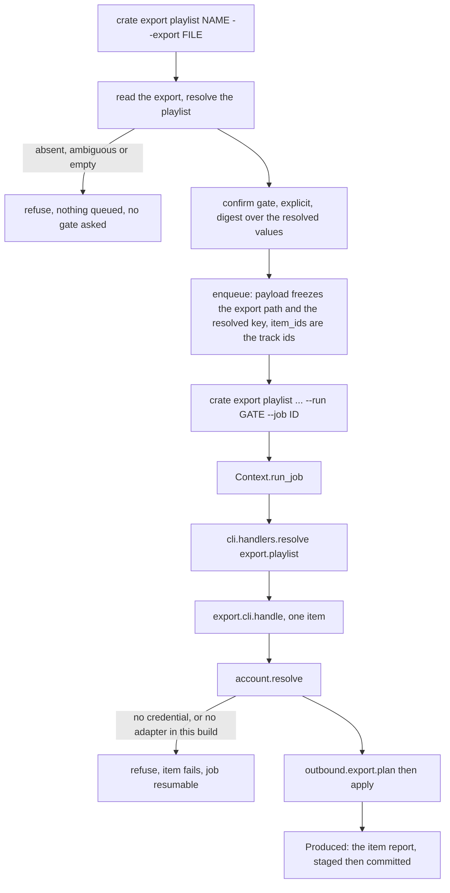

# Outbound workers for playlist export and the hearts sweep - Plan

Board unit U51, GitHub issue #69, phase E. Branch `relay/69`.

---

## Goal Capsule

- Objective: a person who confirms `crate export playlist` or `crate sync favorites` stops getting a queue that reports itself. The job's items become the real tracks, the driver runs them, and the run ends by naming what it wrote or by naming the one thing that stopped it, rather than sitting pending for ever.
- Means: bind both handler keys to per item workers and populate `item_ids` at enqueue from a named library playlist (KTD1, KTD3).
- What this build actually reaches: no streaming provider adapter ships, so on a real machine both verbs now end at the provider seam with a named cause rather than in silence (KTD5). The driven end to end path is proved against a substituted account, and R-144's live half is recorded rather than claimed (R12).
- Authority: `DJ_tools/docs/migration/00-SEAM-DECISIONS.md` outranks this plan. `docs/METHOD.md` owns the merge bar. `CLAUDE.md` owns the standing constraints. This plan outranks issue #69's brief where the two differ, and every such difference is recorded as a KTD.
- Execution profile: one branch, one merge, the three part battery plus a mutation table over the item derivation and the two handlers.
- Stop conditions: stop and record rather than widen if closing R-144 would need a live Tidal session, a live rekordbox database write, or an acquisition adapter. Stop if the item derivation cannot be made to refuse an empty playlist without a second source of truth about what a playlist is.
- Tail ownership: this plan ends at a green battery on `relay/69`. The runner owns the gate, the merge and the push.

---

## Product Contract

### Summary

Both outbound verbs already freeze a configuration, answer an explicit confirm gate, and queue a job. Neither one gives the job anything to do. This work decides what each verb's items are, populates them at enqueue, refuses rather than queueing zero of them, and binds each handler key to a worker that runs one item through the outbound engine that already exists. The provider account stays a seam that tests substitute; no live streaming account is opened.

### Problem Frame

`registry.ENTRIES` holds twenty landed `long_running` entries. U46 bound `master` and U50 bound `backup.run`, and `job.resume` is exempt by role, so seventeen remain queued with no worker under R-203. `export.playlist` and `sync.favorites` are two of the seventeen. R-203's own enumeration still lists `backup.run` and is stale by one entry.

R-144 records the narrower half: nothing in `src` calls `cratekit.modules.outbound.export.apply` or `cratekit.modules.outbound.hearts.heart_back`, so the outbound discipline the engines carry has never been reached from a verb.

The cost is compound. A person confirms an export, is told the job is queued, and the job sits pending for ever. `crate job show` now says `worker: none` for both keys, which is honest but is not the feature. And two engines with no caller have never had their failure paths shaped by anyone who had a reason to care about them, which is the mechanism `docs/solutions/workflow-issues/adding-the-first-caller-makes-you-the-owner-of-its-unreviewed-defects.md` records.

### Key Decisions

- The favorites sweep is add only. It never un hearts and never un colours. Inherited from R36 and from `modules/outbound/service.py`, whose protocol carries no remove. Governs R7, R8.
- The library rows both verbs read come from a rekordbox collection export, not from the live database. The live database is a standing refusal outside the backup feature. Governs R1, R2, R3.
- A favourite, for this verb, is membership in a named rekordbox playlist rather than the pink track colour. This is a change to what the word means here, not a naming detail. `modules/outbound/hearts.py` opens by calling its input "pink local favourites", and the live `DJ_favorites` workflow treats pink as the operator's standing heart this signal. A collection export's `CollectionEntry` carries no colour field, so the chosen source cannot express pink at all, and a hand coloured row outside the named playlist is unreachable by this build. Governs R3.
- A real export against a real streaming account is attended work and stays out of this unit. Governs R9, R12.

### Requirements

**Item derivation and the zero item rule**

- R1. Each verb resolves its work from a rekordbox collection export whose path the caller names and the job freezes.
- R2. `export.playlist` derives one item per track identifier in the named library playlist.
- R3. `sync.favorites` derives one item per track identifier in the favourites playlist.
- R4. Neither verb enqueues a job with zero items. A named playlist that is absent, ambiguous or empty is a refusal with a reserved cause, and nothing is queued.

**The workers**

- R5. `export.playlist` resolves to a worker that matches one library track at the provider and adds it to the remote playlist, reusing a remote playlist the ledger already records.
- R6. Each item produces a durable artifact recording what that item wrote, committed by the engine before the item's row flips to done.
- R7. `sync.favorites` resolves to a worker that hearts one matched favourite at the provider and records it in the outbound ledger.
- R8. The favourites worker performs no remove of any kind, and a provider that already hearts the track is reported as already rather than written again.

**The provider seam**

- R9. Every provider touch goes through one named resolution point that a test can substitute and that refuses with a reserved cause when this build has no adapter to return.
- R10. Both workers receive the configuration the job was frozen against and load no other.

**What a person is told**

- R11. `crate job show` reports `worker: bound` for both handler keys once they are bound.
- R13. A completed run's envelope names the added, already and unmatched sets from the committed artifacts, so a person learns which tracks were not written without opening a file.
- R14. The confirm decision is recorded against the resolved inputs the job freezes, so an approval cannot authorise a write set it never described and a resume cannot meet its own gate as stale.

**Honesty**

- R12. What this unit did not do is recorded in `docs/residual-findings.md` with its measured cost, and R-144's closing condition is not claimed.

### Success Criteria

- On a machine with no provider adapter bound, a confirmed export queues its tracks, drives them, and ends FAILED with the provider seam's named cause on every item. It does not report success and it does not sit pending.
- An export job driven against a substituted provider moves every item from pending to done, and its artifact read back off disk names the remote playlist and the track that was added.
- A second drive of the same export adds nothing at the provider and creates no second remote playlist.
- A favourites sweep against a provider that already hearts one of two candidates writes one heart, not two.
- A job whose one item fails is resumable, the resume attempts that item and no other, and the resume's exit code is not OK.
- An export where the provider matched none of the tracks tells the person so from the envelope, not from the artifacts.

### Scope Boundaries

In scope: the two verbs' shells, their argv builders, the shared item derivation, the two per item workers, the provider resolution point, the handler table entries, the reserved causes, and the tests for all of it.

Named costs this unit accepts rather than fixes:

- Each run of either verb needs a rekordbox collection export the operator produced by hand first. The live `dj-favorites` workflow reads the database directly and runs as one command, so the operator's path to a sweep gets a step longer rather than shorter. No configured default export path is offered, for the reason `cli/reports.py` already gives: a stale export answers every question confidently and wrongly.
- A collection export carries no ISRC, so the favourites worker offers the provider seam a rekordbox row identifier and nothing else. A live adapter must not close that gap with a text search.
- The ledger key is the resolved display path, so renaming or moving a rekordbox playlist starts a new remote playlist rather than updating the recorded one.
- A hand coloured pink row that is not in the named favourites playlist is not swept.

Deferred for later:

- A live Tidal login and a real remote write. Attended, and R-144's closing condition.
- Carrying the track colour on `CollectionEntry` so pink is reachable. It is an additive change to a shared reports module with two report consumers and a golden suite, which is its own unit.
- Forward acquisition of hearted tracks the library does not own.
- The local pink colour and My Tag write the favorites verb declares. It is a live database write and stays behind the guarded write session.
- Binding the other fifteen unbound handler keys. R-203.

Outside this product's identity: any un heart, un colour, or remote delete. `modules/outbound/service.py` has no such method by design and must not grow one.

### Dependencies

Board unit U46, issue #64, merged. It landed `cratekit/cli/handlers.py`, `Context.run_job`, and the `worker` field on `crate job list` and `crate job show`.

---

## Planning Contract

### Key Technical Decisions

- KTD1. **The library source is a rekordbox collection export named on the command line, read through `cratekit.modules.reports.export.read_export_file`.** The live database is off limits outside the backup feature, and no collection reader against it has landed, which R-203 names as the reason `adopt.scan` is unbound. `cli/reports.py` already reads its export through this one function, so reusing it gives the product one answer to "what does this library contain" rather than a second reader that drifts. Those verbs take the export as a POSITIONAL argument and their module docstring argues for that shape; these two verbs take it as `--export PATH` instead, because both already carry a required positional or none at all and a second positional would change the shape of a landed command line. The costs are recorded in Scope Boundaries and written to the ledger by U6.
- KTD2. **`modules/reports/export` is imported under an alias, never bare.** Three things in this tree are called `export`: `cratekit.export.cli`, `cratekit.modules.outbound.export`, and `cratekit.modules.reports.export`. Both outbound shells will now name two of them in one file. Import them as `library_export` and `outbound_export` so one symbol never means two things in two places, which is the defect `docs/METHOD.md` says to go looking for once a suite is green.
- KTD3. **An item is one track identifier, for both verbs.** The alternative, one item for the whole playlist, was rejected: it makes the engine's resume guarantee worthless, because a job with one item that fails halfway redoes the whole playlist, and it makes the zero item rule unenforceable, because a job with one item is never empty however empty the playlist is. `master/cli.py` already reached the same conclusion for a different reason, that a handler reading the payload rather than the claimed item makes every item do the same work. The shape has a measured cost: the collection is parsed once per item unless it is memoized, which is KTD10, and `outbound.export.apply` lists the remote playlist and rewrites the ledger once per item, which U6 records.
- KTD4. **The item derivation has one owner, a new `cratekit/modules/outbound/source.py`.** Both verbs resolve a playlist by identifier out of a `LibraryView` and map its entries into the engine's own input types. Two copies of that resolution would disagree about what an absent playlist is. The mutation table this unit owes centres on this module and extends to the per item claim and the frozen configuration parameter in both handlers.
- KTD5. **The provider account is resolved through `cratekit/modules/outbound/account.py`, which refuses in this build.** No `RemoteAccount` implementation ships; verified by grep, every reference to the protocol in `src` is its own definition, an import, or a parameter annotation. A worker that constructed its own client would put the credential decision in two verbs. One resolution point refuses with a reserved cause, and a test substitutes it by monkeypatching the module attribute, the same shape `master/cli.py` uses for `mastering.subprocess_runner`.
  - **It does not become a second owner of the provider credential.** `cratekit/acquire/provider_session.py` declares itself the sole owner under R4, and both registry entries already declare the `credential.provider` doctor check, which resolves `secrets.Credential.PROVIDER_SESSION`. So `resolve` consults that credential and returns two distinguishable refusals: no credential stored, which doctor can already diagnose and remediate, and a credential present with no adapter to use it, which is this build's own gap. Without that split, `crate doctor` reports the provider credential healthy while the verb says nothing is bound.
  - The monkeypatch substitution reaches only in process tests that call `cli.run` directly. The child `crate job resume` spawns does not inherit it, so there is no supported way to bind a provider in a detached process until an adapter lands. U6 records that.
- KTD6. **The provider refusal happens in the worker, not at enqueue, and the queued envelope says so.** Deferring a refusal is right for an input that can change between enqueue and drive, which is the case `master_recording` argues for a recording that may appear later. A missing adapter cannot appear later without a code change, so that reasoning does not transfer on its own. What makes the deferral honest is telling the person at the moment the information is useful: the queued envelope carries a warning that this build binds no provider adapter, so the job will end at the provider seam. The refusal itself still belongs to the worker, so the cause lands on the item's row where the engine records it.
- KTD7. **The per item artifact is JSON under the queue's own directory, resolved from the frozen configuration.** `jobs.drive` commits `Produced(staged, final)` before the item's row flips to done, so an artifact is the only way an item's outcome survives a kill. The queue root already holds a lock and a log per job, so the artifacts belong beside them rather than in the library tree, where they would be a new thing for the snapshot roles to classify. The root comes from the `cfg` the handler was handed, never from `jobs.store_dir()` with no argument, because that loads the live configuration and is the KTD9 defect wearing an indirection the handler guard cannot see.
- KTD8. **The favourites worker passes `colors=None`.** `hearts.heart_back` accepts a `LocalColors` writer and would colour the library row pink. That is a live database write and belongs behind the guarded write session, so this build reaches the remote half only. R-144 already records the local half as not driven; R12 requires recording that it is still not, and U6 step 4 writes it.
- KTD9. **The confirm digest is computed from the resolved, normalized values the job freezes.** Both verbs answer an explicit gate under R34, so the decision is recorded in one invocation and read in another, and the resume child rebuilds its command line from the frozen payload. Digesting what the person typed makes the resume's digest differ from the recorded one and the job meets `DecisionStale` for ever, which is the defect class `docs/solutions/workflow-issues/an-explicit-gate-makes-a-queued-job-undriveable-without-the-run-id.md` records. Digesting only the playlist name, which is what ships today, lets a decision recorded against one collection document authorise a queue built from another. So the absolute export path and the resolved playlist key are normalized first and the digest is taken over those.
- KTD10. **The parsed `LibraryView` is memoized for the life of one process, keyed on the resolved absolute export path.** `run_job` drives every item of a job in one process, and `read_export` locates and parses every collection track on each call, so without this a hundred item job parses the whole document a hundred times. That is the N times M shape `reports/coverage.py` records this repository shipping and removing once already.

### High-Level Technical Design

The favourites verb is the same graph with `hearts.heart_back` in place of `plan` and `apply`, and with the favourites playlist name in place of the positional identifier.

### Assumptions

- The favourites playlist is named `All Favorites`. In the live library `Favorites` is a FOLDER, created by `DJ_favorites/rb_db.py` through `ensure_folder(db, "Favorites")`, whose track bearing children are `All Favorites` and the quarter playlists. `LibraryView.playlists` excludes folders by design, so a default of `Favorites` would refuse on the operator's real library on every run while the suite stayed green. It stays a flag so a library that names it otherwise is served without a code change.
- A playlist identifier is its display path joined by `/`, and a bare display name is accepted when exactly one playlist in the tree carries it. The rekordbox export format has no stable playlist id, so the path is the only identifier there is. `Playlist.path` excludes the playlist root's own name, so the anchor must be confirmed at implementation time against a real export.
- The remote playlist's display name is the resolved playlist's own last path element. `outbound.export.plan` takes `name` separately from `playlist_key` precisely so the two can differ.
- Residual numbers start at R-226. R-225 is the highest on `main` at branch time; confirm before writing.

### Sequencing

U1 and U2 are independent of each other and both precede U3 and U4. U3 and U4 are independent. U5 depends on U3 and U4. U6 depends on U3, U4 and U5, and so transitively on all of them.

---

## Implementation Units

### U1. The item derivation, with one owner

- Goal: one module resolves a library playlist out of a collection export and maps it into the outbound engines' input types, refusing rather than returning an empty set.
- Requirements: R1, R2, R3, R4. KTD1, KTD2, KTD4, KTD10.
- Dependencies: none.
- Files: `src/cratekit/modules/outbound/source.py`, `src/cratekit/core/cause.py`, `tests/modules/test_outbound_source.py`, `tests/test_reserved_causes.py`.
- Approach:
  1. Resolve a playlist from a `LibraryView` by identifier. Match the full display path joined by `/` first, then a unique display name. Refuse `export-playlist-unknown` when nothing matches and a new ambiguity cause when several do.
  2. Refuse a new empty cause when the resolved playlist carries no track identifiers. This is the zero item rule at its only enforcement point.
  3. Append both new slugs to the reserved table in `core/cause.py`, appended rather than inserted, for the reason the neighbouring blocks give about auto merging. Re pin `tests/test_reserved_causes.py`'s population assertion with a comment naming this unit's slugs rather than counting them, in the style of the existing re pins.
  4. Map the resolved playlist's entries to `outbound.export.LocalTrack` and to `hearts.HeartCandidate`, as two functions a caller picks between rather than one that builds both. Carry the collection entry's title and artist onto the track so an unmatched row is reportable; the export format carries no ISRC, so leave it empty and say so in a comment rather than inventing one.
  5. Skip a track identifier the playlist names that the collection does not carry, and report it rather than dropping it silently. R-146 records that a dangling `TrackID` is accepted by `read_export`, so this is reachable input, not a hypothetical.
  6. Deduplicate a track identifier a playlist names twice, preserving document order, and report the repeat the way step 5 reports a dangling one. `job_items` is keyed on `(job_id, item_id)`, so a repeat reaches `jobs.enqueue` as an `IntegrityError` and a person is told to file a defect report over a document the reader accepted.
  7. Memoize the parsed `LibraryView` per process, keyed on the resolved absolute path (KTD10).
  8. Import `cratekit.modules.reports.export` as `library_export` per KTD2.
- Patterns to follow: `src/cratekit/modules/reports/coverage.py` for indexing a `LibraryView` once rather than calling `LibraryView.entry` per row, whose docstring names the N times M shape U18 shipped and removed.
- Test scenarios:
  - A tree with one playlist named `Crate One` resolves by bare name and by full path, and both return the same track identifiers in document order.
  - Two playlists in different folders both displaying `2026` refuse the ambiguity cause, and the refusal names both paths.
  - A playlist name nothing carries refuses `export-playlist-unknown`.
  - A name that belongs to a FOLDER rather than a playlist refuses the unknown cause, since folders never appear in `LibraryView.playlists`. This is the live library's `Favorites` shape.
  - A playlist present in the tree with no track children refuses the empty cause; the refusal is distinguishable from the unknown one.
  - A playlist naming a `TrackID` the collection does not carry returns the tracks it can resolve and reports the dangling identifier.
  - A playlist naming one track identifier twice yields one item and reports the repeat.
  - The heart candidates and the local tracks derived from one playlist name the same row identifiers.
  - Two resolutions against one path in one process parse the document once.
- Verification: the derivation refuses on every empty shape, and no path through it returns an empty tuple to a caller.

### U2. The provider resolution point

- Goal: one named place returns the streaming account a worker writes through, and refuses with a reserved cause when this build cannot produce one.
- Requirements: R9. KTD5.
- Dependencies: none.
- Files: `src/cratekit/modules/outbound/account.py`, `src/cratekit/core/cause.py`, `tests/modules/test_outbound_account.py`, `tests/test_reserved_causes.py`.
- Approach:
  1. Define `resolve(cfg)` returning a `RemoteAccount`. It consults `secrets.Credential.PROVIDER_SESSION` and raises one of two structured refusals: the credential is absent, or the credential is present and this build binds no adapter to use it. Both carry a remediation a person can act on, and the first one's remediation is the one `cli/doctor.py` already reserves for `credential.provider`.
  2. Append the new slugs to the reserved table in `core/cause.py` and re pin `tests/test_reserved_causes.py` the same way U1 does. Classify both as preconditions, not internal errors: a build without an adapter is not a defect a person should report.
  3. State in the module docstring that this is the seam a live adapter lands on, that R-144's closing condition runs through it, that `acquire/provider_session.py` stays the sole owner of the credential itself, and that a live adapter must match on ISRC or an equivalent identity and must not fall back to a text search, which is the rule the live workflow already holds.
- Test scenarios:
  - With no credential stored, `resolve` raises the credential refusal and its exit code is not the internal error code.
  - With a credential stored, `resolve` raises the no adapter refusal, distinguishable from the first by slug.
  - Both refusals carry a remediation string that is not empty.
  - The reserved cause table has no duplicate key after both units' appends.
- Verification: `tests/test_reserved_causes.py` passes with the new slugs and its pinned population reflects them, and no caller of `resolve` converts the refusal to an internal error.

### U3. `crate export playlist` runs

- Goal: the export verb freezes an export document, queues one item per track, and its handler writes one track to the remote playlist per item.
- Requirements: R1, R2, R4, R5, R6, R10, R11, R13, R14. KTD1, KTD2, KTD3, KTD6, KTD7, KTD9, KTD10.
- Dependencies: U1, U2.
- Files: `src/cratekit/export/cli.py`, `src/cratekit/cli/handlers.py`, `tests/test_outbound_workers.py`.
- Approach:
  1. Read U46's merged diff and `src/cratekit/master/cli.py` first. `master_recording` and `handle` are the worked example for the freeze, the resume branch and the item worker.
  2. Add `--export PATH` to `build`. Freeze the absolute path in the payload, for the reason `master.frozen_payload` gives: `jobs.spawn` starts the child with the resuming process's working directory, so a relative path freezes an instruction that means different files in different directories.
  3. Freeze the resolved playlist key alongside the caller's identifier, so the ledger key a resume uses is the one the enqueue resolved rather than one re resolved against an export that has since changed.
  4. On the branch where `ctx.args.job` is ABSENT: read the export, resolve the playlist, and populate `item_ids` from U1's derivation, all before the gate is required, so a person is not asked to confirm an export that is about to refuse. Compute the confirm digest from the normalized frozen values per KTD9. The `--job` branch neither reads nor requires the export document; its items are already in the queue.
  5. Rebuild every frozen flag in `export_argv`, including `--export`, so the resume's rebuilt command line matches the payload the digest was taken over. Keep the existing `--run` handling unchanged and keep the flag before the verb path.
  6. Add the resume branch that calls `ctx.run_job`, mirroring `master_recording`. Read R-225 before writing it: `master/cli.py`'s resume branch exits OK on a half failed job, and copying that branch inherits the defect. Re raise the job's own cause the way U50 did for `backup.run`.
  7. Write `handle(job, item, cfg)`. Read the frozen export through U1's memoized reader, derive the single local track for the claimed item, plan and apply through `outbound_export`, serialize the report to a staged JSON file under the artifact root resolved from `cfg` (KTD7), and return `Produced`.
  8. Aggregate the committed artifacts into the reported envelope so the added, already and unmatched sets are visible without opening a file (R13). Derive them from what ran, never from the plan.
  9. Carry the KTD6 warning on the queued envelope.
  10. Move `export.playlist` from `HANDLERS_NOT_YET_BOUND` to `HANDLERS`.
- Execution note: this unit adds the first `src` caller of `outbound.export.plan` and `outbound.export.apply`. Read `docs/solutions/workflow-issues/adding-the-first-caller-makes-you-the-owner-of-its-unreviewed-defects.md` before writing the call, run the grep it names to confirm, and drive at least one failure path per newly reached engine function. `apply` writing to the ledger between the provider call and the next item is the path to look at hardest: a kill between `create_playlist` and `record_playlist` leaves the next item creating a second remote playlist.
- Test scenarios:
  - An export of a three track playlist queues three items, drives pending to done through the real resume argv, and the third item's artifact read back off disk names the remote playlist id and that track's remote id.
  - A second drive of the same playlist key adds nothing at the provider, creates no second remote playlist, and reports every track as already.
  - A playlist whose tracks the provider cannot match completes, and the envelope names the unmatched rows rather than only counting items.
  - An export naming a playlist the document does not carry refuses and queues nothing; the queue is empty afterwards.
  - An export with no `--export` refuses rather than queueing a zero item job.
  - A provider that fails on the second of three tracks leaves the job resumable through `crate job resume`, which re arms the job; the resume claims that one item and the two done items are not redone.
  - The resume of a half failed job exits with the job's own cause rather than OK. This is R-225 pinned at the moment the branch is written rather than inherited.
  - The confirm is answered with a relative `--export`, then the real `argv_for` output is driven: the digest still matches and the job advances rather than meeting a stale decision.
  - A confirm recorded against one export document does not authorise a queue built from another.
  - The configuration reaching `handle` is the frozen one. Move a configuration key that NO environment variable overrides, and read `docs/solutions/workflow-issues/a-frozen-config-is-frozen-against-the-file-not-against-an-env-override.md` first: the suite sets `CRATEKIT_LIBRARY_ROOT` globally and `frozen_config` reapplies environment overrides, so the obvious version of this test cannot fail.
  - `crate job show` on the queued job reports `worker: bound` and no unbound reason.
  - With no provider adapter bound, the queued envelope carries the KTD6 warning and the drive ends FAILED with the provider seam's cause.
- Verification: the export verb's job reaches SUCCEEDED against a substituted account, every artifact it committed parses and names the item it belongs to, and the envelope's sets agree with the artifacts.

### U4. `crate sync favorites` runs

- Goal: the favourites verb queues one item per favourite and its handler hearts one matched favourite per item, add only.
- Requirements: R1, R3, R4, R6, R7, R8, R10, R11, R13, R14. KTD1, KTD2, KTD3, KTD6, KTD7, KTD8, KTD9, KTD10.
- Dependencies: U1, U2.
- Files: `src/cratekit/favorites/cli.py`, `src/cratekit/cli/handlers.py`, `tests/test_outbound_workers.py`.
- Approach:
  1. Add `--export PATH` and `--favorites-playlist NAME` to `build_sync`, the second defaulting to `All Favorites` per the Assumptions. Freeze both, absolute for the path.
  2. Populate `item_ids` from U1's derivation over the favourites playlist, on the branch where `ctx.args.job` is absent, and compute the confirm digest from the normalized frozen values per KTD9. Refuse rather than queue when the playlist is absent or empty.
  3. Extend `sync_favorites_argv` with both flags. The two run identifiers stay exactly as they are; the function's docstring records the defect that conflating them caused and nothing here changes it.
  4. Add the resume branch calling `ctx.run_job`, with the same R-225 treatment U3 applies.
  5. Write `handle(job, item, cfg)` calling `hearts.heart_back` with a single candidate, `colors=None` per KTD8, and no `flags`. Serialize the report under the KTD7 artifact root and return `Produced`.
  6. Aggregate the artifacts into the envelope (R13) and carry the KTD6 warning on the queued envelope, both as U3 does.
  7. Move `sync.favorites` from `HANDLERS_NOT_YET_BOUND` to `HANDLERS`.
- Execution note: this unit adds the first `src` caller of `hearts.heart_back`. Same first caller discipline as U3. Its unmatched branch and its `already` branch both need driving, because both are decisions the engine makes that no caller has ever read.
- Test scenarios:
  - A favourites playlist of two rows queues two items and drives both to done; the provider records two hearts.
  - A provider that already hearts one of the two writes one heart, and the second item's artifact reports that row as already rather than as hearted.
  - A run against a ledger that already records one of the two hearts writes one heart, proving the ledger short circuit is reached without asking the provider.
  - A candidate the provider cannot match is reported unmatched and does not fail the item.
  - The worker calls nothing that removes: assert against a provider stand in that raises on any attribute outside the `RemoteAccount` protocol.
  - No `LocalColors` writer is passed, so no library row is coloured by a queued sweep.
  - An empty or absent favourites playlist refuses and queues nothing, and a name that resolves to a folder refuses the same way.
  - A failed item leaves the job resumable and the resume redoes only that item.
  - The resume of a half failed sweep exits with the job's own cause rather than OK.
  - The frozen configuration reaches the handler, asserted with the same non overridden key U3 uses.
  - `crate job show` reports `worker: bound` for `sync.favorites`.
- Verification: the sweep reaches SUCCEEDED against a substituted account, and no code path in either the shell or the engine can produce a remove.

### U5. The suite the two verbs now break, repaired rather than relaxed

- Goal: every existing guard that queued these verbs still passes, and passes because it drives the new shape rather than because it was loosened.
- Requirements: R11. KTD3.
- Dependencies: U3, U4.
- Files: `tests/test_queued_resume_contract.py`, `tests/modules/test_outbound.py`, `tests/outbound_fakes.py`.
- Approach:
  1. Extract the existing `FakeAccount` from `tests/modules/test_outbound.py` into `tests/outbound_fakes.py` and import it from both files. One stand in describing the provider contract, not two that drift.
  2. `test_the_resume_the_job_driver_spawns_can_actually_proceed` now drives real work for these two verbs. Give it an export fixture carrying the playlists both verbs name, and substitute `outbound.account.resolve` with the shared fake, so the resume proceeds to a driven job rather than to a reconcile. The parametrisation is read before any fixture runs, so the export path goes in through the file's existing `LIBRARY_FOLDER` placeholder and `_resolved` helper rather than a literal.
  3. `test_the_favorites_intake_run_and_its_gate_run_are_separate_fields` needs the SAME treatment, not just the new flags. Its closing `assert _drive(argv)[0] == int(ExitCode.OK)` becomes a real drive once the worker is bound, so without the fixture and the substituted account every item fails, the job is recorded failed, and the resume exits non zero. Give it both, and keep its two assertions about the intake run and the gate run untouched.
  4. Check `tests/test_handlers.py` needs no edit. Its population is derived from the registry, so a bound verb should move through it without a change; if it needs one, that is a signal the derivation is not derived.
  5. This unit is the sole owner of every edit to `tests/test_queued_resume_contract.py`. U3 and U4 do not touch it, so the audit below is over a file this branch has not already quietly repaired.
- Test scenarios: no new scenarios of its own. The unit is done when the existing files assert the same properties against the new shape.
- Verification: no assertion was deleted or weakened to make a file pass. Any guard that genuinely no longer applies is removed with its reason stated in the file, not silently.

### U6. The record

- Goal: what this unit did not do is written down with its measured cost, and nothing claims R-144 is closed.
- Requirements: R12. KTD3, KTD5, KTD8.
- Dependencies: U3, U4, U5.
- Files: `docs/residual-findings.md`.
- Approach:
  1. Confirm the highest residual number on `main` and take the next ones, appended.
  2. Record that no `RemoteAccount` implementation ships, so both workers end at the provider seam on any real machine, and that the monkeypatch substitution does not reach the detached child `crate job resume` spawns, so there is no supported way to bind a provider in a real process until an adapter lands. Name what is now reachable that was not, and state that R-144 advances rather than closes.
  3. Record the operator cost KTD1 accepts: each run needs a hand produced collection export, no configured default is offered and why, and a sweep is only as fresh as that export with nothing warning when it is stale.
  4. Record that the local pink colour and My Tag write is still not driven, citing KTD8 and the live database constraint, and that a hand coloured pink row outside the named playlist is unreachable because `CollectionEntry` carries no colour.
  5. Record that the ledger key is a mutable display path, so a rekordbox reorganisation forks a second remote playlist.
  6. Record that `outbound.export.apply` lists the remote playlist and rewrites the ledger once per item, which KTD3's per item shape makes N round trips against a rate limited service.
  7. Record that a collection export carries no ISRC, so the favourites worker offers the provider seam a row identifier alone.
  8. Update R-203's population sentence: it is stale by one, still listing `backup.run`, which U50 bound. Remove that entry and correct the count for this unit's two. Do not renumber anything.
- Test expectation: none, this unit is documentation.
- Verification: `.venv/bin/python scripts/board.py audit` exits 0, and no residual entry claims a verification that was not run.

---

## Verification Contract

| Gate | Command | Applies to |
|---|---|---|
| Lint | `.venv/bin/ruff check src tests scripts` | every unit |
| Suite | `.venv/bin/python -m pytest` | every unit |
| Portability and secrets | `.venv/bin/python scripts/scan_repo.py` | every unit |
| Board truth | `.venv/bin/python scripts/board.py audit` | U6 |
| Mutation table | `.venv/bin/python scripts/mutate.py <rows>.toml --name u51-item-derivation` | U1, U3, U4 |

The mutation table's rows revert one guard at a time: the unknown playlist refusal, the ambiguity refusal, the empty playlist refusal, the dangling identifier report, the duplicate identifier dedup, the per item claim in each handler, and the frozen configuration parameter. A row that kills zero tests is a guard nothing covers and is fixed or recorded before merge, not dismissed. The frozen configuration row is the one most likely to read zero for the wrong reason; U3's scenario names why.

Beyond the battery, hunt what a green suite cannot see, per `docs/METHOD.md`: a duplicate key in the reserved cause table after three appends across two units, and one symbol meaning two things across the three modules named `export` (KTD2).

---

## Definition of Done

Global:

- Both handler keys are in `HANDLERS` and neither is in `HANDLERS_NOT_YET_BOUND`.
- Neither verb can enqueue a job with zero items, driven rather than argued.
- Every provider touch in the suite goes through a stand in; no test opens a network connection or a live account.
- No beat grid is written anywhere, no live rekordbox database is opened, and `DJ_tools` code is unchanged.
- No em dash, en dash or double hyphen in any file this branch touches.
- Every unit lands with the code and architecture explanation the standing rule asks for.
- The full battery is green and the mutation table has no unexplained zero row.
- Abandoned approaches are removed from the diff rather than left behind.

Per unit: each unit's Verification line above is the done signal for that unit.

---

## Risks

- The two verbs' existing resume tests currently pass because the resume does nothing. Binding a worker turns those into drives of real work, and a repair that makes them pass by loosening an assertion would remove the guard that caught two live defects in August. U5 exists to make that repair visible and owns those edits alone.
- `master/cli.py`'s resume branch is the worked example and carries R-225, a half failed job exiting OK. Copying it copies the defect into two more verbs. U3 and U4 both name it and both pin it with a scenario.
- First caller ownership. `outbound.export.plan`, `outbound.export.apply` and `hearts.heart_back` gain their first `src` caller here. The producer that satisfies the merge bar's third condition is the shipped verb driven end to end with a substituted account, which is a real producer a person types even though the account is a stand in; the substitution replaces the remote service, not the path under test. A defect found in those three functions on this branch is therefore BLOCKING rather than residual. Budget a fix round for it.
- The favourites default was wrong in the first draft of this plan, naming a folder rather than the track bearing playlist under it, and the suite would have stayed green because its fixtures name a playlist directly. Any default that names a real library structure is worth checking against `DJ_tools` rather than remembering.
