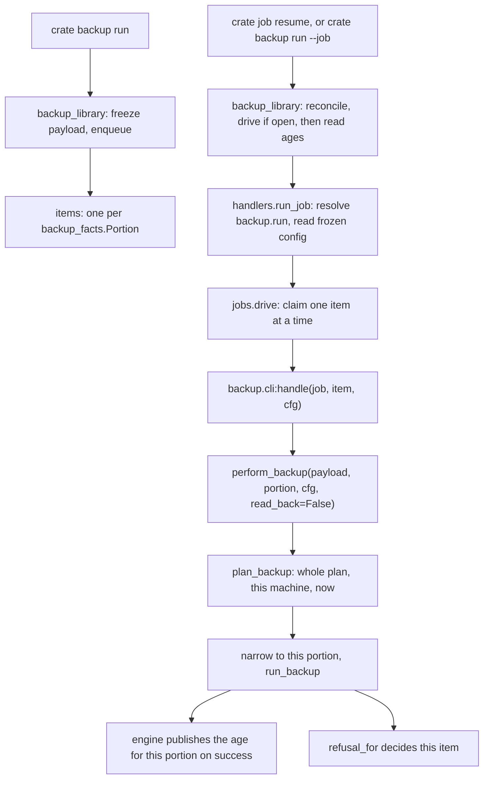

# Backup Worker Binding - Plan

## Goal Capsule

- **Objective:** a queued backup actually copies the library to the remote, and the backup age a destructive session reads is the age of that copy. Today the queue holds backup jobs that nothing on the machine ever runs, so a person who asks for a backup gets a job identifier and no copy.
- **Means:** bind `backup.run` into the `HANDLERS` table U46 landed, with one job item per backup portion (KTD1) and a per portion worker built from the existing `perform_backup` body (KTD2).
- **Authority hierarchy:** `DJ_tools/docs/migration/00-SEAM-DECISIONS.md` Part 5, then `docs/METHOD.md`, then this plan, then board issue #68.
- **Stop conditions:** stop and record a residual rather than widen scope if binding reaches a defect in `modules/tools/backup.py` that a fix would make reachable. Stop if the item derivation cannot be made to satisfy the zero item rule without planning at enqueue time.
- **Execution profile:** one branch, `relay/68`, one merge commit closing #68. Battery green before merge.
- **Tail ownership:** the runner owns the gate, the merge and the push.

**The typed verb still ends one command short, and that is this unit's boundary.** `crate backup run` queues. `crate job resume <id>` runs it. That is the seam every long running verb in this product has, `master` included, and changing it is a decision about the verb rather than about the worker. The Objective above is met when the queued job copies the library, not when one command does both.

**U-numbers in this document carry two meanings, and the section says which.** Under `## Implementation Units`, U1 through U4 are steps of this plan. Everywhere else a U-number is a board unit: this whole plan is board unit U50, issue #68, and it depends on board units U46 (issue #64) and U48 (issue #66), both merged.

---

## Product Contract

### Summary

Bind the backup worker so a queued backup job runs to completion through `crate job resume`, with the job's items being the two declared backup portions. The item list is derived from `backup_facts.Portion` rather than from a plan, so queueing still needs no rclone, no remote and no mounted volume. Each item's verdict is `refusal_for` applied to that portion's own outcome, so a portion that could not run fails its item and stays retryable, and a job in which nothing was copied never ends SUCCEEDED.

### Problem Frame

`cratekit.core.jobs.drive` had no caller in `src` until U46, which is residual R-198. U46 bound one verb, `master`, and recorded the other eighteen as R-203. `backup.run` is one of those eighteen: `backup_library` freezes its configuration, enqueues, and reports, and `crate job resume` respawns a child that reports the same job again. The items stay pending for ever.

The work body is already there and orphaned. `perform_backup` at `src/cratekit/backup/cli.py:382` has zero callers in `src`. The engine under it, `run_backup` in `src/cratekit/modules/tools/backup.py`, is complete and was board unit U45's subject.

Binding the table entry alone would make this worse rather than better. `backup_library` calls `jobs.enqueue` with no `item_ids`, and `jobs.drive` transitions a job with no items straight to SUCCEEDED: `claim` returns `None` on the first pass, `attempted` is zero, `result.failed` is zero, and the final `else` at `src/cratekit/core/jobs.py:1303` records success. A bound handler over an empty item list turns "queued for ever" into "reports success, copied nothing", and the second is the one a person acts on.

### Requirements

**The queued run**

- R1. A backup job carries one item per declared backup portion, and is never enqueued with an empty item list.
- R2. The item list is derived by iterating `backup_facts.Portion`, not by naming the two portions in a literal.
- R3. Queueing still requires no rclone, no configured remote and no mounted library volume. The verb's existing `test_queueing_needs_no_rclone_no_remote_and_no_volume` stays green unchanged.
- R4. A resume of an OPEN backup job drives its items in this process through `Context.run_job`, then reports the job it continued rather than filing a second one.
- R15. The resume envelope carries the ages read back from the fact file, so a person who just drove a backup sees what a destructive session would now see. The shell reads them after the drive returns, outside any item boundary.

**The per portion worker**

- R5. The worker runs only the portion its claimed item names. It does not run the other portion.
- R6. An item naming a value that is not a declared portion refuses by name rather than raising an uncaught exception into the engine's internal error path.
- R7. `handle` passes the configuration frozen on the job (KTD9) to the work body. `handle` itself loads no configuration, by any spelling or through any helper. `perform_backup` keeps its own `_load` fallback for the callers that pass none.
- R8. The worker resolves the rclone runner at call time from the module attribute, so a stand in installed on `cratekit.modules.tools.backup.subprocess_runner` reaches it.
- R9. The worker publishes no backup age. Publishing stays with `run_backup`, per portion, on success.
- R10. The worker returns no artifact. A backup writes to a remote, so there is no staged local file for the engine to commit.
- R16. The worker does not fail an item for a condition discovered after that portion's transfer completed. The age read back is not performed inside the item boundary.

**The verdict**

- R11. A portion whose transfer came back non zero fails its item. `jobs.retry` re-arms exactly that item, and the next drive redoes that portion and no other.
- R12. A portion the engine refused before attempting anything fails its item, carrying that portion's own reserved refusal and remediation.
- R13. A job in which no portion was copied ends FAILED, never SUCCEEDED.
- R14. `crate job show` reports `worker: bound` for a `backup.run` job, and `backup.run` is no longer in `HANDLERS_NOT_YET_BOUND`.

### Key Decisions

- **The items are the portions, not the whole run.** Chosen over one item per job because the backup age, the refusal vocabulary and the R15 warning are already per portion, so a per portion item ledger gives each portion's state one home instead of two. Governs R1, R5, R11.
- **A portion that could not run fails its item, and a resume is how it is retried.** Chosen over completing the item and recording the refusal as a survivable skip. Governs R11, R12, R13.

  **This reverses the first draft of this plan, and the reason is worth keeping.** The draft had a refused portion complete its item whenever some other portion would run, so that a person backing up with rekordbox open would not be told their backup failed. That is unrecoverable: `complete_item` writes `ItemState.DONE`, and `jobs.retry` re-arms only FAILED and CLAIMED rows, stating in its own docstring that "Items that are DONE stay done". The person then closes rekordbox, resumes, and nothing happens, for ever, over a job reporting SUCCEEDED. The draft's argument was that a FAILED item would tell someone to resume work that can never advance. That argument does not hold against the reserved remediations: `rekordbox-running` reserves `quit-rekordbox`, `library-root-absent` reserves `mount-library-volume`, `rclone-missing` reserves `install-binary`. Each names something the person does, after which the resume completes the backup. The cost of the reversal is stated below and accepted.

- **The accepted cost of that reversal.** A library backed up without quitting rekordbox first now ends with the job FAILED and the database item failed carrying `quit-rekordbox`, where the whole run verdict in `refusal_for` calls the same state a success. That is louder, and it is the honest reading: the database was not copied, and R15's per portion warning exists to make exactly that visible rather than to hide it behind one verdict. The alternative that avoids both the noise and the unrecoverable DONE is a third item state: `ItemState.SKIPPED` is already declared and already counted as settled by `jobs.progress`, but no writer produces it and `drive` has no verdict rule for it, so reaching it means changing `core/jobs.py`, which is outside this unit's files. Recorded as R-224.

### Scope Boundaries

**Deferred for later, each recorded as a residual numbered above main's highest, which is R-220 at branch time**

- R-221: the resume envelope carries the ages and nothing else from the backup report. The per portion `ran` flags, the archive rotation warnings and the `dry_run` flag stay unreported on the queued path, so a rehearsal driven through the queue is indistinguishable in the envelope from a real run.
- R-222: a retried portion writes a new dated archive folder, and `DEFAULT_ARCHIVE_KEEP` is 1, so the successful retry's prune deletes the failed attempt's archive folder. That folder holds the only remaining copies of destination files the failed attempt overwrote. This unit is what first makes a retried mirror reachable.
- R-223: `crate backup run` queues a second job when one is already open, and two jobs driving the same destination interleave their mirrors and prune each other's archive at a keep of 1. Making the verb report the open job instead is a change to the enqueue contract rather than to the worker.
- R-224: a portion that refuses cannot be recorded as skipped, only as failed, because `ItemState.SKIPPED` has no writer and no verdict rule.

**Outside this unit**

- A real backup against a real remote. That is R-9 and attended.
- Board units U29, U30, U20, chores A1, A2, and `.worktrees/conformance`.
- Any change to `modules/tools/backup.py` behavior or to `core/jobs.py`. The engine is board unit U45's subject and this unit is a caller of it.
- Binding the other seventeen verbs. R-203 stays open and its closing condition is unchanged.

### Sources

- `src/cratekit/cli/handlers.py` for the table, `resolve`, `run_job`, and why the table is strings rather than imports.
- `src/cratekit/master/cli.py:305` for the worked handler and `:202` for the worked resume branch.
- `src/cratekit/core/jobs.py:1279` for the zero item transition, `:551` for `enqueue`, `:685` for `retry` and its DONE rule, `:1262` for the `Produced` commit.
- `src/cratekit/cli/jobs.py:274` for `resume`, the only caller of `jobs.retry`.
- `src/cratekit/backup/cli.py:303` for `refusal_for` and its three branches, `:253` for `published_ages` and why it refuses.
- `src/cratekit/modules/tools/backup.py:462` for `plan_backup`, `:668` for `run_backup`, `:148` for `DEFAULT_ARCHIVE_KEEP`.
- `src/cratekit/cli/exit_codes.py:291` for the reserved remediations the failed items carry.
- `docs/residual-findings.md` R-203 and R-198.
- `docs/mutation/u46-author.md` and `docs/mutation/u46-author.toml` for what board unit U46 already pinned.

---

## Planning Contract

### Key Technical Decisions

- KTD1. **One job item per member of `backup_facts.Portion`, derived by iterating the enum.** The enum is declared and non empty by construction, so the item list needs nothing from the machine, which is what keeps R3 true. Deriving from `plan_backup` instead would make queueing resolve rclone, read the process table and stat the library root, and `backup_library`'s docstring already states why that is wrong. `plan_backup` always builds one entry per declared portion, so the item set and the plan's portion set are the same set from the same source. Iterating rather than writing `("files", "database")` is Part 5's P3: a set a name quantifies over is derived at run time or it is a list in disguise. Governs R1, R2, R3.

  **The saved work is not the argument, and saying so keeps the decision honest.** A re-run mirror is `rclone sync` against an already synced destination, which compares and transfers almost nothing, so "a failed database snapshot does not redo the mirror" saves a tree walk rather than a transfer. The argument is that the fact file, the refusal vocabulary and the age are already per portion, and an item ledger at the same granularity means each portion's state has one home rather than two that can disagree.

- KTD2. **`perform_backup` gains a `portion` parameter; `None` keeps the whole run behavior.** The work body stays one function rather than growing a second one beside it, so the properties its docstring claims stay drivable without a job store. `None` preserves every existing caller and test in `tests/test_backup_cli.py` unchanged, which is Part 5's P6 applied before the change rather than after. A portion value narrows the plan to that one entry and runs it. Governs R5.

- KTD3. **The narrowed run is a new `BackupPlan` holding one `PortionPlan`, built from the whole plan's stamp and `archive_keep`.** `run_backup` takes a plan and iterates its portions, so narrowing the plan is how one portion is run without a second execution path. Taking `archive_keep` off the plan rather than passing it again is the rule `BackupPlan`'s own docstring states. Governs R5.

- KTD4. **The verdict is `refusal_for` over the single portion outcome, unchanged and unqualified.** Over a one portion outcome its three branches give the answer this unit wants without a condition added on top: a portion that ran returns `None` and the item completes, a portion that failed returns `backup-transfer-failed`, and a portion that refused returns the engine refusal carrying the reserved remediation. The whole run reading of its refusal branch, that a refusal only ends the run when nothing ran, is a statement about a run with two portions in it; a single portion outcome is a run in which nothing ran whenever that portion did not. Nothing about the engine's decision is re-decided at this layer, and no evidence about a sibling item is consulted. Governs R11, R12, R13.

- KTD5. **Each item stamps its own dated folder.** `plan_backup` is called per item, so each portion's archive or snapshot folder is dated when that portion actually ran. Freezing one stamp into the payload at enqueue time was rejected: a resume days later would then write into a folder dated for the day the job was queued, which misstates when the copy was taken. Two consequences follow and both are recorded rather than hidden: the two portions of one job can land under folders whose timestamps differ by the gap between them, and a retried portion creates a new rotation slot, which is R-222.

- KTD6. **The handler returns `None`, and nothing is staged.** `master`'s handler stages because it writes a local file the engine must commit with `os.replace`. rclone writes to the remote and leaves nothing local, so there is no staged path and no final path. `jobs.drive` handles `produced is None` at `src/cratekit/core/jobs.py:1262` and calls `complete_item` with no artifact. Governs R10.

- KTD7. **The frozen configuration reaches `perform_backup` as the `cfg` argument, and `handle` calls no loader.** The guard in `tests/test_handlers.py::test_no_declared_handler_loads_a_fresh_configuration` walks only the declared function's own body and states in its docstring that it cannot see an indirection through a helper. `backup/cli.py` has such a helper, `_load`, used by the non queued path. `handle` must not call it. Governs R7.

- KTD8. **The age read back moves out of the worker and onto the shell's resume envelope.** `perform_backup` gains `read_back: bool = True`, and `handle` passes `False`. Two reasons, and the first is a defect the first draft carried: `published_ages` refuses `backup-facts-unreadable`, and inside the item boundary that refusal fails an item whose mirror already completed and whose age the engine already published, so every retry re-runs the whole transfer and dies at the same line over a condition a retry cannot fix. The second is that the handler discards the report, so building it was work with no reader. The shell reads the ages after `ctx.run_job` returns, where the same refusal refuses the command instead, which is what `published_ages`'s own docstring argues it is for. Governs R15, R16.

### High-Level Technical Design

The two questions the worker answers per item, in order:

1. Is `item.item_id` a declared portion? If not, refuse `internal-error` naming the item and the declared portions (R6).
2. Run the portion and apply `refusal_for`. Ran completes the item; failed or refused fails it (R11, R12, R13).

### Assumptions

- `tests/test_backup_cli.py::test_a_resume_reports_the_queued_job_rather_than_filing_a_second` currently takes only the `cfg` fixture. Once the resume branch drives, that test reads whatever rclone this machine has, which makes it machine dependent. It is assumed to need the `rclone` fixture added so the driven run is pinned. Verify this rather than assume it.
- The difference in rendering between a whole run `backup-nothing-ran` cause and two per item causes, when the two portions refuse for different reasons, is accepted. Each item carries its own diagnosis instead of one flattened one, which is the direction `_engine_refusal`'s docstring argues for.

### Sequencing

U1, U2 and U3 land in one commit, because U3 alone leaves the build claiming a worker that does not exist and U1 alone leaves a work body nothing calls. U4 runs after the battery is green.

---

## Implementation Units

U1 through U4 are steps of this plan, not board units. See the Goal Capsule note.

### U1. The portion scoped work body and the handler

- **Goal:** `perform_backup` can run one portion, and `handle` is the per item worker behind `handler_key` `backup.run`.
- **Requirements:** R5, R6, R7, R8, R9, R10, R11, R12, R13, R16.
- **Dependencies:** none.
- **Files:** `src/cratekit/backup/cli.py`.
- **Approach:**
  - Add `portion: backup_facts.Portion | None = None` and `read_back: bool = True` to `perform_backup`. Keep every existing parameter and its default.
  - After `plan_backup` succeeds, when `portion` is given, take `plan.portion(portion)` and build the narrowed `BackupPlan` per KTD3. When `portion` is `None`, run the whole plan as today.
  - Apply `refusal_for(outcome)` unchanged and raise whatever it returns. No suppression, no condition, no reading of the other portion's plan entry. Write KTD4's reason as a comment so the next reader does not add one back.
  - Guard the `report["ages"] = published_ages(...)` line on `read_back`, carrying KTD8's reason in a comment. `report["dry_run"]` stays unconditional; it costs nothing and it is not a read of anything that can fail.
  - Write `handle(job, item, cfg)` beside `perform_backup`. It coerces `item.item_id` to a `Portion`, refusing `internal-error` with `Remedy.REPORT_DEFECT` when the value is not declared, then calls `perform_backup(dict(job.payload or {}), portion=..., cfg=cfg, runner=backup.subprocess_runner, read_back=False)` and returns `None`.
  - Pass `runner=backup.subprocess_runner` explicitly at the call, resolved at call time, for the reason `master.cli.handle` states about its own encoder.
  - Add `handle` to `__all__`.
  - Do not call `_load` anywhere in `handle`, per KTD7. Write that as a comment on `handle` so the guard's blind spot is stated at both ends, the way `handlers.ItemHandler`'s comment does.
- **Test scenarios** (`tests/test_backup_cli.py`):
  - `perform_backup` given `Portion.FILES` runs the mirror commands and no database command, read off the `rclone` fixture's invocation log.
  - `perform_backup` given `Portion.DATABASE` runs the snapshot and no mirror.
  - `perform_backup` with no `portion` still runs both, which is the existing behavior every current test in this file drives.
  - A refused portion raises even when the other portion would run: drive the database refused by a rekordbox process on the injected lister, with rclone present, and assert the slug is `rekordbox-running` and the remedy is `quit-rekordbox`. Name in the test what this forecloses: an item completed over a portion that was never copied is DONE for ever, because `jobs.retry` re-arms only FAILED and CLAIMED.
  - A refused portion carries its reserved remediation rather than the class default: drive with `no_rclone` and assert `rclone-missing` with `install-binary`, not `run-doctor`.
  - A portion whose transfer failed raises `backup-transfer-failed` naming that portion.
  - `read_back=False` returns a report with no `ages` key and does not touch the fact file. Drive it with an unreadable fact file after a successful transfer and assert `perform_backup` returns rather than raising, which is the condition R16 exists for.
  - `handle` given an item naming `"playlists"` refuses `internal-error` and names the two declared portions in the message.
  - `handle` passes the configuration it was given through to the work body: build two configurations with different `backup.dest`, hand one to `handle`, and assert the invocation log names that one.
- **Verification:** `.venv/bin/python -m pytest tests/test_backup_cli.py` green.

### U2. The items, the driven resume, and the ages

- **Goal:** a backup job is queued with one item per portion, a resume drives it, and the envelope reports the ages.
- **Requirements:** R1, R2, R3, R4, R11, R15.
- **Dependencies:** U1.
- **Files:** `src/cratekit/backup/cli.py`.
- **Approach:**
  - Add a module level derivation, one expression iterating `backup_facts.Portion`, used by `backup_library` as `item_ids`. A named function or constant rather than an inline generator, so the mutation table has a single line to take out and the test has one thing to assert against.
  - Pass it to `jobs.enqueue`. Carry the comment `master.cli` carries about why the item list is not optional, in this file's own terms.
  - Replace the `--job` branch with the reconcile, drive, re-read shape `master.cli:202` uses. Keep `jobs.reconcile` first, guard the drive on `job.is_open()`, put the drift warnings on the envelope.
  - After the drive, add the ages to the reported data by calling `published_ages(cfg)`. This is outside the item boundary by construction, which is the half of KTD8 that makes the guard in U1 safe rather than merely quieter.
- **Test scenarios** (`tests/test_backup_cli.py`):
  - A queued backup job's items are exactly the members of `backup_facts.Portion`, asserted by iterating the enum rather than against a literal pair, and the assertion message names the SUCCEEDED empty hazard: a job enqueued with no items is transitioned straight to SUCCEEDED by `jobs.drive`, so a bound worker over an empty list reports a backup that copied nothing.
  - A backup job is never enqueued with zero items: assert the enqueued item count is non zero and equals `len(backup_facts.Portion)`.
  - `test_queueing_needs_no_rclone_no_remote_and_no_volume` still passes unchanged.
  - A queued backup job runs from pending to done through the real resume path: `_drive(["backup", "run"])` then `_drive(["backup", "run", "--job", job_id])` with the `rclone` fixture, then read the item rows back through `jobs.items` and assert every one is done and the job is SUCCEEDED.
  - The published age after that driven run is the engine's, read back through `backup_facts.ages` directly, not from the envelope, so the assertion is about the file the session reads.
  - The resume envelope carries those same ages (R15).
  - A portion that fails leaves the job resumable, and the retry redoes exactly that portion. **The route matters and the first draft of this plan had it wrong.** A job with a failed item ends FAILED, which is terminal, so `job.is_open()` is false and neither `backup_library`'s `--job` branch nor `jobs.drive` will touch it again. `jobs.retry` is the only thing that re-arms a FAILED item, and the shipped verb that calls it is `crate job resume`, which then spawns a detached child that a stand in cannot reach. So drive this in process: fail the database snapshot on the first pass, assert files done and database failed, call `jobs.retry(store, job_id)`, drive again with a working stand in, and assert the database item is the only one attempted the second time.
  - The frozen configuration reaches the worker: queue against one `backup.dest`, save a different one, resume, and assert the invocation log names the frozen destination and that the envelope carries a `config-drift` warning.
  - Fix `test_a_resume_reports_the_queued_job_rather_than_filing_a_second` per the assumption above, so it does not read this machine's rclone.
- **Verification:** `.venv/bin/python -m pytest tests/test_backup_cli.py tests/test_job_seam.py` green.

### U3. The binding

- **Goal:** `backup.run` is a bound handler and no longer a recorded absence.
- **Requirements:** R14.
- **Dependencies:** U1.
- **Files:** `src/cratekit/cli/handlers.py`.
- **Approach:** add `"backup.run": "cratekit.backup.cli:handle"` to `HANDLERS` and delete the `backup.run` line from `HANDLERS_NOT_YET_BOUND`. Nothing else in that module changes. The population tests derive from `registry.ENTRIES`, so they carry the change without editing.
- **Test scenarios** (`tests/test_handlers.py`):
  - `crate job show` on a queued backup job reports `worker: bound`. Drive it through the real dispatcher rather than asserting on the table.
  - The existing derived population guards stay green with no edit, which is the property that makes them worth having.
- **Verification:** `.venv/bin/python -m pytest tests/test_handlers.py` green, including `test_no_declared_handler_loads_a_fresh_configuration`, which only reaches `backup/cli.py` once this unit's table entry exists. Also `tests/test_layering.py` green, since `backup/cli.py` is modules ranked and gains no CLI import it did not already have.

### U4. The mutation table

- **Goal:** the new guards are measured, not asserted.
- **Requirements:** none directly; this is METHOD's verification bar.
- **Dependencies:** U1, U2, U3, and a green battery.
- **Files:** `docs/mutation/u50-author.toml`, `docs/mutation/u50-author.md`.
- **Approach:**
  - Read `docs/mutation/u46-author.md` summary rows first. Do not re-measure H1 through H8 or J1: the table mechanics, `Context.run_job`, the frozen config in `run_job`, the drift wording and the worker field are already pinned. `M1_no_items_enqueued` pinned master's item derivation, so the backup equivalent is a different row over a different file and is in scope.
  - Use `scripts/mutate.py`. Light pass, 25 row cap, foreground, `PYTHONDONTWRITEBYTECODE=1`.
  - Rows to write, at minimum: remove the `item_ids` argument from the backup `enqueue`; replace the enum derivation with a one element literal; replace it with an empty tuple; drop the drive from the resume branch; drop the ages from the resume envelope; suppress `refusal_for` when the portion refused, which is the first draft's rule and the row that proves the reversal is guarded; run the whole plan instead of the narrowed one; read the portion from the payload instead of the item; bind the runner at definition time instead of at call time; pass `read_back=True` from the handler; drop the unknown portion refusal.
  - Any zero row on a user facing surface gets a composite per METHOD, or is reclassified. Log every row ranked below the cap with its reason.
- **Verification:** the table is written into `docs/mutation/` with full row descriptions, a null control row, and the collected count on every row.

---

## Verification Contract

| Gate | Command | When |
|---|---|---|
| Lint | `.venv/bin/ruff check src tests scripts` | before every commit, and the hook runs it again |
| Suite | `.venv/bin/python -m pytest` | before merge |
| Repo scan | `.venv/bin/python scripts/scan_repo.py` | before every commit, and the hook runs it again |
| Board | `.venv/bin/python scripts/board.py audit` | before ending the session |
| Mutation | `scripts/mutate.py` with `docs/mutation/u50-author.toml` | after the battery is green |

Targeted runs while working: `.venv/bin/python -m pytest tests/test_backup_cli.py tests/test_handlers.py tests/test_job_seam.py tests/test_queued_resume_contract.py`.

Checks that are not commands:

- After the suite is green, look for what a green suite cannot see, per `docs/METHOD.md`: a duplicate key in `HANDLERS` or `HANDLERS_NOT_YET_BOUND` after both were edited, and one symbol meaning two things across `backup/cli.py` and `modules/tools/backup.py`. The second is a live hazard in this pair: `run_backup` is the engine and `perform_backup` is the shell, and that split exists because a reader grepping `run_backup` must find one function.
- Re-read the diff and, for each behavior changed, name what else read it. That is Part 5's P6. The specific list here is: every existing test in `tests/test_backup_cli.py` that calls `perform_backup`, `tests/test_queued_resume_contract.py`'s derived population, and `tests/test_handlers.py`'s derived population.

---

## Definition of Done

**Global**

- The three battery commands are green, run in that order, in the foreground.
- `backup.run` is in `HANDLERS` and absent from `HANDLERS_NOT_YET_BOUND`. R-203's closing condition is unchanged and it stays open with seventeen verbs.
- Four residuals are appended, R-221 through R-224, numbered above main's highest at branch time, which is R-220.
- `docs/mutation/u50-author.md` and `.toml` are committed.
- No dead ends left in the diff: no second work body, no abandoned narrowing helper, no suppression condition left commented out.
- The commit body carries the code and architecture explanation the standing rule asks for: what a job item is here, why the portions are the items, and why a portion that could not run fails its item rather than completing it.
- The merge commit ends with `Closes #68`.

**Per unit**

| Unit | Done when |
|---|---|
| U1 | `perform_backup` runs one named portion, `handle` exists, and the nine scenarios above pass |
| U2 | a queued backup job carries one item per portion, a resume drives it to SUCCEEDED through the real dispatcher, and the envelope carries the ages |
| U3 | `crate job show` reports `worker: bound` for a `backup.run` job |
| U4 | the table is in `docs/mutation/`, with the dropped rows logged |
