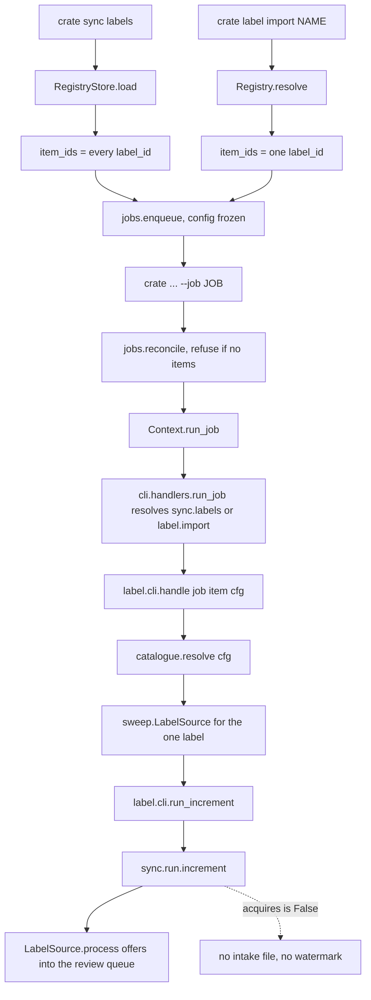
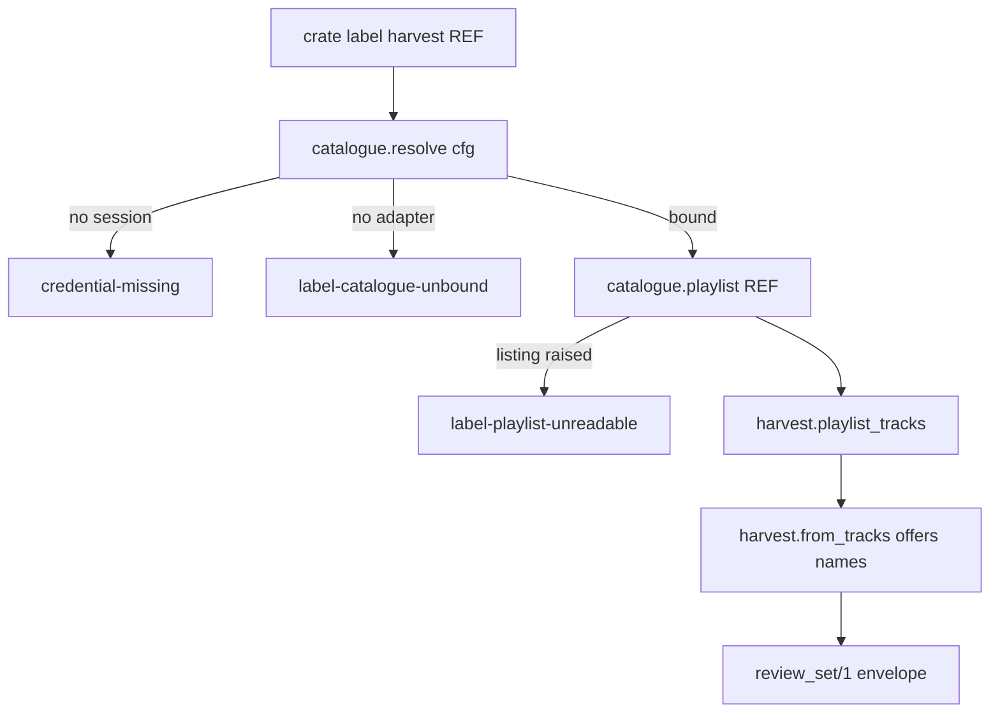

# Label Workers, the Increment Runs and Harvest Stops Refusing Everything - Plan

Board unit U52, GitHub issue #70, branch `relay/70`.

**Three ID namespaces meet in this document and they are not the same.** Plan requirements are `R1` upward with no hyphen. The repository's ledger entries keep their hyphen, `R-135`. The seam document `DJ_tools/docs/migration/00-SEAM-DECISIONS.md` owns its own numbering and is always cited with a prefix, as in seam KTD9 and seam R32. Plan implementation units are `U1` upward and are plan local; the board's unit for all of this work is U52.

---

## Goal Capsule

- **Objective:** A person who registers a favourite label and runs `crate sync labels` gets a job carrying real items, a warning at enqueue that no catalogue adapter is bound, and an item that fails with a named cause instead of a success over work it never did. Against a bound catalogue, which after this branch exists only in the suite, those items are offered into the review queue. A person who runs `crate label harvest` is refused with a cause that names the build rather than blaming their playlist. Today both commands complete and neither does anything, which is the state this replaces.
- **Means:** Bind the two label handler keys to a per item worker that constructs `LabelSource` and drives `cratekit.sync.run.increment`, behind a new catalogue provider seam the tests substitute (KTD1, KTD3, KTD5).
- **Authority hierarchy:** `DJ_tools/docs/migration/00-SEAM-DECISIONS.md` outranks this plan. `docs/METHOD.md` owns the merge bar, the driver rules and the mutation table method. `CLAUDE.md` owns the session contract. This plan outranks the issue body where the two disagree, and every such disagreement is named in Scope Boundaries.
- **Stop conditions:** Stop and record rather than build if closing a residual requires a live provider call, a write to the live rekordbox database, or a change to `cratekit.core.jobs.drive`. Stop if the fix for a residual cannot be landed on the checking path and would have to be duplicated per caller.
- **Execution profile:** Seven units on one branch, landed in order. The battery runs green before each commit; the branch merges once, by the runner.
- **Tail ownership:** The runner owns the gate, the merge and the push. This plan owns the code, the tests, the ledger edits and the mutation table.

---

## Product Contract

### Summary

Bind `sync.labels` and `label.import` to a worker so a queued label job runs its increment for real, derive each job's items from the favourite label registry so no empty job can be queued, add a catalogue provider seam that the tests own and that no shipped adapter fills, and rebuild `crate label harvest` on that seam so it can succeed against a readable playlist and refuses honestly when it cannot. Two defects are fixed on the checking path as part of making the path reachable: an unreadable listing now raises instead of reporting a verified empty catalogue, and an increment whose source only offers no longer writes an intake file or advances a watermark. One ledger entry closes on that, R-140; four more are amended rather than closed.

### Problem Frame

`cratekit.label.cli.run_increment` has no caller anywhere in `src`. `cratekit.label.sweep.LabelSource` is never constructed in `src`. `cratekit.sync.run.increment`'s only `src` caller is `run_increment` itself, which has no caller, and `cratekit.sync.run.run_independent` has no `src` caller at all, so the shared increment engine is unreachable rather than merely uncalled. So `crate sync labels` and `crate label import` freeze a configuration, write a job row, and report it. The items stay pending forever, because there are no items: neither verb passes `item_ids` to `jobs.enqueue`, and `jobs.drive` treats a job with no items as a genuine no op and transitions it straight to SUCCEEDED. Two of the fifteen verbs R-203 still counts.

`crate label harvest` is worse than dormant. It raises `label-playlist-unreadable` on every call and has never listed a playlist, so it tells a person their playlist could not be read when nothing was ever contacted. R-139 records it as a command that cannot succeed.

Under `docs/METHOD.md`'s merge bar, condition three, a finding whose input this branch makes reachable is this branch's to answer. Binding these handlers makes four recorded findings reachable at once: R-135, R-137, R-138 and R-140. This is the same shape R-204 records about the acquisition handler, and it is why this unit's scope is wider than one call site.

### Requirements

**The workers run**

- R1. `crate sync labels` queues one job whose items are the registered favourite labels, and driving that job offers each label's confirmed releases into the `label-release` review queue. Ownership dedup does not run, because the worker passes an empty owned set per KTD9, so a release the library already holds is offered rather than filtered.
- R2. `crate label import <name>` queues one job with exactly one item, the resolved label, and driving it offers that label's releases.
- R3. Both verbs resume a queued job through `--job` and drive it to a terminal state, and a job that closed carrying a cause raises that cause rather than reporting a normal envelope.
- R4. Both handler keys move from `HANDLERS_NOT_YET_BOUND` to `HANDLERS` in `src/cratekit/cli/handlers.py`, and `unbound_reason` returns `None` for each.

**No empty job, and no clean report over work that did not happen**

- R5. `crate sync labels` refuses to queue when the favourite label registry is empty, naming the command that adds a label.
- R6. `crate label import` cannot queue an empty job by construction, because it already refuses an unresolvable name before it queues.
- R7. Resuming a job that carries no items refuses rather than driving it, because a job frozen by an earlier build has no items and driving it would report a success over work it never did. The refusal lives on the resume branch, which U5 builds.
- R8. An item whose increment returned per candidate errors fails, carrying those errors as its cause, rather than completing.

**The increment tells the truth about what it did**

- R9. A source that offers rather than acquires writes no intake file, registers no artifact and advances no source watermark. `LabelSource` is such a source. This closes R-140.
- R10. A label listing that could not be read raises `run.LookupFailure`, which the increment converts to `sync-source-lookups-failed`, so an unreachable provider surfaces as the item's cause and never as `shortfall="empty"`. This closes two of R-135's three producers, the raising listing and the missing method; the third stays recorded.
- R11. An artist object that exposes none of the listing methods is an unreadable provider, not an empty catalogue. An artist the catalogue could not resolve at all is the same, so the seam raises rather than returning nothing.

**Harvest**

- R12. `crate label harvest <playlist>` resolves the playlist through the catalogue seam, lists its tracks, offers the verified label names into the `label-release` review queue, and emits a `review_set/1` envelope.
- R13. `label-playlist-unreadable` is raised only when a bound provider failed to list the named playlist.
- R14. A build with no catalogue adapter refuses harvest with a cause that says the capability is not built, distinct from the cause that says the playlist could not be read.

**The seam and the frozen configuration**

- R15. All provider reads for labels go through one module, `src/cratekit/label/catalogue.py`, whose `resolve` the tests replace in process. No shipped adapter fills it, and `bound()` answers that question without raising.
- R16. Each queueing verb warns at enqueue when no adapter is bound, so a person learns it at the moment the information is still useful rather than inside a detached child.
- R17. The worker reads its configuration from the parameter the driver hands it and resolves every library scoped path against that configuration, the review store and the staging directory among them. Seam KTD9. The favourite label registry is installation scoped and is not one of those paths, which KTD6 states rather than assumes.

### Scope Boundaries

**In scope:** the two handler bindings, the item derivation, the catalogue seam, the harvest rebuild, the two checking path fixes for R-135 and R-140, the ledger edits, the mutation table, and the explanation `CLAUDE.md` requires.

**Where this exceeds the issue, and why.** The issue names R-135, R-137 and R-138 as entries to read before designing and does not name R-140 at all. This plan fixes R-135's reachable producers and closes R-140, both on the checking path. That is not invention: `docs/METHOD.md`'s merge bar makes a finding whose input a branch creates that branch's to answer, R-140's own ledger text says the labels increment is what reaches it, and the Goal Capsule puts METHOD above this plan and above the issue. The two entries the issue did name and this plan does not fix are below.

**Deferred to follow up work**

- R-137, newest N taken before owned dedup. Not fixed. There is no producer of an owned identity set on the labels path anywhere in `src`, so the worker passes an empty owned set and the ordering defect is not reachable through the shipped caller. Recorded, with the reachability stated as measured rather than assumed.
- R-138, the 400 cap counts albums under a constant named `DEFAULT_TRACK_LIMIT`. Not fixed, and its two arms are answered separately. The counting arm, count tracks rather than albums, loses its motivation to R9: the labels increment offers rather than acquires, so the cap bounds review queue rows and never bytes of audio. The naming arm, rename the field so the number means what it does, survives that and is declined for its own reason: `LabelEntry.track_limit` is a persisted registry field, so renaming it is a migration this unit does not carry. This branch is the first caller ever to apply either as the operative cap, and the amendment says so.
- The label catalogue adapter. Nothing in this branch fills the seam, so the single real user still cannot run any label workflow when it lands. That is the whole remaining distance and it earns a follow up board unit rather than only a ledger line, because a residual is the register of what was accepted and not a queue. The adapter itself is unattended work in the shape U56 uses; the first live sweep against it stays attended.
- `label.marks.advance` stays without a caller. A per label year is an audit record that gates nothing under seam KTD11, and adding a first caller for it is a first caller obligation this unit does not need.
- Per label offer counts in the verb's own envelope. The envelope stays exactly `job_state/1` and the review queue is the product's record of what was offered. Recorded as a new residual.
- `sync.all`. `src/cratekit/sync/cli.py` queues one job per source under `ctx.entry.handler_key`, which is `sync.all`, so binding `sync.labels` does not make `crate sync all` execute anything. That is a separate entry in R-203 and it carries R-130's run identity obligation.

**Outside this unit entirely:** a live provider call, which is attended. U29, U30, U20, R-9, A1, A2 and `.worktrees/conformance`, per the issue and `docs/METHOD.md`'s do not touch section.

### Sources

- `src/cratekit/label/cli.py`, `src/cratekit/label/sweep.py`, `src/cratekit/sync/run.py`, `src/cratekit/cli/handlers.py`: the code under change.
- `src/cratekit/favorites/cli.py` and `src/cratekit/backup/cli.py`: the two worked examples. Backup is the closer one, because it is a queued verb with no gate.
- `src/cratekit/modules/outbound/account.py`: the shape the catalogue seam mirrors.
- `src/cratekit/modules/outbound/shell.py`, the zero item refusal and the closed cause re raise: the two load bearing fragments worth lifting.
- `docs/residual-findings.md`, entries R-135, R-137, R-138, R-139, R-140, R-203, R-204.
- `docs/solutions/workflow-issues/adding-the-first-caller-makes-you-the-owner-of-its-unreviewed-defects.md`.
- `docs/solutions/workflow-issues/a-watermark-as-date-floor-rebuilds-the-silent-empty-run.md`.
- `docs/solutions/workflow-issues/a-frozen-config-is-frozen-against-the-file-not-against-an-env-override.md`.

---

## Planning Contract

Plan local decisions are numbered KTD1 upward. They are distinct from the seam document's numbering, which is always cited with a prefix.

### Key Technical Decisions

- KTD1. **One favourite label is one item.** The item id is the `label_id`, never a display name, per seam R19. Chosen over one item per release, which would require listing the provider at enqueue time. Governs R1, R2.
- KTD2. **Items are derived from the favourite label registry, never from a provider listing.** `src/cratekit/backup/cli.py` established the rule and stated the reason: items must be derivable without touching the machine, so queueing cannot refuse where the work would have run. A provider listing at enqueue would also freeze a catalogue snapshot that has moved by the time the driver claims it. Governs R1, R5.
- KTD3. **A source declares whether it acquires, and the increment reads that declaration.** `cratekit.sync.run.Source` gains an `acquires` attribute defaulting to `True`; `LabelSource.acquires` is `False`. `increment` reads it and, when false, skips the intake append, the artifact registration and the watermark advance. Chosen over a keyword argument on `increment`, because the fact belongs to the source that offers rather than to each call site, and over widening `IncrementResult`, which R-136 records as a contract change. **The caller obligation this creates is stated rather than left implicit:** after this, a non empty `processed` tuple with `shortfall=None` no longer implies the intake file holds those identities, and `IncrementResult` gives a caller no way to ask. `run_independent` returns a mixed dict with no per source signal, so `sync.all` is the caller that will need the distinction. Recorded as a residual by U7. Governs R9.
- KTD4. **The unreadable listing raises inside `sweep.list_for_label`, the checking path, and the seam raises rather than returning nothing for a label it cannot resolve.** Two places, because `LabelSource.list_recent` skips a label with no artist object before `list_for_label` is ever reached, so `list_for_label` alone does not cover the caller this branch adds. Chosen over raising inside the new worker, which is `docs/METHOD.md` defect pattern three, a fix on the performing path that leaves the hole open. Governs R10, R11.
- KTD5. **Harvest becomes real behind the same catalogue seam rather than staying a refusal.** The issue offers both arms and names the refusal the worse state. One seam serves three verbs, and R-139's closing condition asks for exactly this. The refusal a person gets from today's build changes from a false statement about their playlist to a true statement about the build. Governs R12, R13, R14.
- KTD6. **The favourite label registry is installation scoped, so the worker constructs `RegistryStore()` plainly and the frozen configuration is proven on a path that can actually move.** `label_intent` declares `root=StateRoot.INSTALLATION` in `src/cratekit/core/config.py`, and `state_path` resolves an installation scoped entry without touching a `Config` at all, so passing `cfg` would return the identical path and a test moving the library root would prove nothing. R17 is therefore proven against a library scoped path the worker genuinely resolves against `cfg`, the review store and the staging directory. The real hazard on the installation side is `CRATEKIT_STATE_DIR`, which a frozen configuration cannot pin; that is recorded rather than papered over. The AST guard in `tests/test_handlers.py` cannot see a reload reached through a helper and says so in its own docstring, so R17 is pinned by a driven test rather than left to the guard. Governs R17.
- KTD7. **No new artifact store, and the envelope stays exactly `job_state/1`.** The handler returns `None`, as backup's does. Per verb detail added beside `progress` is the undeclared key U51 had to remove. The cost, that a completed sweep reports item counts and not offer counts, is recorded as a residual rather than paid for with a second store. Governs R3.
- KTD8. **`outbound/shell.resume` is not reused; `src/cratekit/backup/cli.py`'s gateless resume is the model.** `shell.resume` calls `ctx.gate.require` unconditionally and its digest signature is the fixed outbound triple of playlist, export and tracks. Neither label verb declares a gate and neither carries those payload keys. Two fragments are lifted rather than the function: the zero item refusal and the closed cause re raise. The `master` verb's resume branch is missing the second and must not be copied. Governs R3, R7.
- KTD9. **The worker passes an empty owned set.** No producer of owned identities exists on the labels path in `src`. Stating this is what keeps R-137 a residual under the merge bar's third condition rather than a finding this branch created. **It has a second consequence larger than R-137's and R1 carries it:** `scope.scoped` and `list_for_label` both filter only on membership in the set they are handed, so an empty set means no ownership filtering happens at all, not merely that it happens in the wrong order. A sweep offers releases the library already holds. Recorded by U7. Governs the R-137 deferral.

### High-Level Technical Design

The two verbs share one worker. The seam is the only place a provider is resolved, and it is unbound in every shipped build.

The harvest verb runs in process and queues nothing.

### Assumptions

- The three new refusal slugs are `label-catalogue-unbound`, `label-registry-empty` and `label-sweep-incomplete`. Each needs an entry in `src/cratekit/core/cause.py` and a re pin in `tests/test_reserved_causes.py`. The re pin has two halves: name the three slugs in the comment block, and move the population triple and the kebab literal totals that suite asserts. Take the new numbers by differencing against `origin/main`'s tree rather than by adding three to the old ones. Reusing `label-playlist-unreadable` for the genuine listing failure costs nothing and avoids a fourth.
- The catalogue seam's module is named `catalogue.py` rather than `provider.py`, because `cratekit.acquire.provider_session` already owns the word provider for the credential and `crate doctor` already reports a `credential.provider` check. One symbol meaning two things in two modules is on `docs/METHOD.md`'s list of what a green suite cannot see.
- Residual numbering starts at R-235. Main's highest is R-234, not the R-209 the issue body names; the issue was written before three merges landed. (At the merge on 2026-09-07 main's highest had moved to R-256 through U55 and U56, so the eight residuals this unit filed as R-235 to R-242 on the branch took R-257 to R-264 on merge, per the append only rule.)
- The mutation pass is a full pass at a 45 row cap, because this branch touches the shared increment engine and binds two workers.

### Sequencing

U1 first, because U5 and U6 both depend on the seam U1 constructs. U2 and U3 are independent of each other and both precede U5, because U5's tests assert the behaviour they add. U4 precedes U5 because a worker with nothing to claim cannot be driven. U6 depends only on U1. U7 last, because the ledger records what the six units actually did.

---

## Implementation Units

### U1. The catalogue provider seam and its reserved causes

- **Goal:** One module in `src` resolves everything the label package reads from a provider, and no shipped build fills it.
- **Requirements:** R15, R16, R14.
- **Dependencies:** none.
- **Files:** `src/cratekit/label/catalogue.py` (new), `src/cratekit/core/cause.py`, `tests/label_fakes.py` (new), `tests/test_reserved_causes.py`, `tests/modules/test_labels.py`.
- **Approach:**
  1. Write `src/cratekit/label/catalogue.py` mirroring `src/cratekit/modules/outbound/account.py`: a `bound()` returning a constant, and a `resolve(cfg)` raising `credential-missing` when `secrets.Credential.PROVIDER_SESSION` is absent and `label-catalogue-unbound` otherwise. The docstring says why they are two refusals and not one, in the words `account.py` already uses: they are undone by different acts.
  2. Declare the protocol the three call sites need and nothing more: an artist object for a label entry, a playlist object for a reference, the release search callable `verify.verify_release` takes as `search`, and the name check callable `harvest.from_tracks` takes as `verify`. **State the failure contract on the protocol, not only the shape.** The artist and playlist lookups raise for a label or a playlist the provider cannot resolve, and never return `None`, because `LabelSource.list_recent` skips a label with no artist object without raising and a returned `None` would become a silent empty catalogue. That obligation is R11's and U3 drives it.
  3. Append the three new slugs to `src/cratekit/core/cause.py` in one block, following the U26 and U33 comment convention. `label-catalogue-unbound` and `label-registry-empty` are `PRECONDITION`. `label-sweep-incomplete` is `PRECONDITION` with a resume remediation.
  4. Write `tests/label_fakes.py` as the shared stand in, mirroring `tests/outbound_fakes.py` including its own reason for existing: three private copies of a provider stand in is three descriptions of one protocol. It carries a fake catalogue, a strict variant that raises on anything outside the protocol, an unreadable variant, and a `catalogue_factory(fake)` returning a `resolve(cfg)` drop in.
- **Patterns to follow:** `src/cratekit/modules/outbound/account.py` for the seam, `tests/outbound_fakes.py` for the stand in module, the U26 block in `src/cratekit/core/cause.py` for the appended slugs.
- **Test scenarios:**
  - With no provider session recorded, `catalogue.resolve` refuses `credential-missing` and names the credential in its detail.
  - With a session recorded and no adapter, `catalogue.resolve` refuses `label-catalogue-unbound` and its message says the build has no adapter, not that anything was unreachable.
  - `catalogue.bound()` returns `False` without raising and without reading a credential.
  - The strict stand in raises when a caller reaches for a method outside the declared protocol.
  - The reserved cause suite passes with the three new slugs named in its re pin.
- **Verification:** `catalogue.resolve` raises two distinguishable causes, the fake substitutes in process by replacing the module attribute, and the full battery is green.

### U2. The increment stops claiming an acquisition it did not make

- **Goal:** A source that offers rather than acquires leaves no intake file and no watermark behind. Closes R-140.
- **Requirements:** R9.
- **Dependencies:** none.
- **Files:** `src/cratekit/sync/run.py`, `src/cratekit/label/sweep.py`, `tests/test_incremental_sync.py`.
- **Approach:**
  1. Add `acquires: bool` to the `Source` protocol in `src/cratekit/sync/run.py` with the meaning stated on it: whether a completed `process` call means the item landed in the library or means it was offered for a decision.
  2. In `increment`, read the declaration off the source with a default of `True`, so every existing source and every test double is unaffected. When it is false, return the successful `IncrementResult` without appending the intake file, without registering the artifact and without advancing the source watermark.
  3. Set `LabelSource.acquires = False` in `src/cratekit/label/sweep.py` beside a comment naming `review.offer` as the reason: it queues an item and returns it, and its verdict is `None`.
  4. Leave `IncrementResult` unchanged. R-136 records widening it as a contract change and this unit is not that unit.
- **Patterns to follow:** the docstring style of `increment`, which already states the watermark rule in one sentence.
- **Test scenarios:**
  - An offering source that processes three candidates returns `shortfall=None` and writes no `{run_id}_synced.xml` at the staging path.
  - The same run leaves the source watermark unset, read back from the watermark store rather than inferred.
  - An acquiring source in the same test module still writes the intake file and still advances the watermark, so the default is pinned beside the new branch.
  - Two sources in one run, one acquiring and one offering, produce one intake file holding only the acquiring source's identities.
  - `LabelSource.acquires` is `False`, asserted on the class rather than on an instance.
- **Verification:** the offering branch and the acquiring branch are both driven, and the intake file's absence is asserted at a path the test computed rather than by a directory being empty.

### U3. An unreadable listing raises instead of reporting an empty catalogue

- **Goal:** A provider that could not be read is distinguishable from a label with nothing new. Closes two of R-135's three producers.
- **Requirements:** R10, R11.
- **Dependencies:** none.
- **Files:** `src/cratekit/label/sweep.py`, `tests/modules/test_labels.py`.
- **Approach:**
  1. In `sweep.list_for_label`, wrap the `crawl.releases(artist)` call. `listing.fetch_with_retry` re raises the provider's own exception after its retries, and `listing._paged_caller` raises `ListingNotPaginated`, which is a plain `RuntimeError`. Both become `run.LookupFailure` carrying the original as the cause.
  2. In the same place, refuse an artist object exposing none of the listing methods `listing.artist_releases` tries. `artist_releases` skips a missing method rather than raising, which is the producer R-135 names as returning an empty list rather than an error.
  3. Do not touch `listing.paginate`. An empty first page from a method that exists is a genuinely exhausted crawl and is the one case that should still report empty. `paginate` also turns a `None` answer into a break, which is R-135's third producer; it stays open and U7 records it.
  4. Close the path `list_for_label` cannot see. `LabelSource.list_recent` skips a label whose artist object is absent, so the seam's artist lookup raises rather than returning `None`, per KTD4's second clause and U1's protocol failure contract.
  5. `run.increment` already converts `LookupFailure` into `sync-source-lookups-failed`, so nothing changes there.
- **Patterns to follow:** `docs/solutions/workflow-issues/a-watermark-as-date-floor-rebuilds-the-silent-empty-run.md`, whose paired test shape is an outcome test named after the mechanism plus an adversarial test that would pass under the brief's literal reading.
- **Test scenarios:**
  - An artist object whose listing method raises produces `run.LookupFailure` from `list_for_label`, and the original exception is reachable as the cause.
  - The same failure driven through `run.increment` produces `sync-source-lookups-failed` and not `shortfall="empty"`.
  - An artist object exposing neither `get_albums` nor `get_ep_singles` raises rather than returning no candidates.
  - An artist object exposing one method that returns an empty first page still reports `shortfall="empty"`, so the fix did not turn every quiet label into an error.
  - A registered label the catalogue cannot resolve to an artist surfaces as `sync-source-lookups-failed` through `increment`, not as `shortfall="empty"`, so the path `list_for_label` never sees is driven too.
  - The assertion names where the run stopped, not only that the processed set was empty.
- **Verification:** the empty and the unreadable cases produce different observable outcomes, and both are driven through `increment` rather than only through `list_for_label`.

### U4. Real items at enqueue, and the zero item refusal at drive

- **Goal:** Neither verb can queue a job with nothing to claim.
- **Requirements:** R1, R2, R5, R6.
- **Dependencies:** U1.
- **Files:** `src/cratekit/label/cli.py`, `tests/test_label_workers.py` (new).
- **Approach:**
  1. Split `_queue` so the two verbs pass their own `item_ids`. `sync_labels` loads the registry and passes every `label_id`. `import_label` already resolves one entry and refuses `label-unknown` when it cannot, so it passes that one `label_id`.
  2. `sync_labels` refuses `label-registry-empty` when the registry holds no labels, naming `crate label registry add` in its steps.
  3. Both verbs emit an enqueue time warning when `catalogue.bound()` is false, in the shape `src/cratekit/modules/outbound/shell.queue_warnings` uses: a code and a message saying the job will queue and then fail at the provider seam.
  4. Leave both payloads as they are. The item is authoritative and the payload's `label_id` is not what the worker reads.
- **Patterns to follow:** `src/cratekit/master/cli.py` for the one line `item_ids` comment naming the empty success it prevents, `src/cratekit/backup/cli.py` for deriving items without touching anything the work needs.
- **Test scenarios:**
  - `crate sync labels` with three registered labels queues one job carrying three item rows, read back from the job store in ordinal order.
  - `crate sync labels` with an empty registry refuses `label-registry-empty` and writes no job row.
  - `crate label import` of a registered label queues one job carrying exactly one item whose id is the `label_id`.
  - `crate label import` of an unregistered name still refuses `label-unknown` and writes no job row.
  - With no adapter bound, both queueing paths emit the unbound warning and still queue.
- **Verification:** the item rows are read back from the store, and the enqueue refusal is proven by the absence of a job row rather than by an exception alone.

### U5. The worker, the bindings, and the resume branch

- **Goal:** A queued label job runs pending to done through the shipped resume path, and a job with nothing to claim refuses there rather than driving.
- **Requirements:** R1, R2, R3, R4, R7, R8, R17.
- **Dependencies:** U1, U2, U3, U4.
- **Files:** `src/cratekit/label/cli.py`, `src/cratekit/cli/handlers.py`, `tests/test_label_workers.py`, `tests/test_handlers.py`.
- **Approach:**
  1. Write one `handle(job, item, cfg)` in `src/cratekit/label/cli.py` serving both keys. It reads the `label_id` from `item.item_id`, never from the payload, which is the first defect U46's end to end drive surfaced.
  2. It loads the favourite label registry with a plain `RegistryStore()`, per KTD6, and refuses `label-unknown` when the registry no longer carries the queued label.
  3. It resolves the catalogue by looking the module attribute up at call time, builds a single label `Registry` and a `LabelSource` over it, and calls `run_increment` with an empty owned set, the entry's effective limit, and the run id from the payload falling back to the job id.
  4. It raises `label-sweep-incomplete` when the result carries errors, so a partial round fails the item rather than completing it. It returns `None` on success; there is no artifact.
  5. Add the resume branch to `sync_labels` and `import_label`, in the order `src/cratekit/backup/cli.py` uses: reconcile, refuse an itemless job, run through `ctx.run_job`, re fetch, then re raise the cause of any closed job that carries one. The re raise sits outside the `is_open` branch, which is the placement backup's own comment records as its first draft's bug.
  6. Move both keys from `HANDLERS_NOT_YET_BOUND` to `HANDLERS` in `src/cratekit/cli/handlers.py`. Deleting the exemption is half the change and the suite fails if only one half lands.
- **Patterns to follow:** `src/cratekit/backup/cli.py` lines around its resume branch and `_refuse_an_empty_job`; `src/cratekit/favorites/cli.py` for the per item worker docstring that says why the item names the row.
- **Test scenarios:**
  - A `sync.labels` job with two labels runs pending to done against a faked catalogue, and both items are read back as done from the job store.
  - The same job offers into the `label-release` review queue, and the two labels produced different offers, so an item that read the payload instead of the item would fail.
  - A catalogue whose listing raises surfaces as the item's cause `sync-source-lookups-failed`, and the job is FAILED rather than SUCCEEDED with an empty result.
  - An increment returning per candidate errors fails the item with `label-sweep-incomplete`.
  - The frozen configuration reaches the worker: with `CRATEKIT_LIBRARY_ROOT` removed from the environment, the saved configuration's root and `db_path` moved together after the job was queued, and the divergence asserted before driving, the worker's review store opens under the frozen library rather than the current one. Assert the divergence exists before driving, or the test cannot fail.
  - A job carrying no items refuses on resume, naming the job id, and the job is left open rather than driven.
  - `crate label import` runs its one item to done through the same worker.
  - A job that closed carrying a cause raises it from the resume branch rather than returning a normal envelope.
  - `unbound_reason` returns `None` for both keys, and neither key appears in both handler tables.
  - The emitted envelope validates as `job_state/1` and carries no key beside the declared four.
- **Verification:** the increment is driven through `Context.run_job` and the real handler resolution rather than by calling `handle` directly, at least once per key. `jobs.drive` still has exactly one call site.

### U6. Harvest becomes a command that can succeed

- **Goal:** `crate label harvest` lists a readable playlist and offers the labels behind its tracks, and every refusal it can give says something true. Amends R-139 rather than closing it, because no shipped build fills the seam.
- **Requirements:** R12, R13, R14.
- **Dependencies:** U1.
- **Files:** `src/cratekit/label/cli.py`, `tests/modules/test_labels.py`, `tests/test_label_workers.py`.
- **Approach:**
  1. Replace the unconditional refusal. Load the configuration, resolve the catalogue, resolve the playlist from the reference, list its tracks through `harvest.playlist_tracks`, and offer through `harvest.from_tracks` with the catalogue's name check callable and a review store opened against the loaded configuration.
  2. Translate provider failures at the label boundary. `listing.fetch_with_retry` re raises the provider's own exception and `ListingNotPaginated` is a plain `RuntimeError`; both become `label-playlist-unreadable`, which is already reserved at `UPSTREAM_UNAVAILABLE`. A `CratekitError` from further down passes through unchanged.
  3. Emit `review_set/1`: the queue slug, the offered items, and the count of names that could not be resolved.
  4. Rewrite the existing refusal test rather than deleting it. It currently builds a `Ctx` whose `envelope` raises, which cannot survive a verb that emits, and with the seam in place an unbound build now refuses at a different point than the test asserts.
- **Patterns to follow:** `src/cratekit/label/harvest.py`'s own `HarvestReport`, which already names its populations `offered` and `dropped` rather than acquired.
- **Test scenarios:**
  - With no adapter bound, harvest refuses `label-catalogue-unbound`, the review queue is still empty, and the message does not claim the playlist was unreadable.
  - With no provider session recorded, harvest refuses `credential-missing`.
  - With a bound catalogue whose playlist listing raises, harvest refuses `label-playlist-unreadable` and the review queue is still empty.
  - With a bound catalogue and a readable playlist, harvest offers one review item per verified label name and emits a `review_set/1` envelope whose queue is `label-release`.
  - A track carrying no copyright string contributes nothing and is counted in the unresolved total rather than dropped silently.
  - A playlist with no tracks offers nothing and reports zero rather than raising, so an empty playlist and an unreadable one stay distinguishable.
- **Verification:** all four refusal and success branches are pinned, the review queue's contents are read back from the store, and the envelope validates against `review_set/1`.

### U7. The ledger, the mutation table, and the explanation

- **Goal:** The repository records what this branch closed, what it made reachable and chose not to close, and what a green suite could not see.
- **Requirements:** all, as evidence.
- **Dependencies:** U1 through U6.
- **Files:** `docs/residual-findings.md`, `docs/mutation/u52-item-derivation.toml` (the authored row spec `scripts/mutate.py` takes), `docs/mutation/u52-item-derivation.md`, `docs/mutation/u52-item-derivation.json`, `RESTART-cratekit.md`.
- **Approach:**
  1. Mark R-140 closed by this unit, with the evidence its closing condition asks for and the file and function that carries it. Leave the entry in place; numbers are append only.
  2. Amend R-135, R-137, R-138 and R-139 with a dated paragraph each, rather than closing any of them. R-135's says which two of its three producers now refuse and that `paginate`'s `None` first page remains. R-137's is the absent owned set producer, and it names the larger consequence KTD9 records. R-138's answers both arms separately per Scope Boundaries. R-139's follows R-204's "still open after U47" shape: the false refusal is gone and the success path is driven under a fake, and the command still cannot succeed in a shipped build because nothing fills the seam.
  3. Correct R-203's count in the same style its existing correction uses: name what is now true, leave the title's number alone, and say the population is derived from `registry.ENTRIES` by `tests/test_handlers.py`.
  4. Record new residuals from R-235 upward. At minimum, six: a completed sweep reports item counts and no offer counts in its own envelope; the catalogue seam has no adapter, so no label workflow can run outside a test; the labels path applies no ownership filtering at all, so a sweep offers releases the library already holds; `IncrementResult` no longer distinguishes a run that wrote the intake file from one that did not, and `sync.all` is the caller that will need it; `listing.artist_releases` skips a missing listing method individually, so a client exposing one of two yields a half catalogue reported as a complete crawl; and `sync.labels` and `label.import` declare `writes={"xml","files"}` and `destructive=True` over workers that now write only review rows, which is R-233's shape on two more verbs. Do not file `sync.all`'s unbound worker as new: R-203 already counts it.
  5. Run the mutation table with `scripts/mutate.py`. Rows cover the item derivation, the zero item refusals at both ends, the `acquires` branch, the `LookupFailure` translation, the shortfall to cause mapping, the frozen configuration path resolution, and the four harvest branches. Full pass, 45 row cap, and log what was dropped and why if the cap binds. Confirm deaths on the importing test files and promote every zero to a full run before reporting it.
  6. Update `RESTART-cratekit.md`'s wave state and write the code and architecture explanation `CLAUDE.md` requires.
- **Test scenarios:** Test expectation: none. This unit produces records, and the mutation table is itself the measurement.
- **Verification:** the two duplicate checks in `docs/METHOD.md` are clean, the mutation table is committed with full row descriptions and not only counts, and the ledger says which entry closed and which four were amended, with the reason for each amendment.

---

## Verification Contract

| Gate | Command | Applies to |
|---|---|---|
| Lint | `.venv/bin/ruff check src tests scripts` | every unit |
| Suite | `.venv/bin/python -m pytest` | every unit |
| Repository scan | `.venv/bin/python scripts/scan_repo.py` | every unit |
| Collected count | `.venv/bin/python -m pytest --collect-only -o addopts=` | after any test file is added or renamed |
| Mutation table | `scripts/mutate.py`, full pass, 45 row cap | U7 |
| Board | `.venv/bin/python scripts/board.py audit` | before the session ends |

Never pass `-q`; `pyproject.toml` already sets it. Reconcile the collected count by identifier and not by total, because a total only check shows a healthy rise and hides a collapse.

Beyond the battery, hunt what a green suite cannot see: duplicate keys in the two handler tables, and whether `catalogue` now means one thing in `src/cratekit/label/` and something else where `provider` already appears.

---

## Definition of Done

**Global**

- The three battery commands are green, run in the foreground, from the main checkout's own `.venv`.
- `crate sync labels`, `crate label import` and `crate label harvest` each do something observable against a faked catalogue, proven by rows read back from a store rather than by a return value.
- Neither label key appears in `HANDLERS_NOT_YET_BOUND`, and `tests/test_handlers.py` derives that from `registry.ENTRIES` rather than from a list.
- No beat grid is written on any surface, the live rekordbox database is untouched, and `DJ_tools` carries no code change.
- No em dash, en dash or double hyphen in any prose, comment, commit message or ledger entry.
- Every residual number added is above R-234, and no number already on `main` moved.
- Abandoned approaches are removed from the diff rather than left behind a flag.

**Per unit**

| Unit | Done when |
|---|---|
| U1 | Two distinguishable refusals, a `bound()` that answers without raising, and a shared stand in module the later units import. |
| U2 | An offering source leaves no intake file and no watermark, and the acquiring default is pinned beside it. |
| U3 | An unreadable listing and an exhausted one produce different observable outcomes through `increment`, including the unresolvable label `list_for_label` never sees. |
| U4 | Both verbs queue real item rows and an empty registry refuses. |
| U5 | A two label job runs pending to done through `Context.run_job`, the two items did different work, an itemless job refuses on resume, and the frozen configuration reaches the worker under a proven divergence. |
| U6 | All four harvest branches are pinned and the success branch emits a valid `review_set/1`. |
| U7 | One entry closed, four amended with reasons, six new residuals recorded, and the mutation table committed with its rows and its authored spec. |
