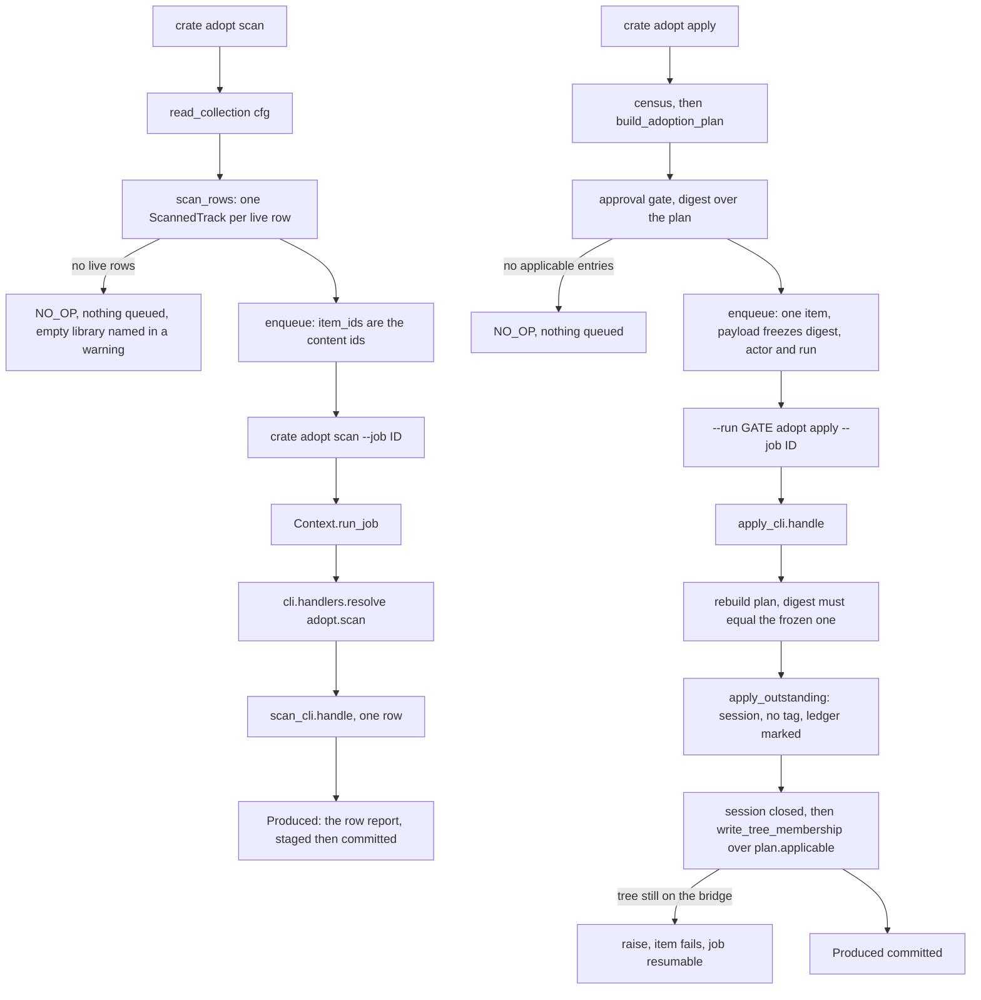

# The collection reader, and the two adopt verbs executing - Plan

Board unit U55, GitHub issue #73, phase E. Branch `relay/73`, taken from `main` at
`40826e1`.

---

## Goal Capsule

- Objective: a person who runs `crate adopt scan` stops getting a queue with
  nothing in it and a report about a library nothing read. The census becomes the
  person's own collection, the plan becomes a plan about their tracks, and both
  adopt verbs drive their items from pending to done or say exactly why they
  cannot.
- Means: one collection reader over the configured rekordbox database, read only;
  real `item_ids` at both enqueue sites; both handler keys bound to workers.
- What this build actually reaches: the scan runs end to end and produces a real
  census. The apply reaches the membership write and lands it on a library whose
  taxonomy tree has been cut over to the database. No shipped verb performs a
  cutover, so on any real library today the apply refuses per entry instead, and
  the membership write is exercised by tests that record a cutover directly. That
  asymmetry is the honest state of this build and it is recorded rather than
  papered over.
- Authority: `DJ_tools/docs/migration/00-SEAM-DECISIONS.md` outranks this plan.
  `docs/METHOD.md` owns the merge bar and the mutation method. `CLAUDE.md` owns
  the standing constraints. This plan outranks issue #73's brief where the two
  differ, and every such difference is recorded as a KTD.
- Execution profile: one branch, one merge, the three part battery plus a mutation
  table over the reader, the census wiring, both verbs' enqueue and resume
  branches, and the membership writer.
- Stop conditions: stop and record rather than widen if the work would need a
  cutover performed against a real library, an XML bridge membership writer, or a
  shipped `adopt.revert` verb. Stop if the reader cannot be made to read a
  database without a code path that could write one.
- Tail ownership: this plan ends at a green battery on `relay/73`. The runner owns
  the gate, the merge and the push.

---

## Product Contract

### Summary

`cratekit.adopt.scan` is a complete census engine that has never been handed a
row. `cratekit.adopt.apply_cli.census` returns the empty tuple and says in its own
docstring that it will until a reader lands. Both adopt verbs freeze a
configuration, queue a job with no items, and report it. This work lands the
reader, wires it into both verbs, decides what each verb's items are, refuses to
queue zero of them except through the honest empty library path, and binds both
handler keys to workers.

It also closes a seam mismatch found while planning: the mapping
`adopt.apply_cli._collector` builds is keyed by content identifier and
`cratekit.write.trees.write_tree_membership` matches its values as LOCATIONS, so
handing one to the other matches nothing and reports a clean session over a write
that never happened. That is the wiring this unit owns and it is fixed here rather
than filed.

### Problem Frame

Three facts, each verified on `main` at `40826e1` on 2026-09-02.

- `adopt/apply_cli.py:101` defines `census(cfg)` returning `()`. Every apply
  therefore builds the empty plan, has nothing outstanding, and reports OK.
  `tests/test_adopt_apply_cli.py:480` drives that emptiness on purpose so the day
  a reader lands is visible.
- `adopt/scan_cli.py`'s `scan` docstring says the worker that walks a real
  collection "is not in this unit and cannot be", because turning a library into
  `CollectionRow` values needs a reader that had not landed.
- `cli/handlers.HANDLERS_NOT_YET_BOUND` carries `adopt.scan` and `adopt.apply`
  with the reason "no worker yet, R-203". Neither verb passes `item_ids` to
  `jobs.enqueue`, and `core/jobs.drive` reports a zero item job as SUCCEEDED by
  design, so even a bound worker would report a clean success over work it never
  did.

The cost is compound and it is the same cost R-198 named: a person runs an
adoption scan, is told a job is queued, and the job sits pending for ever over a
library nothing read.

### Key Decisions

- **KD1. The reader READS the configured rekordbox database and no code path in
  it can write one.** Reading the configured database from a shipped verb is
  already the product's practice: `deletion/cli.py`, `write/routing_cli.py` and
  `cli/converge.py` all do it. The standing constraint protects the live database
  against WRITES and against tests that can reach it; every driven test here uses
  a disposable database built in a temporary directory, or a `CRATEKIT_TEST_DB`
  snapshot copied again before anything runs. Governs R1, R2, R11.
- **KD2. No tag is written by this unit.** `apply_plan`'s `tag_value` stays
  `None`, which is the value that writes nothing, and the reason is not caution:
  the tag write is the one act no snapshot undoes, the registry declares no
  `adopt.revert` verb, so a person could not undo one, and seven ledger findings
  against the revert path (R-83, R-84, R-89, R-90, R-91, R-93, R-94) are
  unreachable today precisely because nothing writes a tag. Landing a reader must
  not be what makes them reachable. Governs R16.
- **KD3. An empty library is a legitimate zero and it is reported, never queued.**
  A refusal would make the one library that most needs a census the one library
  that cannot have one. Governs R5, R6.
- **KD4. Adoption cannot file tracks into a library whose taxonomy tree has not
  been cut over to the database, and that is a property of the tree registry
  rather than a gap in this unit.** Governs R8, R15.

### Requirements

**The reader**

- R1. One module turns the configured rekordbox database into
  `cratekit.adopt.scan.CollectionRow` values: content identifier, recorded
  location, genre, and the soft delete marker read rather than defaulted.
- R2. The reader opens the database read only and no code path in it can open one
  for writing. Asserted mechanically, not by review.
- R3. The reader takes an iterable of mapped rows, so every branch in the
  derivation is drivable with no database at all, and a thin sibling opens the
  handle and supplies `db.get_content()`.
- R4. A row whose genre foreign key names a genre row that does not exist reads as
  no genre, the same as a row with no genre, and that fusion is stated where a
  reader will find it.

**The census and the zero item rule**

- R5. `census(cfg, declared)` returns the scanned rows of the person's own
  collection.
- R6. Neither adopt verb can enqueue a job with zero items. A library with nothing
  to do reports that outcome and queues nothing, and the envelope distinguishes it
  from a queued job.
- R7. `adopt.scan` derives one item per live collection row. `adopt.apply` derives
  exactly one item, the plan itself, and refuses to create it when the plan has no
  applicable entries.

**The workers**

- R8. `adopt.apply` resolves to a worker that writes the plan's memberships
  through `write_tree_membership`, handing it LOCATIONS, in one session after the
  apply loop's session has closed.
- R9. `adopt.scan` resolves to a worker that classifies one collection row and
  commits a durable artifact recording what it found, before the item's row flips
  to done.
- R10. Both workers receive the configuration the job was frozen against and load
  no other.
- R11. Every driven test that touches a database touches a disposable copy in a
  temporary directory.

**What a person is told**

- R12. `crate job show` reports `worker: bound` for both handler keys.
- R13. A completed scan's envelope names the census counts from the committed
  artifacts, so a person learns what their library looks like without opening a
  file.
- R14. A worker whose work did not land raises, so the item fails, the job reaches
  FAILED, and a resume attempts it again.
- R16. Neither worker writes a tag. `apply_plan` is called with `tag_value=None`,
  and nothing in this unit supplies one.

**Honesty**

- R15. What this unit did not do is recorded in `docs/residual-findings.md` with
  its measured cost, and R-148's successor is a new numbered residual rather than
  a claim that R-148 half closed.

### Success Criteria

- The reader over a disposable database yields the expected `CollectionRow`
  values, including a row whose title and location carry non ASCII characters in
  both composition forms, and a row whose file is not on disk.
- A test that patches `rb_writer.open_db` and asserts on its arguments proves the
  reader never asks for a write intent open, and a second test proves the
  disposable file's bytes and modification time are unchanged after a full read.
- `census` over the fixture returns rows and over an empty library returns
  nothing, and the two produce visibly different verb outcomes: a queued job with
  items in the first, an explicit no-op naming the empty library in the second.
- A scan job driven through the real resume argv moves every item from pending to
  done, and the third item's artifact read back off disk names that row's
  readability and disposition.
- An apply job on a library whose tree is recorded as database native with an
  existing root writes the memberships, read back from the database copy, and
  marks exactly the applicable entries in the applied ledger and no others.
- An apply on a library whose tree has not been cut over marks nothing, raises,
  and leaves the job FAILED and resumable.
- No invocation of either verb produces a job with zero items.

### Scope Boundaries

In scope: the collection reader, its wiring into `census`, both verbs' item
derivation and enqueue, both workers, the handler table entries, the membership
write that replaces the collector, the reserved causes, the suites that break when
these verbs start doing work, and the record.

Named costs this unit accepts rather than fixes:

- Adoption writes no genre tag, so a library whose files carry a genre the
  taxonomy cannot route is reported as `needs-genre` and nothing is done about it.
  The tag write path exists and stays uncalled.
- An entry this unit marks applied received a membership row and no tag, and the
  applied ledger cannot tell that record from a fully adopted one:
  `apply.outstanding` subtracts applied entry ids from `plan.applicable()`, and
  `entry_id` folds tree, content, bucket and sub with nothing about the tag. So a
  later `tag_value` supplier finds nothing outstanding for anything this unit
  adopted. Recovering those entries needs a ledger field recording what an apply
  actually wrote, which is not this unit's to add.
- Adoption cannot serve a library whose taxonomy tree is still on the bridge,
  which is every library that has not had its cutover. Nothing under `src` calls
  `tree_registry.record_cutover` or `flip`, so no shipped verb can move a library
  to the mode the membership write requires: the refusal names a remedy nobody can
  perform today, and the apply's write path is reachable only from tests that
  record a cutover directly. The capability is U29's and U20's.
- The reader opens the database and materializes the collection once per process.
  A scan of a large library therefore holds the whole collection in memory for the
  life of the job's drive, and commits one JSON artifact per row.
- One membership session per apply JOB, which is what the single item shape buys.
  `write_tree_membership` runs `snapshot.capture` and `snapshot.assert_verified`
  inside its own session, so each session also copies the whole rekordbox database
  and its companion files into a new dated capture directory. One per job is a
  cost; one per track, which is what an item-per-entry shape would have produced,
  is a filled disk partway through an apply.

Deferred for later:

- An XML bridge membership writer, which is what would let adoption serve a
  pre-cutover library.
- A shipped `adopt.revert` verb, without which no tag write should be made.
- A `tag_value` supplier for `apply_plan`, and with it the seven adoption record
  findings and the ledger field that would make them reachable.
- Binding the other thirteen unbound handler keys. R-203.
- The live library walk, the attended pass, and the first live adoption. U29.

Outside this product's identity: any code path in the reader that can open a
database for writing, and any beat grid write in any container.

### Dependencies

Board unit U46, issue #64, merged. It landed `cratekit/cli/handlers.py`,
`Context.run_job`, and the `worker` field on `crate job list` and
`crate job show`. Board unit U51, issue #69, merged, is the worked example for
item derivation, the resume branch, per item artifacts and the R-225 treatment.

---

## Planning Contract

### Key Technical Decisions

- KTD1. **The reader opens the configured database through
  `rb_writer.open_db(path, require_closed=False)` and nothing else.** That is the
  read side of the one gate every database open in this product goes through: it
  names an unmounted volume as an unmounted volume, it raises
  `library-database-missing` when the file is absent, it enforces the binding pin
  even on a read only open, and it runs the cloud sync canary and the schema pin.
  `require_closed` is the write intent flag, so leaving it False is what makes
  this a read. `check_app_version` is passed False for documentation only:
  `open_db` consults it exclusively inside `if require_closed:`, so on a read it
  is inert and no mutation row covers it. Three shipped verbs already open the
  configured database this way and the standing constraint is about writes.
- KTD2. **The reader is two functions and the split is the testability decision.**
  `collection_rows(rows)` takes an iterable of mapped rows and yields
  `CollectionRow` values; `read_collection(cfg)` opens the handle, hands over
  `db.get_content()`, materializes into a tuple, and closes the handle in a
  `finally`. This is the exact shape `cratekit.deletion.library.read_collection`
  and `cratekit.write.routing_pass.content_rows` already use. Note the name
  collision deliberately: `deletion.library.read_collection` takes ROWS while this
  one takes a config, so the two functions share a name and have opposite
  parameters. State it in both directions in the new module's docstring, since one
  symbol meaning two things is what `docs/METHOD.md` says to hunt.
- KTD3. **The genre is read through the binding's `GenreName` association proxy,
  and a dangling `GenreID` reads as no genre.** Measured on 2026-09-02 against a
  disposable database built from the binding's own schema: a row whose `GenreID`
  names a `djmdGenre` row that does not exist returns `None` from `GenreName`
  without raising, which is indistinguishable from a row with no genre at all.
  Both classify as `Disposition.NEEDS_GENRE` through
  `cratekit.adopt.scan.classify_genre`, so the fusion costs a person nothing here
  and is stated in the module rather than left to be discovered.
- KTD4. **The soft delete marker is read through
  `cratekit.write.trees.soft_delete_marker`, never defaulted and never re-spelled.**
  This is that function's third producer. `CollectionRow.deleted` has no default
  on purpose and its comment gives the cost of supplying one: every tombstone
  reaches the census as a live row and adoption proposes to put a track the person
  deleted back into their library. `getattr(row, "rb_local_deleted", False)` is the
  exact defect R-186 records one module over.
- KTD5. **The encryption probe is added to `core/rb_writer.py` as
  `unlock_needed(path)` for this unit's two callers, and `deletion/cli.py` is not
  touched.** The reader and the apply worker both have to decide the `unlock`
  argument, and a third and fourth spelling of the SQLite magic check is the drift
  `docs/METHOD.md` says to hunt. Rewiring `deletion/cli._needs_unlock` to delegate
  would pull a shipped destructive verb into a diff no test in this unit covers,
  which is the same argument that keeps the two `unlock=False` call sites in
  `write/routing_cli.py` and `cli/converge.py` untouched. All three are recorded
  by U6 instead.
- KTD6. **A scan's item is one content identifier. An apply's ITEM IS THE PLAN,
  one item, and the zero item rule is enforced at enqueue.** The two verbs differ
  because their resume mechanisms differ. A scan probes one file per row, holds no
  session, and gains everything from per row resume. An apply already HAS a resume
  mechanism older than the job engine: `apply.outstanding` subtracts the applied
  ledger from the plan, so a re-run does only what did not land, and a second per
  item resume beside it is two mechanisms for one property. The measured reason
  is stronger than the tidiness one: `write_tree_membership` takes a whole mapping
  and opens one session with a full `snapshot.capture` in front of it, so one item
  per entry is one complete copy of the rekordbox database per track. U51's KTD3
  rejected a single item job because the zero item rule would be unenforceable,
  and that objection does not transfer: the rule is enforced here at enqueue
  (KTD7), so a job exists only when there is work, and emptiness is never the
  thing being checked at drive time.
- KTD7. **An empty result is a `NO_OP` outcome, not a refusal, and no job is
  created.** `Outcome.NO_OP` shares exit status 0 with `OK`
  (`core/cause.py:578`), so the verb stays reachable and scriptable. The envelope
  carries `job_id: ""` rather than `None`, which is the declared `job_state/1`
  shape U51 established in `modules/outbound/shell.declined` and the shape R-234
  says `adopt.apply` gets wrong today. Together with R6 this makes the property
  exact: a job exists only when it has items, so `jobs.drive` can never report a
  clean success over work nobody queued, and the honest empty path is visible in
  the envelope rather than expressed as an absence.
- KTD8. **The membership mapping is keyed on LOCATIONS, and it is derived from the
  PLAN rather than from the run.** Two corrections in one decision.
  - `apply_cli._collector`'s docstring claims what it builds is "the mapping
    `membership_plan` produces and `write_tree_membership` consumes". That claim
    is false and the falseness is invisible: `membership_plan` groups
    `entry.content_id`, and `write_tree_membership` passes each value of its
    `plan` through `match_indexed_rows`, which decodes it as a recorded LOCATION
    and looks it up in an index keyed on resolved paths. A content identifier
    comes back `UNRESOLVED`, `added` stays 0, and `MembershipReport` reports a
    session that wrote nothing as a session that ran. So the mapping written here
    groups `entry.path`.
  - It is built from `plan.applicable()`, not from what this run's loop reached.
    The ledger mark happens inside `apply_plan` and the membership write happens
    after it returns, so a crash between the two leaves entries marked and
    unwritten. A mapping derived from THIS RUN's applied set is empty on the
    re-run, which makes the gap permanent; a mapping derived from the plan is
    rewritten in full and `write_tree_membership` reports the rows already there
    as `already_present`. The two are equal on a first run and a test asserts it.
  - `membership_plan` itself is left alone. It is `adopt/apply.py`'s function with
    its own contract, and changing what it groups from here would be a second
    opinion about a surface this unit does not own. Its docstring's claim is
    recorded as a residual.
- KTD9. **The worker calls `apply_outstanding`, then writes the memberships after
  that session has closed.** That is exactly what `apply_cli`'s module docstring
  already instructs: "The collected mapping is returned instead ... so the caller
  that holds a database writes it after this session has closed."
  `cratekit.core.session.session_lock` raises `SessionComposition` on a nested
  acquisition, so the membership write cannot happen inside the apply loop, and
  two SEQUENTIAL sessions are not a nesting. This gives `apply_outstanding` its
  first `src` caller and keeps R-81's destructive session guard on the driven
  path. The reachability worry that argued against opening a session for a run
  that writes no file does not apply: `write_tree_membership` opens the same three
  gates itself, so a machine with no acknowledged backup meets that refusal
  either way.
- KTD10. **The worker RE-RAISES when the apply did not fully land.** `apply_plan`
  catches a `CratekitError` from `place` and records it in `ApplyReport.failed`,
  then returns normally, and `jobs.drive` fails an item only when the handler
  RAISES. A worker that returned a `Produced` over a report full of failures would
  flip the item to done and drive the job to SUCCEEDED over an apply that wrote
  nothing, which is precisely R14's failure. So the worker inspects the report and
  raises a `CratekitError` naming the entries that failed, after committing the
  artifact that records them.
- KTD11. **The worker's approval is minted against the FULL plan and the
  approving actor is frozen at enqueue.** `apply_plan` calls
  `require_approval(plan, approval)`, which compares `approval.digest` against
  `plan.digest()`, and that digest folds every applicable entry id and every
  disposition count. `handle(job, item, cfg)` receives no run and no actor, and
  `approval.grant` refuses an empty one. So: `apply_adoption` freezes
  `ctx.run.decisions[spec.name].actor` in the payload beside the existing digest,
  and `handle` rebuilds the full plan, refuses `decision-stale` when its digest
  does not equal the frozen `payload["digest"]`, and mints the approval against
  that rebuilt plan. R34 is preserved rather than laundered, because the check
  that matters is the one against the digest a person was actually offered.
- KTD12. **The apply worker opens its own write intent handle and closes it in a
  `finally`.** `write_tree_membership(cfg, db, ...)` takes an open handle and
  commits through it, and `root_exists` has to query one. That handle is a WRITE
  and cannot be the reader's: KTD2 closes the reader's handle and R2 forbids the
  reader module from carrying a write capable open at all. The worker opens with
  `require_closed=True`, which asserts rekordbox is closed and the application pin
  matches before anything opens, and `unlock=unlock_needed(path)`. That is
  stricter than `write/routing_cli.py:195`, which writes through an
  `require_closed=False` open; the divergence is deliberate and is recorded rather
  than propagated. The mutation table reverts this `require_closed` the same way
  it reverts the reader's.
- KTD13. **The collection is re-read at drive time and is NOT frozen, and an item
  the re-read no longer produces is a named refusal.** `jobs.enqueue` freezes the
  payload and the configuration TOML, and neither carries the collection. A row
  soft deleted or a track removed in rekordbox between enqueue and drive leaves an
  item naming a content identifier the rebuilt collection does not hold. The scan
  worker refuses that item with a reserved cause naming the row; the apply worker
  meets it first as a digest mismatch under KTD11, which is the stronger and
  earlier answer. Say this in both workers rather than calling the re-read
  "frozen", which is what the first draft of this plan did.
- KTD14. **The materialized collection is memoized for the life of one process,
  keyed on the resolved absolute database path. The HANDLE is not.**
  `cli.handlers.run_job` drives every item of a job in one process, and without
  this a hundred item scan opens the database a hundred times and walks the whole
  collection each time. The handle is closed by `read_collection` before it
  returns, so what the cache holds is a tuple of values and nothing that can write.
  The cache is cleared by an explicit function the tests call, because a module
  level cache that no test can clear is a cache that leaks one test's library into
  the next.
- KTD15. **`census` gains the declared taxonomy as a parameter.** Its name and its
  single call site do not change. Keeping it at one parameter would force it to
  call `taxonomy.default_taxonomy()` internally while `current_plan` resolves
  `sub` from the taxonomy IT was handed, so `current_plan(cfg, moved)` would mix
  buckets from the shipped taxonomy with subs from `moved`, and
  `tests/test_adopt_apply_cli.py:509` drives exactly that call and would keep
  passing. That is the assertion-that-measures-nothing shape `docs/METHOD.md`
  names.

### High-Level Technical Design

### Assumptions

- Residual numbers start at R-235. R-234 is the highest on `main` at branch time,
  measured on 2026-09-02; `RESTART-cratekit.md` says R-209 and is stale by
  twenty five. Confirm before writing.
- The conformance fixture's disposable database carries two `DjmdContent` rows
  with no `FolderPath`, so after this unit `census` over it returns two rows, both
  `NOT_A_PATH` and therefore `EXCLUDED`, and the plan has zero applicable entries.
  `adopt.apply` on that fixture therefore takes the KTD7 no-op path and exits 0
  after its gate is answered. Confirm against `test_conformance_3` at
  implementation time and, if the suite needs a library with applicable entries,
  give the fixture rows with real locations rather than relaxing an assertion.
- `tests/test_queued_resume_contract.py` derives its population from the registry
  and drives a resume for every long running verb. Both adopt verbs are in it, and
  both currently resume to a reconcile because nothing runs. They will now drive
  real work, which is the same repair U51 owed for the two outbound verbs.
- `rb_writer.ensure_folder` seeds an adopted root row on a disposable database and
  `tree_registry.record_cutover` records the native mode, which is how
  `tests/test_tree_writer.py:827` reaches a real membership write. The apply's
  happy path test is built the same way.
- `CollectionRow` and `write.trees.ContentRow` are structurally compatible for
  `index_active_rows`, which reads only `.deleted`, `.recorded` and
  `.content_id`. The declared parameter type is `Iterable[ContentRow]`, so the
  call site carries a comment saying the reader's rows satisfy it structurally and
  that this is deliberate rather than a type error nobody noticed.
- `Registry.mode` returns `Mode.XML` for a tree with no record, so an unrecorded
  registry and a bridge recorded one are ONE state raising one `TreeModeRefused`.
  Both that refusal and `RegistrySkew` carry the slug `tree-unconverged`, so a
  test cannot tell them apart by slug and asserts on the refusal detail instead.

### Sequencing

U1 precedes everything. U2 depends on U1. U3 and U4 both depend on U2 and are
independent of each other, except that both edit `src/cratekit/cli/handlers.py`
and both write into `tests/test_adopt_workers.py`; on one serial branch that is a
sequencing note rather than a conflict. U5 depends on U3 and U4. U6 depends on all
of them.

**U2, U3 and U4 are expected to leave `tests/test_queued_resume_contract.py` and
`tests/test_cli_contract.py` red until U5 lands.** U5 is the sole owner of those
repairs, so a red battery at those unit boundaries is the planned state and not
something to fix in place.

---

## Implementation Units

### U1. The reader

- Goal: one module turns a rekordbox database into `CollectionRow` values, reads
  only, and is drivable with no database at all.
- Requirements: R1, R2, R3, R4, R11. KTD1, KTD2, KTD3, KTD4, KTD5, KTD14.
- Dependencies: none.
- Files: `src/cratekit/adopt/collection.py` (new), `src/cratekit/core/rb_writer.py`,
  `tests/test_adopt_collection.py`.
- Approach:
  1. Read `src/cratekit/write/routing_pass.py:663` and
     `src/cratekit/deletion/library.py:321` first. Both are the shape this module
     takes and both docstrings carry rules that apply here unchanged: the
     generator over the binding's own query, consumed exactly once, and the soft
     delete marker read rather than defaulted.
  2. Write `collection_rows(rows)` yielding `CollectionRow(content_id, recorded,
     genre, deleted)`. `content_id` is `str(row.ID)`, `recorded` is
     `str(getattr(row, "FolderPath", "") or "")`, `genre` is
     `str(getattr(row, "GenreName", "") or "")` per KTD3, `deleted` is
     `trees.soft_delete_marker(row)` per KTD4.
  3. Write `read_collection(cfg)` returning a tuple. It resolves
     `rb_writer.live_db_path(cfg)`, asks `rb_writer.unlock_needed(path)`, opens
     with `require_closed=False`, materializes `collection_rows(db.get_content())`,
     and closes the handle in a `finally` through `rb_writer.close_db`.
  4. Add `unlock_needed(path)` to `core/rb_writer.py` beside `open_db`, reading
     the SQLite magic the way `deletion/cli._needs_unlock` does. Do not touch
     `deletion/cli.py` and do not touch the two `unlock=False` call sites (KTD5).
  5. Memoize per process, keyed on the resolved absolute path, with an explicit
     `reset_cache()` the tests call (KTD14). The cache holds the materialized
     tuple, never a handle.
  6. State in the module docstring: that this module contains no write, that
     `require_closed` is the write intent flag and leaving it False is what makes
     this a read, that the live database is protected against writes rather than
     being unreadable, with the three shipped verbs that already read it named,
     and that `deletion.library.read_collection` is a different function with the
     opposite parameter (KTD2).
- Patterns to follow: `tests/test_rb_writer_db.py:98` `_build_disposable_database`
  for the fixture, and `tests/test_tree_writer.py:766` for the `CRATEKIT_TEST_DB`
  substitution that copies a supplied snapshot before use.
- Test scenarios:
  - Three rows in a disposable database yield three `CollectionRow` values with
    the expected identifiers, locations and genres.
  - A row whose title and `FolderPath` carry an accented character in NFC and a
    second row carrying the same character in NFD both come back with their
    recorded text unchanged; the reader normalizes nothing, which is
    `locations`' job one layer down.
  - A row whose `FolderPath` names a file that is not on disk still comes back as
    a row. The reader does not stat anything; `scan_rows` does.
  - A row with `GenreID` naming a genre row that does not exist yields the empty
    genre, and so does a row with `GenreID` null. Both classify `needs-genre`.
  - A row with `rb_local_deleted=1` comes back with `deleted=True`, and a mapped
    object with no such attribute raises the shared refusal rather than defaulting.
  - The reader never opens for writing: patch `rb_writer.open_db`, drive
    `read_collection`, and assert `require_closed` is False in the recorded call.
    Assert the same for `unlock`, which must be the answer `unlock_needed` gave.
  - The database file's bytes and its `st_mtime_ns` are identical before and after
    a full `read_collection`, and so are its write ahead log sidecars.
  - Two `read_collection` calls against one path in one process open the database
    once, and `reset_cache()` makes the second call open it again.
  - `read_collection` against a configured library with no database file raises
    `library-database-missing` rather than a traceback.
- Verification: the module contains no call that opens a database for writing, no
  `session` import, and no `commit`. Asserted by an AST walk over the module in
  the test file, not by grep and not by review.

### U2. `census` stops returning empty

- Goal: `census` returns the person's own collection, classified against the
  taxonomy its caller resolved, and the guard that pinned its emptiness is
  discharged rather than deleted.
- Requirements: R5. KTD15.
- Dependencies: U1.
- Files: `src/cratekit/adopt/apply_cli.py`, `tests/test_adopt_apply_cli.py`.
- Approach:
  1. Change the signature to `census(cfg, declared)` and pass the taxonomy through
     from `current_plan` (KTD15). Give it a body:
     `tuple(scan.scan_rows(collection.read_collection(cfg), declared,
     root=cfg.library.root, prefix_map=[...]))`, building the prefix rules from
     `cfg.resolved_prefix_map()` the way the four existing sites do. This is the
     fifth copy of that comprehension; U6 records it.
  2. Rewrite the docstring. Everything it says about being empty is now false, and
     a docstring that overclaims in the other direction is the same defect. Say
     what it reads, that it stats every file in the library through the probe, that
     an empty return now means an empty library rather than a missing feature, and
     that the taxonomy is a parameter for the reason KTD15 gives.
  3. Replace `test_the_census_is_empty_because_no_unit_lands_a_collection_reader`
     rather than deleting it. Read
     `docs/solutions/workflow-issues/a-guard-safe-only-because-its-subject-is-unimplemented-expires-when-it-lands.md`
     first: a guard that is safe only because its subject is unimplemented expires
     the day somebody implements it, and the obvious restatement measures nothing.
     The replacement asserts the census over a disposable database with known rows
     equals the rows those tracks derive, and asserts separately that it is empty
     over a database with no live rows.
  4. Check every other test in that file that leans on the census being empty.
     `test_an_empty_plan_still_has_a_digest_to_approve_against` and
     `test_the_tree_comes_off_the_declared_taxonomy_rather_than_a_flag` both call
     `current_plan`, which now opens a database, so their fixture needs one. The
     second one is the guard KTD15 exists for: after the change it must fail if
     `census` resolves its own taxonomy.
- Test scenarios:
  - `census` over a disposable database holding one readable file, one missing
    file and one row with no location returns three `ScannedTrack` values with
    `readable`, `missing` and `not-a-path` respectively.
  - `census` over a database whose only rows are soft deleted returns nothing, and
    so does a database with no rows at all. The two are indistinguishable through
    the census, which is stated in the test as the limit of what the census can
    say; U3 gets the distinction from the collection instead.
  - `current_plan` over the same fixture carries every one of those rows, and
    `plan.applicable()` holds only the routable readable one.
  - `current_plan(cfg, moved)` against a modified taxonomy resolves both bucket
    and sub from `moved`, driven by a taxonomy whose bucket identifiers differ
    from the shipped ones.
  - The digest of two builds of a non empty plan over one unchanged database is
    the same value, which is what makes a recorded approval survive a resume.
- Verification: no test in `tests/test_adopt_apply_cli.py` asserts the census is
  empty for the reason the reader was absent, and every assertion that changed
  says what it now measures.

### U3. `crate adopt scan` runs

- Goal: the scan verb queues one item per live collection row, drives them, and
  reports the census it produced.
- Requirements: R6, R7, R9, R10, R12, R13, R14. KTD6, KTD7, KTD13, KTD14.
- Dependencies: U2.
- Files: `src/cratekit/adopt/scan_cli.py`, `src/cratekit/cli/handlers.py`,
  `src/cratekit/core/cause.py`, `tests/test_adopt_workers.py`,
  `tests/test_reserved_causes.py`.
- Approach:
  1. Read U51's merged `src/cratekit/export/cli.py` and
     `src/cratekit/modules/outbound/shell.py` first. The resume branch, the R-225
     treatment, the per item artifact and the envelope aggregation are all worked
     examples there.
  2. On the branch where `ctx.args.job` is absent: read the collection, derive the
     item identifiers from the live rows, and enqueue with them. Freeze the tree
     identifier in the payload as today.
  3. When the derivation yields nothing, return `ctx.envelope(data={"job_id": "",
     "state": "no-op", "cause": None, "progress": {}}, outcome=Outcome.NO_OP)` and
     queue nothing (KTD7). Carry a warning distinguishing an empty collection from
     one whose rows are all tombstones; the collection can tell them apart even
     though the census cannot.
  4. Add the resume branch calling `ctx.run_job`, and apply the R-225 treatment:
     re-raise the job's own cause for any closed job carrying one, not for FAILED
     alone, which is the narrower predicate `modules/outbound/shell.resume` records
     as having exited 0 over an interrupted run.
  5. Refuse a job with no items on the resume branch, the way
     `modules/outbound/shell.resume` does: a job frozen by a build before this one
     carries no items, and driving it reports a clean success over a census that
     never happened.
  6. Write `handle(job, item, cfg)`. Read the collection through U1's memoized
     reader, classify the one row the item names, serialize the `ScannedTrack` to
     a staged JSON file under the artifact root resolved from `cfg`, and return
     `Produced`. Follow `src/cratekit/modules/outbound/artifacts.py` for the
     staged and final pair; resolve the root from the handed `cfg` and never from
     `jobs.store_dir()` with no argument, which is the frozen configuration defect
     R10 forbids and which `cli/handlers.py` records under its own KTD9.
  7. Per KTD13, refuse with a reserved cause when the re-read collection no longer
     holds the row the item names, rather than raising a `KeyError` out of the
     worker.
  8. Aggregate the committed artifacts into the reported envelope's `progress` so
     the category and disposition counts are visible without opening a file. Under
     `progress`, never beside it, for the reason `modules/outbound/shell.reported`
     records: `job_state/1` is closed with `additionalProperties: false`.
  9. Rewrite `scan`'s docstring. It currently says the worker that walks a real
     collection "is not in this unit and cannot be", which this unit falsifies.
     Say what the verb now queues and drives and that the reader landed here.
  10. Move `adopt.scan` from `HANDLERS_NOT_YET_BOUND` to `HANDLERS`.
  11. Add any new reserved cause slugs to `core/cause.py`, appended rather than
      inserted, and re-pin `tests/test_reserved_causes.py` with a comment naming
      this unit's slugs.
- Execution note: this unit adds the first `src` caller of
  `cratekit.adopt.scan.scan_rows`. Read
  `docs/solutions/workflow-issues/adding-the-first-caller-makes-you-the-owner-of-its-unreviewed-defects.md`
  before writing the call and drive at least one failure path per newly reached
  engine function. The probe's two outer handlers and the generator's own two are
  the paths to look at hardest, because a probe that raises kills the walk and
  takes every row after it.
- Test scenarios:
  - A disposable database with three live rows queues three items, drives pending
    to done through the real resume argv, and the third item's artifact read back
    off disk names that row's readability and disposition.
  - A database with no rows queues nothing, exits 0, and the envelope names the
    empty library. `crate job list` afterwards shows no new job.
  - A database whose only rows are tombstones takes the same path, and the warning
    says so rather than saying the library is empty.
  - A row removed from the database between enqueue and drive fails that item with
    the reserved cause, and the other items still run.
  - A resume of a half failed scan exits with the job's own cause rather than OK,
    and a scan cancelled by a signal does too. R-225, pinned at the moment the
    branch is written rather than inherited.
  - A job queued with no items refuses on the resume branch rather than driving to
    SUCCEEDED.
  - The configuration reaching `handle` is the frozen one. Read
    `docs/solutions/workflow-issues/a-frozen-config-is-frozen-against-the-file-not-against-an-env-override.md`
    first and move a key that no environment variable overrides, because the suite
    sets `CRATEKIT_LIBRARY_ROOT` globally and the obvious version of this test
    cannot fail.
  - `crate job show` on the queued job reports `worker: bound` and no unbound
    reason.
  - The database is opened once for a three item drive, not three times.
- Verification: a scan job reaches SUCCEEDED against a disposable database, every
  artifact it committed parses and names the row it belongs to, and the envelope's
  counts equal `scan.categories` over the artifacts.

### U4. `crate adopt apply` runs, and writes membership where it can

- Goal: the apply verb queues one item, and its worker applies the plan and writes
  its memberships in a second session, or raises so the job is FAILED and
  resumable.
- Requirements: R6, R7, R8, R10, R12, R14, R16. KTD6, KTD7, KTD8, KTD9, KTD10,
  KTD11, KTD12, KTD13, KTD14.
- Dependencies: U2.
- Files: `src/cratekit/adopt/apply_cli.py`, `src/cratekit/cli/handlers.py`,
  `src/cratekit/core/cause.py`, `tests/test_adopt_workers.py`,
  `tests/test_adopt_apply_cli.py`, `tests/test_reserved_causes.py`.
- Approach:
  1. At enqueue, after the gate is asked (`apply_adoption`'s docstring argues that
     an empty plan still asks, and that argument is unchanged): when
     `plan.applicable()` is empty, take the KTD7 no-op path and queue nothing.
     Otherwise enqueue ONE item whose identifier is the plan digest (KTD6), and
     freeze the approving actor read off `ctx.run.decisions[spec.name].actor`
     beside the existing `tree`, `digest` and `GATE_RUN_KEY` entries (KTD11).
  2. Fix the declined branch to emit `job_id: ""` rather than `None`, which is
     R-234 and is one character in this unit's own file. Record it as closed.
  3. Rewrite `_collector` to group `entry.path` instead of `entry.content_id`
     (KTD8), and correct its docstring's claim about `membership_plan`. It stays a
     collector: it records what the loop reached and writes nothing, which is what
     keeps the run's session unnested.
  4. Add `membership_locations(entries, declared)` beside it, producing the
     `(folder, sub)` to locations mapping from `plan.applicable()` (KTD8). Assert
     in a test that on a first run it equals what the collector gathered.
  5. An entry with no `path` never reaches either mapping. `plan.applicable()`
     already excludes the excluded dispositions, but assert it rather than assume
     it: a `None` path would reach `match_indexed_rows` as the string `"None"`.
  6. Write `handle(job, item, cfg)`:
     - rebuild the plan from a fresh census and refuse `decision-stale` when its
       digest does not equal the frozen `payload["digest"]` (KTD11, KTD13);
     - call `apply_outstanding(cfg, plan, declared, actor=<frozen actor>)` with
       `tag_value=None` (KTD9, R16), which opens the destructive session, marks the
       ledger per entry, and returns the report and the gathered mapping;
     - after that session has closed, open a write intent handle (KTD12) and call
       `write_tree_membership` with `plan=membership_locations(...)`, `rows` from
       U1's memoized reader, `tree_id` from the plan, `registry` from
       `tree_registry.read(cfg)`, `root_exists` querying the handle the way
       `write/routing_cli.py:196` does, and `analysis_roots=(cfg.library.root,)`;
     - serialize the `ApplyReport` and the `MembershipReport` to a staged artifact
       and commit it through `Produced`;
     - then re-raise per KTD10 when `report.failed` is non empty or when the
       membership write raised, so the item fails and the job is resumable. The
       artifact is committed BEFORE the raise, so what happened survives.
  7. Add the resume branch calling `ctx.run_job` with the same R-225 treatment and
     the same no-items refusal U3 applies.
  8. Move `adopt.apply` from `HANDLERS_NOT_YET_BOUND` to `HANDLERS`.
  9. Update `apply_outstanding`'s docstring: it now has a caller, and the caller
     writes the memberships it returns.
- Execution note: this unit adds the first `src` caller of
  `cratekit.adopt.apply.apply_plan`, of `apply_cli.apply_outstanding`, and the
  first caller anywhere that hands `write_tree_membership` a plan built by
  adoption. Same first caller discipline as U3. The `failed` path, the
  `already_applied` path and the `KeyError` from `destination` all need driving,
  because all three are decisions the engine makes that no caller has ever read.
- Test scenarios:
  - On a disposable database with a seeded adopted root and a `tree_registry`
    record in DATABASE mode, an apply of two routable tracks writes two membership
    rows, read back from the database copy by querying the playlist the write
    created, and marks exactly those two entries in the applied ledger.
  - The same apply writes NOTHING else: the two files' bytes are unchanged, no
    genre tag is written, and adoption's revert ledger is still absent.
  - On a library whose tree registry has no record and on one recorded as bridge
    mode, the refusal is the identical `TreeModeRefused`, because `Registry.mode`
    treats an absent record as the bridge by design. Assert on the refusal detail
    rather than on the slug, since `TreeModeRefused` and `RegistrySkew` share
    `tree-unconverged`. The applied ledger is empty afterwards, the worker raised,
    and the job is FAILED and resumable.
  - A registry recorded as DATABASE naming a root the library does not have raises
    `RegistrySkew`, distinguishable from the bridge case by its detail.
  - A second drive of the same job adds no second membership row, reports the rows
    as already present, and marks nothing new in the ledger.
  - A crash simulated between the ledger mark and the membership write is repaired
    by the next drive: the ledger says everything is applied, `apply_outstanding`
    gathers nothing, and the membership rows still land because the mapping comes
    from the plan (KTD8).
  - A plan with no applicable entries queues nothing and exits 0 after the gate is
    answered.
  - An apply whose rebuilt plan digest differs from the frozen one refuses
    `decision-stale` rather than applying a write set nobody approved. Driven by
    changing the disposable database between enqueue and drive.
  - The declined branch's envelope validates against
    `tests/schemas/job_state.v1.json` through `tests/cli_drive.drive`, which is
    what R-234 says nothing did.
  - A membership write handed content identifiers instead of locations matches
    nothing. Driven directly against `write_tree_membership` so the seam mismatch
    KTD8 names is a measurement in the repository rather than a claim in this plan.
  - Exactly one `snapshot.capture` happens per apply job, whatever the entry count.
  - The configuration reaching `handle` is the frozen one, with the same non
    overridden key U3 uses.
- Verification: an apply job reaches SUCCEEDED on a cut over disposable library
  with the membership rows present in the database copy, and reaches FAILED with
  an empty applied ledger on a library that has not been cut over.

### U5. The suites these verbs now break, repaired rather than relaxed

- Goal: every existing guard that queued these verbs still passes, and passes
  because it drives the new shape.
- Requirements: R12. KTD6, KTD7.
- Dependencies: U3, U4.
- Files: `tests/test_queued_resume_contract.py`, `tests/test_cli_contract.py`,
  `tests/test_handlers.py`, `tests/test_adoption.py`.
- Approach:
  1. `test_queued_resume_contract.py` derives its population from the registry, so
     both adopt verbs are already in it and both now drive real work. Give the
     fixture a disposable database with rows both verbs can act on, the way U51
     gave the outbound verbs an export fixture. The parametrisation is read before
     any fixture runs, so the database path goes in through the file's existing
     placeholder and resolver rather than a literal.
  2. `test_cli_contract.py`'s `configured` fixture already builds a disposable
     database, so `census` will read it. Confirm `test_conformance_3` still reaches
     OK for `adopt.apply` on the KTD7 path and, if it needs applicable entries,
     give the fixture rows with real locations rather than relaxing an assertion.
  3. Confirm `tests/test_adoption.py` still holds. It builds `CollectionRow`
     values by hand against the census engine, which this unit does not change, so
     nothing should move; if something does, repair it rather than relax it and say
     in the file what moved.
  4. Check `tests/test_handlers.py` needs no edit. Its population is derived from
     the registry, so two bound verbs should move through it unchanged; if it needs
     an edit, that is a signal the derivation is not derived.
  5. This unit is the sole owner of every edit to those files. U3 and U4 do not
     touch them, so the audit below is over files this branch has not already
     quietly repaired.
- Test scenarios: no new scenarios of its own. The unit is done when the existing
  files assert the same properties against the new shape.
- Verification: no assertion was deleted or weakened to make a file pass, and the
  collected count is reconciled by identifier rather than by total.

### U6. The record

- Goal: what this unit did not do is written down with its measured cost, and the
  registers that describe the old state stop describing it.
- Requirements: R15.
- Dependencies: U1, U2, U3, U4, U5.
- Files: `docs/residual-findings.md`, `tests/_pending.py`, `RESTART-cratekit.md`.
- Approach:
  1. Confirm the highest residual number on `main` and take the next ones,
     appended. R-234 measured 2026-09-02.
  2. Close R-148. Both of its bullets are discharged: the reader landed, and the
     memberships this loop collects are now written in a second session opened
     after the first has closed, with the ordering between the ledger mark and the
     membership row argued in KTD8. What replaces it is narrower and takes its own
     new number: adoption cannot write membership on a library whose taxonomy tree
     has not been cut over, and no shipped verb performs a cutover, so the apply's
     write path is reachable only from tests.
  3. Record the seam mismatch KTD8 fixed: `membership_plan` groups content
     identifiers, `write_tree_membership` matches locations, and `_collector`'s
     docstring claimed the two were one shape. State what was measured, that the
     wiring is corrected in this unit, and that `membership_plan`'s own docstring
     claim is left standing because that function belongs to another unit's file.
  4. Record that no tag is written and why (Key Decision KD2), and that R-83,
     R-84, R-89, R-90, R-91, R-93 and R-94 stay unreachable for that reason rather
     than for a reason that expires. Name the act that would make them reachable.
  5. Record the ledger conflation: an entry this unit marks applied got a
     membership row and no tag, and `entry_id` folds nothing about the tag, so a
     later `tag_value` supplier will find nothing outstanding for it. Name the
     ledger field that would fix it.
  6. Record the capture cost: one `snapshot.capture` per apply job, and the reason
     the item shape is one per job rather than one per entry (KTD6).
  7. Record the three encryption probe sites KTD5 did not touch:
     `deletion/cli._needs_unlock`'s duplicate spelling, and the two `unlock=False`
     call sites in `write/routing_cli.py` and `cli/converge.py` that would fail on
     a real encrypted library. Record KTD12's divergence from `routing_cli`, which
     writes through a `require_closed=False` open.
  8. Record the fifth copy of the `PrefixRule` list comprehension.
  9. Update R-203's population sentence: it is now stale by two more entries.
     Correct the count and do not renumber anything.
  10. Record R-234 as closed by U4 step 2.
  11. Discharge the stale rider in `tests/_pending.py:224-231`. It says the
      memberships half of an apply is still unwritten and that no unit lands the
      collection reader; both halves are false after this merge. The `PENDING` dict
      is empty and stays empty, so this is a comment edit and not a countdown
      discharge; no `@requires` decorator names anything here.
  12. Update `RESTART-cratekit.md`: its residual high water mark says R-209 and is
      wrong by twenty five, and its claim that no takeable unit is left is wrong by
      seven.
- Test expectation: none, this unit is documentation.
- Verification: `.venv/bin/python scripts/board.py audit` exits 0, no residual
  entry claims a verification that was not run, and both merge checks in
  `docs/METHOD.md` under "Residual numbers are APPEND ONLY" are clean.

---

## Verification Contract

| Gate | Command | Applies to |
|---|---|---|
| Lint | `.venv/bin/ruff check src tests scripts` | every unit |
| Suite | `.venv/bin/python -m pytest` | the branch, at U5 and after |
| Portability and secrets | `.venv/bin/python scripts/scan_repo.py` | every unit |
| Board truth | `.venv/bin/python scripts/board.py audit` | U6 |
| Mutation table | `.venv/bin/python scripts/mutate.py <rows>.toml --name u55-collection-reader` | U1, U2, U3, U4 |

The suite gate is branch-level rather than per unit because U5 owns the repairs
that U3 and U4 make necessary; see Sequencing. Each unit's own new tests are still
expected green as it lands.

The mutation table's rows revert one guard at a time, scoped to this branch's own
diff per `docs/METHOD.md`, with a hard cap of 45 rows on a full pass and every row
dropped below the cap logged with its ranking reason. The guards to revert:

- `require_closed=False` on the reader's open, mutated to True;
- `require_closed=True` on the apply worker's open, mutated to False;
- the `unlock` argument on each open, mutated to a constant;
- `soft_delete_marker(row)`, mutated to `getattr(row, "rb_local_deleted", False)`,
  which is R-186's exact defect one module over;
- the `GenreName` read, mutated to `row.GenreID`;
- the memoization key, mutated from the resolved absolute path to the raw one;
- the `declared` parameter on `census`, reverted to an internal
  `default_taxonomy()` call;
- the empty derivation branch in each verb, deleted so a zero item job is queued;
- the `job_id: ""` spelling, reverted to `None`;
- the no-items refusal on each resume branch;
- the R-225 predicate, narrowed from "closed and carrying a cause" to "FAILED";
- `entry.path` in the collector and in `membership_locations`, reverted to
  `entry.content_id`, which is the defect KTD8 found;
- `membership_locations(plan.applicable())`, swapped for the run's gathered
  mapping, which is the crash-repair guard KTD8 argues for;
- the re-raise in KTD10, deleted so a failed apply reports SUCCEEDED;
- the digest comparison in KTD11, deleted so a stale plan applies;
- the frozen configuration parameter in each handler, replaced with a fresh load.

A row that kills zero tests is a guard nothing covers and is fixed or recorded
before merge. The `entry.path` row and the two frozen configuration rows are the
ones most likely to read zero for the wrong reason; U3 and U4 name why for the
second, and the first must be paired with a composite showing what the membership
write does hold. `check_app_version` gets no row: `open_db` consults it only on a
write intent open, so reverting it on the reader is inert by construction (KTD1).

Beyond the battery, hunt what a green suite cannot see, per `docs/METHOD.md`:

- one symbol meaning two things across the two modules that now both define a
  `read_collection` (`cratekit.deletion.library` and `cratekit.adopt.collection`,
  with opposite parameters), and across the six modules that will carry a `handle`
  once both adopt verbs are bound;
- duplicate keys in the reserved cause table after this unit's appends;
- a test whose expected value comes from the code under test, which is the
  standing risk in every assertion about a census derived from the same fixture the
  assertion names;
- the fifth copy of the `PrefixRule` list comprehension this unit adds.

---

## Definition of Done

Global:

- Both handler keys are in `HANDLERS` and neither is in `HANDLERS_NOT_YET_BOUND`.
- Neither verb can enqueue a job with zero items, driven rather than argued, and
  the honest empty library path is visible in the envelope.
- No code path in `cratekit.adopt.collection` can open a database for writing,
  asserted by an AST walk rather than by review.
- Every test that touches a database touches a disposable copy in a temporary
  directory, and none can reach the configured live one.
- No beat grid is written anywhere, no genre tag is written by shipped code, and
  `DJ_tools` is unchanged. The one mutation row that installs a tag writer runs
  against a disposable fixture and is reverted by the driver.
- No em dash, en dash or double hyphen in any file this branch touches.
- Every unit lands with the code and architecture explanation the standing rule
  asks for.
- The full battery is green and the mutation table has no unexplained zero row.
- Abandoned approaches are removed from the diff rather than left behind.

Per unit: each unit's Verification line above is the done signal for that unit.

---

## Risks

- **The membership seam mismatch was reasoned from source and then confirmed by an
  independent read, and it is still undriven.** U4's eleventh scenario drives it.
  If the drive shows the two shapes do agree, KTD8's first half is wrong and the
  collector's key stays as it is; say so and correct the plan rather than keeping
  the change. KTD8's second half, the derivation from the plan rather than the
  run, stands either way.
- **The census now opens a database at a call site that never did.**
  `current_plan` is called during `apply_adoption` before the gate, so every
  `crate adopt apply` invocation on a machine with no database now refuses where it
  used to queue. `open_db` raises `library-database-missing` for exactly that case,
  so the refusal is named rather than a traceback, but it is a new refusal surface
  on a shipped verb and the conformance fixture is what proves it stays reachable.
- **Two suites currently pass because these verbs do nothing.** Binding workers
  turns them into drives of real work, and a repair that makes them pass by
  loosening an assertion removes guards that have caught live defects. U5 exists to
  make that repair visible and owns those edits alone.
- **First caller ownership, four times over.** `scan_rows`, `apply_plan`,
  `apply_outstanding` and the adoption side of `write_tree_membership` all gain
  their first shipped caller here. A defect found in any of them on this branch is
  BLOCKING rather than residual, because the producer is a verb a person types.
  Budget a fix round.
- **The apply's write path lands ahead of the capability that makes it reachable.**
  No shipped verb records a cutover, so the membership write is exercised only by
  tests. The alternative, shipping the scan half alone and leaving the apply worker
  to the unit that makes it reachable, was considered and rejected: R-203 wants
  both keys bound, the seam mismatch is found and fixing it needs a caller, and an
  apply that queues and never runs is the state this unit exists to end. The cost
  is recorded rather than hidden.
- **The reader is the one piece where being wrong costs somebody their library.**
  Every guard on the write side of `rb_writer` exists because a read path that
  quietly became a write path is how that happens. The mutation row that turns
  `require_closed=False` into True is the single most important row in the table,
  and if it kills zero tests the guard is not a guard.
