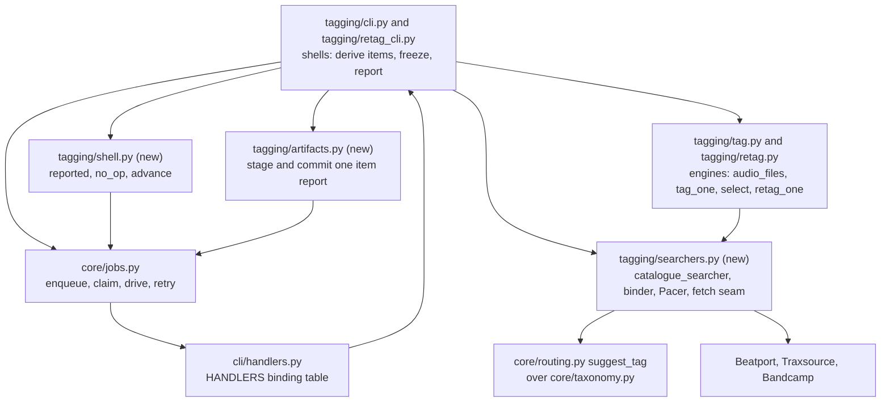
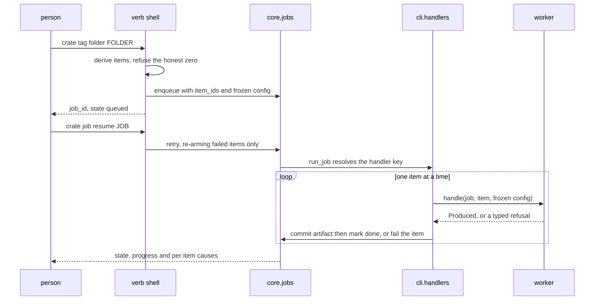
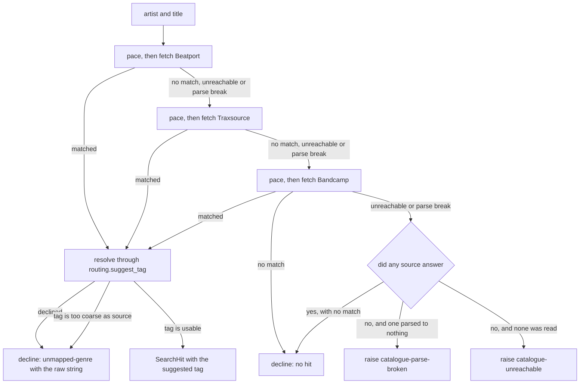
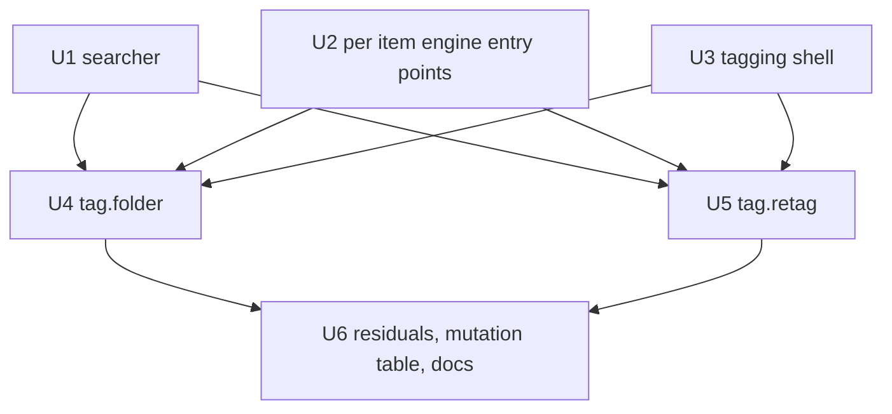

# Catalogue Searcher and the Tag Workers - Plan

Board unit U56, issue #74, branch `relay/74`. The `U<N>.` units below are this plan's own work packets inside that board unit; they are not board issues. Repository requirement identifiers such as KTD26, KTD9, R32 and R19 come from `DJ_tools/docs/migration/`, and this plan's own `KTD<N>.` entries are separate. Where both could be meant, the repository ones are named as "repo requirement".

---

## Goal Capsule

- **Objective:** A person who runs `crate tag folder` or `crate tag retag` gets the genres written onto their files. Today both verbs return a job identifier and nothing happens.
- **Means:** Land a real catalogue searcher and bind both handler keys to per item workers, so `cratekit.core.jobs.drive` has something to run (KTD1, KTD5).
- **Authority:** `DJ_tools/docs/migration/00-SEAM-DECISIONS.md` outranks this plan. `docs/METHOD.md` owns the merge bar, the mutation table method and the do-not-touch list. `CLAUDE.md` owns the standing constraints.
- **Execution profile:** Bounded at 300 minutes. Finish over polish. The battery is the gate.
- **Stop conditions:** Stop and record a residual rather than widen scope if the database half of the retag, the album art write path, or a live catalogue call is what stands in the way. None of those is in this unit.
- **Tail ownership:** No pull request. Feature branch, local merge, push `main`, delete the branch. The relay runner owns the gate, the merge and the push.

---

## Product Contract

### Summary

Add `src/cratekit/tagging/searchers.py`, a rate limited HTTP searcher over Beatport, Traxsource and Bandcamp with every network touch behind one injectable seam. Extract a per file entry point from each tagging engine. Populate job items at enqueue for both verbs, bind both handler keys in `src/cratekit/cli/handlers.py`, and give each verb a worker that does one file. The suite fakes the seam, so the battery passes with no network.

### Problem Frame

`cratekit.tagging.tag.Searcher` is a callable alias at `src/cratekit/tagging/tag.py:20`. Both engines require one and no concrete searcher exists anywhere in non vendored `src`. The only mention of Beatport, Traxsource or Bandcamp is the package docstring at `src/cratekit/tagging/__init__.py:5` saying live searchers bind at the CLI, which nothing does.

Neither verb passes `item_ids` to `jobs.enqueue`, so each queues a job with nothing to claim. `core.jobs` treats attempting nothing as a genuine no-op, so a driver would report a clean success over a folder it never walked. Neither handler key is in `HANDLERS` at `src/cratekit/cli/handlers.py:74`, so both sit in `HANDLERS_NOT_YET_BOUND` with the reason "no worker yet, R-203".

`tagging/tag.py` has no direct test anywhere in `tests/`. This unit is its first caller and its first suite, so under `docs/solutions/workflow-issues/adding-the-first-caller-makes-you-the-owner-of-its-unreviewed-defects.md` its unreviewed failure paths are this unit's to drive.

### Key Decisions

- **A catalogue answer is resolved through the shipped resolver or it is a decline.** `cratekit.core.routing.suggest_tag` already answers this question and is covered by a parity test against the live system. The live system passes an unrecognized vendor genre through verbatim, and an answer too coarse to be a final tag through as well. This does neither. Governs R3, R4, R20.
- **An unreachable catalogue is not an absent one, and a moved page is neither.** A source that could not be read never contributes a miss, and a source whose markup changed is a defect in this product rather than a fact about the catalogue. Governs R5, R6, R21, R22.
- **The database half of the retag stays out.** `retag.plan_library` and `retag.apply_library` still have no caller in `src` after this unit, and R-185 is driven rather than closed. Governs R14.

### Requirements

**The searcher**

- R1. `src/cratekit/tagging/searchers.py` exposes a factory that returns a `Searcher`, so a live searcher can be bound at a worker.
- R2. The searcher queries Beatport first, then Traxsource, then Bandcamp, matching on artist and title.
- R3. A matched source genre is resolved through `cratekit.core.routing.suggest_tag`. Its suggested tag is what gets written; a declined suggestion is a decline that names the raw string.
- R4. The searcher names no genre string in code. Every mapping comes from the declared taxonomy through `suggest_tag` (repo requirement R19).
- R20. A suggestion whose tag the declared taxonomy answers `is_too_coarse_as_source` for is a decline, not a hit.
- R5. Each source has a four way outcome: matched, answered with no match, unreachable, or parsed to no recognizable shape. Only the second is a miss.
- R6. When no source answered, the searcher raises a typed refusal rather than declining.
- R21. A page that parsed to no recognizable shape raises its own refusal, distinct from unreachable, whose remedy says the parser needs rewriting and names the source.
- R22. The outcome of one fetch is classified by an explicit rule: a transport failure or a non 200 other than 429 is unreachable; a 429 whose attempts are spent is unreachable; a 200 that parses to nothing recognizable is a parse break; a 200 that parses with no artist and title match is a miss.
- R7. Consecutive HTTP touches are separated by a minimum jittered interval of one second, drawn from an injected random source, and the sleep is injectable so the suite asserts the schedule instead of waiting it.
- R8. HTTP 429 backs off linearly from a thirty second base, capped at three attempts per source, after which the source is unreachable.
- R9. Every network touch goes through one injectable fetch seam carrying a fifteen second per request timeout. The default fetch takes its HTTP getter and its sleep as parameters, so the backoff is drivable with no network. Nothing else in the module names `requests`.
- R23. The searcher a worker uses is looked up through a module level binder at call time, not constructed inline, so a test can substitute a fake in process.

**The two verbs**

- R10. `crate tag folder` queues one item per audio file under the folder, derived by the same walk the engine uses.
- R11. `crate tag retag` queues one item per confirmed plan row, and freezes those rows in the payload.
- R12. Neither verb can queue a job with zero items. A folder with nothing to do reports NO_OP with a warning and queues nothing.
- R13. `tag.retag`'s resume answers its gate from the frozen payload, never from a fresh walk of the folder.
- R14. Each verb's worker does exactly one item, so a run killed part way redoes only what it had not finished.
- R15. A worker whose file has moved or whose genre no longer meets the verb's selection reports that outcome rather than writing.
- R16. A skip reason reaches the job's committed artifact and the verb's report.
- R24. `crate tag folder`'s report names the distinct unresolved source genre strings and their counts, not only an `unmapped-genre` total, so a person learns which alias their taxonomy is missing.
- R17. Both handler keys are in `HANDLERS` and neither is in `HANDLERS_NOT_YET_BOUND`.

**The suite**

- R18. The searcher and both verbs open no socket under the suite, asserted by detonating the module's fetch seam and its HTTP getter and driving both verbs end to end. U6 also attempts the stronger property, that the whole battery opens no socket, with a session scoped detonator.
- R19x. A fake searcher that raises mid folder fails that item, leaves the job resumable, and a resume redoes only that item. Both verbs owe this.

### Acceptance Examples

- AE1. **Covers R3, R16, R24.** Given a file with no genre whose Beatport answer is a sub genre `suggest_tag` declines, when the worker runs, then the file is untagged, the item is done, its artifact carries `unmapped-genre` and the raw source string, and the verb's report names that string with its count.
- AE2. **Covers R5, R6.** Given Beatport and Traxsource unreachable and Bandcamp answering with no match, when the searcher runs, then it declines. Given all three unreachable, then it raises `catalogue-unreachable`.
- AE5. **Covers R20.** Given a Beatport answer of `Electro (Classic / Detroit / Modern)`, which the shipped template aliases to the fallback bucket whose display sits in `too_coarse_as_source`, when the searcher resolves it, then it declines rather than writing that display onto the file. `retag.py` refuses the same value at its own write for the same reason.
- AE6. **Covers R21.** Given Beatport answering 200 with markup carrying no recognizable shape and the other two sources unreachable, when the searcher runs, then it raises the parse break refusal rather than `catalogue-unreachable`, so the remedy sends somebody to the parser rather than to the network.
- AE3. **Covers R12.** Given a folder holding no audio files, when `crate tag folder` runs, then exit code OK, outcome NO_OP, `job_id` is the empty string, and `jobs.list_jobs` holds nothing new.
- AE4. **Covers R13.** Given a confirmed retag of three files, one written before the run was killed, when the job is resumed, then the gate is met and the two remaining files are corrected. The selection is smaller than it was at queue time and that does not stall the resume.

### Scope Boundaries

**In scope:** the searcher, the item derivation, both workers, both bindings, the frozen retag digest, and the tests and residuals for all of it.

**Deferred to follow-up work:**

- The database half of the retag. `plan_library` and `apply_library` keep having no caller in `src`. R-185 is driven and measured here, not closed.
- Album art. Neither engine writes a picture today, so a searcher that fetched art bytes would produce dead data.

**Outside this unit:**

- Any live catalogue call. That is attended, so U6 records the unverified page shapes as a residual rather than an agent running the check.
- U29, U30, U20, R-9, A1, A2 and `.worktrees/conformance`.
- The live rekordbox database.

### Open Questions

All deferred, none blocking.

- Should a `tag.folder` decline offer into `review.Queue.GENRE` the way `tag.retag`'s unanswerable cases do? That would give the missing alias a person to answer it, and it would make a verb this plan keeps unattended into an attended one. R24 takes the cheaper half now, naming the strings in the report, and the residual carries the queue as its closing condition.
- Should `tag.retag` write a durable pending library write register, or will the deferred database half re-derive its population by comparing file tags against library rows? This plan takes neither: the committed item artifacts already carry what a register would, and choosing now would decide another unit's design.
- Should `SearchHit` carry the artwork URL the Beatport payload already holds beside the genre, so a later art unit does not re-scrape every file? Free to record, and it commits a field nothing reads.
- A file added to the folder between the enqueue and the drive is never tagged and the job still reports SUCCEEDED. R15 covers only the file that disappeared.

### Sources

- `src/cratekit/tagging/tag.py:20`, `:38` for the `Searcher` alias and the fill if empty policy.
- `src/cratekit/tagging/retag.py:325` for `retag_folder`, and `:163` for `select`.
- `src/cratekit/adopt/scan_cli.py:161`, `:246` for the shape a bound verb takes: derive items, refuse the honest zero, drive on resume, one item per worker call.
- `src/cratekit/adopt/shell.py` for `reported`, `no_op` and `advance`, including the R-225 predicate.
- `src/cratekit/cli/handlers.py:74` for the binding table and `:210` for the one caller of `jobs.drive`.
- `src/cratekit/core/jobs.py:769` `claim`, `:685` `retry`, `:1181` `drive`, and `src/cratekit/cli/jobs.py:274` `resume`, which is the chain that redoes only a failed item.
- `src/cratekit/core/routing.py:149` `suggest_tag`, the shipped replacement for the live system's `GENRE_NORMALIZE`, with its parity assertion in `tests/test_routing_parity.py`. It has no caller in `src` today. `src/cratekit/core/taxonomy.py:400` `is_too_coarse_as_source` is the guard applied to its answer.
- `src/cratekit/modules/outbound/account.py` `resolve`, the shipped shape for a boundary a worker looks up rather than constructs, and R-226 for the limit of substituting one in process.
- `src/cratekit/adopt/artifacts.py`, the per item report staging and commit helper both workers need, and R-240 for why there are already two copies of it.
- `DJ_tools/src/dj_tools/DJ_tagging/scrape.py` for what the live system queries and how it matches. Read for approach, never copied.
- R-183, R-185, R-171, R-172 and R-203 in `docs/residual-findings.md`.

---

## Planning Contract

### Key Technical Decisions

- KTD1. **The searcher is a factory, not a module level function.** `catalogue_searcher(declared, *, fetch, sleep, pacing)` returns the `Searcher` callable. The alias is `(artist, title) -> SearchHit | None` and cannot carry a taxonomy or a seam, so both bind at construction. Governs R1, R4, R9.
- KTD2. **Genre normalization is `cratekit.core.routing.suggest_tag`, the resolver this repository already shipped.** It is documented as entry point 2, tagging; it resolves a sub level alias to the sub's display rather than the parent bucket's; it runs the taxonomy's own exact refusals and tempo rules before the alias lookup; and `tests/test_routing_parity.py` already asserts it matches the live system's `GENRE_NORMALIZE`. It has no caller in `src`, so U1 takes the first caller obligation with it. A hand rolled `tagging_alias` lookup would be a weaker second opinion about a question that has an owner. Governs R3, R4.
- KTD3. **A declined suggestion, and a suggestion too coarse to be a final tag, both decline.** The live system passes both through verbatim. A raw vendor sub genre lands on a file that routing cannot place and that `tag.retag` will never select, because it is specific rather than too coarse. A catch all display is worse: `retag.py` refuses exactly that value at its own write, so writing it here would make the two tagging verbs disagree about one catalogue answer and bounce the file between them for ever. Declining leaves the file askable. Governs R3, R20.
- KTD4. **The per source outcome is the module's core type, and it has four values.** Matched, no match, unreachable, parse break. Folding unreachable into no match is METHOD's first defect pattern, absence read as evidence of absence. Folding a parse break into unreachable is the same mistake one layer along: it tells a person their network is down when their scraper is broken, and it is a permanent state wearing a transient remedy. The live system keeps the first distinction and loses the second. Governs R5, R21, R22.
- KTD5. **A source that never answered raises; anything answered declines.** A decline is a question the next run asks again, which is what `tag.py`'s docstring already promises. A job reporting every item done over a catalogue that was down is the merge bar's named cost, a clean report over state the tool could not read. The two refusals are separately named so the remedy is actionable in both cases. Governs R6, R21, R19x.
- KTD6. **Pacing is a small `Pacer` in this module, not `acquire.download.Pacing`.** That one is a bounded concurrent pool bound to the adapter contract, and importing it would tie tagging to acquisition. The duplication is recorded as a residual rather than hidden. Governs R7, R8.
- KTD7. **Items are derived by the same function the engine walks with.** `tag.audio_files(root)` is called at enqueue and inside `tag_folder`. Two walks that must agree is how an enqueue and a worker come to disagree about what the job covers. Governs R10, R14.
- KTD8. **The retag's resume digests the frozen payload.** `retag_cli.retag_genres` currently rebuilds the plan by walking the folder on every invocation, including the resume. Once a worker writes, the selection shrinks, the digest changes, and `ctx.gate.require` raises `DecisionStale` on the respawn. That stall is unreachable today only because nothing writes; this unit makes it reachable. `modules/outbound/shell.resume` already states the rule. Governs R13.
- KTD9x. **A third copy of the queued verb shell lands in `src/cratekit/tagging/shell.py`.** `adopt/shell.py` and `modules/outbound/shell.py` are the first two. Reaching into `adopt` from `tagging` would put an adoption name on a tagging rule; promoting to `core` is another unit's files. The copy is recorded as a residual beside R-240. Governs R12, R14.
- KTD10. **The zero path never raises the gate.** `tag.retag` derives its selection before it asks. An empty selection reports NO_OP and asks nobody, rather than spending a person's decision on a sweep of nothing and then queueing a confirmed empty job. Governs R12.
- KTD11. **The worker looks its searcher up through the module rather than constructing one.** `ItemHandler` is a fixed three argument callable, so a handler that builds its own searcher inline leaves a test nowhere to hand in a fake and R18's proof unwritable. `src/cratekit/modules/outbound/account.resolve` is the shipped shape for exactly this: the workers look it up at call time and a test replaces it in process. R-226 records the honest limit, that an in process substitution does not reach the detached child `crate job resume` spawns. Governs R23, R18.
- KTD12. **Network constants are stated rather than left to the implementer.** A fetch with no timeout blocks for ever, and a test asserting the shape of a schedule against invented numbers pins nothing. The live client carries values this project already paid for, a fifteen second timeout and a thirty second rate limit base wait. Governs R7, R8, R9.

### High-Level Technical Design

Directional only. Names are indicative, not signatures to copy.

**Component topology.** What is new, what is edited, and what already exists.

**The queue lifecycle, including the resume that redoes only the failed item.** This is the sequence the two verbs owe.

**The searcher's decision flow.** Three sources, four outcomes each.

### Assumptions

- The catalogue page shapes are read from `DJ_tools/src/dj_tools/DJ_tagging/scrape.py` as a description of what to query, not as code to copy. No live request is made to verify a current page shape, because a live call is attended and out of scope. **The consequence is stated rather than hidden: no gate in this unit can tell a working searcher from a wholly broken one**, because every test feeds synthetic page text. A parse that matches nothing is classified as a parse break under R21, so the first person to run the verb against a moved page gets a refusal naming the parser rather than a silent miss. U6 records the missing live check as a residual whose closing condition is one attended lookup against each source.
- The genre review queue this retag offers into is small, because it holds only unanswered coarse genre questions. A worker that reads the whole queue per item is therefore acceptable. If a measurement says otherwise, that is a residual rather than a redesign.
- `requests` is already a core dependency at `pyproject.toml`, so the searcher adds no dependency and the slim core is unaffected.

### Sequencing

U1 and U2 are independent and both feed U4 and U5. U3 is independent. U6 runs last because it records what the other five measured.

---

## Implementation Units

### U1. The catalogue searcher and its network seam

- **Goal:** A concrete `Searcher` exists, it is rate limited, and every network touch is behind one seam the suite fakes.
- **Requirements:** R1, R2, R3, R4, R5, R6, R7, R8, R9, R20, R21, R22, R23. Cites KTD1, KTD2, KTD3, KTD4, KTD5, KTD6, KTD11, KTD12.
- **Dependencies:** none.
- **Files:** `src/cratekit/tagging/searchers.py` (new), `src/cratekit/tagging/tag.py` (additive fields on `SearchHit`), `src/cratekit/tagging/__init__.py` (export), `tests/test_catalogue_searcher.py` (new).
- **Execution note:** this is the first caller of `cratekit.core.routing.suggest_tag` in `src`, so under `docs/solutions/workflow-issues/adding-the-first-caller-makes-you-the-owner-of-its-unreviewed-defects.md` its failure paths are this unit's to drive, not only its happy path.
- **Approach:**
  - Four way outcome type per source, carrying the source name, the raw genre string, and which of matched, miss, unreachable or parse break it was (KTD4). The classification rule is R22's, written once.
  - `Pacer` with a one second minimum interval, a jitter fraction, an injected `random.Random`, and an injected `sleep` that the suite records (KTD6, KTD12). Every fetch is paced, including the first, so a fresh run does not open with a burst.
  - One `fetch` seam: a callable taking a URL and returning the page text or the outcome that replaces it. The default implementation carries a fifteen second timeout and takes its HTTP getter and its sleep as parameters, so the 429 backoff is drivable with nothing on the network (R9). The backoff is linear from thirty seconds, capped at three attempts, and exhaustion is unreachable rather than a miss (R8).
  - `catalogue_searcher(declared, *, fetch=None, sleep=None, pacing=None) -> Searcher` closes over the taxonomy and the seams (KTD1). Fallback order Beatport, Traxsource, Bandcamp.
  - A module level binder returns the searcher a worker should use, so a test substitutes a fake in process rather than reaching inside a handler (KTD11, R23).
  - Genre resolution: `routing.suggest_tag(declared, raw)`. Write `Suggestion.tag` when it is set; a set `Suggestion.decline`, or a tag the taxonomy answers `is_too_coarse_as_source` for, is a decline carrying the raw string (KTD2, KTD3, R20).
  - Additive fields on `SearchHit`: `source` and `source_genre`, both defaulting to empty, so a decline can say which catalogue answered and with what. `art` stays unset; nothing writes it.
- **Test scenarios:**
  - Beatport matches: the hit carries the suggested tag, the source name, and the raw source genre.
  - Beatport answers with no match and Traxsource matches: the fallback order is exercised and the hit names Traxsource.
  - Beatport is unreachable and Traxsource matches: an unreachable first source does not stop the walk.
  - All three answer with no match: the searcher returns None.
  - All three are unreachable: the searcher raises `catalogue-unreachable` with an actionable remedy.
  - One source parses to no recognizable shape and the others are unreachable: the searcher raises the parse break refusal, and its remedy names the parser rather than the network (AE6).
  - Two unreachable and one answering with no match: the searcher returns None rather than raising, because a source did answer.
  - A source genre that aliases to a SUB rather than a bucket resolves to the sub's display, which is the difference `suggest_tag` carries and a bare bucket lookup loses.
  - A source genre the taxonomy declares an exact refusal for declines rather than resolving.
  - A source genre that aliases to the fallback bucket declines, and the file is left untouched (AE5).
  - A source genre with surrounding whitespace resolves the same as the trimmed one.
  - A matched track whose source genre `suggest_tag` declines: the result declines and carries `source_genre` set to the raw string.
  - The pacer sleeps before every fetch, including the first, and the recorded schedule is at least one second per touch.
  - Jitter is drawn from an injected `random.Random`, so two seeded runs produce two different schedules and one seed reproduces.
  - A source answering 429 twice then 200 succeeds, driven through the injected HTTP getter, and the recorded schedule shows the backoff grew from thirty seconds.
  - A source answering 429 until the attempt cap is spent is unreachable and never retried again in that call.
  - The default fetch passes a timeout to its HTTP getter. Assert the value reaches the getter, because a fetch with no timeout blocks for ever and nothing else in the suite would notice.
  - An artist or title whose text needs escaping reaches the fetch seam as a correctly quoted URL.
  - The module names no genre display string. Assert by an AST or source scan over `searchers.py` for any string equal to a declared bucket or sub display.
- **Verification:** `.venv/bin/python -m pytest tests/test_catalogue_searcher.py tests/test_routing_parity.py`, then ruff over the new file.

### U2. Per item entry points on both engines

- **Goal:** Each engine exposes the unit of work a job item is, and the folder function becomes a loop over it.
- **Requirements:** R10, R14, R15, R16. Cites KTD7.
- **Dependencies:** none.
- **Files:** `src/cratekit/tagging/tag.py`, `src/cratekit/tagging/retag.py`, `tests/test_tagging_engine.py` (new), `tests/test_genre_retag.py`.
- **Approach:**
  - `tag.audio_files(root) -> tuple[Path, ...]`: the sorted walk `tag_folder` already performs, lifted out and used by both the shell and the engine (KTD7).
  - `tag.tag_one(path, *, searcher) -> TagResult`: the body of the current loop. `tag_folder` becomes `audio_files` plus a `tag_one` per file, so behavior is preserved by construction.
  - `TagResult` gains `source` and `source_genre`, both defaulting to empty, and a `unmapped-genre` skip reason when the hit carried a source genre that did not resolve (R16).
  - `retag.retag_one(candidate, *, searcher, declared, store, handler_key, decided) -> RetagResult`: the body of `retag_folder`'s loop, including the recorded verdict read, the too coarse refusal and the review offer. `retag_folder` keeps `select`, `_decided` and the loop.
  - No behavior change is intended in this unit. Its evidence is that the existing `tests/test_genre_retag.py` stays green untouched.
- **Test scenarios:**
  - `audio_files` returns only audio extensions, sorted, and recurses. A folder that is not there returns empty rather than raising.
  - `tag_one` on a file with no genre and a hitting searcher writes the genre and reports it.
  - `tag_one` on a file that already has a genre writes nothing and reports `has-genre`.
  - `tag_one` on a declining searcher reports `no-hit` and leaves the file untouched.
  - `tag_one` on a hit whose genre is empty but whose `source_genre` is set reports `unmapped-genre` and carries the raw string.
  - `tag_folder` over a mixed folder produces exactly the results the per file calls produce, in the same order.
  - `retag_one` reproduces each branch the existing suite drives on `retag_folder`: a written correction, an answer that is itself too coarse, a decline, a recorded acceptance, and a recorded rejection.
  - Every test already in `tests/test_genre_retag.py` still passes with no edit to its assertions.
- **Verification:** `.venv/bin/python -m pytest tests/test_tagging_engine.py tests/test_genre_retag.py`.

### U3. The tagging shell and its artifact helper

- **Goal:** One owner for the report payload, the honest zero, the resume, and where a per item report is staged, shared by both tagging verbs.
- **Requirements:** R12, R14, R16. Cites KTD9x.
- **Dependencies:** none.
- **Files:** `src/cratekit/tagging/shell.py` (new), `src/cratekit/tagging/artifacts.py` (new), `tests/test_tag_workers.py` (new).
- **Approach:**
  - `artifacts.py` is `src/cratekit/adopt/artifacts.py` with two different directory names, `tag-artifacts` and `tag-staging`, under the KTD9x precedent. Both workers are required to commit a report the verb reads back, and no module in `src` stages one for tagging. The root comes from the FROZEN configuration as a parameter, never from `jobs.store_dir()` with no argument, because that reload is the KTD9 defect behind an indirection the handler guard cannot see. Sorting a job's reports back is by the ordinal as an integer, not by filename. The third copy is recorded as a residual cross referenced to R-240.
  - `reported(store, job, extra=None)`, `no_op(state)` and `advance(ctx, store, job, *, origin, nothing_to_run)` with the same contracts `src/cratekit/adopt/shell.py` states, including the R-225 predicate: any closed job carrying a cause raises rather than reporting through a normal envelope, because CANCELLED carries one too.
  - The function that drives must not be named `drive`. `tests/test_handlers.py` counts every call whose callee is named `drive` to assert there is exactly one caller of the job driver.
  - `no_op` returns `job_id` as the empty string, never `None`, because `cli.output` types the field as a required string. That is R-234 and it must not be reintroduced here.
  - `extra` rides under `progress`, never beside it, because `job_state/1` is closed with `additionalProperties: false`.
- **Test scenarios:**
  - `reported` puts an `extra` mapping under `progress` and leaves the four top level keys alone.
  - `no_op` emits an empty string `job_id` and validates against the `job_state/1` schema.
  - `advance` on a job with no items refuses with `internal-error` rather than driving it to a false success.
  - `advance` on a job that closed CANCELLED with a cause raises, rather than returning an envelope that exits 0.
  - `advance` on a SUCCEEDED job returns it without driving.
  - No symbol named `drive` is defined or called in this module.
  - A staged report is committed to a path built from the ordinal, so an item identifier holding a separator cannot escape the directory.
  - Reports read back for a job with more than nine thousand nine hundred and ninety nine items come back in item order, which text sorting on a four digit name does not give.
  - `artifacts.py` never calls `jobs.store_dir()` with no argument. Assert by source scan, since the guard in `tests/test_handlers.py` reads handler bodies and cannot follow a reload through a helper.
- **Verification:** `.venv/bin/python -m pytest tests/test_tag_workers.py tests/test_handlers.py`.

### U4. `tag.folder` items, worker and binding

- **Goal:** `crate tag folder` walks a real folder, tags what needs tagging, and reports what it skipped.
- **Requirements:** R10, R12, R14, R15, R16, R17, R19x, R23, R24. Cites KTD1, KTD5, KTD7, KTD11.
- **Dependencies:** U1, U2, U3.
- **Files:** `src/cratekit/tagging/cli.py`, `src/cratekit/cli/handlers.py`, `tests/test_tag_workers.py`, `tests/test_handlers.py`.
- **Approach:**
  - The shell derives `tag.audio_files(Path(folder))` before it queues. Item identifiers are the paths relative to the folder, which keeps them short and makes the payload's folder the only absolute part. Artifact filenames come from the ordinal, so an arbitrary item identifier is safe.
  - Zero audio files reports NO_OP with a warning naming which zero it is, and queues nothing (R12). A folder that is not there and a folder that holds no audio are two different warnings.
  - The resume branch goes through `shell.advance`.
  - `handle(job, item, cfg)` resolves the file under the frozen payload's folder, looks the searcher up through the `searchers` module binder rather than constructing one (KTD11), calls `tag.tag_one`, and produces an artifact carrying the path, the genre written, the skip reason, the source and the source genre.
  - The verb's report groups the `unmapped-genre` items by their raw source genre and names each string with its count (R24), read back off the committed artifacts rather than accumulated in memory, so the number survives a resume.
  - A file that is no longer there at drive time is refused with its own slug, in the shape `adopt/scan_cli.handle` uses. It is not an internal error and it is not a silent done.
  - The configuration is the frozen parameter. Never load one inside the handler; `tests/test_handlers.py` guards three spellings of the reload and repo requirement KTD9 is what it closes.
  - **Alias the engine import.** `tagging/cli.py` already defines a function named `tag_folder`, the verb handler, and `tagging/tag.py` defines `tag_folder`, the engine. This unit makes the shell import the engine for the first time, and one symbol meaning two things is the defect METHOD says to hunt. `adopt/scan_cli.py` aliased its engine import for exactly this shape.
  - Move `"tag.folder"` from `HANDLERS_NOT_YET_BOUND` to `HANDLERS` as `"cratekit.tagging.cli:handle"`.
- **Test scenarios:**
  - A fixture folder of three files, one already carrying a genre, driven through `ctx.run_job` with a fake searcher bound through the module binder: two are tagged, one reports `has-genre`, and all three artifacts are committed.
  - The skip reason survives to the report: the verb's `progress` payload carries the counts and the committed artifacts carry the per file reasons.
  - A folder where two files decline with the same raw source genre and one with a different one: the report names both strings with counts of two and one.
  - A folder with no audio files: exit OK, outcome NO_OP, empty string `job_id`, a warning naming the zero, and no new job in the store.
  - A folder that does not exist: exit OK, outcome NO_OP, a different warning, and no new job.
  - A fake searcher that raises on the second of three files: that item is FAILED, the other two are DONE, the job is FAILED with a cause, and nothing about the two written files is undone.
  - After that failure, `jobs.retry` then the `--job` branch drives exactly one item and the two already done are not re-attempted. Assert by counting the searcher's calls.
  - The worker never calls `config.load`. Assert through the existing handler guard's population, which derives from the registry.
  - `tag.folder` is in `HANDLERS` and is absent from `HANDLERS_NOT_YET_BOUND`, asserted through the registry derived population that `tests/test_handlers.py` already builds.
  - A file removed between the enqueue and the drive is refused with its own slug rather than reported done.
  - The resume argv still round trips the frozen folder and carries no `--run`, since this verb declares no gate.
- **Verification:** `.venv/bin/python -m pytest tests/test_tag_workers.py tests/test_handlers.py tests/test_cli_contract.py`.

### U5. `tag.retag` frozen plan, worker and binding

- **Goal:** A confirmed retag runs from `pending` to `done`, and a resume after a partial run does not stall on its own gate.
- **Requirements:** R11, R12, R13, R14, R15, R16, R17, R19x, R23. Cites KTD5, KTD8, KTD10, KTD11.
- **Dependencies:** U1, U2, U3.
- **Files:** `src/cratekit/tagging/retag_cli.py`, `src/cratekit/cli/handlers.py`, `tests/test_genre_retag.py`, `tests/test_tag_workers.py`.
- **Approach:**
  - Split `plan_for` into a pure `digest_for(folder, items)` and a `plan_for(folder, declared)` that calls it. The resume digests the frozen payload's rows through `digest_for`; the first invocation digests the fresh walk (KTD8). This is the defect that would otherwise land: a worker that writes shrinks the selection, so a second resume would raise `DecisionStale` for ever.
  - The enqueue freezes `folder`, the plan `items`, and the gate run under `jobs.GATE_RUN_KEY`, and passes the candidate paths as `item_ids` (R11).
  - Derive the selection before the gate. An empty selection reports NO_OP with a warning and never raises the gate (KTD10, R12).
  - The resume branch answers the gate from the frozen payload, then goes through `shell.advance`.
  - `handle(job, item, cfg)` re-reads the file's genre, then routes: the file is gone, refuse with its own slug; the genre is now blank, report `no-genre` and write nothing, because that is `tag.folder`'s field under fill if empty; the genre is now specific, report `genre-specific`; otherwise build the candidate and call `retag.retag_one` with the searcher from the module binder and the review store opened against the frozen configuration.
  - The artifact carries the path, the previous value, what was written, the reason, and any review item identifier, so the report is derived from what ran rather than from what was planned. **Those artifacts are also the only record of which library rows went stale**, which is what the deferred database half will read when it lands. R-185's entry names them as its input rather than leaving the deferred half with no population, because a corrected file stops being selectable the moment it is written.
  - Move `"tag.retag"` from `HANDLERS_NOT_YET_BOUND` to `HANDLERS` as `"cratekit.tagging.retag_cli:handle"`.
- **Test scenarios:**
  - A three file retag confirmed, queued, and driven: every item goes `pending` to `done`, each file carries a specific genre, and the job is SUCCEEDED.
  - The frozen digest holds across a partial run. Drive one item, kill the run, resume, and assert the gate is met and the remaining two are corrected. Driven against the pre split `plan_for` first, so the stall is measured before it is fixed.
  - Two different empty folders still produce two different digests, which is the property `plan_for` already carries and the split must not lose.
  - An empty selection: exit OK, outcome NO_OP, no gate raised, no job queued, and a warning naming the zero.
  - A file whose genre became specific between the confirm and the drive is reported `genre-specific` and is not rewritten.
  - A file whose genre became blank is reported `no-genre` and is not written, because the two verbs must not both own that state.
  - A file that is gone at drive time is refused with its own slug.
  - An answer that is itself too coarse still lands in the review queue, driven through the worker rather than through `retag_folder`.
  - A recorded acceptance is used and the searcher is never asked, driven through the worker.
  - **R-185 driven and measured.** Interrupt a retag after one file is corrected. Assert the file on disk carries the new genre, assert nothing planned or wrote the library row, and assert that a second full run over the same folder selects nothing, so the row stays stale. Then assert the committed artifact for that item still names the path, the previous genre and the written genre, which is what makes the stale row recoverable at all. Record the measurement in the residual rather than repairing it here.
  - A fake searcher that raises on the second of three candidates: that item is FAILED, the other two are DONE, and after `jobs.retry` the `--job` branch drives exactly one item (R19x).
  - `tag.retag` is in `HANDLERS` and absent from `HANDLERS_NOT_YET_BOUND`.
  - The resume argv still carries `--run` before the verb path, and a payload from an older build with no gate run still builds a valid command line.
- **Verification:** `.venv/bin/python -m pytest tests/test_genre_retag.py tests/test_tag_workers.py tests/test_queued_resume_contract.py tests/test_handlers.py`.

### U6. Residuals, the mutation table and the no network proof

- **Goal:** What this unit measured is written down, and the claim that the battery needs no network is proved rather than asserted.
- **Requirements:** R18. Cites KTD6, KTD9x, KTD11.
- **Dependencies:** U4, U5.
- **Files:** `docs/residual-findings.md`, `docs/mutation/u56-round-1.md` (new), `tests/test_catalogue_searcher.py`, `tests/test_tag_workers.py`, `tests/conftest.py`, `RESTART-cratekit.md`.
- **Approach:**
  - Residual numbers are append only and main's highest is R-244, so this unit's take R-245 and upward.
  - Residuals to write, each with its measured cost and its closing condition: **no source's page shape was verified against a live catalogue, so no gate in this unit distinguishes a working searcher from a broken one**, closing when one attended lookup per source is recorded, which is Phillip's to run and not an agent's; the database half of the retag still has no caller in `src` while the registry declares `db_metadata` among the verb's writes; R-185 measured rather than closed, naming the committed item artifacts as the input its deferred half will read; **no alias authoring path**, so a person told which source genre is unmapped has nowhere to declare it, closing when the gap reaches `review.Queue.GENRE` the way `tag.retag`'s unanswerable cases already do; the third copy of the queued verb shell and the third copy of the artifact helper, both cross referenced to R-240; the second pacing implementation, cross referenced to `acquire/download.Pacing`; the per item read of the whole genre review queue; the in process searcher substitution not reaching a detached resume child, cross referenced to R-226; and any zero death row from the table below that has a user facing surface.
  - Update R-203's population note: two more of the thirteen unbound verbs are bound, so eleven remain. Correct the number in the entry's body rather than rewriting its title, which is the convention that entry already established.
  - Update `RESTART-cratekit.md` with the new wave state, main's new highest residual, and the measured suite count.
  - The mutation table uses `scripts/mutate.py`. Do not hand roll a driver. Rows are scoped to this unit's own diff plus a fixed sample of the tagging guards that already exist. Cap is 45 rows on a full pass. Log anything dropped and why it ranked below the cap.
  - The table must cover the searcher fallback order and the item derivation, which the brief names. Rows: reorder the three sources; drop the unreachable versus no match distinction so every unreachable reads as a miss; drop the parse break versus unreachable distinction; make a source that never answered decline rather than raise; replace `suggest_tag` with a bare alias lookup; drop the too coarse guard on the suggestion; remove the pacer sleep; remove the 429 backoff; remove the fetch timeout; derive `tag.folder`'s items from a fresh walk inside the worker rather than from the frozen payload; queue with no `item_ids`; digest the retag resume from a fresh walk again.
- **Test scenarios:**
  - The scoped proof: a test that replaces the searcher module's fetch seam and its HTTP getter with detonators and drives both verbs end to end. Nothing raises, which is what proves these two verbs reach no socket.
  - A second, narrower proof over the searcher itself: constructing `catalogue_searcher` with no arguments beyond the taxonomy touches no network until a fetch happens.
  - The stronger proof, attempted: a session scoped fixture in `tests/conftest.py` that detonates `socket.socket.connect` for the whole battery. If any existing test fails under it, that failure IS the finding: name the test, record which socket it opened as a residual, and drop the fixture rather than weakening it. A suite wide claim about the network is worth one attempt and is not worth a fixture with exemptions in it.
- **Verification:** the full battery, plus the written table under `docs/mutation/`.

---

## Verification Contract

| Gate | Command | Applies to |
|---|---|---|
| Lint | `.venv/bin/ruff check src tests scripts` | every unit |
| Suite | `.venv/bin/python -m pytest` | every unit |
| Repository scan | `.venv/bin/python scripts/scan_repo.py` | every unit |
| Board audit | `.venv/bin/python scripts/board.py audit` | before the session ends |
| Mutation table | `scripts/mutate.py`, rows written under `docs/mutation/u56-round-1.md` | U6 |

Driver rules that bite here, from `docs/METHOD.md`: never pass `-q`, because `pyproject.toml` already sets it; check the collected count on every row, because a file that fails to collect takes its tests with it and the run still looks green; run rows synchronously in the foreground; set `PYTHONDONTWRITEBYTECODE=1`; never let a driver invoke git; do not edit `tests/` while the driver runs.

An author's own table is a draft rather than a result. Say so in the report. Measured gaps between an author's table and an independent one on this project were 10 against 17, 39 against 49, and 49 against 83.

---

## Definition of Done

**Global**

- The three part battery is clean.
- No em dash, en dash or double hyphen in any prose, comment, commit message or issue body added by this work.
- No beat grid is written in any container. Nothing in this unit goes near a tempo field.
- The live rekordbox database is untouched. Every test that needs a database makes a disposable copy in a temporary directory.
- `DJ_tools` is read only. Its tagger was read for approach and no code was copied from it.
- Residual numbers start above R-244 and no number already on main moved. Verify with `grep "^## R-" docs/residual-findings.md | sort | uniq -d` returning empty.
- Abandoned experimental code is removed from the diff, not left in place.
- The code and architecture explanation ships with the unit, per the standing rule that every unit lands with one.

**Per unit**

| Unit | Done when |
|---|---|
| U1 | `catalogue_searcher` exists, all three sources are queried in order, the four way outcome is distinguished, resolution goes through `suggest_tag` with the too coarse guard on its answer, the pacer's schedule and the fetch timeout are asserted, and no genre string is named in the module. |
| U2 | `audio_files`, `tag_one` and `retag_one` exist, both folder functions delegate to them, and `tests/test_genre_retag.py` passes with no edit to its assertions. |
| U3 | `tagging/shell.py` and `tagging/artifacts.py` exist, nothing in the shell is named `drive`, `no_op` emits an empty string `job_id` that validates, and neither module loads a configuration. |
| U4 | `tag.folder` is in `HANDLERS`, a fixture folder is tagged end to end through the real worker, a zero folder queues nothing, and a mid folder refusal leaves the job resumable with only the failed item redone. |
| U5 | `tag.retag` is in `HANDLERS`, a confirmed retag runs to done, the resume digests the frozen payload, and R-185 is driven with its cost recorded. |
| U6 | The residuals are written with measured costs, the mutation table is in `docs/mutation/`, R-203's population is corrected, and the no network proof passes. **The unit is not done while the missing live check goes unrecorded**: a green battery here proves the shape of the searcher, never that it returns a real hit, and the residual is what says so out loud. |
